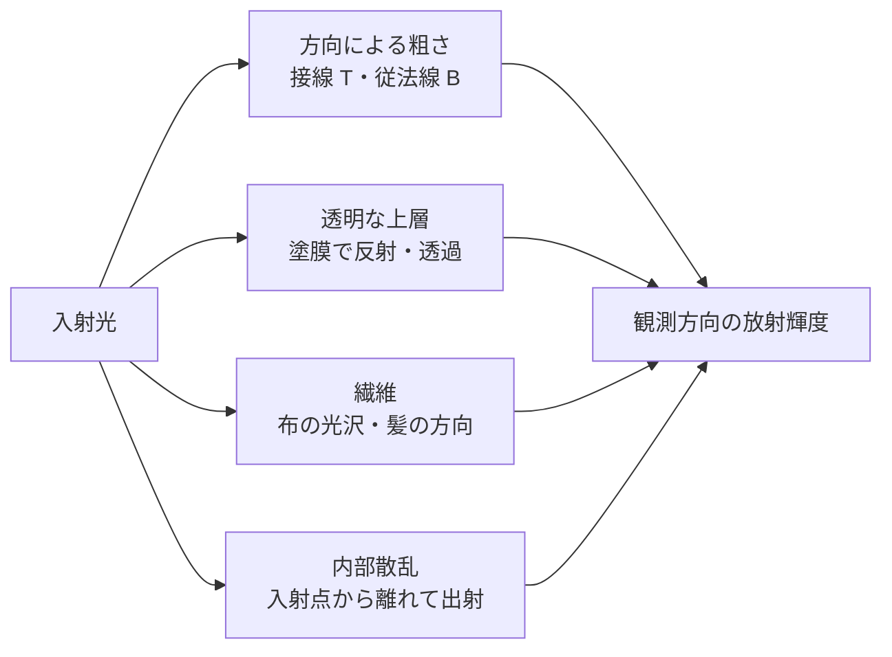

# 材質モデルの拡張 — 異方性・クリアコート・繊維の光沢・皮膚と髪

表面の金属度と粗さを同じ値にしても、ヘアライン加工した金属、透明な塗膜を重ねた塗装、ベルベット、皮膚では見え方が異なる。どの方向へ光を返すか、表面を何層に分けるか、光が表面下でどれくらい移動するかが違うためだ。[BRDF の中身](brdf-internals.md)で扱う等方的な GGX を出発点に、追加する入力と評価の違いを見る。



| 表現 | 追加する入力の例 | 何が変わるか |
| --- | --- | --- |
| 異方性 | 接線方向、方向別の粗さ | ハイライトが表面の向きに応じて伸びる |
| クリアコート | コートの量、粗さ、上層の法線 | ベースの上に別の反射ローブが現れる |
| 繊維の光沢（sheen） | 繊維の色、光沢の粗さ | 布を浅い角度から見たときの柔らかい反射が現れる |
| サブサーフェス | 散乱距離、散乱色、厚み | 光が入った点から離れた場所や裏側に光の影響が出る |
| 髪 | 毛の接線、色や吸収、粗さ | 毛に沿う方向と毛の周囲の方向で反射・透過が変わる |

## 接空間で反射の向きを決める

異方性 GGX では、ハーフベクトル $H$ の接線成分 $h_t=H\cdot T$、従法線成分 $h_b=H\cdot B$、法線成分 $h_n=H\cdot N$ を使う。方向別の傾きの広がりを $\alpha_t,\alpha_b>0$ とすると、$h_n>0$ の法線分布項は次の形になる。

$$
D(H)=\frac{1}{\pi\alpha_t\alpha_b
\left[(h_t/\alpha_t)^2+(h_b/\alpha_b)^2+h_n^2\right]^2}
$$

$\alpha_t=\alpha_b$ なら接線と従法線を回しても値は変わらない。異なる値を指定した場合、接線フレームを回すとハイライトも回る。[法線マップと接空間](normal-mapping.md)で扱う接線の符号やミラー UV は、この方向にも関係する。glTF 2.0 の `KHR_materials_anisotropy` は、強度・回転と、方向や強度を調整するテクスチャを定義する。

## 層とローブを重ねる

クリアコートにはベースと異なる粗さや法線を指定できる。上層で反射された光のぶん、ベースに届く寄与を弱める。上層とベースの反射を独立に足し続けると、入ってきた光より多くのエネルギーを返す結果になりうる。glTF 2.0 の `KHR_materials_clearcoat` は層の近似と入力を定義する。`KHR_materials_sheen` の布のローブにも、ベースとのエネルギー配分がある。

皮膚の内部散乱は、同じ表面点で入射・出射を評価する BRDF から外れる。散乱距離が細部の大きさと同程度になると、輪郭や薄い部分の色に影響する。髪のローブは毛の向きを基準に考え、Marschner らのモデルでは毛の表面で反射する経路、内部を透過する経路、内部で反射してから出る経路を区別する。

### クリアコート — 上層とベースに反射を配分する

空気から屈折率 $\eta$ の塗膜へ正面から光が入るとき、界面の反射率は $F_0=((1-\eta)/(1+\eta))^2$。glTF 2.0 の `KHR_materials_clearcoat` は $\eta=1.5$ を使うので $F_0=0.04$ になる。コートの法線を $N_c$、視線を $V$、コートの量を $c\in[0,1]$ とすると、仕様の合成は次のように書ける。

$$
\begin{aligned}
F_c &= F_0+(1-F_0)(1-|N_c\cdot V|)^5,\qquad w=cF_c,\\
f_\mathrm{layered} &= (1-w)f_\mathrm{base}+
 w\frac{D_\mathrm{GGX}(\alpha_c)G_\mathrm{GGX}(\alpha_c)}
 {4|N_c\cdot V||N_c\cdot L|},\qquad \alpha_c=r_c^2 .
\end{aligned}
$$

$D$ と $G$ はコートの法線と粗さ $r_c$ で評価する。ベースの評価にはベース自身の法線・粗さ・フレネルを使う。コートのフレネルは $w$ に入っているので、上層の $D G/(4|N_c\cdot V||N_c\cdot L|)$ にもう一度掛けると、正面での反射が $F_0^2$ のオーダーまで小さくなる。発光も塗膜の下に置くため、同拡張ではベースの発光を $1-w$ 倍する。

$c=0.75$ なら、正面で $w=0.03$、$|N_c\cdot V|=0.2$ で $F_c=0.3545728$、$w=0.2659296$。同じ塗膜でも斜めから見ると上層の寄与が増える。固定した $V$ に対してこの重みは $L$ に依存しない。両ローブが共通の法線と余弦で積分され、個々の方向半球反射率が 1 以下なら、その凸結合も 1 以下になる。実装で法線を変えるときは各ローブの余弦と可視半球を追い、斜めから見たときにシェーディング法線が幾何法線の裏側を向くケースを調べる。

この重ね方は屈折率による方向の変化や層間の多重反射を省く薄層近似である。塗膜の厚みや吸収を扱う場合は、入射側の透過、層内のベースの応答、出射側の透過を別々に評価する。式を選ぶときは、ベースの材質として測定済みの反射率に何が含まれているかも確認する。塗装済みの測定値にもう一層を加えると、元の塗膜を二重にモデル化することになる。参考資料の glTF 2.0 `KHR_materials_clearcoat` と、Disney のレイヤー付き BSDF を参照。

### 繊維の光沢（sheen） — 繊維のかすめ角を別のローブで扱う

短い繊維のある布では、面をかすめる向きに柔らかい色付きの反射が出る。光沢の色を $C_s$、粗さを $r_s$、$\alpha_s=r_s^2>0$、$q=1/\alpha_s$ とする。Conty と Kulla の Charlie 分布は、表面法線とハーフベクトルのなす角 $\theta_h$ に対して

$$
D_s(H)=\frac{2+q}{2\pi}\sin^q\theta_h,\qquad
f_s=C_s D_s(H)\mathcal V_s(N\cdot L,N\cdot V)
$$

となる。GGX の典型的な正面側のピークと比べると、Charlie は $\theta_h$ が $\pi/2$ に近い側へ密度を寄せる。$\int_{\Omega^+}D_s(H)(N\cdot H)\,d\omega_h=1$ は、$u=\sin\theta_h$ と置けば $(2+q)\int_0^1u^{q+1}du=1$ から確認できる。$r_s=0.5$ なら $q=4$ で、$\theta_h=30^\circ$ の $D_s$ は約 0.05968、$60^\circ$ では約 0.53715 になる。これは分布の値であり、最終の明るさには可視項 $\mathcal V_s$ と入射余弦が効く。粗さを 0 にしたときの分布は極限として扱い、浮動小数点の評価では適切な下限を設ける。

glTF 2.0 の `KHR_materials_sheen` は Charlie の可視項と、簡略な Ashikhmin の可視項を例示する。後者は $x=N\cdot L,\ y=N\cdot V$ が正の領域で $\mathcal V_s=1/[4(x+y-xy)]$ になる。仕様は、簡略可視項を用いる場合、次の配分手法でエネルギー保存が保証されないことにも触れている。ベースへローブを加えるときは、白い光沢ローブの方向半球反射率 $E(x,r_s)$ を LUT に持てる。入射方向と出射方向の双方を見る方法なら、ベースを

$$
a_b = \min\left(1-\max(C_s)E(N\cdot V,r_s),\
                 1-\max(C_s)E(N\cdot L,r_s)\right)
$$

倍する。積分に使う $D_s$ と $\mathcal V_s$ が実行時と同じなら、LUT の数値は使うローブのエネルギーを表す。視線側の $E$ だけを使う簡略化では、同じベース減衰を全光源や環境光へ使い回せる。粗さを変えたのに LUT を引く座標を変え忘れると、縁の明るさとベースの暗さの関係が崩れる。織り目の方向が見える布では、ここで使う軸対称の繊維ローブに加え、異方性や繊維の向きも検討する。

### サブサーフェス — 距離の分布をどこで積分するか

表面下で光が移動するモデルでは、入射位置 $x_i$ と出射位置 $x_o$ の両方を引数に取る BSSRDF（Bidirectional Surface Scattering Reflectance Distribution Function）を使う。完全な評価では方向も引数に入る。散乱の距離分布を使う近似では、まず光が入った場所の照明を求め、出射位置の周囲で距離に応じて混ぜる。表面で直接返る鏡面反射は散乱のぼかしから外して合成する。

| 方式 | どこで積分するか | 画面で確認できる制約 |
| --- | --- | --- |
| プリインテグレート | 代表的な曲面に沿った散乱を事前計算する。実行時は $N\cdot L$ と曲率などで LUT を引く | 点ごとの実際の近傍照明や離れた面同士の接触を、LUT の入力だけで復元することはできない |
| スクリーンスペース SSS | 拡散側の照明バッファを画面上でフィルターする。分離近似なら横・縦のパスに分けられる | 画面外や遮蔽された面は入力に現れない。輪郭や重なりでは深度・材質マスクを使って混色を抑える |
| プロファイルからのサンプリング | 距離の分布からサンプルを引き、表面上の点を探索して照明を積分する | 形状と可視性を調べる費用が掛かる。サンプル不足はノイズとして現れる |

Penner と Borshukov の方式では、散乱距離に対して曲率半径が小さいほど、離れた表面点の法線方向が大きく変わる。$N\cdot L$ が負に入った場所でも、近くの光が当たる側から赤みが届く結果を LUT に持てる。Jimenez らの分離型スクリーンスペース方式では、曲面に置いた LUT の代わりに、そのフレームの近傍照明を横・縦に集める。画面上の半径を固定するとカメラを離したときも同じピクセル数だけぼけるので、ワールド長を投影深度と投影倍率から画面上の半径に変換する。

#### Burley の正規化拡散

Christensen と Burley のプロファイルの形を、距離 $r>0$、スケール長 $d>0$、総反射率 $A$ を使って 1 チャンネル分で書く。

$$
R(r)=A\frac{e^{-r/d}+e^{-r/(3d)}}{8\pi dr}.
$$

$R$ は面積あたりの反射率で、$r$ と $d$ の単位を mm とすれば単位は $\mathrm{mm}^{-2}$。薄い環の面積 $2\pi r\,dr$ を掛けると $1/r$ が消え、無限の平面での積分は $A(d+3d)/(4d)=A$ になる。半径 $R_0$ までに含まれる全反射の割合 $P$ は

$$
P(r\le R_0)=1-\frac14 e^{-R_0/d}-\frac34e^{-R_0/(3d)}
$$

となる。したがって、半径の分布は平均 $d$ と $3d$ の指数分布を 1:3 で混ぜたものとしてサンプリングできる。たとえば $d=1\ \mathrm{mm}$ なら半径 1 mm 以内に約 37.1%、3 mm 以内に約 71.2% が入る。中心画素の重みは $R(0)$ を直接計算せず、有限の画素面積に入る寄与で扱う。中心を半径 $R_0$ の円で近似するなら上の累積量が使える。RGB で $d$ を変えれば、遠くまで届く成分と近くで減衰する成分を分けられる。論文は光学パラメーターから $A$ と $d$ を求めるフィットも示す。アーティストが与える散乱距離を係数に対応づける場合は、その単位とフィットを材質の仕様に含める。

距離プロファイルは半無限の均質媒質をもとに近似している。耳のように厚みが小さい部分の逆光では、裏側の光と厚みを別の透過モデルで評価すると、拡散のぼけだけを強めた場合と区別できる。レンダリング結果を検査するときは、まず単色の照明と一定の散乱長で、明るい箇所がどの距離まで広がるかを見る。鏡面反射と材質色を同時に変えると、散乱長の誤りが見えにくくなる。

### 髪 — 繊維の方向と内部を通る経路を分ける

Kajiya–Kay の毛のモデルは、毛の接線 $T$ に対する光の向きと視線から、円柱状の繊維に沿ったハイライトを作る。拡散の角度因子は、$L$ と $T$ のなす角を $\theta_i$ とすると $\sin\theta_i=\sqrt{1-(T\cdot L)^2}$。鏡面側は、接線を軸にした反射の円錐からのずれを指数で絞る。毛の接線をヘアカードの面法線で代用すると、カードを見回したときに毛の流れと無関係に帯が回るので、毛の根元から毛先へ向かうフレームを別途持つ。帯の色や幅を独立に指定する派生実装もあり、軽量な髪表現で使える。Kajiya と Kay の原論文および Scheuermann の実装例を参照。

Marschner らは、髪の断面を吸収のある透明な繊維、表面を傾いたキューティクルとしてモデル化した。毛の接線に対する**縦方向**の角度と、繊維の周囲を回る**方位方向**の角度を分ける。光の経路を足し合わせるとき、各経路で縦方向のローブの位置・幅と、方位方向の分布が変わる。

| 経路 | 繊維内での光路 | 主に効く量 |
| --- | --- | --- |
| R | 表面で 1 回反射する | 界面のフレネル、キューティクルによる反射帯の移動 |
| TT | 表面から入り、反対側へ出る | 2 回の界面透過、内部距離に応じた吸収 |
| TRT | 入射後に内部で 1 回反射し、表面から出る | 界面での内部反射と透過、長い内部距離、方位方向の強い変化 |

内部での RGB の透過は、吸収係数 $\sigma_a$、通過距離 $\ell$ に対し $e^{-\sigma_a\ell}$。吸収の小さい波長ほど TT・TRT に残りやすい。表面の R は内部を通らないため、吸収による着色の掛け方が異なる。キューティクルが傾くと R と内部反射の帯が同じ位置に重ならない。この違いが、明るい髪を斜めから見たときに複数の反射帯が出る理由の一つになる。一本の繊維での経路と、束の中で別の繊維へ当たる多重散乱も分けて考える。明るい髪の束に単一繊維のモデルだけを適用すると、遮蔽の多い場所を暗く見積もりやすい。

| 観察したい現象 | Kajiya–Kay 系の調整 | Marschner 系で調べる量 |
| --- | --- | --- |
| 毛の流れに沿う細いハイライト | 接線と鏡面指数 | 縦方向のローブ幅 |
| 色の違う複数のハイライト | ローブごとの接線シフトと色 | R と TRT の経路と吸収 |
| 逆光で束の縁が明るくなる | 透過の近似項を設計する | TT の方位分布と束内での遮蔽 |

## コード例 — 異方性 GGX の分布項を比較する

DXC で `-T ps_6_0 -E main` を指定できるピクセルシェーダー。左半分の粗さは両方向とも 0.35、右半分は接線 0.25・従法線 0.55。ハーフベクトルを半球上で動かし、分布項 $D$ を表示用に圧縮する。実際の鏡面反射では、この項にフレネル項、幾何項、光源の放射輝度などが加わる。

```hlsl
static const float PI = 3.14159265358979323846;

float AnisotropicGGX(float3 h, float2 alpha)
{
    float3 scaled = float3(h.xy / alpha, h.z);
    float q = dot(scaled, scaled);
    return 1.0 / (PI * alpha.x * alpha.y * q * q);
}

float4 main(float2 uv : TEXCOORD0) : SV_Target0
{
    float2 disk = float2(frac(uv.x * 2.0), uv.y) * 2.0 - 1.0;
    float radiusSquared = dot(disk, disk);
    if (radiusSquared >= 1.0)
        return float4(0.0, 0.0, 0.0, 1.0);

    float3 h = float3(disk, sqrt(1.0 - radiusSquared));
    float2 alpha = uv.x < 0.5 ? float2(0.35, 0.35) : float2(0.25, 0.55);
    float distribution = AnisotropicGGX(h, alpha);
    return float4((distribution / (1.0 + distribution)).xxx, 1.0);
}
```

$H=N$ のとき、右半分の $D$ は $1/(\pi\times 0.25\times0.55)\simeq2.315$。$D$ は法線の向きに対する分布密度なので、1 を超える値も取る。

### コード例 — クリアコートと Charlie の光沢を比較する

HLSL Shader Model 6.0 の `ps_6_0`、エントリーポイント `main`。一つの指向性ライトの下で、左半分はコート付き、右半分は繊維の光沢付きの球を描く。比較用にベースは同じ Lambert 拡散にする。コートの可視項には高さ相関 Smith GGX を、光沢には Ashikhmin の簡略可視項を使う。光沢の方向半球反射率を LUT の代わりに中点則の積分で求めるため、この例は各ピクセルで 2 回の半球積分を行う。実用時は積分部分を事前計算する。

```hlsl
static const float PI = 3.14159265358979323846;

float Schlick(float cosine, float f0)
{
    float x = 1.0 - saturate(cosine);
    float x2 = x * x;
    return f0 + (1.0 - f0) * x2 * x2 * x;
}

float ClearcoatUnitLobe(float noV, float noL, float noH, float roughness)
{
    float alpha = max(roughness * roughness, 0.002);
    float a2 = alpha * alpha;
    float d = 1.0 + (a2 - 1.0) * noH * noH;
    float distribution = a2 / (PI * d * d);
    float v = noL * sqrt(a2 + (1.0 - a2) * noV * noV);
    float l = noV * sqrt(a2 + (1.0 - a2) * noL * noL);
    float visibility = 0.5 / max(v + l, 1e-6);
    return distribution * visibility;
}

float CharlieAshikhmin(float noV, float noL, float noH, float roughness)
{
    float q = rcp(max(roughness * roughness, 0.001));
    float sinSquared = saturate(1.0 - noH * noH);
    float distribution = (2.0 + q) * pow(sinSquared, 0.5 * q) / (2.0 * PI);
    float visibility = 0.25 / max(noV + noL - noV * noL, 1e-6);
    return distribution * visibility;
}

float SheenDirectionalAlbedo(float noV, float roughness)
{
    const uint muSteps = 12;
    const uint phiSteps = 24;
    float3 v = float3(sqrt(saturate(1.0 - noV * noV)), 0.0, noV);
    float sum = 0.0;
    for (uint j = 0; j < muSteps; ++j)
    {
        float mu = (j + 0.5) / muSteps;
        float radius = sqrt(1.0 - mu * mu);
        for (uint k = 0; k < phiSteps; ++k)
        {
            float phi = 2.0 * PI * (k + 0.5) / phiSteps;
            float s, c;
            sincos(phi, s, c);
            float3 l = float3(radius * c, radius * s, mu);
            float3 h = normalize(v + l);
            sum += CharlieAshikhmin(noV, mu, saturate(h.z), roughness) * mu;
        }
    }
    return saturate(sum * (2.0 * PI / (muSteps * phiSteps)));
}

float4 main(float2 uv : TEXCOORD0) : SV_Target0
{
    float2 p = (float2(frac(uv.x * 2.0), uv.y) * 2.0 - 1.0) / 0.95;
    float p2 = dot(p, p);
    if (p2 >= 1.0)
        return float4(0.025, 0.025, 0.025, 1.0);

    float3 n = float3(p, sqrt(1.0 - p2));
    float3 v = float3(0.0, 0.0, 1.0);
    float3 l = normalize(float3(-0.35, 0.20, 1.0));
    float3 h = normalize(v + l);
    float noV = saturate(dot(n, v));
    float noL = saturate(dot(n, l));
    float noH = saturate(dot(n, h));
    if (noL <= 0.0)
        return float4(0.0, 0.0, 0.0, 1.0);

    float3 baseBrdf = float3(0.35, 0.09, 0.055) / PI;
    float3 brdf;
    if (uv.x < 0.5)
    {
        float weight = 0.75 * Schlick(noV, 0.04);
        brdf = lerp(baseBrdf, ClearcoatUnitLobe(noV, noL, noH, 0.34).xxx, weight);
    }
    else
    {
        const float roughness = 0.60;
        const float3 sheenColor = float3(0.65, 0.30, 0.20);
        float e = max(SheenDirectionalAlbedo(noV, roughness),
                      SheenDirectionalAlbedo(noL, roughness));
        float baseScale = 1.0 - sheenColor.r * e;
        brdf = baseScale * baseBrdf
             + sheenColor * CharlieAshikhmin(noV, noL, noH, roughness);
    }

    float3 radiance = 3.0 * noL * brdf;
    return float4(radiance / (1.0 + radiance), 1.0);
}
```

積分は $\mu=N\cdot L$ と方位 $\phi$ を一様に区切り、$d\omega=d\mu\,d\phi$ を使う。LUT を作るときは、特に粗さが低く視線がかすめ角に近い範囲でサンプル数を増やし、分解能を上げても値が収束することを確認する。ローブの比較は出力用の圧縮を通す前のリニア値でも行える。色空間の扱いは [色空間と HDR](color-space-and-hdr.md) を参照。

## 理解度チェック

1. $\alpha_t=\alpha_b$ のとき、接線を 90° 回すと $D$ は変わるか。
2. 塗膜とベースの反射をそのまま足すと何が起きうるか。
3. 皮膚の内部散乱を表現するとき、BRDF の入射・出射点に関する前提のどこが変わるか。
4. glTF 2.0 のクリアコートで $c=0.75$、$N_c\cdot V=1$ のとき、ベースには何を掛けるか。
5. 光沢の可視項を差し替えたとき、ベース減衰用の LUT も更新する理由は何か。
6. 半径 3 mm までの Burley 拡散の割合が約 71% の場合、同じ材質で画面上のフィルター半径を固定すると、カメラを離したときに何が変わるか。
7. 髪の色を決める内部吸収を強くしたとき、R、TT、TRT のうち、どの経路がその係数の影響を受けるか。

::: details 解答

1. 変わらない。接平面内の二成分は、同じ係数で重み付けした二乗和になる。
2. 上層で反射した光とベースに入る光を二重に数え、入力より多くのエネルギーを返しうる。
3. 光が入った点と、散乱を経て出る点が別になりうる。
4. $1-0.75\times0.04=0.97$。
5. LUT はローブ全体の方向半球反射率を積分した値だから。可視項を変えると、配分すべきエネルギー量も変わる。
6. 画面の 1 ピクセルが覆うワールド長が大きくなり、同じ画面半径でもより遠い表面点が混ざる。散乱距離を保つには投影に応じてピクセル半径を縮める。
7. TT と TRT。R は表面で反射して毛の内部を通らない。

:::

## 関連項目

- [BRDF の中身](brdf-internals.md)
- [法線マップと接空間](normal-mapping.md)
- [PBR](../lighting/pbr.md)
- [水面の表現](water-shading.md)

## 参考資料

- Khronos Group, [glTF 2.0 PBR Material Extensions](https://www.khronos.org/gltf/pbr)
- Khronos Group, [KHR_materials_anisotropy](https://github.com/KhronosGroup/glTF/tree/main/extensions/2.0/Khronos/KHR_materials_anisotropy)
- Khronos Group, [KHR_materials_clearcoat](https://github.com/KhronosGroup/glTF/tree/main/extensions/2.0/Khronos/KHR_materials_clearcoat)
- Khronos Group, [KHR_materials_sheen](https://github.com/KhronosGroup/glTF/tree/main/extensions/2.0/Khronos/KHR_materials_sheen)
- Brent Burley, [Physically Based Shading at Disney](https://media.disneyanimation.com/uploads/production/publication_asset/48/asset/s2012_pbs_disney_brdf_notes_v3.pdf)
- Brent Burley, [Extending the Disney BRDF to a BSDF with Integrated Subsurface Scattering](https://blog.selfshadow.com/publications/s2015-shading-course/burley/s2015_pbs_disney_bsdf_notes.pdf), SIGGRAPH 2015
- Alejandro Conty Estevez and Christopher Kulla, [Production Friendly Microfacet Sheen BRDF](https://fpsunflower.github.io/ckulla/data/s2017_pbs_imageworks_sheen.pdf), SIGGRAPH 2017
- Eric Penner, [Pre-Integrated Skin Shading](https://advances.realtimerendering.com/s2011/), SIGGRAPH 2011 の講演資料
- Jorge Jimenez et al., [Separable Subsurface Scattering](https://iryoku.com/separable-sss/), 2015
- Per H. Christensen and Brent Burley, [Approximate Reflectance Profiles for Efficient Subsurface Scattering](https://research.pixar.com/docs/2015.TechnicalReport.CB.pdf), Pixar Technical Memo 15-04, 2015
- Henrik Wann Jensen et al., [A Practical Model for Subsurface Light Transport](https://graphics.stanford.edu/~srm/publications/SG01-subsurf-abstract.html)
- James T. Kajiya and Timothy L. Kay, [Rendering Fur with Three Dimensional Textures](https://doi.org/10.1145/74333.74361), SIGGRAPH 1989
- Thorsten Scheuermann, [Practical Real-Time Hair Rendering and Shading](https://shaderwrangler.com/publications/hairsketch/), SIGGRAPH 2004
- Stephen R. Marschner et al., [Light Scattering from Human Hair Fibers](https://www.cs.cornell.edu/~srm/publications/SG03-hair-abstract.html)
