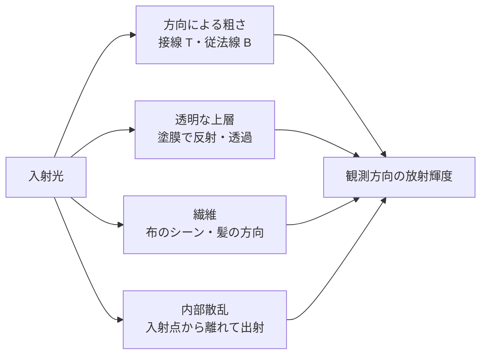

# 材質モデルの拡張 — 異方性・クリアコート・シーン・皮膚と髪

表面の金属度と粗さを同じ値にしても、ヘアライン加工した金属、透明な塗膜を重ねた塗装、ベルベット、皮膚では見え方が異なる。どの方向へ光を返すか、表面を何層に分けるか、光が表面下でどれくらい移動するかが違うためだ。[BRDF の中身](brdf-internals.md)で扱う等方的な GGX を出発点に、追加する入力と評価の違いを見る。



| 表現 | 追加する入力の例 | 何が変わるか |
| --- | --- | --- |
| 異方性 | 接線方向、方向別の粗さ | ハイライトが表面の向きに応じて伸びる |
| クリアコート | コートの量、粗さ、上層の法線 | ベースの上に別の反射ローブが現れる |
| シーン（sheen） | 繊維の色、シーンの粗さ | 布を浅い角度から見たときの柔らかい反射が現れる |
| サブサーフェス | 散乱距離、散乱色、厚み | 光が入った点から離れた場所や裏側に光の影響が出る |
| 髪 | 毛の接線、色や吸収、粗さ | 毛に沿う方向と毛の周囲の方向で反射・透過が変わる |

## 接空間で反射の向きを決める

異方性 GGX では、ハーフベクトル $H$ の接線成分 $h_t=H\cdot T$、従法線成分 $h_b=H\cdot B$、法線成分 $h_n=H\cdot N$ を使う。方向別の傾きの広がりを $\alpha_t,\alpha_b>0$ とすると、$h_n>0$ の法線分布項は次の形になる。

$$
D(H)=\frac{1}{\pi\alpha_t\alpha_b
\left[(h_t/\alpha_t)^2+(h_b/\alpha_b)^2+h_n^2\right]^2}
$$

$\alpha_t=\alpha_b$ なら接線と従法線を回しても値は変わらない。異なる値を指定した場合、接線フレームを回すとハイライトも回る。[法線マップと接空間](normal-mapping.md)で扱う接線の符号やミラー UV は、この方向にも関係する。glTF 2.0 の `KHR_materials_anisotropy` は、強度・回転と、方向や強度を調整するテクスチャを定義する。

## 層とローブを重ねる

クリアコートにはベースと異なる粗さや法線を指定できる。上層で反射された光のぶん、ベースに届く寄与を弱める。上層とベースの反射を独立に足し続けると、入ってきた光より多くのエネルギーを返す結果になりうる。glTF 2.0 の `KHR_materials_clearcoat` は層の近似と入力を定義する。`KHR_materials_sheen` の布のローブにも、ベースとのエネルギー配分がある。

皮膚の内部散乱は、同じ表面点で入射・出射を評価する BRDF から外れる。散乱距離が細部の大きさと同程度になると、輪郭や薄い部分の色に影響する。髪のローブは毛の向きを基準に考え、Marschner らのモデルでは毛の表面で反射する経路、内部を透過する経路、内部で反射してから出る経路を区別する。

## コード例 — 異方性 GGX の分布項を比較する

DXC で `-T ps_6_0 -E main` を指定できるピクセルシェーダー。左半分の粗さは両方向とも 0.35、右半分は接線 0.25・従法線 0.55。ハーフベクトルを半球上で動かし、分布項 $D$ を表示用に圧縮する。実際の鏡面反射では、この項にフレネル項、幾何項、光源の放射輝度などが加わる。

```hlsl
static const float PI = 3.14159265358979323846;

float AnisotropicGGX(float3 h, float2 alpha)
{
    float3 scaled = float3(h.xy / alpha, h.z);
    float q = dot(scaled, scaled);
    return 1.0 / (PI * alpha.x * alpha.y * q * q);
}

float4 main(float2 uv : TEXCOORD0) : SV_Target0
{
    float2 disk = float2(frac(uv.x * 2.0), uv.y) * 2.0 - 1.0;
    float radiusSquared = dot(disk, disk);
    if (radiusSquared >= 1.0)
        return float4(0.0, 0.0, 0.0, 1.0);

    float3 h = float3(disk, sqrt(1.0 - radiusSquared));
    float2 alpha = uv.x < 0.5 ? float2(0.35, 0.35) : float2(0.25, 0.55);
    float distribution = AnisotropicGGX(h, alpha);
    return float4((distribution / (1.0 + distribution)).xxx, 1.0);
}
```

$H=N$ のとき、右半分の $D$ は $1/(\pi\times 0.25\times0.55)\simeq2.315$。$D$ は法線の向きに対する分布密度なので、1 を超える値も取る。

## 理解度チェック

1. $\alpha_t=\alpha_b$ のとき、接線を 90° 回すと $D$ は変わるか。
2. 塗膜とベースの反射をそのまま足すと何が起きうるか。
3. 皮膚の内部散乱を表現するとき、BRDF の入射・出射点に関する前提のどこが変わるか。

::: details 解答

1. 変わらない。接平面内の二成分は、同じ係数で重み付けした二乗和になる。
2. 上層で反射した光とベースに入る光を二重に数え、入力より多くのエネルギーを返しうる。
3. 光が入った点と、散乱を経て出る点が別になりうる。

:::

## 関連項目

- [BRDF の中身](brdf-internals.md)
- [法線マップと接空間](normal-mapping.md)
- [PBR](../lighting/pbr.md)
- [水面の表現](water-shading.md)

## 参考資料

- Khronos Group, [glTF 2.0 PBR Material Extensions](https://www.khronos.org/gltf/pbr)
- Khronos Group, [KHR_materials_anisotropy](https://github.com/KhronosGroup/glTF/tree/main/extensions/2.0/Khronos/KHR_materials_anisotropy)
- Khronos Group, [KHR_materials_clearcoat](https://github.com/KhronosGroup/glTF/tree/main/extensions/2.0/Khronos/KHR_materials_clearcoat)
- Khronos Group, [KHR_materials_sheen](https://github.com/KhronosGroup/glTF/tree/main/extensions/2.0/Khronos/KHR_materials_sheen)
- Brent Burley, [Physically Based Shading at Disney](https://media.disneyanimation.com/uploads/production/publication_asset/48/asset/s2012_pbs_disney_brdf_notes_v3.pdf)
- Henrik Wann Jensen et al., [A Practical Model for Subsurface Light Transport](https://graphics.stanford.edu/~srm/publications/SG01-subsurf-abstract.html)
- Stephen R. Marschner et al., [Light Scattering from Human Hair Fibers](https://www.cs.cornell.edu/~srm/publications/SG03-hair-abstract.html)
