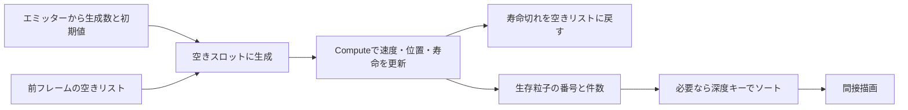

# GPUパーティクル — Computeで更新し、Indirectで描く

粒子ごとの位置や速度、残り寿命をGPUバッファに置き、コンピュートシェーダーで更新します。生き残った粒子の番号と描画する個数を同じGPU処理で書けば、毎フレームその個数をCPUへ読み戻さずに描画できます。GPUで作った引数を読む方法が**間接描画（Indirect描画）**です。

## 生成、更新、削除をバッファ上で分ける

最大粒子数を決め、各スロットに位置、速度、残り寿命を置きます。エミッターは空いているスロットへ初期値を書き、更新は残り寿命を減らしながら位置と速度を進めます。残り寿命が0以下になったスロットは、空きとして再利用できます。例えば、次のフレームの生成が、前フレームの更新で作った空きリストを消費する構成にすると、生成と削除が同じスロットを同時に触らずに済みます。



全スロットを調べる方式は、各スレッドが決まった番号にアクセスできるので単純です。生存数が容量よりずっと少ない場合は、密な生存リストだけを更新し、前後のリストを別バッファにして入れ替える方法があります。生存スロットが4、12、20なら、描画側には長さ3の `[4, 12, 20]` を渡します。アトミック加算の実行順で詰める場合、リストの順は実行ごとに変わり得ます。

## コード例 — 生存リストと描画のインスタンス数を作る

HLSL Shader Model 6.0のコンピュートシェーダーです。`dxc -T cs_6_0 -E UpdateCS Particles.hlsl` でコンパイルできます。Direct3D 12の `D3D12_DRAW_ARGUMENTS` を4個の32ビット整数として書きます。バイトオフセット4は `InstanceCount` です。三角形リストで1粒子を四角形にする場合、Dispatch前に引数を `{6, 0, 0, 0}` に用意します。2番目の0を毎回初期化し、粒子バッファと生存リストに `Capacity` 件以上を確保します。

```hlsl
struct Particle
{
    float3 position;
    float life;
    float3 velocity;
    float padding;
};

cbuffer Simulation : register(b0)
{
    float3 Gravity;
    float DeltaSeconds;
    uint Capacity;
};

RWStructuredBuffer<Particle> Particles : register(u0);
RWStructuredBuffer<uint> ActiveIndices : register(u1);
RWByteAddressBuffer DrawArgs : register(u2);

[numthreads(64, 1, 1)]
void UpdateCS(uint3 id : SV_DispatchThreadID)
{
    if (id.x >= Capacity)
    {
        return;
    }

    Particle particle = Particles[id.x];
    if (particle.life <= 0.0)
    {
        return;
    }

    particle.life -= DeltaSeconds;
    if (particle.life > 0.0)
    {
        particle.velocity += Gravity * DeltaSeconds;
        particle.position += particle.velocity * DeltaSeconds;

        uint activeSlot;
        DrawArgs.InterlockedAdd(4, 1, activeSlot);
        ActiveIndices[activeSlot] = id.x;
    }
    Particles[id.x] = particle;
}
```

X方向のグループ数は $\lceil\mathrm{Capacity}/64\rceil$ です。例えば容量1000なら16グループが計1024スレッドを起動し、最後の24スレッドは範囲の確認で抜けます。各スロットからリストへ書くのは最大1回なので、カウンターを0から始めれば生存リストは容量内に収まります。大量の粒子が同じカウンターを更新する場合は、グループ内で件数と書き込み先の相対位置を求め、グループ単位で領域を予約する方式と計測して比べます。

## 間接描画へ渡すときの同期

Direct3D 12のレガシーバリアを使う例では、引数をUAVへの書き込みから `D3D12_RESOURCE_STATE_INDIRECT_ARGUMENT` に遷移させます。頂点シェーダーで生存リストと粒子をSRVとして読むなら、それらも `D3D12_RESOURCE_STATE_NON_PIXEL_SHADER_RESOURCE` へ遷移させます。初期化や前段の生成をUAVのまま続ける場合は、その書き込みに依存する後段のDispatchとの間にUAVバリアが必要です。`InterlockedAdd` はカウンターへの加算をアトミックに行います。リストと引数を次の描画で読めるようにする同期は別に指定します。別キューで動かす場合はキュー間のフェンスによる順序付けも必要です。

この例はDrawのコマンドシグネチャを1件使います。`ExecuteIndirect` に最大コマンド数1を渡し、Count Bufferは省略できます。粒子の件数はコマンド数ではなく、引数の `InstanceCount` に入っています。頂点側は `SV_InstanceID` を生存リストの添字に、`SV_VertexID` を四角形の頂点選択に使えます。

## 半透明の重なりを並べ替える

通常のソースオーバー合成では、奥の粒子から手前の粒子の順で描きます。背景が黒で、赤と青の不透明度がともに0.5なら、赤→青の結果は $(0.25,0,0.50)$、青→赤なら $(0.50,0,0.25)$ です。コンパクションの順序をそのまま使うと、色が意図と異なったりフレーム間で変化したりします。粒子のビュー空間深度をキーにして、番号のリストをGPU上で並べ替えます。粒子同士が交差すると、中心点による並べ替えは近似になります。

単純に色を加算する発光粒子では、他の条件が同じなら、通常のアルファ合成ほど粒子同士の順序を気にせずに済みます。画面を覆う面積が大きい粒子は、更新時間と描画時間を分け、同じピクセルに何度も描く負荷を調べます。

## 理解度チェック

1. 生存数が50なら、ExecuteIndirectのコマンド数を50にする？
2. 同じスロットを別の粒子へ渡すには、いつ空きとして扱う？
3. 全粒子が生存しているとき、この例のActiveIndicesは容量を超える？

::: details 解答
1. この例ではコマンドは1件です。その1件にインスタンス数50を渡して四角形を50枚描きます。
2. 更新で寿命が切れたことを確定してから空きリストに戻します。生成がそのリストを消費する前に、書き込みと読み込みを順序付けます。
3. カウンターを0へ初期化していれば超えません。各スロットは最大1回しか登録されず、最大の添字は容量から1を引いた値です。
:::

## 関連項目

- [ソート](/algorithms/sorting.html)
- [コンピュートシェーダー](/graphics/compute/compute-shader.html)
- [D3D12のリソースバリア](/graphics/optimization/d3d12-resource-barriers.html)
- [出力マージャー](/graphics/pipeline/output-merger.html)

## 参考資料

- [Microsoft、HLSLのRWByteAddressBuffer](https://learn.microsoft.com/en-us/windows/win32/direct3dhlsl/sm5-object-rwbyteaddressbuffer)
- [Microsoft、HLSLのInterlockedAdd](https://learn.microsoft.com/en-us/windows/win32/direct3dhlsl/interlockedadd)
- [Microsoft、Direct3D 12の間接描画とコマンドシグネチャ](https://learn.microsoft.com/en-us/windows/win32/direct3d12/indirect-drawing)
- [Microsoft、Direct3D 12のD3D12_DRAW_ARGUMENTS](https://learn.microsoft.com/en-us/windows/win32/api/d3d12/ns-d3d12-d3d12_draw_arguments)
- [Microsoft、Direct3D 12のリソース状態とバリア](https://learn.microsoft.com/en-us/windows/win32/direct3d12/using-resource-barriers-to-synchronize-resource-states-in-direct3d-12)
- [Khronos、Vulkanのフレームバッファ合成式](https://docs.vulkan.org/spec/latest/chapters/framebuffer.html#framebuffer-blendoperations)
