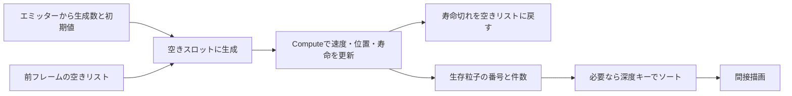
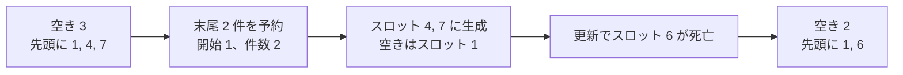
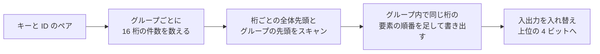

# GPUパーティクル — Computeで更新し、Indirectで描く

粒子ごとの位置や速度、残り寿命をGPUバッファに置き、コンピュートシェーダーで更新します。生き残った粒子の番号と描画する個数を同じGPU処理で書けば、毎フレームその個数をCPUへ読み戻さずに描画できます。GPUで作った引数を読む方法が**間接描画（Indirect描画）**です。

## 生成、更新、削除をバッファ上で分ける

最大粒子数を決め、各スロットに位置、速度、残り寿命を置きます。エミッターは空いているスロットへ初期値を書き、更新は残り寿命を減らしながら位置と速度を進めます。残り寿命が0以下になったスロットは、空きとして再利用できます。例えば、次のフレームの生成が、前フレームの更新で作った空きリストを消費する構成にすると、生成と削除が同じスロットを同時に触らずに済みます。



全スロットを調べる方式は、各スレッドが決まった番号にアクセスできるので単純です。生存数が容量よりずっと少ない場合は、密な生存リストだけを更新し、前後のリストを別バッファにして入れ替える方法があります。生存スロットが4、12、20なら、描画側には長さ3の `[4, 12, 20]` を渡します。アトミック加算の実行順で詰める場合、リストの順は実行ごとに変わり得ます。

### 生成数を空き枠で制限する

容量を $C$、フレーム開始時の空き数を $F$、生成の要求数を $R$ とします。作れる粒子は $E=\min(R,F)$。空きリストの末尾 $[F-E,F)$ を予約し、残る空き範囲を $[0,F-E)$ に縮めます。生成スレッドはこの予約区間の別々の要素を読み、対応する粒子スロットを初期化します。寿命切れの返却とフェーズを分け、予約は 1 スレッドでまとめて行うので、生成時に同じカウンターへ全スレッドが競合する構成を避けられます。複数のエミッターに広げる場合は、要求数のプレフィックスサムから重ならない区間を割り当て、各区間を空きの上限で切り詰めます。エミッターの順で空き枠を渡す場合は、上限に近いフレームで優先順位が見えるようにします。

例えば容量 8、空き数 3、空きリストの先頭 3 件が `[1, 4, 7]` のとき、2 件の要求に対して区間 $[1,3)$ を予約します。生成するスロットは 4 と 7 で、空きは 1 だけになります。そのフレームでスロット 6 が寿命切れになれば、空きリストに 6 が追加され、先頭 2 件は `[1, 6]` になります。フレーム前の生存数 $C-F=5$ は生成で 7、寿命切れで 6 になり、空き数 2 と合わせて容量 8 です。



生成した粒子を同フレームで更新する設計では、最初の位置と寿命も 1 刻み進んだ状態で描かれます。寿命が刻み以下なら最初のフレームに描画されず、更新で空きに戻ります。生成時の状態を最初に描く設計なら、更新の対象と生成の順序を変えます。固定刻みの複数ステップを 1 フレームにまとめるときは、どのステップでエミッターの要求を消費するかも決めます。[物理の時間積分と衝突判定](/math/physics-integration-and-collision.html)

## コード例 — 生存リストと描画のインスタンス数を作る

HLSL Shader Model 6.0 のコンピュートシェーダーです。`Particles.hlsl` に保存して、`dxc -T cs_6_0 -E ReserveEmitCS Particles.hlsl`、`dxc -T cs_6_0 -E EmitCS Particles.hlsl`、`dxc -T cs_6_0 -E UpdateCS Particles.hlsl` で 3 つのエントリーを個別にコンパイルできます。Direct3D 12 の `D3D12_DRAW_ARGUMENTS` を 4 個の 32 ビット整数として扱います。バイトオフセット 4 は `InstanceCount` です。三角形リストで 1 粒子を四角形にする場合、初回に引数を `{6, 0, 0, 0}` に用意します。`ReserveEmitCS` で毎フレーム `InstanceCount` を 0 に戻し、粒子バッファと生存・空きリストに `Capacity` 件以上を確保します。

空きリストの件数 `FreeCount` は、`DrawArgs` の件数と別に持ちます。初回は全スロットを寿命 0 にし、空きリストに `0` から `Capacity - 1` までの番号を一度ずつ入れ、`FreeCount` を `Capacity` にします。予約結果 `EmitRange` は開始位置と件数を格納する 8 バイトのバッファです。`Particle` のストライドは 32 バイト。`DeltaSeconds` は有限の非負値、`SpawnLife` は生成時の正の寿命です。次の例はエミッター 1 個を扱い、生成する粒子をエミッター位置の X 軸方向に `SpawnSpacing` 間隔で並べます。

```hlsl
struct Particle
{
    float3 position;
    float life;
    float3 velocity;
    float padding;
};

cbuffer Simulation : register(b0)
{
    float3 Gravity;
    float DeltaSeconds;
    uint Capacity;
    uint EmitRequested;
    float SpawnLife;
    float SpawnSpacing;
    float3 EmitterPosition;
    float3 EmitterVelocity;
};

RWStructuredBuffer<Particle> Particles : register(u0);
RWStructuredBuffer<uint> ActiveIndices : register(u1);
RWByteAddressBuffer DrawArgs : register(u2);
RWStructuredBuffer<uint> FreeIndices : register(u3);
RWByteAddressBuffer FreeCount : register(u4);
RWByteAddressBuffer EmitRange : register(u5);

[numthreads(1, 1, 1)]
void ReserveEmitCS()
{
    uint freeBefore = FreeCount.Load(0);
    uint count = SpawnLife > 0.0 ? min(EmitRequested, freeBefore) : 0;
    uint first = freeBefore - count;
    FreeCount.Store(0, first);
    EmitRange.Store2(0, uint2(first, count));
    DrawArgs.Store(4, 0);
}

[numthreads(64, 1, 1)]
void EmitCS(uint3 id : SV_DispatchThreadID)
{
    uint2 range = EmitRange.Load2(0);
    if (id.x >= range.y)
    {
        return;
    }

    uint particleIndex = FreeIndices[range.x + id.x];
    float offset = (float(id.x) - 0.5 * float(range.y - 1)) * SpawnSpacing;
    Particle particle;
    particle.position = EmitterPosition + float3(offset, 0.0, 0.0);
    particle.life = SpawnLife;
    particle.velocity = EmitterVelocity;
    particle.padding = 0.0;
    Particles[particleIndex] = particle;
}

[numthreads(64, 1, 1)]
void UpdateCS(uint3 id : SV_DispatchThreadID)
{
    if (id.x >= Capacity)
    {
        return;
    }

    Particle particle = Particles[id.x];
    if (particle.life <= 0.0)
    {
        return;
    }

    particle.life -= DeltaSeconds;
    if (particle.life > 0.0)
    {
        particle.velocity += Gravity * DeltaSeconds;
        particle.position += particle.velocity * DeltaSeconds;

        uint activeSlot;
        DrawArgs.InterlockedAdd(4, 1, activeSlot);
        ActiveIndices[activeSlot] = id.x;
    }
    else
    {
        particle.life = 0.0;
        uint freeSlot;
        FreeCount.InterlockedAdd(0, 1, freeSlot);
        FreeIndices[freeSlot] = id.x;
    }
    Particles[id.x] = particle;
}
```

`ReserveEmitCS` は `Dispatch(1, 1, 1)` で呼びます。生成の X 方向グループ数は $\lceil\min(R,C)/64\rceil$。GPU 側で決まった $E$ がこれより小さいとき、範囲外のスレッドは早く終了します。生成要求 0 の場合は `EmitCS` の dispatch を省けます。更新の X 方向グループ数は $\lceil C/64\rceil$ です。例えば容量 1000 なら 16 グループが計 1024 スレッドを起動し、最後の 24 スレッドは範囲の確認で抜けます。Direct3D 12 の X 方向グループ数の上限に収まる容量を使います。実行例の定数バッファーは、最初の 16 バイトに `Gravity` と `DeltaSeconds`、次の 16 バイトに `Capacity` から `SpawnSpacing` までを置き、`EmitterPosition` と `EmitterVelocity` はそれぞれ次の 16 バイト境界から格納します。[Microsoft、HLSL のパッキング規則](https://learn.microsoft.com/en-us/windows/win32/direct3dhlsl/dx-graphics-hlsl-packing-rules)

すでに寿命が 0 のスロットは空きリストに入っているので、更新開始時点では生きていた粒子が寿命切れになったときだけ空きリストに追加します。生成が取り出した件数を正しく差し引いていれば、更新後の生存数と空き数の合計は `Capacity` です。死んだ粒子の返却と生存リストへの追加は異なるカウンターです。同じカウンターへの競合が目立つ場合は、[wave 内で書き出し区間を確保する方式](shader-optimization.md#wave-compaction)を適用できます。

## 間接描画へ渡すときの同期

Direct3D 12のレガシーバリアを使う例では、引数をUAVへの書き込みから `D3D12_RESOURCE_STATE_INDIRECT_ARGUMENT` に遷移させます。頂点シェーダーで生存リストと粒子をSRVとして読むなら、それらも `D3D12_RESOURCE_STATE_NON_PIXEL_SHADER_RESOURCE` へ遷移させます。

次の `ReserveEmitCS` の前に、引数バッファを `UNORDERED_ACCESS` へ戻します。状態の起点は、二つの処理をどこでキューへ渡すかで変わります。同じ `ExecuteCommandLists` 呼び出しの中では、コマンドリストが分かれていても `INDIRECT_ARGUMENT` から遷移させます。前の `ExecuteCommandLists` の処理がGPU上で完了すると、バッファは `COMMON` へ戻ります。次の実行では `COMMON` を起点にし、条件を満たせば暗黙の昇格を使えます。リセットをコピーで行う場合は、コピー前に `COPY_DEST`、次のUAV書き込み前に `UNORDERED_ACCESS` を使います。粒子と生存リストも、現在の状態からUAVで書き込める状態に戻します。

初期化・生成・更新が同じリソースをUAVのまま使い、同じ `ExecuteCommandLists` の中で後段が前段の書き込みに依存する場合は、その間にUAVバリアを入れます。例えば更新と次回の生成の間で、空きリストと件数の両方を順序付けます。`InterlockedAdd` はカウンターへの加算をアトミックに行う操作です。リストへの書き込みを後続パスから読めるようにする同期は別に指定します。別キューで動かす場合はキュー間のフェンスによる順序付けも必要です。

この例はDrawのコマンドシグネチャを1件使います。`ExecuteIndirect` に最大コマンド数1を渡し、Count Bufferは省略できます。粒子の件数はコマンド数ではなく、引数の `InstanceCount` に入っています。頂点側は `SV_InstanceID` を生存リストの添字に、`SV_VertexID` を四角形の頂点選択に使えます。

| 区間 | 後続パスに渡すデータ |
| --- | --- |
| 予約 → 生成 | `EmitRange` の開始位置と件数 |
| 予約 → 更新 | `FreeCount` の残数と、ゼロにした `DrawArgs.InstanceCount` |
| 生成 → 更新 | 新しい粒子データ。生成が読み取った `FreeIndices` の末尾を、更新が空きリストへの追加で上書きすることもある |
| 更新 → ソートまたは描画 | 位置と生存 ID、引数。ソートする場合は生存数を読み、並べ替えた ID を描画側が読む |
| 更新 → 次フレームの予約・生成 | 返却済みの `FreeIndices` と `FreeCount` |

同じ Direct キューを使い UAV のまま順序付ける構成なら、予約後と生成後に対象の依存を覆う UAV バリアを置きます。生成 → 更新では `Particles` の書き込みに加えて、更新の `FreeIndices` への上書きを生成の読み取りより後にします。グループ内のバリアは別のグループや dispatch を待てないので、これらの依存にはコマンドリスト上のバリアを使います。

## 半透明の重なりを並べ替える

通常のソースオーバー合成では、奥の粒子から手前の粒子の順で描きます。背景が黒で、赤と青の不透明度がともに0.5なら、赤→青の結果は $(0.25,0,0.50)$、青→赤なら $(0.50,0,0.25)$ です。コンパクションの順序をそのまま使うと、色が意図と異なったりフレーム間で変化したりします。粒子のビュー空間深度をキーにして、番号のリストをGPU上で並べ替えます。粒子同士が交差すると、中心点による並べ替えは近似になります。

単純に色を加算する発光粒子では、他の条件が同じなら、通常のアルファ合成ほど粒子同士の順序を気にせずに済みます。画面を覆う面積が大きい粒子は、更新時間と描画時間を分け、同じピクセルに何度も描く負荷を調べます。

### 深度キーとスロット番号を組にする

毎フレーム並べ替えるのは粒子本体ではなく、ビュー方向の深度とスロット番号のペアです。スロット番号を固定すると、空きリストと更新側は並べ替えの影響を受けません。深度はカメラから前方へ測った投影距離 $d=(\mathbf p-\mathbf c)\cdot\mathbf f$ とします。$\mathbf p$ が粒子の中心、$\mathbf c$ がカメラ位置、$\mathbf f$ が正規化したカメラ前方ベクトルです。遠い順なら、通常は $d$ が大きい粒子が先になります。カメラ原点からの直線距離を使うと、画面の端の粒子と中央の粒子がビュー方向と異なる順に並ぶことがあります。

有限で正の IEEE 754 binary32 は、符号ビットが 0 で指数と仮数が上位から並んでいるため、ビット列を符号なし整数として比較した順序が値の順序と一致します。昇順で処理するソートには、`~asuint(d)` をキーとして使うと正の深度が降順になります。深度 1、2、4 のビット列はそれぞれ `0x3f800000`、`0x40000000`、`0x40800000`。ビット反転後を昇順に並べると 4、2、1 の順になります。次の例ではカメラより後ろの中心を深度 0 として末尾側に扱い、正と負のゼロも同じキーにします。前方の粒子だけを描く構成では、ソートの前にカリングで取り除けます。NaN や無限大をキーにしないよう、シミュレーションの出力は有限に保ちます。[Microsoft、HLSL asuint](https://learn.microsoft.com/en-us/windows/win32/direct3dhlsl/dx-graphics-hlsl-asuint)

### バイトニックソート — 1 グループの比較交換

バイトニックソートでは、隣り合う部分列を交互の向きに並べてから、長さを 2 倍にしながらマージします。例えば 8 件の最後のマージでは、前半と後半を距離 4 のペアで比較交換し、その後は距離 2、1 のペアを処理します。各段ではペアが重複しないので並列に比較交換できます。長さ $k$ のマージでは距離を $k/2,k/4,\dots,1$ と下げ、比較相手を添字の XOR で求めます。2 のべき乗 $N=2^m$ 件なら、全体の比較交換の段数は $1+2+\dots+m=m(m+1)/2$。各段は最大 $N/2$ 件を比較します。128 件では $m=7$ なので 28 段、1792 比較です。[K. E. Batcher、Sorting Networks and Their Applications](https://doi.org/10.1145/1468075.1468121)

次の HLSL Shader Model 6.0 の例は、生存数が常に 128 以下のエミッターやパーティクルプール用です。`dxc -T cs_6_0 -E Sort128CS Sort128.hlsl` でコンパイルし、`Dispatch(1, 1, 1)` で実行します。`ParticleData` と `InputIds` は更新パスが書いた粒子と生存 ID、`InputDrawArgs` は更新済みの描画引数です。`SortedIds` に生存 ID を並べ替えて格納し、間接描画の引数はそのまま使います。未使用レーンには最大キーと最大 ID を設定し、末尾へ送ります。同じ深度ではスロット番号で順番を決めます。

```hlsl
struct Particle
{
    float3 position;
    float life;
    float3 velocity;
    float padding;
};

cbuffer SortCamera : register(b0)
{
    float3 CameraPosition;
    float3 CameraForward;
};

StructuredBuffer<Particle> ParticleData : register(t0);
StructuredBuffer<uint> InputIds : register(t1);
ByteAddressBuffer InputDrawArgs : register(t2);
RWStructuredBuffer<uint> SortedIds : register(u0);
groupshared uint2 KeysAndIds[128];

bool Less(uint2 a, uint2 b)
{
    return a.x < b.x || (a.x == b.x && a.y < b.y);
}

[numthreads(128, 1, 1)]
void Sort128CS(uint i : SV_GroupIndex)
{
    uint aliveCount = InputDrawArgs.Load(4);
    uint2 entry = uint2(0xffffffffu, 0xffffffffu);

    if (i < aliveCount)
    {
        uint id = InputIds[i];
        float d = dot(ParticleData[id].position - CameraPosition, CameraForward);
        uint depthBits = d > 0.0 ? asuint(d) : 0u;
        entry = uint2(~depthBits, id);
    }
    KeysAndIds[i] = entry;
    GroupMemoryBarrierWithGroupSync();

    for (uint block = 2; block <= 128; block <<= 1)
    {
        for (uint stride = block >> 1; stride > 0; stride >>= 1)
        {
            uint peer = i ^ stride;
            if (i < peer)
            {
                uint2 a = KeysAndIds[i];
                uint2 b = KeysAndIds[peer];
                bool ascending = (i & block) == 0;
                bool swap = ascending ? Less(b, a) : Less(a, b);
                if (swap)
                {
                    KeysAndIds[i] = b;
                    KeysAndIds[peer] = a;
                }
            }
            GroupMemoryBarrierWithGroupSync();
        }
    }

    if (i < aliveCount)
        SortedIds[i] = KeysAndIds[i].y;
}
```

範囲外のレーンも比較交換と同期に参加します。早期リターンさせるとグループ全体が同期点へそろわず、末尾を埋める要素もなくなります。この例では全生存 ID を 1 グループに載せます。複数グループへそのまま拡張した場合はグループ内だけがソートされるため、グループをまたぐ比較交換の段を別の dispatch にし、段の間を UAV バリアで順序付けます。128 件用のコードを利用する場合は、粒子プールの容量や描画する件数も 128 以下に制限します。D3D12 で SRV を使うこのコードでは、更新の UAV 書き込みが終わった粒子、ID、引数をコンピュートシェーダーで読み取れる状態に遷移させます。描画時は並べ替え後の ID を SRV へ、引数を間接描画用の状態へ遷移させます。[Microsoft、GroupMemoryBarrierWithGroupSync](https://learn.microsoft.com/en-us/windows/win32/direct3dhlsl/groupmemorybarrierwithgroupsync)

### 基数ソート — ヒストグラム、スキャン、書き出し

32 ビットの整数キーで大量の粒子を並べるなら、下位から数ビットずつ処理する基数ソートを選べます。1 桁を 4 ビットにすると、16 個のバケットを持ち、8 回の桁処理で 32 ビットを覆います。1 回の桁処理で、各グループが桁のヒストグラムを作り、グループの境界をまたいで件数をスキャンし、各要素を行き先へ scatter します。次の桁では入力と出力のバッファを入れ替えます。

桁 $d$ に対し、バケット開始位置 $B_d$ は自分より小さい桁の合計、グループ $g$ のオフセット $G_{g,d}$ は同じ桁について前にあるグループの合計です。グループ内で同じ桁の要素の先頭から自分より前の個数を $r$ とすると、書き込み先は $B_d+G_{g,d}+r$ になります。この順序で、同じ桁を持つ要素の入力順を保てます。例えば下位桁の列が $[2,1,2,0]$ なら、桁 0、1、2 の件数は $[1,1,2]$、開始位置は $[0,1,2]$。入力順の書き込み先は $[2,1,3,0]$ です。同じ桁 2 の 2 件が入れ替わると、すでに処理した下位桁の順序を壊す場合があります。グローバルな atomic 加算で空き位置を取るだけでは、同じ桁の入力順は保証されません。



安定な基数ソートも、入力自体が毎フレーム atomic 加算で作られていれば、完全に同じキーの要素の順序が変わり得ます。必要ならスロット番号を副キーにし、副キーを先に安定に並べてから深度キーで安定に並べます。深度を粗く量子化してキーのビット数を減らす方法では、同じ区間の粒子が増えます。近接して異なる色が重なる箇所に注目し、画像差とソート時間を比べます。

AMD FidelityFX SDK v1.1.4 の Parallel Sort は DirectX 12 と Vulkan を対象とする GPU 基数ソートの実装例です。1 回 4 ビットを扱い、Count、Reduce、Scan、Scan Add、Scatter を組み合わせます。グループ内に収まる小さなバイトニックソートは中間データをグループ共有メモリーに置けます。基数ソートは大量の入力を扱えますが、作業用バッファと桁ごとの転送が必要です。実際のパスでは、半透明に必要な生存数、桁の分布、作業バッファの転送量、ソートなしの描画時間も合わせて比較します。[AMD、FidelityFX Parallel Sort](https://gpuopen.com/fidelityfx-parallel-sort/)、[Satish・Harris・Garland、Designing Efficient Sorting Algorithms for Manycore GPUs](https://research.nvidia.com/publication/2009-05_designing-efficient-sorting-algorithms-manycore-gpus)

## 理解度チェック

1. 生存数が50なら、ExecuteIndirectのコマンド数を50にする？
2. 同じスロットを別の粒子へ渡すには、いつ空きとして扱う？
3. 全粒子が生存しているとき、この例のActiveIndicesは容量を超える？
4. 空き 3 件に対し生成要求が 5 件ある。何件生成でき、そのフレームの更新前に空きはいくつ残る？
5. 128 件をソートするグループで生存数が 5 のとき、残りの 123 レーンをソートの前に終了させてよい？
6. 基数ソートの scatter で、同じ桁の書き込み位置を atomic 加算の到着順だけで決めると何が起きる？

::: details 解答
1. この例ではコマンドは1件です。その1件にインスタンス数50を渡して四角形を50枚描きます。
2. この更新で寿命が正から0以下へ変わったときに一度だけ空きリストに戻します。生成がリストと件数を消費する前に、書き込みと読み込みを順序付けます。
3. カウンターを0へ初期化していれば超えません。各スロットは最大1回しか登録されず、最大の添字は容量から1を引いた値です。
4. 3 件です。予約で空き数を 0 にし、更新で死亡した粒子の数だけ空きが戻ります。
5. いいえ。未使用レーンも最大キーと最大 ID の組で比較交換に参加し、全レーンでグループ内の同期点に到達します。
6. 同じ桁を持つ要素が入力と異なる順で並び、すでに処理した下位桁の順序が壊れる場合があります。
:::

## 関連項目

- [ソート](/algorithms/sorting.html)
- [コンピュートシェーダー](/graphics/compute/compute-shader.html)
- [D3D12のリソースバリア](/graphics/optimization/d3d12-resource-barriers.html)
- [出力マージャー](/graphics/pipeline/output-merger.html)
- [シェーダー最適化の実践](shader-optimization.md)

## 参考資料

- [Microsoft、HLSLのRWByteAddressBuffer](https://learn.microsoft.com/en-us/windows/win32/direct3dhlsl/sm5-object-rwbyteaddressbuffer)
- [Microsoft、HLSLのInterlockedAdd](https://learn.microsoft.com/en-us/windows/win32/direct3dhlsl/interlockedadd)
- [Microsoft、Direct3D 12の間接描画とコマンドシグネチャ](https://learn.microsoft.com/en-us/windows/win32/direct3d12/indirect-drawing)
- [Microsoft、Direct3D 12のD3D12_DRAW_ARGUMENTS](https://learn.microsoft.com/en-us/windows/win32/api/d3d12/ns-d3d12-d3d12_draw_arguments)
- [Microsoft、Direct3D 12のリソース状態とバリア](https://learn.microsoft.com/en-us/windows/win32/direct3d12/using-resource-barriers-to-synchronize-resource-states-in-direct3d-12)
- [Khronos、Vulkanのフレームバッファ合成式](https://docs.vulkan.org/spec/latest/chapters/framebuffer.html#framebuffer-blendoperations)
- [Microsoft、GroupMemoryBarrierWithGroupSync](https://learn.microsoft.com/en-us/windows/win32/direct3dhlsl/groupmemorybarrierwithgroupsync)
- [K. E. Batcher、Sorting Networks and Their Applications](https://doi.org/10.1145/1468075.1468121)
- [AMD、FidelityFX Parallel Sort（SDK v1.1.4）](https://gpuopen.com/fidelityfx-parallel-sort/)
- [N. Satish・M. Harris・M. Garland、Designing Efficient Sorting Algorithms for Manycore GPUs](https://research.nvidia.com/publication/2009-05_designing-efficient-sorting-algorithms-manycore-gpus)
