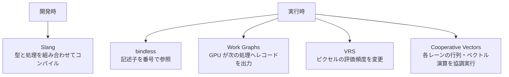

# 最新のシェーダー技術 — Slang・bindless・Work Graphs・VRS・Cooperative Vectors

複数の材質や GPU 上の仕事を一つの描画フレームで扱うとき、言語、リソースの指定、仕事の投入方法、ピクセルを評価する頻度、それぞれに異なる選択肢がある。例えばテクスチャの参照方法を変更しても、シェーダーの評価回数は自動では減らない。以下の対応状況は 2026 年 11 月 13 日時点。



## Slang と bindless

**Slang v2026.22** は、インターフェースとジェネリクスでシェーダーの処理を組み替えられる。例えば光の評価をインターフェースにし、材質の型ごとに実装を選べる。DXIL や SPIR-V などの出力先があり、出力先の API や GPU の機能は別途確認する。

**bindless** では、個々のテクスチャを描画ごとに専用スロットへ割り当てる代わりに、材質が保持するインデックスで記述子を選ぶ。Direct3D 12 Shader Model 6.6 の直接インデックスでは `ResourceDescriptorHeap` などを使う。wave 内で異なるインデックスを取りうる場合は `NonUniformResourceIndex` を指定する。CPU 側には有効な記述子の配置と、GPU が読み終えるまでの寿命管理が必要になる。

## Work Graphs と VRS

**Work Graphs** は Direct3D 12 Agility SDK 1.613 と Shader Model 6.8 で正式提供された。CPU が開始ノードにレコードを渡し、GPU 上のノードは入力に応じて次のノードへレコードを出力する。例えばタイル内の光源数を分類して、光の少ないタイルと多いタイルの処理を分けられる。出力の上限やグラフ用のバッキングメモリが必要な場合の管理を含めて設計し、`D3D12_FEATURE_D3D12_OPTIONS21` の `WorkGraphsTier` を確認する。

**VRS**（Variable Rate Shading）は、複数ピクセルをまとめて 1 回のシェーディング結果を使えるようにする。Direct3D 12 の Tier 1 は描画単位のレート、Tier 2 はプリミティブごとの指定や画面タイルごとのレート画像を追加する。2×2 の粗いレートでは、まとめられた領域の 4 ピクセルで結果を共有できる。細かい輪郭や高周波の材質では画質を確認する。画面の解像度や表示リフレッシュを変える機能とは適用箇所が異なる。

## Cooperative Vectors

ニューラル材質などでは、多数のピクセルで小さな行列・ベクトル積が必要になる。**Vulkan の `VK_NV_cooperative_vector` rev. 4** は、各呼び出しのベクトル演算を実装側で協調して実行できるようにする NVIDIA ベンダー拡張。使えるステージ、型、行列レイアウトはデバイスから問い合わせる。加速の有無や推論速度は、形状・型・メモリ配置・ハードウェアに左右される。

Direct3D 12 側では、行列・ベクトル演算を含む線形代数機能が **Shader Model 6.10 Preview** にある。2026 年 11 月 9 日公開の Agility SDK 1.620.2 は正式版、1.722.1 はプレビュー版であり、Microsoft は 1.620 / 1.722 の発表で Shader Model 6.10 は引き続きプレビューと明記している。出荷向けの要件を決める際は、言語仕様、DXC、ランタイム、ドライバーの対応を別々に確認する。

## コード例 — 材質インデックスでテクスチャを選ぶ

DXC の `-T ps_6_6 -E main` でコンパイルできる。`SV_PrimitiveID` の偶奇を二つの材質の代わりに使う。ホスト側ではシェーダーから見える CBV/SRV/UAV ヒープの連続する二枠にテクスチャの SRV を置き、先頭インデックスを `TextureBase` に渡す。ルートシグネチャには `CBV_SRV_UAV_HEAP_DIRECTLY_INDEXED` フラグを付け、`b0` と `s0` のバインディングも用意する。

```hlsl
cbuffer MaterialTable : register(b0)
{
    uint TextureBase;
};

SamplerState LinearSampler : register(s0);

float4 main(float2 uv : TEXCOORD0, uint primitive : SV_PrimitiveID) : SV_Target0
{
    uint descriptor = TextureBase + (primitive & 1u);
    Texture2D<float4> colorTexture =
        ResourceDescriptorHeap[NonUniformResourceIndex(descriptor)];
    return colorTexture.Sample(LinearSampler, uv);
}
```

先頭が 40 なら、プリミティブ ID が 5 のときは 41、6 のときは 40 を参照する。描画命令に記述子を渡さなくなっても、このインデックスが指す記述子の有効期間はホストが管理する。

## 理解度チェック

1. bindless で一つの wave の各レーンが異なるテクスチャを選ぶ可能性がある。HLSL のインデックスに何を付けるか。
2. 同じ画面解像度で、細部の少ない領域のシェーディング評価をまとめたい。どの機能を調べるか。
3. Vulkan で Cooperative Vectors を使った材質を表示する前に、拡張名以外に何を確認するか。

::: details 解答

1. `NonUniformResourceIndex`。
2. VRS。画面領域ごとに設定するには、Direct3D 12 では Tier 2 のレート画像を使える。
3. デバイスの機能と、使いたいシェーダーステージ、型、行列レイアウトに対応しているか。

:::

## 関連項目

- [HLSL](hlsl.md)
- [SPIR-V](spirv.md)
- [コンピュートシェーダー](../compute/compute-shader.md)
- [GPU 駆動描画](../optimization/gpu-driven.md)
- [シェーダー最適化の実践](shader-optimization.md)

## 参考資料

- Slang project, [v2026.22](https://github.com/shader-slang/slang/releases/tag/v2026.22)・[Interfaces and Generics](https://shader-slang.org/slang/user-guide/interfaces-generics.html)
- Microsoft, [HLSL Shader Model 6.6 Dynamic Resources](https://microsoft.github.io/DirectX-Specs/d3d/HLSL_SM_6_6_DynamicResources.html)
- Microsoft, [D3D12 Work Graphs](https://devblogs.microsoft.com/directx/d3d12-work-graphs/)・[仕様](https://microsoft.github.io/DirectX-Specs/d3d/WorkGraphs.html)
- Microsoft, [Variable-rate shading (VRS)](https://learn.microsoft.com/en-us/windows/win32/direct3d12/vrs)
- Khronos Group, [VK_NV_cooperative_vector](https://docs.vulkan.org/refpages/latest/refpages/source/VK_NV_cooperative_vector.html)
- Microsoft, [D3D12 LinAlg Matrix Preview](https://devblogs.microsoft.com/directx/d3d12-linalg-preview/)・[Agility SDK 1.620 Retail and 1.722 Preview](https://devblogs.microsoft.com/directx/agilitysdk-1-620-retail-and-1-722-preview/)・[Agility SDK ダウンロード](https://devblogs.microsoft.com/directx/directx12agility/)
