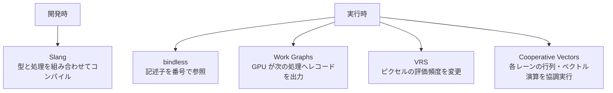
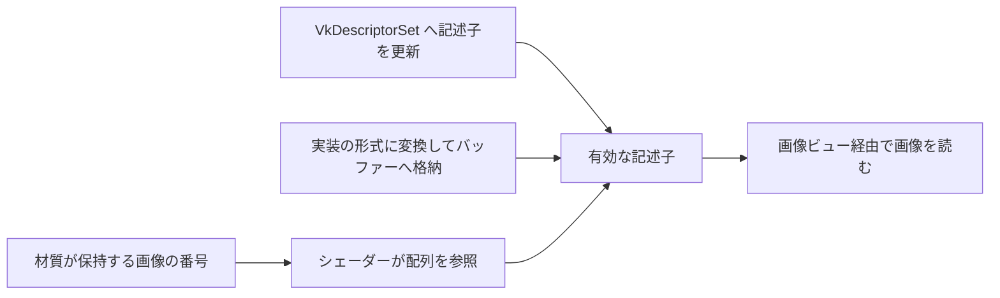

# 最新のシェーダー技術 — Slang・bindless・Work Graphs・VRS・Cooperative Vectors

複数の材質や GPU 上の仕事を一つの描画フレームで扱うとき、言語、リソースの指定、仕事の投入方法、ピクセルを評価する頻度、それぞれに異なる選択肢がある。例えばテクスチャの参照方法を変更しても、シェーダーの評価回数は自動では減らない。以下の対応状況は 2026 年 11 月 13 日時点。



## Slang と bindless

### Slang — 型で実装を選び、自動微分で勾配を得る

**Slang v2026.22** は、インターフェースとジェネリクスでシェーダーの処理を組み替えられる。例えば光の評価をインターフェースにし、材質の型ごとに実装を選べる。DXIL や SPIR-V などの出力先があり、出力先の API や GPU の機能は別途確認する。

2024 年 11 月に Khronos Group は Slang Initiative を発足させ、NVIDIA から提供を受けたオープンソースコンパイラーを複数社で運営する枠組みを設けた。言語の機能を採用する場合は Slang の版と出力先を記録する。例えば光の評価関数をジェネリックな材質シェーダーに渡すとき、出力先に必要な機能と、型を特殊化してできるバリアント数を別々に確認できる。

Slang の自動微分は、`[Differentiable]` を付けた関数をコンパイラーが微分する。`fwd_diff(f)` は入力とその変化方向 $v$ を組にして渡し、ヤコビアンとの積 $J_fv$ を求める。変更したいパラメーターが一つで、多数の出力がどう変化するか見たい場合に向く。`bwd_diff(f)` は出力側から勾配を渡し、入力側の勾配 $J_f^\mathsf{T}v$ を得る。粗さ・色・重みなどの多数の入力に対して、単一の損失を減らす方向を求めるのが一例。HLSL の `ddx` や `ddy` は画面上の近傍呼び出しを使った差分なので、材質パラメーターで式を微分する用途とは入力が異なる。

例えば $r=wx-y$、$L=r^2/2$ とする。積の微分と連鎖律から $\partial L/\partial w = rx$、$\partial L/\partial x = rw$ になる。$w=2$、$x=3$、$y=4$ では $r=2$、$L=2$ なので、重み方向の微分は $6$、入力方向は $4$。前進モードで $(dw,dx)=(1,0)$ を渡すと $6$ が返り、逆伝播で $dL=1$ を渡すと両方を得られる。

次のコンピュートシェーダーは Slang v2026.22 の `slangc loss.slang -entry main -target spirv -o loss.spv` で SPIR-V にコンパイルできる。`output[0]` に損失と、重みを増やす方向の微分 $(2,6)$ を書く。出力バッファーは少なくとも 1 要素で、グループを一つ投入する。

```slang
RWStructuredBuffer<float2> output;

[Differentiable]
float loss(float w, float x)
{
    float r = w * x - 4.0;
    return 0.5 * r * r;
}

[shader("compute")]
[numthreads(1, 1, 1)]
void main()
{
    DifferentialPair<float> dw = diffPair(2.0, 1.0);
    DifferentialPair<float> dx = diffPair(3.0, 0.0);
    DifferentialPair<float> result = fwd_diff(loss)(dw, dx);
    output[0] = float2(result.p, result.d);
}
```

実際の材質では `saturate` の境界や離散的な材質選択で、勾配が途切れたりゼロになったりする。逆伝播用の中間値もメモリを使う。まず最適化したい入力と損失を絞り、小さい既知のケースや有限差分で符号・大きさを確かめる。

### bindless — Vulkan での配列参照と記述子の格納

**bindless** では、個々のテクスチャを描画ごとに専用スロットへ割り当てる代わりに、材質が保持するインデックスで記述子を選ぶ。Direct3D 12 Shader Model 6.6 の直接インデックスでは `ResourceDescriptorHeap` などを使う。wave 内で異なるインデックスを取りうる場合は `NonUniformResourceIndex` を指定する。CPU 側には有効な記述子の配置と、GPU が読み終えるまでの寿命管理が必要になる。

Vulkan の `VK_EXT_descriptor_indexing` の機能は Vulkan 1.2 に取り込まれた。大きなテクスチャ配列を使う場合は、次の条件を個別に確認する。バインディング数や記述子の総数には、デバイスの上限も適用される。

| 必要な操作 | 確認する機能 |
| --- | --- |
| シェーダーでサイズを指定しない記述子配列を使う | `runtimeDescriptorArray` |
| 同一の描画内でピクセルによって異なる sampled image を選ぶ | `shaderSampledImageArrayNonUniformIndexing`。HLSL では添字を `NonUniformResourceIndex` で囲む |
| 配列の末尾のバインディングについて、割り当てる記述子数を決める | `descriptorBindingVariableDescriptorCount`。当該セットレイアウトで最も大きなバインディング番号に適用する |
| 実行中に参照しない枠を未設定にしておく | `descriptorBindingPartiallyBound`。シェーダーが実際に参照する枠は有効にする |
| コマンドにセットをバインドした後で、実行前に枠を更新する | sampled image なら `descriptorBindingSampledImageUpdateAfterBind`。プール、セットレイアウト、バインディングのそれぞれに対応フラグを付ける |

未設定の枠があるときは、材質の有効な ID を CPU 側で検証するか、欠けたテクスチャを共通の記述子に置き換える。GPU が読む可能性のあるスロットを使い回す場合は、以前の処理の完了をフェンスやタイムラインセマフォーで確認する。フレーム番号を使った循環バッファーでも、CPU が GPU より複数フレーム先に進んだときの上限が要る。

`VK_EXT_descriptor_buffer` は、シェーダーが使う記述子を、アプリケーションが管理するバッファーに格納する拡張。配列の添字の使い方と、記述子をどこに置くかは別の選択である。セットレイアウトとパイプラインを対応するフラグで作り、`vkGetDescriptorSetLayoutSizeEXT` と `vkGetDescriptorSetLayoutBindingOffsetEXT` で大きさとバインディングの位置を得る。各要素は `vkGetDescriptorEXT` でデバイス用のバイト列に変換する。GPU から見えるバッファーを `vkCmdBindDescriptorBuffersEXT` でバインドし、`vkCmdSetDescriptorBufferOffsetsEXT` でセットごとの開始オフセットを指定する。開始位置は `descriptorBufferOffsetAlignment` にそろえる。CPU の `VkDescriptorImageInfo` を構造体のまま書いても、デバイスが読む記述子にはならない。

例えば 32 バイトの sampled-image 記述子を 3 個持つバインディングが、セット先頭から 64 バイトにあるとする。セットをバッファーの 256 バイト目に置いた場合、添字 2 の記述子は $256+64+2\times32=384$ バイト目から始まる。32 と 64 は説明用の値で、実装ではプロパティーとレイアウトを問い合わせる。画像本体のレイアウト遷移やアクセス同期も引き続き必要になる。



## Work Graphs と VRS

### Work Graphs — タイルの仕事を GPU から追加する

**Work Graphs** は Direct3D 12 Agility SDK 1.613 と Shader Model 6.8 で正式提供された。CPU が開始ノードにレコードを渡し、GPU 上のノードは入力に応じて次のノードへレコードを出力する。例えばタイル内の光源数を分類して、光の少ないタイルと多いタイルの処理を分けられる。出力の上限やグラフ用のバッキングメモリが必要な場合の管理を含めて設計し、`D3D12_FEATURE_D3D12_OPTIONS21` の `WorkGraphsTier` を確認する。

`[NodeLaunch("thread")]` はレコード一つにスレッド一つを対応させる。タイル全体にスレッドグループを割り当てたい場合は `broadcasting`、小さいレコードを一つのグループにまとめたい場合は `coalescing` が候補になる。処理の途中でレコードを作ったら、`OutputComplete()` でレコードへの書き込みを終え、後続ノードが受け取れるようにする。後続ノードが実行される順序は固定されないため、以下の例では出力先が互いに異なるレコードを投入する。

`dxc -T lib_6_8 -WX classify.hlsl -Fo classify.dxil` で、入口と後続ノードを一つの DXIL ライブラリーへコンパイルする。CPU 側はグラフのステートオブジェクトを作り、`GetWorkGraphMemoryRequirements` の結果に応じた領域を確保し、`SetProgram` で選択してから `DispatchGraph` に `Classify` の入力レコードを渡す。

```hlsl
struct Tile
{
    uint index;
    uint lightCount;
};

RWStructuredBuffer<uint> Output : register(u0);

[Shader("node")]
[NodeLaunch("thread")]
[NodeIsProgramEntry]
void Classify(ThreadNodeInputRecord<Tile> input,
              [MaxRecords(1)] NodeOutput<Tile> Shade)
{
    const Tile tile = input.Get();
    if (tile.lightCount == 0u)
    {
        Output[tile.index] = 0u;
        return;
    }

    ThreadNodeOutputRecords<Tile> record = Shade.GetThreadNodeOutputRecords(1);
    record.Get() = tile;
    record.OutputComplete();
}

[Shader("node")]
[NodeLaunch("thread")]
void Shade(ThreadNodeInputRecord<Tile> input)
{
    const Tile tile = input.Get();
    Output[tile.index] = tile.lightCount;
}
```

要素数が 2 以上の UAV に `(index, lightCount) = (0, 0), (1, 5)` を投入すると、`Output` の先頭 2 要素は 0、5 になる。2 番目のレコードだけが後続ノードを起動する。グラフの終了後に別のパスから `Output` を読む場合は、用途に合わせて [D3D12 のバリア](../optimization/d3d12-resource-barriers.md) を設定する。個々のレコードに大きなデータをコピーせず、バッファー内の位置と要素数を渡すと、ノード間で運ぶデータ量を抑えられる。導入時は、分類パスの後に間接実行する構成と GPU 時間、グラフのバッキングメモリ、仕事の粒度を比較する。

**Mesh nodes** はグラフの葉をラスタライズへつなぐ。例えば前段のノードが可視クラスタのレコードを出すと、`[NodeLaunch("mesh")]` のノードが頂点とプリミティブを生成し、関連付けたグラフィックスプログラムで描画する。Microsoft の 2024 年 7 月の公開プレビューは Agility SDK 1.715 と専用の DXC を使う。告知で指定された `lib_6_9` は当時の実験用ターゲットで、正式版 SM 6.9 に mesh nodes が入ったという意味ではない。通常の `WorkGraphsTier` によるコンピュートノードの可否に加え、mesh nodes 用のプレビュー SDK とドライバーの対応を確認する。

Vulkan には、GPU 側で後続ノードを起動する実験的なデバイス拡張 `VK_AMDX_shader_enqueue` がある。rev. 2 では、`shaderEnqueue` に加えて `shaderMeshEnqueue` が有効ならメッシュノードを追加できる。`vkCreateExecutionGraphPipelinesAMDX` でグラフを作り、必要なスクラッチ領域を問い合わせて `vkCmdDispatchGraphAMDX` で入口にペイロードを投入する。D3D12 のグラフとはノードの記述形式や API が異なるため、機能検出とパス構成は API ごとに行う。 [Khronos Group — VK_AMDX_shader_enqueue rev. 2](https://docs.vulkan.org/refpages/latest/refpages/source/VK_AMDX_shader_enqueue.html)

### VRS — Vulkan のフラグメントサイズと合成規則

**VRS**（Variable Rate Shading）は、複数ピクセルをまとめて 1 回のシェーディング結果を使えるようにする。Direct3D 12 の Tier 1 は描画単位のレート、Tier 2 はプリミティブごとの指定や画面タイルごとのレート画像を追加する。2×2 の粗いレートでは、まとめられた領域の 4 ピクセルで結果を共有できる。細かい輪郭や高周波の材質では画質を確認する。画面の解像度や表示リフレッシュを変える機能とは適用箇所が異なる。

Vulkan では `VK_KHR_fragment_shading_rate` の `pipelineFragmentShadingRate`、`primitiveFragmentShadingRate`、`attachmentFragmentShadingRate` が、それぞれ描画、プリミティブ、画面領域の指定を有効にする。合成は描画とプリミティブを先に行い、得られたレートとアタッチメントを次に合成する。例えば前者で `KEEP`、後者で `REPLACE` を選ぶと、アタッチメントに従う。`MIN` は各軸で小さいフラグメントサイズを選ぶため、細部を優先する合成に使える。使える合成規則、フラグメントサイズ、MSAA サンプル数の組はデバイスから問い合わせる。サンプルシェーディングが有効な場合など、最終サイズが 1×1 になる条件もある。

1920×1080 の全面を一つのプリミティブで覆い、全域で 2×2 のフラグメントが選ばれたとする。画素を重複なくまとめられる理想化では、評価数は $1920\times1080/4=518\,400$。レート画像の 1 テクセルが画面の 16×16 ピクセルを担当する場合、画像は $\lceil1920/16
ceil\times\lceil1080/16
ceil=120\times68$ テクセルになる。2×2 はシェーダーが色を共有する範囲、16×16 はその率を設定する範囲である。

実際のパスでは、小さい三角形、アルファで抜いた輪郭、シェーダーの深度書き込み、MSAA の構成などによって節約量や画質が変わる。レート画像をデバッグ表示して、文字、細いジオメトリ、強いスペキュラーを 1×1 に保てるかを確認する。GPU キャプチャーではフラグメントの実行回数とパス時間を一緒に記録する。深度テストや帯域が支配的なパスでは、評価回数の減少とパス時間の変化は比例しない。

## Cooperative Vectors

ニューラル材質などでは、多数のピクセルで小さな行列・ベクトル積が必要になる。**Vulkan の `VK_NV_cooperative_vector` rev. 4** は、各呼び出しのベクトル演算を実装側で協調して実行できるようにする NVIDIA ベンダー拡張。使えるステージ、型、行列レイアウトはデバイスから問い合わせる。加速の有無や推論速度は、形状・型・メモリ配置・ハードウェアに左右される。

Direct3D 12 側では、行列・ベクトル演算を含む線形代数機能が **Shader Model 6.10 Preview** にある。2026 年 11 月 9 日公開の Agility SDK 1.620.2 は正式版、1.722.1 はプレビュー版であり、Microsoft は 1.620 / 1.722 の発表で Shader Model 6.10 は引き続きプレビューと明記している。出荷向けの要件を決める際は、言語仕様、DXC、ランタイム、ドライバーの対応を別々に確認する。

### Direct3D のプレビューから SM 6.10 の LinAlg まで

| 時期 | Microsoft の公開内容 |
| --- | --- |
| 2025 年 5 月 | Agility SDK 1.717 Preview で、SM 6.9 プレビューの Cooperative Vectors を公開 |
| 2025 年 9 月 | Cooperative Vector の設計を見直し、SM 6.9 の正式版から外す方針を発表 |
| 2026 年 4 月 | Agility SDK 1.720 Preview と SM 6.10 Preview に `dx::linalg` を追加。行列×ベクトルと行列×行列を扱う API に再設計 |
| 2026 年 5 月 | Agility SDK 1.721 Preview で LinAlg の `VectorAccumulate` を追加 |
| 2026 年 11 月 13 日 | Agility SDK 1.722.1 時点で SM 6.10 はプレビュー |

`dx::linalg::MatrixScope::Thread` の行列×ベクトルは、各呼び出しが固有の入力 $x$ と出力 $y$ を持つ。例えば材質の潜在表現 $x$ から $y=\max(0,Wx+b)$ を計算するとき、レーンごとに違う UV で得た $x$ を同じ重み $W$ に通せる。`MatrixScope::Wave` の行列×行列では wave が協調して行列を扱うため、仕事の割り当て方が異なる。

FP16 の $16\times16$ 行列を行優先で密に置くと、行ストライドは $16\times2=32$ バイト、行列は $16\times32=512$ バイト。これは移植可能な入力データのサイズで、デバイス固有の `MUL_OPTIMAL` 形式の大きさや順序はプロパティーと変換 API に従う。同じ `float16_t` の出力でも、重みや入力に選べる成分型、演算の組み合わせはデバイスが公開する対応範囲で決まる。量子化とレイアウトの扱いは [ニューラルレンダリング](../path/neural-rendering.md) を参照。

複数のシェーダーで利用するなら、CPU 側で一度変換した重みを再利用し、シェーダーの実行時間に加えてアップロード量、常駐サイズ、出力の誤差を比較する。対象 GPU が対応しない形状や型の組には、通常の演算やテクスチャを使う別経路を用意する。

## コード例 — 材質インデックスでテクスチャを選ぶ

DXC の `-T ps_6_6 -E main` でコンパイルできる。`SV_PrimitiveID` の偶奇を二つの材質の代わりに使う。ホスト側ではシェーダーから見える CBV/SRV/UAV ヒープの連続する二枠にテクスチャの SRV を置き、先頭インデックスを `TextureBase` に渡す。ルートシグネチャには `CBV_SRV_UAV_HEAP_DIRECTLY_INDEXED` フラグを付け、`b0` と `s0` のバインディングも用意する。

```hlsl
cbuffer MaterialTable : register(b0)
{
    uint TextureBase;
};

SamplerState LinearSampler : register(s0);

float4 main(float2 uv : TEXCOORD0, uint primitive : SV_PrimitiveID) : SV_Target0
{
    uint descriptor = TextureBase + (primitive & 1u);
    Texture2D<float4> colorTexture =
        ResourceDescriptorHeap[NonUniformResourceIndex(descriptor)];
    return colorTexture.Sample(LinearSampler, uv);
}
```

先頭が 40 なら、プリミティブ ID が 5 のときは 41、6 のときは 40 を参照する。描画命令に記述子を渡さなくなっても、このインデックスが指す記述子の有効期間はホストが管理する。

## 理解度チェック

1. bindless で一つの wave の各レーンが異なるテクスチャを選ぶ可能性がある。HLSL のインデックスに何を付けるか。
2. 同じ画面解像度で、細部の少ない領域のシェーディング評価をまとめたい。どの機能を調べるか。
3. Vulkan で Cooperative Vectors を使った材質を表示する前に、拡張名以外に何を確認するか。
4. Vulkan の記述子配列で空の枠を許したとき、描画中にその枠を参照できるか。
5. Work Graphs の分類ノードが別のレコードと同じ UAV 要素に書く可能性がある。レコードを出した順に書き込みが起きると仮定できるか。
6. MSAA 付きのパスで、希望する VRS の 2×2 が使えるかはどこで確かめるか。

::: details 解答

1. `NonUniformResourceIndex`。
2. VRS。画面領域ごとに設定するには、Direct3D 12 では Tier 2 のレート画像を使える。
3. デバイスの機能と、使いたいシェーダーステージ、型、行列レイアウトに対応しているか。
4. 参照する記述子は有効でなければならない。`PARTIALLY_BOUND` は実際に参照しない枠の初期化を省くために使う。
5. 仮定できない。異なる出力先を割り当てるか、目的に合ったアトミック操作や別のパスを使う。
6. `vkGetPhysicalDeviceFragmentShadingRatesKHR` の 2×2 の項目が目的のサンプル数を含むかを調べ、サンプルシェーディングなどで 1×1 に制限される条件も確認する。

:::

## 関連項目

- [HLSL](hlsl.md)
- [SPIR-V](spirv.md)
- [コンピュートシェーダー](../compute/compute-shader.md)
- [GPU 駆動描画](../optimization/gpu-driven.md)
- [シェーダー最適化の実践](shader-optimization.md)

- [ニューラルレンダリング](../path/neural-rendering.md)
- [シェーダーバリアントの管理](shader-variants.md)

## 参考資料

- Slang project, [v2026.22](https://github.com/shader-slang/slang/releases/tag/v2026.22)・[Interfaces and Generics](https://shader-slang.org/slang/user-guide/interfaces-generics.html)
- Microsoft, [HLSL Shader Model 6.6 Dynamic Resources](https://microsoft.github.io/DirectX-Specs/d3d/HLSL_SM_6_6_DynamicResources.html)
- Microsoft, [D3D12 Work Graphs](https://devblogs.microsoft.com/directx/d3d12-work-graphs/)・[仕様](https://microsoft.github.io/DirectX-Specs/d3d/WorkGraphs.html)
- Microsoft, [Variable-rate shading (VRS)](https://learn.microsoft.com/en-us/windows/win32/direct3d12/vrs)
- Khronos Group, [VK_NV_cooperative_vector](https://docs.vulkan.org/refpages/latest/refpages/source/VK_NV_cooperative_vector.html)
- Microsoft, [D3D12 LinAlg Matrix Preview](https://devblogs.microsoft.com/directx/d3d12-linalg-preview/)・[Agility SDK 1.620 Retail and 1.722 Preview](https://devblogs.microsoft.com/directx/agilitysdk-1-620-retail-and-1-722-preview/)・[Agility SDK ダウンロード](https://devblogs.microsoft.com/directx/directx12agility/)

- Khronos Group, [Slang Initiative 発足の告知](https://www.khronos.org/news/press/khronos-group-launches-slang-initiative-hosting-open-source-compiler-contributed-by-nvidia)。Slang project, [Automatic Differentiation](https://shader-slang.org/slang/user-guide/autodiff)
- Khronos Group, [Descriptor Indexing](https://docs.vulkan.org/guide/latest/extensions/VK_EXT_descriptor_indexing.html)・[VK_EXT_descriptor_buffer](https://docs.vulkan.org/refpages/latest/refpages/source/VK_EXT_descriptor_buffer.html)・[Descriptor Buffer ガイド](https://docs.vulkan.org/guide/latest/descriptor_buffer.html)
- Khronos Group, [VK_KHR_fragment_shading_rate](https://docs.vulkan.org/refpages/latest/refpages/source/VK_KHR_fragment_shading_rate.html)・[Vulkan 仕様 Fragment Shading Rate](https://docs.vulkan.org/spec/latest/chapters/primsrast.html#primsrast-fragment-shading-rate)
- Microsoft, [Mesh Nodes in Work Graphs の公開プレビュー](https://devblogs.microsoft.com/directx/d3d12-mesh-nodes-in-work-graphs/)
- Microsoft, [Agility SDK 1.717 Preview](https://devblogs.microsoft.com/directx/agility-sdk-1-717-preview-and-1-616-retail/)・[SM 6.9 と Cooperative Vector の方針](https://devblogs.microsoft.com/directx/shader-model-6-9-and-the-future-of-cooperative-vector/)・[SM 6.10 Preview](https://devblogs.microsoft.com/directx/shader-model-6-10-agilitysdk-720-preview/)・[LinAlg VectorAccumulate](https://devblogs.microsoft.com/directx/announcing-agilitysdk-721-preview-and-more-shader-model-6-10-features/)
