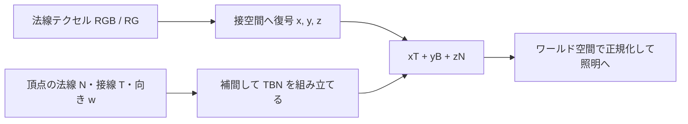

# 法線マップと接空間 — TBN・MikkTSpace・チャンネル規約

法線マップは、面の小さな凹凸を照明計算に反映するため、テクセルごとに法線の向きを持つ。平らな面でも、斜めの法線を使えば光の当たり方が変わる。頂点の位置や輪郭も変えたい場合は、変位など、位置を変更する処理が必要になる。

## テクセルから照明計算まで

接空間は、その面の上に置いた局所座標系。`T` は UV の `u` が増える方向、`B` は `v` が増える方向に対応し、`N` は面の法線を表す。正規直交な基底を使うと、接空間の `n = (x, y, z)` をワールド空間へ変換する式は `nWorld = normalize(xT + yB + zN)` になる。この線形結合を明示すると、行列の行・列や `mul` の引数順による混乱を避けられる。



glTF 2.0 の法線テクスチャは、線形の RGB に接空間の X・Y・Z を格納する。各成分を `2c - 1` で復号するので、`(0.5, 0.5, 1.0)` は `(0, 0, 1)`、つまり表面からまっすぐ外を向く法線になる。法線や粗さは数値データとして読み、テクスチャの sRGB デコードを無効にする。sRGB デコードがかかると 0.5 が約 0.214 に変わり、平らな法線まで傾く。

### 接線の符号と緑チャンネル

| 何を合わせるか | 合わせ方 |
| --- | --- |
| テクスチャの Y 成分 | テクスチャに書かれた Y の正負をランタイムの規約に合わせる。符号を反転するなら復号後に `y = -y`。 |
| UV アイランドの向き | glTF の `tangent.w` は `+1` または `-1`。`B = cross(N,T) * w` で、鏡像の UV に対応する。 |
| ベイク時の接空間 | ベイクと実行時で、接線生成・頂点分割・基底の補間や再構成をそろえる。 |

緑チャンネルの反転はテクスチャの規約を変換する処理。`tangent.w` はメッシュ上の局所的な基底の向きを表すので、両方を使う場合も、それぞれが補正する対象を確認する。モデル自体を負のスケールで反転してワールド空間で基底を組む場合は、変換行列の行列式の符号も `w` に掛ける。非一様スケールでは法線を逆転置行列で変換し、接線は位置の線形変換で変換する。

### MikkTSpace とベイクの一致

glTF 2.0 は接線がない場合に、位置・法線・法線テクスチャ用 UV から既定の MikkTSpace で接線を計算することを推奨している。MikkTSpace はメッシュの三角形と UV から接線基底を求める。ハードエッジ、UV の継ぎ目、鏡像 UV をまたぐ箇所では、同じ位置でも面の角ごとに別の基底が必要になることがある。基底が異なる角を、位置が同じという理由だけで単一頂点にまとめると、継ぎ目や反射の乱れにつながる。

MikkTSpace の実装資料は、ランタイムで使う補間と変換に合わせて、ベイク側で逆変換することも求めている。以下のコードは補間後に `T` を直交化し、`B` を再構成する例。使用するベイカーと、この再構成手順が一致していることを確認する。

## BC5 と Z の再構成

Direct3D の `DXGI_FORMAT_BC5_UNORM` は、4×4 テクセルごとに R と G を独立に圧縮する。1 ブロックは 16 バイト。法線の X と Y に使い、正の Z 半球を仮定できるときは `z = sqrt(max(0, 1 - x*x - y*y))` で Z を復元できる。たとえば `(x,y)=(0.6,0)` なら `z=0.8`。圧縮やフィルタリングで `x*x+y*y` が 1 を超えることがあるため、平方根の前で下限を設け、変換後に正規化する。`BC5_SNORM` を使うパイプラインでは、読み取り結果が符号付きなので `2c - 1` の変換を重ねない。

## コード例 — ワールド空間の法線を可視化する

HLSL のピクセルシェーダー。DXC の `ps_6_0`、エントリーポイント `main` を対象にする。頂点側からワールド空間の法線と接線を渡す。`tangentSign` にはメッシュとモデル変換の向きを反映し、三角形内で一定の符号を渡す。テクスチャ形式に応じて `useBC5` を切り替え、緑を反転する素材だけ `ySign` を `-1` にする。出力は検証用にワールド法線を `[0,1]` に写した色。

```hlsl
Texture2D<float4> normalMap : register(t0);
SamplerState normalSampler : register(s0);

cbuffer Material : register(b0)
{
    float ySign; // +1 or -1
    uint useBC5; // 1 for BC5_UNORM, 0 for RGB UNORM
};

struct PixelInput
{
    float2 uv : TEXCOORD0;
    float3 normalWorld : TEXCOORD1;
    float3 tangentWorld : TEXCOORD2;
    nointerpolation float tangentSign : TEXCOORD3;
};

float4 main(PixelInput input) : SV_Target
{
    float3 sampleValue = normalMap.Sample(normalSampler, input.uv).rgb;
    float3 tangentNormal = 2.0 * sampleValue - 1.0;
    tangentNormal.y *= ySign;
    if (useBC5 != 0)
    {
        float xyLengthSquared = dot(tangentNormal.xy, tangentNormal.xy);
        tangentNormal.z = sqrt(max(0.0, 1.0 - xyLengthSquared));
    }

    float3 normal = normalize(input.normalWorld);
    float3 tangent = normalize(input.tangentWorld
                             - normal * dot(normal, input.tangentWorld));
    float3 bitangent = input.tangentSign * cross(normal, tangent);
    float3 worldNormal = normalize(tangentNormal.x * tangent
                                 + tangentNormal.y * bitangent
                                 + tangentNormal.z * normal);
    return float4(worldNormal * 0.5 + 0.5, 1.0);
}
```

入力は長さが 0 でなく、有効な基底を持つメッシュを前提にする。継ぎ目を調べるときは、平らなテクスチャを使った出力と、X または Y だけ傾けた出力を比較すると、ベース法線と接線基底の問題を切り分けやすい。

## 理解度チェック

<details><summary>RGB が (0.5, 0.5, 1.0) の場合、T と B は結果にどう寄与する？</summary>

X と Y が 0 になるため寄与は 0。ワールド空間の結果は N と同じ向きになる。

</details>

<details><summary>BC5 から復号した X が 0.6、Y が 0 のとき、Z は？</summary>

正の半球なら `sqrt(1 - 0.36) = 0.8`。

</details>

<details><summary>鏡像 UV の継ぎ目だけで凹凸が反転する。まず何を調べる？</summary>

接線の符号が頂点データから届いているか、鏡像 UV を境に必要な頂点分割が行われているか、ベイクと実行時の基底が一致しているかを調べる。

</details>

## 関連項目

- [WebGPU実践でパラメーターを変える](/practice/graphics/shader-lab.html#normals)
- [シェーダーへ渡すデータ — 頂点属性・uniform・テクスチャ](/graphics/shader/shader-inputs-and-uniforms.html)
- [BRDF の中身 — Lambert・Blinn–Phong・GGX](/graphics/shader/brdf-internals.html)
- [色空間と HDR — リニア光量からディスプレイ出力まで](/graphics/shader/color-space-and-hdr.html)

## 参考資料

- [Khronos glTF 2.0 Specification — Meshes、Additional Textures](https://registry.khronos.org/glTF/specs/2.0/glTF-2.0.html)
- [Morten S. Mikkelsen — MikkTSpace の公開実装と利用上の注意](https://github.com/mmikk/MikkTSpace/blob/master/mikktspace.h)
- [Microsoft — Block Compression in Direct3D 10（BC5）](https://learn.microsoft.com/en-us/windows/win32/direct3d10/d3d10-graphics-programming-guide-resources-block-compression)
- [Microsoft — DXGI_FORMAT](https://learn.microsoft.com/en-us/windows/win32/api/dxgiformat/ne-dxgiformat-dxgi_format)
