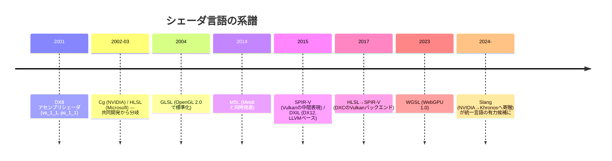
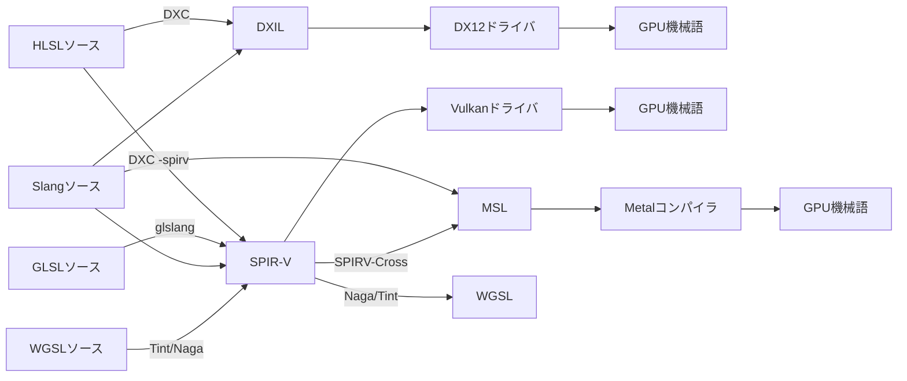

# シェーダ言語総論と比較

## 概要

シェーダ言語は**GPU上で実行されるプログラムを書くための言語**です。現在の主要言語は **HLSL** (DirectX/Unity/UE)、**GLSL** (OpenGL/Vulkan)、**WGSL** (WebGPU)、**MSL** (Metal) の4つで、いずれもC系構文の**データ並列言語**です。このページでは4言語+中間表現 (SPIR-V/DXIL) の全体地図と、言語間対応表を提供します。

## なぜ必要なのか

- C++等の汎用言語はSIMT実行・ベクトル型・テクスチャという GPU の実行モデルを表現できない
- クロスプラットフォーム開発では**1つのソースから複数言語/中間表現へ変換**するのが常識であり、言語間の対応関係の理解が必須
- エンジンのシェーダシステム (Unityのマルチコンパイル、UEのUSF) は全てこの変換パイプラインの上に構築されている

## 歴史・誕生した背景



- **アセンブリ時代 (2001)**: `mov oPos, v0` のような命令列。128命令制限
- **Cg/HLSL (2002-03)**: NVIDIAとMicrosoftがC風高級言語を共同設計し、その後分岐。Cgは2012年に開発終了
- **GLSL (2004)**: OpenGL ARBが「ドライバが直接コンパイルする」設計で標準化 — これが後に断片化の元凶に
- **中間表現の時代 (2015〜)**: ドライバごとのコンパイラ差異をなくすため、SPIR-V/DXILを挟む設計へ → [SPIR-V](/graphics/shader/spirv.html)
- **WGSL (2023)**: Web安全性の要求から新設計 → [WGSL](/graphics/shader/wgsl.html)

## それ以前の技術

固定機能のステート設定 (`glTexEnv`, register combiner) と、GPUベンダー独自の拡張群。

## 解決した課題

高級言語化により (1) 可読性・保守性、(2) 最適化コンパイラによるハードウェア差の吸収、(3) ライブラリ化・インクルードによる共有、が実現しました。中間表現は「同じソースがドライバによって違う結果になる」問題を解決しました。

## 現在の位置づけ

**実務の中心はHLSL**です。Unity・UE・DX12はもちろん、Vulkan開発でもDXC経由でHLSL→SPIR-Vが主流になりつつあります。GLSLはOpenGL資産とVulkanサンプルで現役、WGSLはWeb、MSLはApple専用です。将来的には **Slang** (HLSLスーパーセット、全ターゲット出力) への集約が進む可能性があります。

## 内部動作 — コンパイルパイプライン



重要ツール: **DXC** (HLSL公式コンパイラ)、**glslang** (GLSL→SPIR-V)、**SPIRV-Cross** (SPIR-V→各言語へ逆変換)、**Tint/Naga** (WGSL系)、**Slang**。UnityもUEもこの種の変換網を内部に持っています。

## 4言語対応表

### 基本型

| 概念 | HLSL | GLSL | WGSL | MSL |
|---|---|---|---|---|
| 32bit float | `float` | `float` | `f32` | `float` |
| ベクトル | `float3` | `vec3` | `vec3<f32>` / `vec3f` | `float3` |
| 行列 | `float4x4` | `mat4` | `mat4x4<f32>` | `float4x4` |
| 半精度 | `half` (SM6.2) | `float16_t` (拡張) | `f16` (拡張) | `half` |
| 整数 | `int` / `uint` | `int` / `uint` | `i32` / `u32` | `int` / `uint` |

### シェーダ入出力とリソース

| 概念 | HLSL | GLSL | WGSL | MSL |
|---|---|---|---|---|
| VS出力位置 | `SV_Position` | `gl_Position` | `@builtin(position)` | `[[position]]` |
| 頂点ID | `SV_VertexID` | `gl_VertexIndex` | `@builtin(vertex_index)` | `[[vertex_id]]` |
| 定数バッファ | `cbuffer` / `ConstantBuffer<T>` | `uniform` ブロック (UBO) | `var<uniform>` | `constant T&` |
| 構造化バッファ | `StructuredBuffer<T>` | SSBO (`buffer`) | `var<storage>` | `device T*` |
| テクスチャ | `Texture2D` + `SamplerState` | `sampler2D` (結合型) | `texture_2d<f32>` + `sampler` | `texture2d<float>` + `sampler` |
| サンプル | `tex.Sample(s, uv)` | `texture(tex, uv)` | `textureSample(t, s, uv)` | `tex.sample(s, uv)` |
| バインディング | `register(t0, space0)` | `layout(set=0, binding=0)` | `@group(0) @binding(0)` | `[[texture(0)]]` |
| Compute数 | `[numthreads(x,y,z)]` | `layout(local_size_x=...)` | `@workgroup_size(x,y,z)` | 起動側で指定 |
| グループ共有 | `groupshared` | `shared` | `var<workgroup>` | `threadgroup` |

### 言語仕様の性格の違い

| | HLSL | GLSL | WGSL | MSL |
|---|---|---|---|---|
| 管轄 | Microsoft | Khronos | W3C | Apple |
| エントリポイント | 任意名を指定 | `main` 固定 (ステージごとに1ファイル的) | `@vertex` 等の属性 | `[[vertex]]` 等 + 任意名 |
| テクスチャとサンプラ | 分離 | **結合** (Vulkan版は分離も可) | 分離 | 分離 |
| ポインタ | なし (SM6.6でRWバッファ経由) | なし | 制限付き参照 | **あり** (C++14ベース) |
| 未定義動作 | あり | あり | **排除 (Web安全性)** | あり |
| テンプレート/ジェネリクス | 限定的 | なし | なし | **C++テンプレート** |

## 各環境での扱い

### Unity
**HLSL**で記述 (ShaderLabコンテナ内)。各プラットフォームへはUnity内蔵の変換 (HLSLcc / DXC) でGLSL/SPIR-V/MSLに変換されます。`#pragma multi_compile` によるバリアント大量生成が特徴的。

### Unreal Engine
**HLSL** (`.usf` / `.ush`)。Shader Cross Compiler がSPIR-V経由で各プラットフォーム言語へ変換。マテリアルノードグラフ→HLSL生成→USFテンプレート合成という多段生成です。

### DirectX 12
HLSL + DXC → DXIL。SM6.x の Wave命令・RT・Mesh Shader等はHLSLが最速で仕様化されます。

### Vulkan
SPIR-Vのみを受け取る設計。ソース言語は自由 (GLSL or HLSL)。HLSLサポートは公式にDXCへ統合されており、実務ではHLSL派が増加中。

## コード例 — 同じFSを4言語で

「テクスチャ × 頂点色」のFragment Shader:

```hlsl
// HLSL
Texture2D tex : register(t0);
SamplerState smp : register(s0);
float4 PSMain(float4 pos : SV_Position, float2 uv : TEXCOORD0,
              float4 col : COLOR0) : SV_Target {
    return tex.Sample(smp, uv) * col;
}
```

```glsl
// GLSL (Vulkan)
layout(set = 0, binding = 0) uniform sampler2D tex;
layout(location = 0) in vec2 uv;
layout(location = 1) in vec4 col;
layout(location = 0) out vec4 fragColor;
void main() { fragColor = texture(tex, uv) * col; }
```

```wgsl
// WGSL
@group(0) @binding(0) var tex : texture_2d<f32>;
@group(0) @binding(1) var smp : sampler;
@fragment
fn fsMain(@location(0) uv : vec2f,
          @location(1) col : vec4f) -> @location(0) vec4f {
    return textureSample(tex, smp, uv) * col;
}
```

```cpp
// MSL
fragment float4 fsMain(VSOut in [[stage_in]],
                       texture2d<float> tex [[texture(0)]],
                       sampler smp [[sampler(0)]]) {
    return tex.sample(smp, in.uv) * in.col;
}
```

## 前提知識

- [パイプライン全体像](/graphics/pipeline/overview.html) — シェーダがどこで動くか

## 次に読むべきページ

- [HLSL](/graphics/shader/hlsl.html) — 最重要言語から
- [GLSL](/graphics/shader/glsl.html) → [WGSL](/graphics/shader/wgsl.html) → [MSL](/graphics/shader/msl.html)
- [SPIR-V と中間表現](/graphics/shader/spirv.html)

## 理解度チェック

1. **「中間表現 (SPIR-V/DXIL) を挟む」設計が解決した問題は何か。**
   ::: details 解答
   ドライバが高級言語ソースを直接コンパイルする方式(GLSL初期)では、ベンダーごとのコンパイラの方言・バグ・最適化差により同じソースが環境ごとに異なる挙動を示し、実行時コンパイルの時間も問題だった。中間表現を標準化することで、フロントエンド(構文解析・意味解析)をオフラインの単一ツールに集約し、ドライバは検証済みの単純なIRだけを受け取る形になり、移植性とロード時間が改善した。
   :::

2. **VulkanでHLSLを使うことが実務的に増えている理由を挙げよ。**
   ::: details 解答
   (1)DX12と共通ソースにでき、マルチプラットフォーム開発のシェーダ資産を一本化できる。(2)DXCが公式にSPIR-V出力をサポートし品質が安定した。(3)Wave命令・RT・Mesh Shader等の新機能がHLSL(SM6.x)で最初に整備されるため。
   :::

3. **WGSLが既存言語の採用ではなく新設計になった主因は何か。**
   ::: details 解答
   Webというサンドボックス環境では、未定義動作の排除・メモリ安全性・仕様の厳密性が必須要件であり、既存言語(GLSL/HLSL)は未定義動作や実装依存の挙動を大量に含むため。またSPIR-Vバイナリの直接採用はブラウザ側の検証・可読性・知財の観点で合意に至らなかった。
   :::

## 参考資料

- Microsoft, *HLSL Specifications* (GitHub: microsoft/hlsl-specs)
- Khronos, *GLSL Specification* / *SPIR-V Specification*
- W3C, *WGSL Specification*
- Apple, *Metal Shading Language Specification*
- shader-slang.org — Slang (次世代統一言語)
