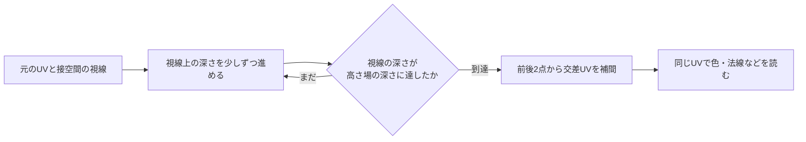

# 視差とデカール — 表面の凹凸と模様を重ねる

溝の中が斜めから見えなくなるのは、手前の盛り上がりが視線を遮るからです。**パララックスオクルージョンマッピング（POM）**は、テクスチャ上の高さ場と視線の交点を探して、この見え方を作ります。**投影デカール**は、既に描かれている壁や床に、汚れや印、弾痕などの材質を重ねる仕組みです。POMの入力は視線と高さ場、投影デカールの入力は表面の位置と投影領域です。

## POMで見えているUVを探す

高さ場の上端を深さ0、下端を1とし、接空間で表面からカメラへ向くベクトルを $V=(V_x,V_y,V_z)$ とします。上端を通るUVを $uv_0$、深さ1までの変位を決める係数を $s$ とすると、視線を奥へたどったときのUVは次の式になります。

$$
uv(d)=uv_0-ds\frac{(V_x,V_y)}{V_z}, \quad 0\le d\le1
$$

$V=(0.6,0,0.8)$、$s=0.04$ なら、深さ0.5での横方向の移動量は $0.5\cdot0.04\cdot0.6/0.8=0.015$ です。正面では $(V_x,V_y)$ がほぼ0になり、元のUVに近づきます。係数 $s$ はこの例ではUV上の尺度です。ワールド空間で同じ厚さに見せるには、面上の長さとUVの密度も考慮します。



各ステップで視線の深さとそのUVの高さ場の深さを比べます。差の符号が初めて変わった前後を補間すると、層の境界が見えにくくなります。ステップの間に細い山があると見落とすため、斜めから見るほどステップを増やす設計もあります。下の実装は固定24段です。POMでサンプル先を変えても、この実装ではポリゴンの輪郭や深度バッファの値は変わりません。隣接する面とのつなぎ目、UVの外へ進む場合、浅い視線角での大きな移動量は素材ごとに扱います。

## コード例 — 深さの差を補間して交点を求める

HLSL Shader Model 6.0のピクセルシェーダーです。`dxc -T ps_6_0 -E ParallaxPS Parallax.hlsl` でコンパイルできます。`DepthMap` は0が手前、1が奥の線形データです。白が手前の高さマップを素材に使う場合は事前に深さへ反転します。`ColorMap` と同じタイルの素材を想定し、サンプラーのアドレスモードをラップにします。

```hlsl
Texture2D<float> DepthMap : register(t0);
Texture2D<float4> ColorMap : register(t1);
SamplerState MaterialSampler : register(s0);

cbuffer Material : register(b0)
{
    float DepthScale;
};

struct PixelInput
{
    float2 uv : TEXCOORD0;
    float3 toCameraTS : TEXCOORD1;
};

float4 ParallaxPS(PixelInput input) : SV_Target
{
    const float2 uvDx = ddx(input.uv);
    const float2 uvDy = ddy(input.uv);
    const float3 view = normalize(input.toCameraTS);
    const uint layerCount = 24;
    const float stepDepth = 1.0 / layerCount;
    const float fade = smoothstep(0.08, 0.25, view.z);
    const float2 shift = fade * DepthScale * view.xy / max(view.z, 0.08);

    float2 previousUV = input.uv;
    float previousGap = -DepthMap.SampleGrad(MaterialSampler, previousUV, uvDx, uvDy);
    float2 hitUV = previousUV;
    if (previousGap < 0.0)
    {
        [loop]
        for (uint layer = 1; layer <= layerCount; ++layer)
        {
            const float rayDepth = layer * stepDepth;
            const float2 uv = input.uv - shift * rayDepth;
            const float surfaceDepth = DepthMap.SampleGrad(MaterialSampler, uv, uvDx, uvDy);
            const float gap = rayDepth - surfaceDepth;
            if (gap >= 0.0)
            {
                const float fraction = -previousGap / (gap - previousGap);
                hitUV = lerp(previousUV, uv, fraction);
                break;
            }
            previousUV = uv;
            previousGap = gap;
        }
    }
    return ColorMap.SampleGrad(MaterialSampler, hitUV, uvDx, uvDy);
}
```

ループに入る前に元のUVの微分を取り、各レーンでステップ数が違っても `SampleGrad` に明示的に渡します。これはミップ選択用の近似です。急な凹凸では実際の交点UVの変化が元のUVの変化と異なるので、距離による効果の減衰や素材のフィルタも確認します。

### POM のセルフシャドウ

視線との交点を求めた後、その位置からライトの向きへ同じ高さ場をたどると、溝の中に落ちる影を近似できます。深さが 0 の上端を基準に深くなる向きを正とし、光へ向かって深さ $d$ を減らします。高さ場から読んだ表面の深さが、その UV でのレイの深さより小さければ、レイはその箇所で表面の下に入り遮られます。交点で直ちに自分を遮蔽物にしないよう小さなバイアスを設け、ほぼ水平な光ではサンプル数の上限を決めます。Tatarchuk の方式は光方向の遮蔽を調べ、距離などを使ってソフトシャドウも近似します。高さ場の外側にいる物体へ投影される影には、別の形状やシャドウパスが必要です。

## 投影デカール — 既に描いた面の位置から模様を読む

デカールの向きと大きさを持つ箱を置き、箱の中にある受け手へ模様を投影します。画面空間で処理する場合、各ピクセルの画面座標と深度から逆ビュー投影行列でワールド座標を復元し、それをデカールのローカル座標に変換します。箱の外は捨て、箱の中は投影面の2軸でUVを作ります。カメラから見えている受け手の位置を使うので、模様を既存メッシュに合わせて曲げた形状を用意せずに済みます。

例えばDirect3Dで、ビューポート内の正規化スクリーンUVが左上原点なら、クリップ空間に渡す座標は `(2*u-1, 1-2*v, depth, 1)` です。通常のビューポート深度範囲 `[0,1]` を前提とし、深度生成時と同じ射影の逆行列を掛け、結果を `w` で割ります。反転Zを使う場合も、深度を生成した射影と復元に使う逆射影をそろえます。

| 合成の段階 | 読むものと書くもの |
| --- | --- |
| 投影位置の計算 | 深度から受け手の位置を復元し、デカールの範囲内か調べる |
| 材質の合成 | 色、法線、粗さなどのうち必要なチャンネルだけを、材質のブレンド方式に従って書く |
| 照明 | デカールを反映した材質で照明を評価する |

Unreal Engine 5.8では、DBufferデカールはBase Passの前にDBufferへ書き、受け手のBase Passで読みます。GBufferを使う経路では、Base Passの後、ライティングの前にGBufferへブレンドします。利用される経路はプラットフォームとレンダラーによって変わります。投影箱が床と壁を同時に含む場合は、デカールを受ける対象の設定や、投影方向と法線の角度で重なりを制限します。

### 法線と書き込み先を分ける

独自のディファードデカールでは、色だけを変えるときに GBuffer の法線・粗さを上書きしないよう、MRT の書き込みマスクやパスを分けます。法線を合成する場合は、受け手とデカールを同じ空間にそろえ、合成後に正規化します。オクタヘドラルなどの符号化済み法線をそのまま補間すると、復号後の方向が意図した混合になりません。受け手の法線を読む必要がある場合は別のバッファで参照できるようにし、読み書きの同期を決めます。UE 5.8 の DBuffer を受ける材質では **Decal Response** で Color、Normal、Roughness の組を選べます。受け手のグラフから DBuffer を手動適用する場合は、自動適用を None にして二重適用を避けます。

### コード例 — 深度からデカールの UV を復元する

HLSL Shader Model 6.0 の `ps_6_0`、エントリーは `DecalPS`。ビューポートは左上原点で描画先と同じサイズ、深度範囲は 0〜1。深度だけでは有限遠平面のクリア値と面を区別できないため、ここでは `OpaqueMask` に受け手が描かれたピクセルを 1 として用意します。`WorldToDecal` はワールドから各軸 $[-0.5,0.5]$ の箱へ変換します。コードは線形のデカール色だけを返し、出力先にはストレートアルファ合成を設定します。元の GBuffer 法線と粗さはこのパスの出力に含めません。

```hlsl
Texture2D<float> DeviceDepth : register(t0);
Texture2D<uint> OpaqueMask : register(t1);
Texture2D<float4> DecalColor : register(t2);
SamplerState DecalSampler : register(s0);

cbuffer DecalSettings : register(b0)
{
    float4x4 WorldFromClip;
    float4x4 WorldToDecal;
    float2 InvViewportSize;
};

float4 DecalPS(float4 position : SV_Position) : SV_Target
{
    int2 pixel = int2(position.xy);
    if (OpaqueMask.Load(int3(pixel, 0)) == 0u)
        discard;
    float z = DeviceDepth.Load(int3(pixel, 0));
    float2 uv = position.xy * InvViewportSize;
    float4 worldH = mul(WorldFromClip, float4(2.0 * uv.x - 1.0, 1.0 - 2.0 * uv.y, z, 1.0));
    if (abs(worldH.w) < 1e-6)
        discard;
    float3 local = mul(WorldToDecal, float4(worldH.xyz / worldH.w, 1.0)).xyz;
    if (any(abs(local) > 0.5))
        discard;
    return DecalColor.SampleLevel(DecalSampler, local.xy + 0.5, 0.0);
}
```

箱のローカル位置が $(0.25,-0.125,0)$ なら UV は $(0.75,0.375)$ です。ここでは箱の境界をまたぐ画面微分の扱いを分けるため、ミップ 0 を指定しています。実用時は縮小表示のちらつきを抑えるために、周辺の受け手の深度が連続することを確認してから勾配や LOD を求めます。

## 理解度チェック

1. 法線マップだけで溝の手前の縁が奥を隠すようにできる？
2. POMで1つ前の層と交差した層の差を使う理由は？
3. 床に置いたデカールがすぐ横の壁にも映る。何を調べる？

::: details 解答
1. 通常の法線マッピングが変えるのは照明に使う向きです。視線との交点に応じてUVを変えるPOMなら、手前にある凹凸の模様を選べます。
2. その2点の間で視線と高さ場の前後関係が入れ替わるからです。差が0になる位置を補間し、サンプル間隔による段差を抑えます。
3. 壁の表面位置が投影箱に入っているか調べます。箱を狭める、受け手を限定する、面の向きで除外する方法があります。
:::

## 関連項目

- [法線マップと接空間](/graphics/shader/normal-mapping.html)
- [ディファードレンダリング](/graphics/path/deferred.html)
- [テクスチャのフィルタリングとミップマップ](/graphics/texture/texture-filtering-and-mipmaps.html)

## 参考資料

- [Natalya Tatarchuk、Dynamic parallax occlusion mapping with approximate soft shadows（I3D 2006）](https://doi.org/10.1145/1111411.1111423)
- [Microsoft、HLSLのSampleGrad](https://learn.microsoft.com/en-us/windows/win32/direct3dhlsl/dx-graphics-hlsl-to-samplegrad)
- [Microsoft、Direct3D 11.3機能仕様のビューポート変換（15.6節）](https://microsoft.github.io/DirectX-Specs/d3d/archive/D3D11_3_FunctionalSpec.htm)
- [Epic Games、Decal Materials（Unreal Engine 5.8）](https://dev.epicgames.com/documentation/unreal-engine/decal-materials-in-unreal-engine?application_version=5.8)

- [Epic Games — EMaterialDecalResponse（Unreal Engine 5.8、受け手の材質設定）](https://dev.epicgames.com/documentation/unreal-engine/API/Runtime/Engine/EMaterialDecalResponse?application_version=5.8)
