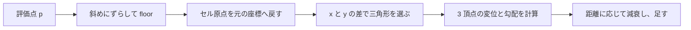
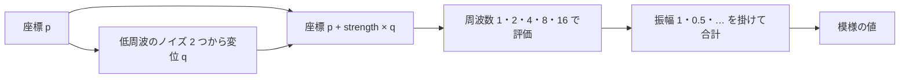

# ノイズと手続き的テクスチャ — 格子・fBm・ドメインワープ

座標から模様を作るときは、同じ場所に対して毎フレーム同じ値が必要になる。格子点をハッシュして値や方向を決め、隣接点の寄与を滑らかに合成すると、連続した模様を作れる。模様を重ねる操作と、模様を読む座標を曲げる操作では、見え方も計算量も変わる。

## 格子点のハッシュとノイズの種類

2D の値ノイズでは、座標 `p` から `cell = floor(p)` と `f = p - cell` を求める。セルの四隅を整数座標でハッシュし、各隅へ値を割り当てる。補間の重みを `s(t)=6t^5-15t^4+10t^3` とすれば、`s(0)=0`、`s(1)=1` で、両端の一階・二階微分は 0。隣り合うセルが格子点の値を共有するため、境界で値が飛ばない。

| 種類 | 格子点で決めるもの | 2D での合成 |
| --- | --- | --- |
| 値ノイズ | スカラー値 | 四隅の値を X・Y 方向に補間する。 |
| Perlin の勾配ノイズ | 勾配ベクトル | 四隅で勾配と変位の内積を求め、補間する。 |
| Simplex ノイズ | 勾配ベクトル | 座標をずらして三角形セルを特定し、3 頂点の内積を距離に応じて減衰させて足す。 |

Improved Perlin Noise の参照実装は 3D で、立方体の 8 隅を使う。Simplex の GLSL 実装を読むと、2D では 3 頂点の寄与に `max(0.5 - dot(d,d), 0)^4` の重みを掛けている。選ぶべき実装は、求める模様、評価する次元、命令やメモリーの測定結果で変わる。

### sin ハッシュと PCG の比較

ハッシュの入力は評価点の小数座標から切り出した整数の格子座標。セルの右上の勾配と、隣のセルの左下の勾配が同じ座標を指すなら、ハッシュも同じ値を返す必要がある。シードを固定すれば、描画スレッドの実行順序に関係なく同じ値を取り出せる。ハッシュの出力を画像として見る場合は補間を外し、格子点をそのままピクセルへ割り当てる。補間してからでは、隣接点の相関が見つけにくい。

`frac(sin(dot(float2(cell), float2(12.9898, 78.233))) * 43758.5453)` の形は、整数座標を浮動小数点の角度一つに折り畳む。`sin` 自体が周期関数で、近い位相に落ちた入力は似た値を作る。さらに大きな定数を掛けてから小数部を取るため、浮動小数点の丸めが模様に出る。たとえば積が 32,768〜65,536 の範囲では、32 ビット浮動小数点の隣り合う値の間隔は `2^(15−23) = 1/256`。この範囲の積から取り出せる小数部は 256 通りに限られる。格子座標が大きくなれば、内積の丸めで別の座標が同じ角度になる場合もある。Jarzynski と Olano の比較では、検証した三角関数ハッシュに帯や反復が見られた。 [Hash Functions for GPU Rendering（2020）、図 1](https://jcgt.org/published/0009/03/02/)

PCG-RXS-M-XS をハッシュとして使う例では、入力 `u` から線形合同式で中間値 `s` を作り、上位ビットに応じたシフト、XOR、乗算、最後の XOR シフトでビットを混ぜる。乗算と加算は 32 ビット符号なし整数の下位 32 ビットを使う。

```text
s = u × 747796405 + 2891336453       mod 2^32
w = ((s >> ((s >> 28) + 4)) XOR s) × 277803737    mod 2^32
hash(u) = (w >> 22) XOR w
```

これを 1 入力・1 出力のハッシュとして使い、下のコードでは `hash(x XOR hash(y XOR seed))` として 2 次元の格子を混ぜる。`int` の座標を `asuint` で読み直すので、負の座標もビット列のまま使える。格子からスカラー値を作るときは、上位 24 ビットを `2^24` で割れば、32 ビット浮動小数点で表せる `[0,1)` の値になる。勾配を 8 方向から選ぶときは、3 ビットを使えば各方向の割り当て数を同じにできる。 [O’Neill — PCG（2014）](https://www.pcg-random.org/pdf/hmc-cs-2014-0905.pdf)、[pcg-c の参照実装](https://github.com/imneme/pcg-c/blob/master/include/pcg_variants.h)

| 観察するもの | 見る場所 |
| --- | --- |
| 縞・斜線・周期 | 同じ大きさの格子画像で、近接点の値が方向ごとに並んでいないかを見る。 |
| 入力の精度 | 原点付近と、座標に大きなオフセットを加えた位置で比較する。 |
| 値の分布 | ヒストグラムで偏りを、隣接画素の相関で繰り返しを調べる。一方が揃っていても他方には偏りがあり得る。 |
| GPU 時間 | 評価回数を揃え、シェーダーの同じ位置で置き換えて測る。ベンダーや最適化で命令コストが変わる。 |

1 次元の PCG の性質を、座標の混ぜ方を含む 2 次元全体にそのまま移せるわけではない。2 個の 32 ビット入力を 1 個の 32 ビット値に縮めるので衝突は起きる。局所的な相関が問題になる用途では、入力を座標の形のまま混ぜる `pcg3d` などの多次元ハッシュも候補になる。PCG に置き換えても、その前段で `float2` の位置から小数部が失われていればノイズは細部を取り戻せない。広いワールドでは、整数のタイル原点をハッシュ側に加え、描画側ではタイル内の位置で変位を計算する。

### Perlin — 四隅の内積と補間関数

格子点 `c` に単位勾配 `g(c)` を一つ割り当て、評価点 `p` に対する寄与を `g(c)·(p−c)` とする。勾配に沿う位置は正、逆向きは負になる。格子点そのものでは変位がゼロなので、勾配ノイズの値もゼロになる。値ノイズの格子点は、ハッシュで割り当てた値を返す。

Perlin の 2002 年版では補間重みに `s(t)=6t⁵−15t⁴+10t³` を使う。これは `s(0)=0`、`s(1)=1` に加え、両端で一階と二階の微分を 0 にした五次式。`s'(t)=30t²(t−1)²`、`s''(t)=60t(2t−1)(t−1)` なので条件を満たす。三次の `3t²−2t³` は両端で一階微分が 0 だが、二階微分は両端で ±6。法線を高さの微分から作る場合、補間関数の二階微分の飛びが、法線の変化率の不連続として見えることがある。 [Ken Perlin — Improving Noise（2002）](https://mrl.cs.nyu.edu/~perlin/paper445.pdf)

下の HLSL は、3D の参照実装と同じ五次補間を 2D の四隅に適用する。勾配は 4 本の軸方向と 4 本の対角方向を用意し、長さを 1 に揃える。各軸に対して偏らない対称な選択肢を用意しても、評価格子には軸の向きがある。地形に格子が見える場合は、ハッシュと勾配の分布を調べたうえで、入力を回転して見え方がどう変わるかを確認する。

| 順番 | シード 0、評価点 `p=(0.25, 0.5)` での計算 |
| --- | --- |
| 四隅の勾配番号 | `(0,0), (1,0), (0,1), (1,1)` の順に `6, 0, 2, 6` |
| 内積 | 同じ順で約 `−0.176777, −0.750000, −0.500000, −0.176777` |
| 補間重み | `s(0.25)=0.103515625`、`s(0.5)=0.5` |
| 結果 | X、Y の順に補間すると約 `−0.351328`。コードの振幅調整を掛ける前の値。 |

### Simplex — 三角形の選択と距離減衰

2D Simplex では、最初に座標の和に比例する値を両軸へ加え、傾いた格子を整数のセルとして扱える座標に写す。元の空間では、このセルは正三角形二枚からなるひし形。`F=(√3−1)/2`、`G=(3−√3)/6` とすると、セルの位置は `i=floor(p + F(px+py))`。原点を逆変換した位置は `i−G(ix+iy)` になる。行列で見ると、全成分が 1 の行列 `U` について順変換は `I+FU`、逆変換は `I−GU`。`U²=2U` なので `G=F/(1+2F)` とすると積が単位行列になる。 [Stefan Gustavson — Simplex Noise Demystified](https://itn-web.it.liu.se/~stegu76/TNM084-2011/simplexnoise-demystified.pdf)



原点からの変位 `d0` の X が Y より大きい場合、中間頂点は整数格子で `i+(1,0)`。それ以外は `i+(0,1)` を選ぶ。終点はどちらも `i+(1,1)`。3 頂点それぞれで変位 `d` と勾配 `g` を使い、`max(0.5−d·d,0)^4 × (g·d)` を足す。半径 `√0.5` を超えた頂点の寄与は 0。正三角形の辺の長さは `√(2/3)`、高さは `√0.5` なので、辺をまたいで候補が入れ替わるとき、入れ替わる頂点の寄与は辺上で 0 になる。共有する 2 頂点では同じ格子座標から勾配を得るので、辺で値が飛ばない。 [Ashima Arts・Gustavson ほか — 2D Simplex の GLSL 実装](https://github.com/stegu/webgl-noise/blob/master/src/noise2D.glsl)

`p=(0.25,0.5)`、シード 0 なら `i=(0,0)`。中間頂点は `(0,1)` で、変位は約 `(0.461325,−0.288675)`。3 頂点の寄与の合計は約 `−0.00467638`、コードの倍率 32 を掛けると約 `−0.149644` になる。倍率は勾配の選び方と合わせて決める。この例の 32 は、各勾配を単位長とした場合の控えめな調整値。寄与の絶対値を `r(0.5−r²)^4` で抑え、微分して得られる最大点 `r²=1/18` を代入すると、3 頂点を合算して 32 倍しても上限は約 0.883。公開 GLSL 実装の勾配や倍率を混ぜて使うと、期待する振幅が変わる。

## fBm とドメインワープ

描画で fBm と呼ぶ手法の一例は、周波数を上げながら振幅を下げたノイズを何層か足す方法。1 層目の周波数と振幅を 1 とし、各層で周波数を 2 倍、振幅を 0.5 倍すると、5 層の振幅は `1, 0.5, 0.25, 0.125, 0.0625`。重みの合計は `1.9375`。サンプルはこの合計で割り、元の値ノイズと同じ値域で見比べられるようにする。

ドメインワープは、ノイズの入力座標を別の場で動かす操作。`p' = p + strength * q(p)` とし、最後のノイズを `p'` で評価する。`q` の X・Y を異なるオフセットから作ると、両軸がいつも同じ値になるのを避けられる。



模様がピクセルより細かくなると、カメラ移動に伴ってちらつく。ピクセルシェーダーでは `ddx` と `ddy` から座標の画面上での変化を見積もり、細かすぎる層の重みを下げる方法がある。ワープの後に評価する場を調べるときは、変形後の座標の変化も考慮する。

### オクターブ・ラクナリティ・ゲイン・H

平均が 0 に近い基底ノイズを `n(p)` とする。層を `k=0,…,N−1` とし、基準周波数 `f0`、基準振幅 `A0`、周波数比 `λ`、振幅比 `g` を使うと、有限の和は次の形になる。

```text
f(k) = f0 × λ^k
A(k) = A0 × g^k
F(p) = Σ A(k) × n(f(k) × p + offset(k))
```

| パラメーター | 画像で変わるところ |
| --- | --- |
| オクターブ数 `N` | 何層を足すか。増やすと細部が増え、各点で評価する回数も増える。 |
| ラクナリティ `λ` | 隣り合う層の周波数比。2 なら周波数が 2 倍、代表的な模様の幅は半分。大きくすると層どうしの模様の大きさが離れる。 |
| ゲイン `g` | 隣り合う層の振幅比。1 より小さくすると細部が弱まり、1 に近いほど細部が残る。 |
| Hurst 指数 `H` | 縮尺に対する振幅の減り方。周波数比を固定すると、H が小さいほど細部が強く残る。 |

振幅を模様の大きさの `H` 乗に比例させると、各層で大きさが `1/λ` 倍になるため、`g=(1/λ)^H=λ^-H`。したがって `H=−log(g)/log(λ)`。元の例の `λ=2, g=0.5` はこの関係では `H=1` に当たる。ここでいう fBm は描画で使う有限のノイズ和で、パラメーターを合わせても数学上の分数ブラウン運動そのものにはならない。 [Mandelbrot — Random fractals: Self-affinity in noise, music, mountains, and clouds](https://research.ibm.com/publications/random-fractals-self-affinity-in-noise-music-mountains-and-clouds)

| `λ=2`、5 層での `H` | ゲイン | 最も細かい層の振幅（第 1 層を 1 とする） | 振幅の合計 |
| ---: | ---: | ---: | ---: |
| 0.25 | 0.840896 | 0.500000 | 3.642607 |
| 0.50 | 0.707107 | 0.250000 | 2.810660 |
| 0.75 | 0.594604 | 0.125000 | 2.283381 |
| 1.00 | 0.500000 | 0.062500 | 1.937500 |

この表の合計は、`g≠1` なら `(1−g^N)/(1−g)`。コードではその合計で割り、パラメーターを変えても表示用の値域を揃える。高さや変位として出力する場合は、同じ高さの単位で細部を足せるよう `A0` を決め、振幅を正規化するかどうかも設計に含める。各層のオフセットやシードを変えると、層どうしの格子の揃い方を変えられる。 [Ryan Geiss — Generating Complex Procedural Terrains Using the GPU](https://developer.nvidia.com/gpugems/gpugems3/part-i-geometry/chapter-1-generating-complex-procedural-terrains-using-gpu)

### ピクセル内に収まらない層を弱める

画面上で隣のピクセルへ移ったとき、サンプル座標がノイズの何セル分動くかを `ρ = max(length(ddx(p)), length(ddy(p)))` で見積もる。層 `k` の入力に `λ^k` を掛けるなら、同じ量は `ρ × λ^k`。たとえば `ρ=0.125`、`λ=2` なら、層ごとに 0.125、0.25、0.5、1、2 セル/ピクセルになる。下のコードは `1−smoothstep(0.25, 0.5, ρ×λ^k)` で高周波を減衰させる。0.25 と 0.5 はノイズの見え方を調整する値。基底ノイズ自体の周波数帯には幅があるので、これは厳密な面積積分の代わりに使う近似。 [GPU Gems — High-Quality Filtering](https://developer.nvidia.com/gpugems/gpugems/part-iv-image-processing/chapter-24-high-quality-filtering)

ドメインワープを使うときは変形後の座標から `ρ` を測る。たとえば変位によって模様が横に詰まる場所では、同じ基準周波数でも 1 ピクセルの中に入るセル数が増える。減衰後の和を元の全層の振幅で割れば、カメラを遠ざけて細部を落としても、残った粗い層の振幅が急に強くならない。ワープを掛けるノイズ自体の周波数が高い場合は、その場の評価にも帯域制限が必要になる。

## コード例 — 同じ座標で 3 種類の模様を比べる

HLSL の `ps_6_0`。`mode=0` は値ノイズ、`1` は 5 層を重ねた fBm、`2` は座標を曲げた fBm。`scale` で基準の周波数、`warpStrength` で変位を調整する。ハッシュは符号付き格子座標のビット列を符号なし整数として混ぜ、上位 24 ビットを `[0,1)` の浮動小数点値に変える。入力は `int2` に収まる格子座標を持ち、浮動小数点でセル内の小数部を表現できる範囲に収める。

```hlsl
cbuffer NoiseSettings : register(b0)
{
    float scale;
    float warpStrength;
    uint mode;
    uint seed;
};

uint hashCell(int2 cell)
{
    uint h = asuint(cell.x) * 0x9e3779b9u
           ^ asuint(cell.y) * 0x85ebca6bu
           ^ seed;
    h ^= h >> 16;
    h *= 0x7feb352du;
    h ^= h >> 15;
    h *= 0x846ca68bu;
    return h ^ (h >> 16);
}

float cornerValue(int2 cell)
{
    return float(hashCell(cell) >> 8) * (1.0 / 16777216.0);
}

float valueNoise(float2 p)
{
    int2 cell = int2(floor(p));
    float2 f = frac(p);
    float2 weight = f * f * f * (f * (6.0 * f - 15.0) + 10.0);
    float lower = lerp(cornerValue(cell), cornerValue(cell + int2(1, 0)), weight.x);
    float upper = lerp(cornerValue(cell + int2(0, 1)),
                       cornerValue(cell + int2(1, 1)), weight.x);
    return lerp(lower, upper, weight.y);
}

float fbm(float2 p)
{
    float value = 0.0;
    float amplitude = 1.0;
    for (uint octave = 0; octave < 5; ++octave)
    {
        value += amplitude * valueNoise(p);
        p = 2.0 * p + float2(7.31, 3.17);
        amplitude *= 0.5;
    }
    return value / 1.9375;
}

float4 main(float2 uv : TEXCOORD0) : SV_Target
{
    float2 p = uv * scale;
    if (mode == 2)
    {
        float2 lowFrequency = 0.45 * p;
        float2 warp = float2(valueNoise(lowFrequency + float2(4.7, 1.3)),
                             valueNoise(lowFrequency + float2(9.2, 8.3))) - 0.5;
        p += warpStrength * warp;
    }
    float value = mode == 0 ? valueNoise(p) : fbm(p);
    return float4(value, value, value, 1.0);
}
```

同じ `seed` と `scale` で切り替えると、重ねる層が増えたときの細かさと、座標を曲げたときの流れの違いを見比べられる。`mode=2` で `warpStrength=0` にすると `mode=1` と同じ模様になる。このコードは比較のために各層をそのまま加算しており、高周波の抑制は含めていない。

### コード例 — Perlin と Simplex を同じ勾配で比較する

HLSL の `ps_6_0`。`mode=0/1` はそれぞれ sin ハッシュと PCG の格子を表示する。`mode=2/3` は Perlin と Simplex を同じ勾配集合とシードで比較する。`mode=4` では Perlin を基底にして、H から求めたゲインで fBm を合成する。`filterOctaves` を 1 にすると、スクリーン上で小さくなった層を弱める。Perlin と Simplex の表示倍率は独立に決めているので、比較では階調に加えて軸方向の筋やセル境界を見る。

```hlsl
cbuffer NoiseControls : register(b0)
{
    float scale;
    float lacunarity;
    float hurst;
    uint octaveCount;
    uint mode;
    uint seed;
    uint filterOctaves;
    float padding;
    float2 coordinateOffset;
};

static const float2 gradients[8] =
{
    float2(1, 0), float2(-1, 0), float2(0, 1), float2(0, -1),
    float2(0.70710678, 0.70710678), float2(-0.70710678, 0.70710678),
    float2(0.70710678, -0.70710678), float2(-0.70710678, -0.70710678)
};

uint pcgHash(uint input)
{
    uint state = input * 747796405u + 2891336453u;
    uint word = ((state >> ((state >> 28u) + 4u)) ^ state) * 277803737u;
    return (word >> 22u) ^ word;
}

uint hashCell(int2 cell, uint cellSeed)
{
    return pcgHash(asuint(cell.x) ^ pcgHash(asuint(cell.y) ^ cellSeed));
}

float sinHash(int2 cell)
{
    return frac(sin(dot(float2(cell), float2(12.9898, 78.233))) * 43758.5453);
}

float gradientDot(int2 cell, float2 displacement, uint cellSeed)
{
    return dot(gradients[hashCell(cell, cellSeed) & 7u], displacement);
}

float perlin2(float2 p, uint cellSeed)
{
    int2 cell = int2(floor(p));
    float2 f = frac(p);
    float2 w = f * f * f * (f * (6.0 * f - 15.0) + 10.0);
    float bottomLeft = gradientDot(cell, f, cellSeed);
    float bottomRight = gradientDot(cell + int2(1, 0), f - float2(1, 0), cellSeed);
    float topLeft = gradientDot(cell + int2(0, 1), f - float2(0, 1), cellSeed);
    float topRight = gradientDot(cell + int2(1, 1), f - float2(1, 1), cellSeed);
    return lerp(lerp(bottomLeft, bottomRight, w.x),
                lerp(topLeft, topRight, w.x), w.y);
}

float simplexCorner(int2 cell, float2 d, uint cellSeed)
{
    float t = max(0.5 - dot(d, d), 0.0);
    t *= t;
    return t * t * gradientDot(cell, d, cellSeed);
}

float simplex2(float2 p, uint cellSeed)
{
    const float skew = 0.366025403784439;
    const float unskew = 0.211324865405187;
    int2 cell = int2(floor(p + (p.x + p.y) * skew));
    float2 d0 = p - float2(cell) + (float(cell.x) + float(cell.y)) * unskew;
    int2 middle = d0.x > d0.y ? int2(1, 0) : int2(0, 1);
    float2 d1 = d0 - float2(middle) + unskew;
    float2 d2 = d0 - 1.0 + 2.0 * unskew;
    return 32.0 * (simplexCorner(cell, d0, cellSeed)
                 + simplexCorner(cell + middle, d1, cellSeed)
                 + simplexCorner(cell + int2(1, 1), d2, cellSeed));
}

float layeredNoise(float2 p, float footprint)
{
    float lambda = max(lacunarity, 1.0001);
    float gain = pow(lambda, -saturate(hurst));
    float frequency = 1.0;
    float amplitude = 1.0;
    float total = 0.0;
    float normalization = 0.0;
    uint count = clamp(octaveCount, 1u, 10u);
    for (uint k = 0u; k < count; ++k)
    {
        float w = filterOctaves != 0u
                ? 1.0 - smoothstep(0.25, 0.5, footprint * frequency)
                : 1.0;
        if (w > 0.0)
            total += amplitude * w * perlin2(p * frequency, seed + k);
        normalization += amplitude;
        amplitude *= gain;
        frequency *= lambda;
    }
    return total / normalization;
}

float4 main(float2 uv : TEXCOORD0) : SV_Target
{
    float2 p = uv * scale + coordinateOffset;
    float footprint = max(length(ddx(p)), length(ddy(p)));
    float value;
    if (mode == 0u)
        value = sinHash(int2(floor(p)));
    else if (mode == 1u)
        value = float(hashCell(int2(floor(p)), seed) >> 8u) * (1.0 / 16777216.0);
    else if (mode == 2u)
        value = 0.5 + 0.5 * perlin2(p, seed);
    else if (mode == 3u)
        value = 0.5 + 0.5 * simplex2(p, seed);
    else
        value = 0.5 + 0.5 * layeredNoise(p, footprint);
    return float4(value.xxx, 1.0);
}
```

`mode=0/1` は `scale` を 512 程度にし、同じ `coordinateOffset` のまま切り替える。sin 側は比較のため係数を固定しているので、PCG だけが `seed` に応じて変わる。`mode=4` は `scale=8, lacunarity=2, octaveCount=5` として `hurst=0.25/0.75` を比べると、低い H で細部が強く残る。入力範囲は最も細かい層でもセル内の位置が `float2` に残るようにする。三角形選択に使う斜めの座標でも整数変換できる範囲を超えないようにする。

## 理解度チェック

<details><summary>値ノイズと Perlin の勾配ノイズは、四隅の何を補間する？</summary>

値ノイズでは格子点に割り当てた値。勾配ノイズでは、格子点に割り当てた方向と評価点までの変位の内積。

</details>

<details><summary>振幅を 1 から半分ずつにして 3 層を足す。合計の重みは？</summary>

`1 + 0.5 + 0.25 = 1.75`。

</details>

<details><summary>ドメインワープは、出力の色を混ぜる処理とどこが違う？</summary>

元の模様を評価する位置を動かす。そのため境界や模様の筋そのものが曲がる。

</details>

<details><summary>補間後のノイズに縞が見えたら、ハッシュのせいか格子の向きのせいかをどう調べる？</summary>

補間前の格子をピクセルに表示し、隣接座標の値の相関を見る。格子を直接表示しても縞があればハッシュ側を調べる。補間後にだけ現れるなら勾配の方向や補間、ピクセルに対する周波数を調べる。

</details>

<details><summary>ラクナリティを 2 に固定して H を 0.75 から 0.25 に変えると、5 層目の振幅はどうなる？</summary>

第 1 層を 1 とすると、`2^(-4H)` は 0.125 から 0.5 になる。正規化前の 5 層目が 4 倍になり、粗い層に対して細部が強く残る。

</details>

## 関連項目

- [WebGPU実践でパラメーターを変える](/practice/graphics/shader-lab.html#noise)
- [HLSL](/graphics/shader/hlsl.html)
- [テクスチャのフィルタリングとミップマップ](/graphics/texture/texture-filtering-and-mipmaps.html)
- [シェーダーのデバッグ — 値の可視化と NaN の追跡](/graphics/shader/shader-debugging.html)

## 参考資料

- [Ken Perlin — Improved Noise reference implementation（2002）](https://mrl.cs.nyu.edu/~perlin/noise/)
- [Ian McEwan・Stefan Gustavson ほか — 2D Simplex Noise の GLSL 実装](https://github.com/stegu/webgl-noise/blob/master/src/noise2D.glsl)
- [Ryan Geiss — Generating Complex Procedural Terrains Using the GPU（NVIDIA GPU Gems 3）](https://developer.nvidia.com/gpugems/gpugems3/part-i-geometry/chapter-1-generating-complex-procedural-terrains-using-gpu)
- [Jarzynski・Olano — Hash Functions for GPU Rendering（JCGT、2020）](https://jcgt.org/published/0009/03/02/)
- [Melissa E. O’Neill — PCG（2014）](https://www.pcg-random.org/pdf/hmc-cs-2014-0905.pdf)
- [Melissa E. O’Neill — PCG-RXS-M-XS の参照実装](https://github.com/imneme/pcg-c/blob/master/include/pcg_variants.h)
- [Ken Perlin — Improving Noise（SIGGRAPH、2002）](https://mrl.cs.nyu.edu/~perlin/paper445.pdf)
- [Stefan Gustavson — Simplex Noise Demystified（2005）](https://itn-web.it.liu.se/~stegu76/TNM084-2011/simplexnoise-demystified.pdf)
- [Benoit B. Mandelbrot — Random fractals: Self-affinity in noise, music, mountains, and clouds](https://research.ibm.com/publications/random-fractals-self-affinity-in-noise-music-mountains-and-clouds)
- [Kevin Bjorke — High-Quality Filtering（NVIDIA GPU Gems）](https://developer.nvidia.com/gpugems/gpugems/part-iv-image-processing/chapter-24-high-quality-filtering)
