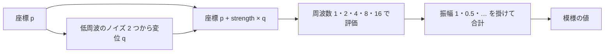

# ノイズと手続き的テクスチャ — 格子・fBm・ドメインワープ

座標から模様を作るときは、同じ場所に対して毎フレーム同じ値が必要になる。格子点をハッシュして値や方向を決め、隣接点の寄与を滑らかに合成すると、連続した模様を作れる。模様を重ねる操作と、模様を読む座標を曲げる操作では、見え方も計算量も変わる。

## 格子点のハッシュとノイズの種類

2D の値ノイズでは、座標 `p` から `cell = floor(p)` と `f = p - cell` を求める。セルの四隅を整数座標でハッシュし、各隅へ値を割り当てる。補間の重みを `s(t)=6t^5-15t^4+10t^3` とすれば、`s(0)=0`、`s(1)=1` で、両端の一階・二階微分は 0。隣り合うセルが格子点の値を共有するため、境界で値が飛ばない。

| 種類 | 格子点で決めるもの | 2D での合成 |
| --- | --- | --- |
| 値ノイズ | スカラー値 | 四隅の値を X・Y 方向に補間する。 |
| Perlin の勾配ノイズ | 勾配ベクトル | 四隅で勾配と変位の内積を求め、補間する。 |
| Simplex ノイズ | 勾配ベクトル | 座標をずらして三角形セルを特定し、3 頂点の内積を距離に応じて減衰させて足す。 |

Improved Perlin Noise の参照実装は 3D で、立方体の 8 隅を使う。Simplex の GLSL 実装を読むと、2D では 3 頂点の寄与に `max(0.5 - dot(d,d), 0)^4` の重みを掛けている。選ぶべき実装は、求める模様、評価する次元、命令やメモリーの測定結果で変わる。

## fBm とドメインワープ

描画で fBm と呼ぶ手法の一例は、周波数を上げながら振幅を下げたノイズを何層か足す方法。1 層目の周波数と振幅を 1 とし、各層で周波数を 2 倍、振幅を 0.5 倍すると、5 層の振幅は `1, 0.5, 0.25, 0.125, 0.0625`。重みの合計は `1.9375`。サンプルはこの合計で割り、元の値ノイズと同じ値域で見比べられるようにする。

ドメインワープは、ノイズの入力座標を別の場で動かす操作。`p' = p + strength * q(p)` とし、最後のノイズを `p'` で評価する。`q` の X・Y を異なるオフセットから作ると、両軸がいつも同じ値になるのを避けられる。



模様がピクセルより細かくなると、カメラ移動に伴ってちらつく。ピクセルシェーダーでは `ddx` と `ddy` から座標の画面上での変化を見積もり、細かすぎる層の重みを下げる方法がある。ワープの後に評価する場を調べるときは、変形後の座標の変化も考慮する。

## コード例 — 同じ座標で 3 種類の模様を比べる

HLSL の `ps_6_0`。`mode=0` は値ノイズ、`1` は 5 層を重ねた fBm、`2` は座標を曲げた fBm。`scale` で基準の周波数、`warpStrength` で変位を調整する。ハッシュは符号付き格子座標のビット列を符号なし整数として混ぜ、上位 24 ビットを `[0,1)` の浮動小数点値に変える。入力は `int2` に収まる格子座標を持ち、浮動小数点でセル内の小数部を表現できる範囲に収める。

```hlsl
cbuffer NoiseSettings : register(b0)
{
    float scale;
    float warpStrength;
    uint mode;
    uint seed;
};

uint hashCell(int2 cell)
{
    uint h = asuint(cell.x) * 0x9e3779b9u
           ^ asuint(cell.y) * 0x85ebca6bu
           ^ seed;
    h ^= h >> 16;
    h *= 0x7feb352du;
    h ^= h >> 15;
    h *= 0x846ca68bu;
    return h ^ (h >> 16);
}

float cornerValue(int2 cell)
{
    return float(hashCell(cell) >> 8) * (1.0 / 16777216.0);
}

float valueNoise(float2 p)
{
    int2 cell = int2(floor(p));
    float2 f = frac(p);
    float2 weight = f * f * f * (f * (6.0 * f - 15.0) + 10.0);
    float lower = lerp(cornerValue(cell), cornerValue(cell + int2(1, 0)), weight.x);
    float upper = lerp(cornerValue(cell + int2(0, 1)),
                       cornerValue(cell + int2(1, 1)), weight.x);
    return lerp(lower, upper, weight.y);
}

float fbm(float2 p)
{
    float value = 0.0;
    float amplitude = 1.0;
    for (uint octave = 0; octave < 5; ++octave)
    {
        value += amplitude * valueNoise(p);
        p = 2.0 * p + float2(7.31, 3.17);
        amplitude *= 0.5;
    }
    return value / 1.9375;
}

float4 main(float2 uv : TEXCOORD0) : SV_Target
{
    float2 p = uv * scale;
    if (mode == 2)
    {
        float2 lowFrequency = 0.45 * p;
        float2 warp = float2(valueNoise(lowFrequency + float2(4.7, 1.3)),
                             valueNoise(lowFrequency + float2(9.2, 8.3))) - 0.5;
        p += warpStrength * warp;
    }
    float value = mode == 0 ? valueNoise(p) : fbm(p);
    return float4(value, value, value, 1.0);
}
```

同じ `seed` と `scale` で切り替えると、重ねる層が増えたときの細かさと、座標を曲げたときの流れの違いを見比べられる。`mode=2` で `warpStrength=0` にすると `mode=1` と同じ模様になる。このコードは比較のために各層をそのまま加算しており、高周波の抑制は含めていない。

## 理解度チェック

<details><summary>値ノイズと Perlin の勾配ノイズは、四隅の何を補間する？</summary>

値ノイズでは格子点に割り当てた値。勾配ノイズでは、格子点に割り当てた方向と評価点までの変位の内積。

</details>

<details><summary>振幅を 1 から半分ずつにして 3 層を足す。合計の重みは？</summary>

`1 + 0.5 + 0.25 = 1.75`。

</details>

<details><summary>ドメインワープは、出力の色を混ぜる処理とどこが違う？</summary>

元の模様を評価する位置を動かす。そのため境界や模様の筋そのものが曲がる。

</details>

## 関連項目

- [WebGPU実践でパラメーターを変える](/practice/graphics/shader-lab.html#noise)
- [HLSL](/graphics/shader/hlsl.html)
- [テクスチャのフィルタリングとミップマップ](/graphics/texture/texture-filtering-and-mipmaps.html)
- [シェーダーのデバッグ — 値の可視化と NaN の追跡](/graphics/shader/shader-debugging.html)

## 参考資料

- [Ken Perlin — Improved Noise reference implementation（2002）](https://mrl.cs.nyu.edu/~perlin/noise/)
- [Ian McEwan・Stefan Gustavson ほか — 2D Simplex Noise の GLSL 実装](https://github.com/stegu/webgl-noise/blob/master/src/noise2D.glsl)
- [Ryan Geiss — Generating Complex Procedural Terrains Using the GPU（NVIDIA GPU Gems 3）](https://developer.nvidia.com/gpugems/gpugems3/part-i-geometry/chapter-1-generating-complex-procedural-terrains-using-gpu)
