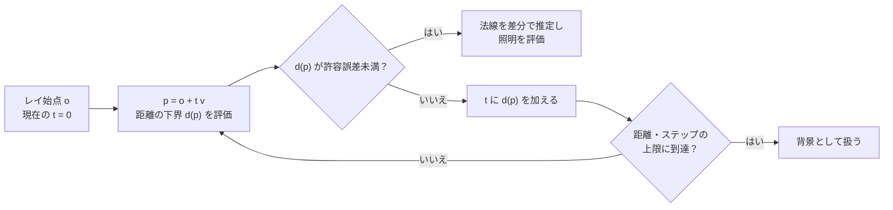

# SDF とレイマーチング — 距離を使って形状・影・AO を描く

符号付き距離関数（SDF）は、点から最も近い境界までの距離に内外の符号を付けた関数。ここでは外側を正、内側を負、境界を 0 とする。中心 $c$、半径 $r$ の球なら $d(p)=\lVert p-c\rVert-r$ で求められる。

## 形を合成する

同じ符号規約を使う距離関数 $a,b$ から、次の式で内外の領域を組み合わせられる。境界の折れ目や形が重なる場所では、合成後の値が真の符号付き距離からずれることがある。球面追跡で使うときは、外側で境界までの距離を過大評価しないことを確かめる。

| 操作 | 式 | 負になる領域 |
| --- | --- | --- |
| 和集合 | `min(a, b)` | どちらかの形状の内側 |
| 積集合 | `max(a, b)` | 両方の形状の内側 |
| 差集合 | `max(a, -b)` | `a < 0` かつ `b > 0` |

距離の単位も重要になる。均一拡大率 $s>0$ で形状を拡大するときは、入力点を $p/s$ に変換し、得られた距離を $s$ 倍する。非一様な拡大や座標のワープでは、距離の下界を別途求める必要がある。

### 滑らかにつなぐ・繰り返す・ねじる

二つの距離値 $a,b$ の境界を丸める一例は、$k>0$ に対して $h=\max(k-|a-b|,0)/k$、$d=\min(a,b)-kh^2/4$ とする多項式の smooth minimum（smin）。$|a-b|\ge k$ では通常の和集合に戻り、$a=b=0$ では $-k/4$ になる。このとき両方の表面が交わる場所は新しい形状の内側に入り、接合部が膨らむ。$a\le b$ の混合範囲では $a,b$ に対する偏微分は $1-h/2,\ h/2$ で、非負かつ和が 1。元の二つの距離が 1-Lipschitz なら、合成した関数も同じ勾配上限を持つ。ただし形状への厳密な距離になったと仮定せず、ゼロ等値面までの距離の下界として使う。

一軸を周期 $P>0$ で繰り返すなら、評価位置を $x'=x-P\lfloor x/P+0.5\rfloor$ に折り返せる。例えば $P=3$、$x=4.1$ なら $x'=1.1$。原点中心の球のように、最近傍のセルに最も近いコピーがある形状に向く。中心から大きく偏った形状や境界をまたぐ形状では、折り返し先の一つのコピーだけでは最短距離を見落としうる。近い複数セルを評価して最小を取るか、距離の下界を保てる配置にする。

ねじりは $y$ に応じて $xz$ 平面を角度 $-ky$ だけ回し、その座標で元の形を評価する方法。$y$ によって回転が変わるので、変形前後の点間距離は一般に保たれない。半径 $R$ の円柱領域に限ると、ねじりのヤコビアンによる伸びを $1+|k|R$ 以下で抑えられる。これは座標を固定角度で回す部分の伸びが 1、角度の変化による追加分が $|k|R$ 以下だから。距離値をこの上限で割ると、領域内で使える保守的なステップになる。領域へ入るまでの進み方は、先に円柱との交差を求めて別に扱う。 [Hart — Sphere Tracing（1996）](https://doi.org/10.1007/s003710050084)

## 球面追跡

レイの進行方向 $v$ を単位ベクトルとする。現在位置 $p=o+tv$ からの距離の下界 $d(p)>0$ が分かれば、その範囲内には境界がない。$t$ に $d(p)$ を足し、次の位置を調べる。微小な距離まで近づいたらヒットとみなし、最大距離または最大ステップに達したら探索を打ち切る。



例えば原点中心、半径 1 の球を、$(0,0,-3)$ から $+z$ に向かって追跡すると、最初の距離は 2。$t=2$ の位置 $(0,0,-1)$ で距離は 0 になる。球をかすめるレイでは 1 回の前進量が小さくなる。ヒットの許容誤差を小さくするほど、ステップ上限との兼ね合いが重要になる。

## 影と環境遮蔽の近似

- **ソフトシャドウ**は、表面から光へ向けたレイで、各サンプルの境界までの距離 $d$ を影レイの始点からの距離 $t$ で割り、`min(visibility, k*d/t)` のように影の係数を更新する。レイが遮蔽物に接近すると係数が下がる。`k` を小さくすると遮蔽物をかすめるレイでも係数が下がりやすくなり、半影が広がる。これは距離場から半影を推定する近似。
- **AO** は法線方向の数点で距離を調べる。$\max(0,h-d(p+hn))$ を近距離優先で足して遮蔽量にする。法線方向に $h$ だけ進んだ点で距離が $h$ より短ければ、近くに別の面があると推定する。距離の下界を使う形状では、値の過小評価でも遮蔽量が増える。掲載例では AO の係数を環境光の `0.22` に掛け、ソフトシャドウの係数を直射光に掛ける。

## コード例 — 球と床を追跡する

HLSL のピクセルシェーダーとして DXC の `-T ps_6_0 -E main` でコンパイルできる。`SceneDistance` は球と $y<0$ の半空間を `min` で合成する。球の最下点は $y=0.15$ なので、床の面との間に 0.15 の隙間がある。カメラは両方の外側にあり、`d < 0.001` をヒットとみなす。影レイの始点を法線方向に 0.01 ずらし、そこから光源方向に 0.02 進んだ点を最初に調べて、表面自身の誤検出を抑える。距離関数を何度も評価するので、ステップ上限は画質と処理量の両方に関わる。

```hlsl
float SceneDistance(float3 p)
{
    float sphere = length(p - float3(0.0, 0.8, 0.0)) - 0.65;
    return min(sphere, p.y);
}

float3 SurfaceNormal(float3 p)
{
    const float e = 0.002;
    const float3 x = float3(e, 0.0, 0.0);
    const float3 y = float3(0.0, e, 0.0);
    const float3 z = float3(0.0, 0.0, e);
    return normalize(float3(
        SceneDistance(p + x) - SceneDistance(p - x),
        SceneDistance(p + y) - SceneDistance(p - y),
        SceneDistance(p + z) - SceneDistance(p - z)));
}

float Shadow(float3 origin, float3 direction)
{
    float visibility = 1.0;
    float t = 0.02;
    for (int i = 0; i < 40 && t < 8.0; ++i)
    {
        float d = SceneDistance(origin + direction * t);
        if (d < 0.001)
            return 0.0;
        visibility = min(visibility, 10.0 * d / t);
        t += d;
    }
    return saturate(visibility);
}

float AmbientVisibility(float3 p, float3 normal)
{
    float occlusion = 0.0;
    float weight = 1.0;
    for (int i = 1; i <= 5; ++i)
    {
        float h = 0.08 * i;
        occlusion += weight * max(0.0, h - SceneDistance(p + normal * h));
        weight *= 0.65;
    }
    return saturate(1.0 - 2.0 * occlusion);
}

float4 main(float2 uv : TEXCOORD0) : SV_Target0
{
    const float3 origin = float3(0.0, 1.0, -3.0);
    float2 screen = (uv * 2.0 - 1.0) * float2(1.0, -1.0);
    float3 direction = normalize(float3(screen.x, screen.y - 0.15, 1.5));
    float t = 0.0;
    for (int i = 0; i < 96 && t < 16.0; ++i)
    {
        float3 p = origin + direction * t;
        float d = SceneDistance(p);
        if (d < 0.001)
        {
            float3 n = SurfaceNormal(p);
            float3 light = normalize(float3(-0.6, 1.0, -0.4));
            float direct = max(dot(n, light), 0.0) * Shadow(p + n * 0.01, light);
            float ambient = 0.22 * AmbientVisibility(p, n);
            return float4(float3(0.45, 0.68, 0.85) * (direct + ambient), 1.0);
        }
        t += d;
    }
    return float4(0.07, 0.10, 0.17, 1.0);
}
```

### 実機GPUでの確認

2026年11月16日、GeForce RTX 3060 と Direct3D 12 で掲載の `main` を実行した。DXC 1.10.2605.37 の `ps_6_0` でコンパイルし、全画面三角形で 320 × 180 ピクセルを RGBA32F に描画した。検証用の派生版では、最初に到達した面の種類と、影・AO の係数も読み戻した。元の球と床を `min` で合成した画像では、球が 5,040 ピクセル、床が 27,280 ピクセルに現れ、残る 25,280 ピクセルは背景になった。GPU ベースの検証を有効にした Direct3D 12 のデバッグ層で、エラーと警告はともに 0 件だった。

<figure class="study-figure">
  
  <figcaption>実機GPUで描画した比較。各パネルは 320 × 180 ピクセルで、表示用に線形 RGB を sRGB に変換した。<a href="/study/images/graphics/sdf-raymarching-gpu-readback.png" target="_blank" rel="noopener noreferrer">比較画像を拡大</a></figcaption>
</figure>

このコードは UV の縦横を同じ $[-1,1]$ に写すので、横長の描画先では球の輪郭も横に伸びる。正方画素で縦横の投影倍率をそろえるには、レイを作る前に `screen.x` に描画先の幅を高さで割った浮動小数点値を掛ける。

形状合成を見比べるため、検証用の派生版では球を中心間隔 0.5、半径 0.65 の二球に置き換え、床とカメラは共通にした。

| 二球の合成 | 最初に合成形状に到達したピクセル数 | 画面に現れた形 |
| --- | ---: | --- |
| `min(a, b)` | 7,524 | 二球を合わせた輪郭 |
| `max(a, b)` | 2,600 | 二球が重なる部分 |
| `max(a, -b)` | 3,762 | 曲面のくぼみが入った左の球 |
| 多項式の smin（`k = 0.25`） | 7,658 | 接合部が丸まり、和集合より少し広がった形 |

元のシーンと二球の四つの合成で、各画像の全 57,600 ピクセルについて、最初に到達した面の分類が倍精度の CPU 参照計算と一致した。元のシーンでは線形 RGB のチャンネルごとの最大絶対誤差が約 $1.55\times10^{-4}$ だった。

元の球と床のシーンでは、片方の係数だけを 1 に固定して照明への影響を分けた。座標は画像の左上を $(0,0)$ とし、色は RGBA32F から読み戻した線形値。

| 床の座標 | ソフトシャドウ係数 | AO の係数 | 赤成分の比較 |
| --- | ---: | ---: | --- |
| (199, 109) | 0.5016 | 1.0000 | ソフトシャドウで 0.2821。遮蔽物へのヒットだけで影を決めるハードシャドウでは 0.4640 |
| (160, 128) | 1.0000 | 0.4038 | AO ありで 0.4050。AO を切ると 0.4640 |

床の 447 ピクセルでソフトシャドウ係数が 0 と 1 の間になった。AO は影レイが遮られない床でも、球の近くで環境光を弱めた。球の下側の $(150,115)$ では法線方向のサンプルが床の下に入り、負の距離が遮蔽量を増やして AO の係数が約 0.188 になった。

## 理解度チェック

1. $d(p)$ が本当の距離より大きいと、レイの前進にどんな問題が起きるか。
2. `max(a, -b)` はどの領域を残すか。
3. AO の例で $h=0.16$、$d=0.04$ なら、重みを掛ける前の遮蔽寄与はいくつか。

::: details 解答

1. 境界を飛び越え、薄い形状や細い形状を見逃しうる。
2. `a < 0` かつ `b > 0` の領域で値が負になる。`a < 0` の範囲で `b = 0` になる所が、くり抜いた部分の境界。
3. $\max(0,0.16-0.04)=0.12$。

:::

## 関連項目

- [WebGPU実践でパラメーターを変える](/practice/graphics/shader-lab.html#sdf)
- [レイトレーシング](../lighting/raytracing.md)
- [SSAO](../lighting/ssao.md)
- [ボリューメトリック](volumetrics.md)

## 参考資料

- John C. Hart, [Sphere Tracing: A Geometric Method for the Antialiased Ray Tracing of Implicit Surfaces](https://doi.org/10.1007/s003710050084)
- Inigo Quilez, [3D Distance Functions](https://iquilezles.org/articles/distfunctions/)
- Inigo Quilez, [Raymarching Distance Fields — Soft Shadows](https://iquilezles.org/articles/rmshadows/)
- Inigo Quilez, [Rendering Worlds with Two Triangles](https://iquilezles.org/articles/nvscene2008/rwwtt.pdf), NVScene 2008
- Microsoft, [DirectX Shader Compiler 1.10.2605.37](https://github.com/microsoft/DirectXShaderCompiler/releases/tag/v1.10.2605.37)
