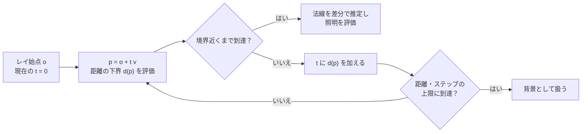

# SDF とレイマーチング — 距離を使って形状・影・AO を描く

符号付き距離関数（SDF）は、点から最も近い境界までの距離に内外の符号を付けた関数。ここでは外側を正、内側を負、境界を 0 とする。中心 $c$、半径 $r$ の球なら $d(p)=\lVert p-c\rVert-r$ で求められる。

## 形を合成する

同じ符号規約を使う距離関数 $a,b$ から、次の式で内外の領域を組み合わせられる。境界の折れ目や形が重なる場所では、合成後の値が真の符号付き距離からずれることがある。球面追跡で使うときは、外側で境界までの距離を過大評価しないことを確かめる。

| 操作 | 式 | 負になる領域 |
| --- | --- | --- |
| 和集合 | `min(a, b)` | どちらかの形状の内側 |
| 積集合 | `max(a, b)` | 両方の形状の内側 |
| 差集合 | `max(a, -b)` | `a` の内側かつ `b` の外側 |

距離の単位も重要になる。均一拡大率 $s>0$ で形状を拡大するときは、入力点を $p/s$ に変換し、得られた距離を $s$ 倍する。非一様な拡大や座標のワープでは、距離の下界を別途求める必要がある。

## 球面追跡

レイの進行方向 $v$ を単位ベクトルとする。現在位置 $p=o+tv$ からの距離の下界 $d(p)>0$ が分かれば、その範囲内には境界がない。$t$ に $d(p)$ を足し、次の位置を調べる。微小な距離まで近づいたらヒットとみなし、最大距離または最大ステップに達したら探索を打ち切る。



例えば原点中心、半径 1 の球を、$(0,0,-3)$ から $+z$ に向かって追跡すると、最初の距離は 2。$t=2$ の位置 $(0,0,-1)$ で距離は 0 になる。球をかすめるレイでは 1 回の前進量が小さくなる。ヒットの許容誤差を小さくするほど、ステップ上限との兼ね合いが重要になる。

## 影と環境遮蔽の近似

- **ソフトシャドウ**は、表面から光へ向けたレイで、各サンプルの境界までの距離 $d$ を表面からの距離 $t$ で割り、`min(visibility, k*d/t)` のように影の係数を更新する。レイが遮蔽物に接近すると係数が下がる。`k` は見かけの影の柔らかさを調整する係数で、面光源を面積積分した解とは違う。
- **AO** は法線方向の数点で距離を調べる。法線方向に $h$ だけ進んだ点の距離が $h$ より短い場合、近くに別の面があると推定できる。$\max(0,h-d(p+hn))$ を近距離優先で足して遮蔽量にする。半球全体の可視性を取る代わりに、法線方向の少数点から周囲の遮蔽を推定する。

## コード例 — 球と床を追跡する

HLSL のピクセルシェーダーとして DXC の `-T ps_6_0 -E main` でコンパイルできる。カメラは形状の外側。影レイは面から 0.01 だけ離して始め、表面自身へのヒットを避ける。距離関数を何度も評価するので、ステップ上限は画質と処理量の両方に関わる。

```hlsl
float SceneDistance(float3 p)
{
    float sphere = length(p - float3(0.0, 0.8, 0.0)) - 0.65;
    return min(sphere, p.y);
}

float3 SurfaceNormal(float3 p)
{
    const float e = 0.002;
    const float3 x = float3(e, 0.0, 0.0);
    const float3 y = float3(0.0, e, 0.0);
    const float3 z = float3(0.0, 0.0, e);
    return normalize(float3(
        SceneDistance(p + x) - SceneDistance(p - x),
        SceneDistance(p + y) - SceneDistance(p - y),
        SceneDistance(p + z) - SceneDistance(p - z)));
}

float Shadow(float3 origin, float3 direction)
{
    float visibility = 1.0;
    float t = 0.02;
    for (int i = 0; i < 40 && t < 8.0; ++i)
    {
        float d = SceneDistance(origin + direction * t);
        if (d < 0.001)
            return 0.0;
        visibility = min(visibility, 10.0 * d / t);
        t += d;
    }
    return saturate(visibility);
}

float AmbientVisibility(float3 p, float3 normal)
{
    float occlusion = 0.0;
    float weight = 1.0;
    for (int i = 1; i <= 5; ++i)
    {
        float h = 0.08 * i;
        occlusion += weight * max(0.0, h - SceneDistance(p + normal * h));
        weight *= 0.65;
    }
    return saturate(1.0 - 2.0 * occlusion);
}

float4 main(float2 uv : TEXCOORD0) : SV_Target0
{
    const float3 origin = float3(0.0, 1.0, -3.0);
    float2 screen = (uv * 2.0 - 1.0) * float2(1.0, -1.0);
    float3 direction = normalize(float3(screen.x, screen.y - 0.15, 1.5));
    float t = 0.0;
    for (int i = 0; i < 96 && t < 16.0; ++i)
    {
        float3 p = origin + direction * t;
        float d = SceneDistance(p);
        if (d < 0.001)
        {
            float3 n = SurfaceNormal(p);
            float3 light = normalize(float3(-0.6, 1.0, -0.4));
            float direct = max(dot(n, light), 0.0) * Shadow(p + n * 0.01, light);
            float ambient = 0.22 * AmbientVisibility(p, n);
            return float4(float3(0.45, 0.68, 0.85) * (direct + ambient), 1.0);
        }
        t += d;
    }
    return float4(0.07, 0.10, 0.17, 1.0);
}
```

## 理解度チェック

1. $d(p)$ が本当の距離より大きいと、レイの前進にどんな問題が起きるか。
2. `max(a, -b)` はどの領域を残すか。
3. AO の例で $h=0.16$、$d=0.04$ なら、重みを掛ける前の遮蔽寄与はいくつか。

::: details 解答

1. 境界を飛び越え、薄い形状や細い形状を見逃しうる。
2. `a` が負で `b` が正の領域。`a` から `b` をくり抜く。
3. $\max(0,0.16-0.04)=0.12$。

:::

## 関連項目

- [WebGPU実践でパラメーターを変える](/practice/graphics/shader-lab.html#sdf)
- [レイトレーシング](../lighting/raytracing.md)
- [SSAO](../lighting/ssao.md)
- [ボリューメトリック](volumetrics.md)

## 参考資料

- John C. Hart, [Sphere Tracing: A Geometric Method for the Antialiased Ray Tracing of Implicit Surfaces](https://doi.org/10.1007/s003710050084)
- Inigo Quilez, [3D Distance Functions](https://iquilezles.org/articles/distfunctions/)
- Inigo Quilez, [Raymarching Distance Fields — Soft Shadows](https://iquilezles.org/articles/rmshadows/)
- Inigo Quilez, [Rendering Worlds with Two Triangles](https://iquilezles.org/articles/nvscene2008/rwwtt.pdf), NVScene 2008
