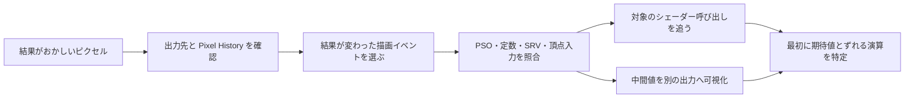

# シェーダーのデバッグ — 値の可視化と NaN の追跡

シェーダーの出力が黒いときは、同じ色でも原因が異なる。想定と違う描画コールが上書きした、別のテクスチャがバインドされた、計算途中で非有限値が出た、といった可能性を段階ごとに調べる。GPU キャプチャで「どのイベントで変わったか」を調べ、シェーダーのデバッグ出力で「画面のどこで値が崩れたか」を絞る。

## 描画イベントを特定する



| ツールと版 | このページで使う対象 |
| --- | --- |
| RenderDoc v1.47 | Direct3D 12 のキャプチャ。イベントで Pipeline State とテクスチャを調べ、デバッグ可能なピクセルを選んで実行を追う。 |
| PIX on Windows 2610.28 | Direct3D 12 の GPU Capture。Pipeline、Show Pixel History、Debug This Pixel で、対象の描画イベントとピクセルを選ぶ。 |

最初に、対象のレンダーターゲットと描画イベント、テクスチャのミップや配列スライス、定数バッファーの値を確認する。最終色のパスで異常が見つかっても、そこで読んだテクスチャにすでに異常があれば、テクスチャを書いたイベントまで戻る。動作が変わる条件が見つかったら、同じイベントで正常なピクセルと異常なピクセルを比較する。

ソース行を追うには、キャプチャに記録したバイナリと対応するデバッグ情報が必要になる。DXC で `-Zi -Qembed_debug` を指定すると、DXIL シェーダーオブジェクトへデバッグ情報を埋め込める。最適化で変数や式が統合される場合は `-Od` で再現できるか確認する。リリース構成だけで再現する現象では、最適化を切った結果と元のキャプチャを区別して扱う。デバッガーが扱える機能は API、シェーダー命令、ドライバーなどに依存し、選んだ呼び出しでデバッグできないときは、色やバッファーでの可視化を使う。

### Vulkan のソースデバッグとエンジンのシンボル

RenderDoc v1.47 の Vulkan ソースデバッグは SPIR-V の `NonSemantic.Shader.DebugInfo.100` を使う。例えば DXC では `dxc -spirv -T ps_6_0 -E main -fspv-target-env=vulkan1.2 -fspv-debug=vulkan-with-source shader.hlsl -Fo shader.spv`、glslang では `glslangValidator -V -gVS shader.frag -o shader.spv` でソースを含む情報を埋め込める。キャプチャしたモジュールがそのバイナリかを確認し、デバッグ可能な呼び出しを選ぶ。

- **Unity 6.3 LTS** の `#pragma enable_d3d11_debug_symbols` は、名前に D3D11 を含むが、D3D11・D3D12・Vulkan と対応コンソールでシンボルを生成する。最適化も無効にするため、普段のビルドと比較する際は同じパスとキーワードを選び、最適化による差も考慮する。
- **Unreal Engine 5.8** では、対象プラットフォームの設定で `r.Shaders.Symbols=1` を指定してシェーダーを再コンパイルする。対応するプラットフォームではシンボルを外部ファイルに書き出し、必要ならキャプチャツールに `Saved/ShaderSymbols/Platform` のパスを渡す。外部ファイルを使わないプラットフォームでは、シンボルがシェーダーデータに入る。

## 値を色へ写す

| 調べる値 | 可視化の例 |
| --- | --- |
| `[-1,1]` の法線 | `n * 0.5 + 0.5`。0 が 0.5 に、+1 が 1 に対応する。 |
| `[0,1]` の UV | `float3(u, v, 0)`。タイル内の値を見る場合だけ `frac` を使う。 |
| 非有限値 | `any(isnan(value))` をマゼンタ、`any(isinf(value))` をオレンジで出す。 |

色の変換、ブレンド、露出などが間に入ると値を読みにくくなる。数値を比較する場合は、デバッグ用出力を直接表示するか、キャプチャ上で浮動小数点レンダーターゲットの中身を読む。

RenderDoc v1.47 の Texture Viewer にある **NaN/Inf/-ve display** は、選んだテクスチャをグレースケールにし、NaN を赤、無限大を緑、負値を青で強調する。複数チャンネルのうち一つだけに該当する値があっても、ピクセルに色が付く。符号付きの法線や速度には正当な負値もある。どのパスで異常が入ったかを調べるときは、最終出力から順に前の浮動小数点バッファへ戻って同じ位置を確認する。負値を格納できない出力や、書き込み前に置き換わった非有限値は、このオーバーレイでは見えない。

### 最初に NaN が出た場所を探す

たとえば `0 / 0` や負数の平方根で NaN が生じることがあり、長さが 0 のベクトルの正規化も有効な方向を返す前提を満たさない。逆に `saturate` で NaN が 0 に置き換わる場合がある。最終出力だけを検査しても、その前に発生した NaN を見落とす。

まず疑わしい演算の直前と直後で同じピクセルを観察し、どこで有限値から非有限値になったかを探す。除算なら分母と分子をそれぞれ表示し、値が 0 になる理由を先に調べる。再現用に最適化を調整する際は、対象の式で NaN や無限大を無視する前提を置いていないかも確かめる。

## コード例 — 中間値を切り替えて表示する

HLSL の `ps_6_0`。`debugStage` が 0 のときは補間された法線、1 のときは正規化直後を表示する。入力を制御できるキャプチャでは、法線 `(0,0,1)` を渡すと両段の出力は `(0.5,0.5,1)`。デバッグ出力の確認用として、入力が非有限値なら法線を正規化する前の段階で検出できる。正規化するベクトルの長さがほぼ 0 の場合は、実装ごとの結果に依存せず青で示す。

```hlsl
cbuffer DebugSettings : register(b0)
{
    uint debugStage;
};

float4 displayNormal(float3 value)
{
    if (any(isnan(value)))
    {
        return float4(1.0, 0.0, 1.0, 1.0);
    }
    if (any(isinf(value)))
    {
        return float4(1.0, 0.5, 0.0, 1.0);
    }
    return float4(saturate(value * 0.5 + 0.5), 1.0);
}

float4 main(float3 interpolatedNormal : TEXCOORD0) : SV_Target
{
    if (debugStage == 0 || any(isnan(interpolatedNormal))
                        || any(isinf(interpolatedNormal)))
    {
        return displayNormal(interpolatedNormal);
    }

    float lengthSquared = dot(interpolatedNormal, interpolatedNormal);
    if (lengthSquared <= 1e-12)
    {
        return float4(0.0, 0.0, 1.0, 1.0);
    }
    if (!isfinite(lengthSquared))
    {
        return displayNormal(float3(lengthSquared, 0.0, 0.0));
    }

    float3 normalized = interpolatedNormal * rsqrt(lengthSquared);
    return displayNormal(normalized);
}
```

長さのしきい値はデバッグ用の選択。修正時は、頂点の法線が入っていない、補間が打ち消し合う、読み取り元が違うなど、実際に異常値が出る理由に合わせて対処する。

## 理解度チェック

<details><summary>最終画面の色が意図と違う。どの描画イベントが書いたか調べるには？</summary>

レンダーターゲットの対象ピクセルで Pixel History を確認し、出力を書いた描画イベントを特定する。そのイベントにバインドされたリソースと入力値を調べる。

</details>

<details><summary>法線を色へ写した結果が (0.5, 0.5, 1)。法線の向きは？</summary>

変換を逆にした `2 * color - 1` は `(0,0,1)`。出力の後に色変換を行っていない値を読む。

</details>

<details><summary>色出力に NaN が見つからなかった。計算途中も正常だったと言える？</summary>

途中の NaN がクリップなどで別の値に置き換わることがある。疑わしい演算の直前と直後で `isnan` や `isfinite` を使って調べる。

</details>

## 関連項目

- [HLSL](/graphics/shader/hlsl.html)
- [シェーダーへ渡すデータ — 頂点属性・uniform・テクスチャ](/graphics/shader/shader-inputs-and-uniforms.html)
- [法線マップと接空間 — TBN・MikkTSpace・チャンネル規約](/graphics/shader/normal-mapping.html)

## 参考資料

- [RenderDoc v1.47 のリリースノート](https://github.com/baldurk/renderdoc/releases/tag/v1.47)
- [RenderDoc — How do I debug a shader?](https://github.com/baldurk/renderdoc/blob/v1.47/docs/how/how_debug_shader.rst)
- [Microsoft — PIX 2610.28 のリリースノート](https://devblogs.microsoft.com/pix/pix-2610-28/)
- [Microsoft — PIX GPU Captures](https://devblogs.microsoft.com/pix/gpu-captures/)
- [Microsoft — PIX でのシェーダー PDB と埋め込みデバッグ情報](https://learn.microsoft.com/windows/pix/directx-dump-files/analyze-dump-files-in-pix)
- [Microsoft HLSL リファレンス — isnan](https://learn.microsoft.com/en-us/windows/win32/direct3dhlsl/dx-graphics-hlsl-isnan)
- [Microsoft HLSL リファレンス — saturate 命令修飾子](https://learn.microsoft.com/en-us/windows/win32/direct3dhlsl/saturate)

- [RenderDoc v1.47 — Texture Viewer のオーバーレイ](https://github.com/baldurk/renderdoc/blob/v1.47/docs/window/texture_viewer.rst)
- [Unity 6.3 LTS — HLSL pragma directives](https://docs.unity3d.com/6000.3/Documentation/Manual/SL-PragmaDirectives.html)
- [Epic Games — Shader Debugging Workflows（Unreal Engine 5.8）](https://dev.epicgames.com/documentation/en-us/unreal-engine/shader-debugging-workflows-unreal-engine?application_version=5.8)
