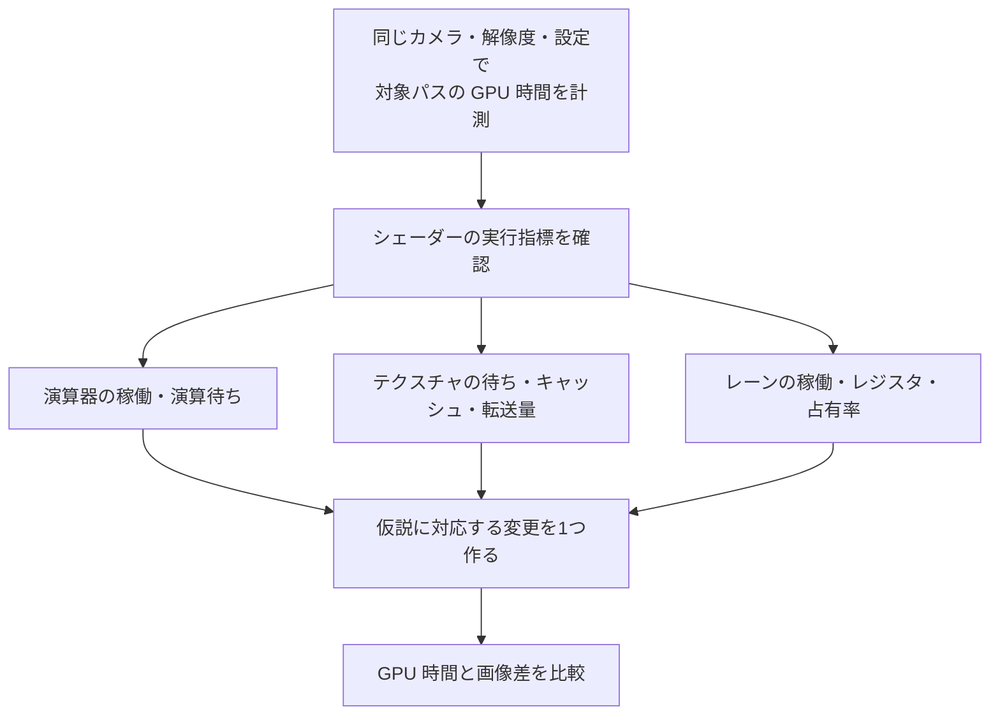

# シェーダー最適化の実践 — 精度・分岐・フェッチを計測する

フレームで時間を使っているパスを [GPU プロファイラー](../optimization/tools.md)で見つけたら、そのパスのシェーダーを絞る。同じ描画で時間を使っていても、演算命令の処理量、テクスチャ取得の待ち、メモリ帯域、レジスタ使用量のどれが効くかで手を入れる箇所が変わる。



## 16 ビット精度をどこで使うか

HLSL の `min16float` は最小精度を指定する型で、実装はより高い精度でも演算できる。DXC の Shader Model 6.2 以降では、`-enable-16bit-types` を指定するとネイティブ 16 ビット型 `float16_t` が使え、`half` も 16 ビットになる。DXC でそのオプションを省いたとき、`half` は `float` に対応する。D3D12 でネイティブ型を実行するには、デバイスの `Native16BitShaderOpsSupported` を確認する。

色の混合係数や短い範囲の局所値は候補になる。大きなワールド座標、深度、長い加算の累積、差の小さい値を引く処理は誤差が見えやすい。IEEE 754 binary16 の 1.0 の直上にある値は $1+2^{-10}=1.0009765625$。例えば 1.0001 は最近接丸めで 1.0 になる。途中を半精度にすると、後から 32 ビットに戻しても落ちた情報は復元できない。

## 分岐とフェッチの見方

**分岐**で同じ wave のレーンが異なる経路へ進むと、パスごとに一部のレーンだけで命令を実行する場合がある。タイルごとに共通する条件なら、wave の多くが同じ側へ進み、不要な処理を省ける可能性がある。短い分岐はコンパイラが選択命令に変えることもあるので、ソースの `if` の数だけで判断しない。レーン稼働率と、その命令列を通る頻度を合わせて確認する。

**フェッチ**を減らしても、同じデータがすでにキャッシュにある場合と、離れたアドレスから読む場合では効果が違う。フェッチの待ちが目立つなら、依存している読み出し、UV の空間的なまとまり、mip の選択、キャッシュミスを調べる。帯域が詰まるなら、転送バイト数や圧縮形式、レンダーターゲットの書き出しも確認する。RGBA16F と RGBA8 の非圧縮の格納量は 1 テクセルあたり 8 バイトと 4 バイトだが、フィルタリングやキャッシュを経た実際の転送量はこの値をサンプル回数に掛けただけでは分からない。

**演算と帯域**を切り分けるには、読み出し結果を定数に置き換える計測版と、読み出しを保って計算を簡略化する計測版を別々に比較する。コンパイラが使われなくなった処理を除去するため、生成コードや計測結果を見て、変えたつもりのない処理まで消えていないか確認する。レジスタ使用量と同時に走る wave 数も、待ち時間を隠せるかに影響する。

## コード例 — 混合係数だけを半精度にする

同じ HLSL を DXC の `-T ps_6_2 -E Main32` と `-T ps_6_2 -E Main16 -enable-16bit-types` でコンパイルして比較する。UV とテクスチャサンプルは 32 ビットのままにし、後段の混合だけを変える。入力テクスチャを変えず、画像差と GPU 時間を比べる。変換命令が加わる場合もあるので、16 ビット版の時間が縮むかは対象 GPU で確かめる。

```hlsl
Texture2D<float4> BaseColor : register(t0);
SamplerState LinearSampler : register(s0);

float4 Main32(float2 uv : TEXCOORD0) : SV_Target0
{
    float4 source = BaseColor.Sample(LinearSampler, uv);
    float factor = saturate(source.a * 0.8 + 0.1);
    float3 tint = float3(0.36, 0.72, 0.51);
    return float4(lerp(source.rgb, tint, factor), source.a);
}

float4 Main16(float2 uv : TEXCOORD0) : SV_Target0
{
    float4 source = BaseColor.Sample(LinearSampler, uv);
    half factor = saturate((half)source.a * (half)0.8 + (half)0.1);
    half3 tint = half3(0.36, 0.72, 0.51);
    half3 blended = lerp((half3)source.rgb, tint, factor);
    return float4((float3)blended, source.a);
}
```

## 理解度チェック

1. `min16float` を指定すれば、演算がネイティブ 16 ビットになることを保証できるか。
2. 画面上で条件の真偽が 1 ピクセルおきに入れ替わる分岐では、どの指標を見たいか。
3. 同じ 2 回のテクスチャフェッチでも、GPU 時間が異なる理由を一つ挙げる。

::: details 解答

1. 保証できない。指定は最小精度で、実装はより高い精度も使える。
2. 経路ごとの有効レーン数や分岐の実行頻度。コンパイラが実際に分岐を生成したかも確認する。
3. UV の並び方が違うとキャッシュの当たり方が変わり、転送量や待ち時間が変わる。

:::

## 関連項目

- [GPU プロファイラー](../optimization/tools.md)
- [描画の最適化](../optimization/basics.md)
- [HLSL](hlsl.md)

## 参考資料

- Microsoft, [Using HLSL Minimum Precision](https://learn.microsoft.com/en-us/windows/win32/direct3dhlsl/using-hlsl-minimum-precision)
- Microsoft, [HLSL Scalar Types](https://learn.microsoft.com/en-us/windows/win32/direct3dhlsl/dx-graphics-hlsl-scalar)
- Microsoft, [D3D12_FEATURE_DATA_D3D12_OPTIONS4](https://learn.microsoft.com/en-us/windows/win32/api/d3d12/ns-d3d12-d3d12_feature_data_d3d12_options4)
- AMD, [RDNA Performance Guide](https://gpuopen.com/learn/rdna-performance-guide/)
- NVIDIA, [Nsight Graphics — Shader Profiler](https://docs.nvidia.com/nsight-graphics/UserGuide/shader-profiler.html)
