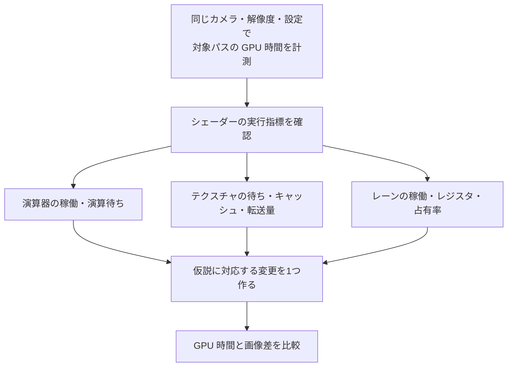
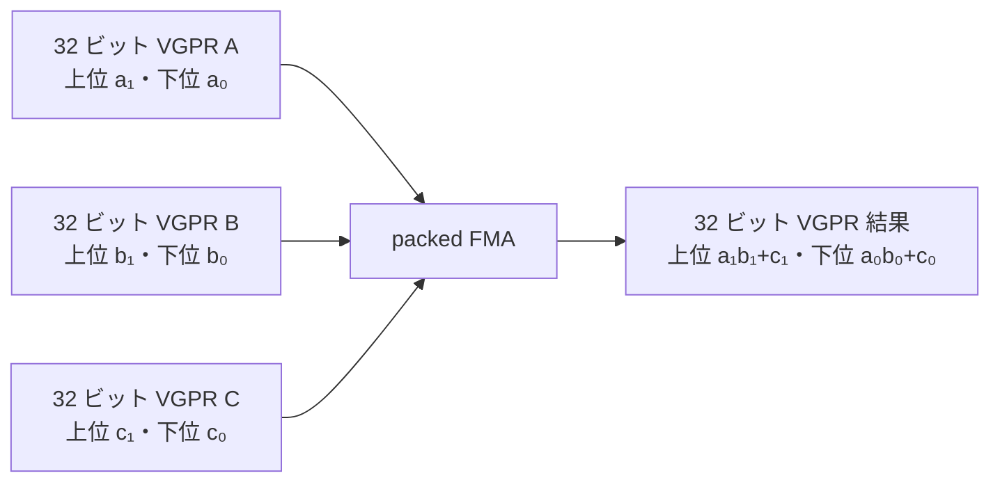
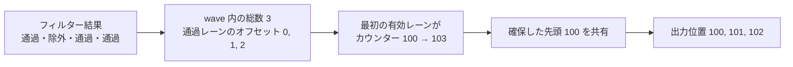

# シェーダー最適化の実践 — 精度・分岐・フェッチを計測する

フレームで時間を使っているパスを [GPU プロファイラー](../optimization/tools.md)で見つけたら、そのパスのシェーダーを絞る。同じ描画で時間を使っていても、演算命令の処理量、テクスチャ取得の待ち、メモリ帯域、レジスタ使用量のどれが効くかで手を入れる箇所が変わる。



## 16 ビット精度をどこで使うか

HLSL の `min16float` は最小精度を指定する型で、実装はより高い精度でも演算できる。DXC の Shader Model 6.2 以降では、`-enable-16bit-types` を指定するとネイティブ 16 ビット型 `float16_t` が使え、`half` も 16 ビットになる。DXC でそのオプションを省いたとき、`half` は `float` に対応する。D3D12 でネイティブ型を実行するには、デバイスの `Native16BitShaderOpsSupported` を確認する。

色の混合係数や短い範囲の局所値は候補になる。大きなワールド座標、深度、長い加算の累積、差の小さい値を引く処理は誤差が見えやすい。IEEE 754 binary16 の 1.0 の直上にある値は $1+2^{-10}=1.0009765625$。例えば 1.0001 は最近接丸めで 1.0 になる。途中を半精度にすると、後から 32 ビットに戻しても落ちた情報は復元できない。

### 2 つの値を 1 命令で処理するパック演算

半精度には、値の格納量を減らす効果と、演算命令が 1 回に処理する値を増やす効果がある。型だけ変えても、テクスチャのフォーマットや構造化バッファーのストライドを変えなければ、リソースの転送量はそのままの場合がある。反対に、16 ビットフォーマットで格納した値をサンプリングして、以降の演算は 32 ビットで行うこともできる。

AMD RDNA 3 の ISA には、1 本の 32 ビット VGPR の上下 16 ビットに入った 2 値を処理する命令がある。例えば `V_PK_FMA_F16` は、レーンごとに下位どうしと上位どうしの 2 組について、積和 $a_ib_i+c_i$ を計算する。32 レーンがすべて有効な wave32 なら、パック命令 1 回の結果は $32\times2=64$ 個の積和になる。積和を乗算と加算の 2 演算と数える場合は 128 FLOP。スカラーの積和命令 1 回なら 32 個の積和、同じ数え方で 64 FLOP になる。これは命令が処理する値の数であり、命令を発行できる頻度や、メモリー待ちを含むパスの時間も測ってはじめて速度が分かる。[AMD RDNA 3 ISA §7.4–7.5](https://www.amd.com/content/dam/amd/en/documents/radeon-tech-docs/instruction-set-architectures/rdna3-shader-instruction-set-architecture-feb-2023_0.pdf)



例えば法線マップから取った 2 成分の値域変換や、2 本の独立したマスクへの補正は、成分ごとに同じ形の命令を出しやすい。片方の結果がもう片方の入力になる演算や、途中で頻繁に FP32 へ変換する演算では、パックしにくかったり、パックの前後で余分な命令が入ったりする。色の 3 成分を処理するときも、対応する 2 成分だけがパックされる可能性がある。HLSL の `half2` は値の型と形を指定する。実際にパック命令へ落ちたかは、対象 GPU 向けの ISA で調べる。

### 半精度化の範囲と画像差

入力 UV、座標の差、深度、複数サンプルを足す蓄積値は FP32 で保ち、演算が局所的で値域が狭い係数から FP16 を試す。例えば、1.0 付近の刻みは $2^{-10}$ だが、1024.0 から 2048.0 の手前までは指数が 10 だけ大きくなり、刻みは $2^{10-10}=1$。1024.25 から 1024.0 を引いたとき、両方を先に FP16 にすると差は 0 になり、FP32 で引いてから FP16 にしても 0.25 を表せる。色の差が小さい場合も、急な露出変化、暗部、時間方向の蓄積、影の境界などに試験範囲を広げる。パスの時間、FP16 との相互変換、割り当てられたレジスタ数、画像差を同じ計測で残す。

## 分岐とフェッチの見方

**分岐**で同じ wave のレーンが異なる経路へ進むと、パスごとに一部のレーンだけで命令を実行する場合がある。タイルごとに共通する条件なら、wave の多くが同じ側へ進み、不要な処理を省ける可能性がある。短い分岐はコンパイラが選択命令に変えることもあるので、ソースの `if` の数だけで判断しない。レーン稼働率と、その命令列を通る頻度を合わせて確認する。

**フェッチ**を減らしても、同じデータがすでにキャッシュにある場合と、離れたアドレスから読む場合では効果が違う。フェッチの待ちが目立つなら、依存している読み出し、UV の空間的なまとまり、mip の選択、キャッシュミスを調べる。帯域が詰まるなら、転送バイト数や圧縮形式、レンダーターゲットの書き出しも確認する。RGBA16F と RGBA8 の非圧縮の格納量は 1 テクセルあたり 8 バイトと 4 バイトだが、フィルタリングやキャッシュを経た実際の転送量はこの値をサンプル回数に掛けただけでは分からない。

**演算と帯域**を切り分けるには、読み出し結果を定数に置き換える計測版と、読み出しを保って計算を簡略化する計測版を別々に比較する。コンパイラが使われなくなった処理を除去するため、生成コードや計測結果を見て、変えたつもりのない処理まで消えていないか確認する。レジスタ使用量と同時に走る wave 数も、待ち時間を隠せるかに影響する。

### NVIDIA Nsight Graphics 2026.4 — SOL と待ちの内訳

GPU Trace の Unit Throughputs と Summary を、対象マーカーの範囲に絞って見る。**SOL**（Speed of Light）は、各ユニットが到達可能なピークに対し、どれだけの仕事を処理したかを比較する考え方。例えば同じ時間範囲に SM の演算、L1TEX の処理、L2 や VRAM の転送を見る。指標ごとに基準となるピークが異なり、同じ時間に複数のユニットが働くため、割合を足して 100% にする指標ではない。高い SM Throughput が出たときは、SM 内のどの演算パイプのスループットが高いか確認する。SM の実行時間だけを見て、浮動小数点の積和が原因と決めると、別種の命令やユニットを見落とす。[NVIDIA、Peak-Performance-Percentage Analysis](https://developer.nvidia.com/blog/the-peak-performance-analysis-method-for-optimizing-any-gpu-workload/)、[GPU Trace UI Reference](https://docs.nvidia.com/nsight-graphics/UserGuide/gpu-trace-ui.html)

L1TEX はシェーダーからのロード／ストアやテクスチャアクセスに関わる。L1TEX の指標が高く VRAM が低いときは、キャッシュが受けるアクセスやフィルタリングの処理量が効くことがある。VRAM が高いときは読み出しと書き出しの内訳、L2 のヒット率、レンダーターゲットの形式やサイズを突き合わせる。主要ユニットのスループットが低くてもパスが長いときは、依存する読み出しの待ちや、wave を追加できない要因も見る。Shader Profiler の stall の内訳は待ちが観測された箇所を絞るのに使える。例えばテクスチャから得た座標で次のテクスチャを引くと、2 回目の座標の計算は 1 回目の値が届くまで進まない。転送量が少なくても、直列の待ちが効く例である。[NVIDIA、GPU Trace への移行ガイド](https://developer.nvidia.com/blog/migrating-from-range-profiler-to-gpu-trace-in-nsight-graphics/)、[Shader Profiler](https://docs.nvidia.com/nsight-graphics/UserGuide/shader-profiler.html)

| 観察した指標 | 検証する仮説 | 比較用に変える処理 |
| --- | --- | --- |
| SM 内の演算パイプのスループットが高く、VRAM 転送が低い | 演算の発行量がパスを制約している | リソースアクセスと結果の書き出しを残し、繰り返す計算を減らす |
| VRAM の読み出しまたは書き出しが高く、転送量も大きい | VRAM 帯域がパスを制約している | 出力のフォーマットを小さくする。画像の許容差と、実際の読み書きバイト数を確認する |
| どのスループットも低く、読み出し待ちのサンプルが目立つ | 依存チェーンの待ちを隠せていない | 次の読み出しまでに独立した計算を入れ、待ちの指標とレジスタ使用量を測る |
| 特定のブランチ命令列で有効レーンが少ない | wave 内で経路が分かれている | グループ分けを変えて同じ種類の仕事を近くに置き、有効レーンと並べ替えの負荷を比べる |

帯域の確認では、例えば 1 パスの読み書きが 48 MB（10 進）で GPU 時間が 0.20 ms なら、その範囲の平均は $48\times10^6/(0.20\times10^{-3})=240\times10^9\ \mathrm{B/s}$。同じ GPU の比較で転送を 24 MB に減らし 0.12 ms になれば 200 GB/s になる。帯域の使用率が下がっても、パスが短くなった理由として転送量の削減を説明できる。これは計算例で、取得したバイト数が VRAM、L2、L1TEX のどこを通ったものかと、分母の時間範囲を実測ではそろえる。

### AMD Radeon GPU Profiler 2.7.1 — VGPR と wavefront 占有率

RGP の Event timing で対象 draw／dispatch を選び、Pipeline state の VGPR、LDS、wave サイズ、理論占有率と、Wavefront occupancy の時間変化を照らし合わせる。AMD の RDNA でいう占有率は、同時に置ける wavefront の枠をどれだけ使っているかを示す。VGPR にライブな値が多いと、1 wave の割り当てが大きくなる。同じ SIMD の VGPR 容量を複数 wave で使うため、割り当ての増加が同時実行数を下げる場合がある。LDS の大きさ、スレッドグループに必要な wave 数、投入できる仕事量も確認する。[AMD、Occupancy explained](https://gpuopen.com/learn/occupancy-explained/)、[RGP、Events](https://github.com/GPUOpen-Tools/radeon_gpu_profiler/blob/master/docs/source/events_windows.rst)

AMD の Radeon RX 7900 XTX の説明例では、wave32 で SIMD あたり 1536 VGPR の容量があり、1 wave の割り当てが 120 VGPR なら $\lfloor1536/120\rfloor=12$ wave、16 枠に対し 75% が VGPR から求まる上限になる。13 wave を入れるためには、割り当て数を $\lfloor1536/13\rfloor=118$ 以下にする必要がある。実際の割り当ては機種と wave サイズごとの単位に切り上げるため、ソース上で 2 個減らせば達成できるという計算にはならない。RGP が示す割り当て数と、次の占有率に届くまでの差を使う。理論占有率は上限で、対象 draw が小さい場合や wave の末尾がまばらな場合は計測値が低くなる。

占有率が上がると、ある wave が読み出し待ちの間に別の wave の命令を進められる余地が増える。キャッシュを共有する wave が増えてヒット率が下がったり、VGPR を減らした結果、レジスタに置けない値がメモリーへ退避されたりする場合もある。例えばループを展開すると依存を外して並行に実行できる計算が増える一方で、後で使う中間値の生存区間が重なる。展開数ごとに Pipeline state と実際の時間を比べ、Radeon GPU Analyzer の Live VGPR Analysis で生存数のピークがどの命令列にあるか確認する。

### 計測版で残す条件

解像度、入力シーン、描画件数、対象 API、ビルド構成をそろえ、まず代表フレームと負荷の高いフレームを別々に測る。解像度を下げて GPU 時間が縮んだ場合、ピクセル側の仕事量への依存は分かるが、ALU、テクスチャ、レンダーターゲットの転送が一緒に減る。次の比較で変える量を絞る。

1. **演算量だけを試す。** サンプルした値が出力に反映されるようにして、高価な関数やループの一部を簡略化する。ISA と実行カウンターで、読み出しまで削られていないか確認する。
2. **帯域や局所性を試す。** 計算と分岐を保ったまま、キャッシュに収まる入力と収まらない入力を比較する。UV の分布、mip、フォーマットを同時に変えると、どれが効いたか区別しづらい。
3. **GPU 全体の時間を測る。** 対象パスの短縮で async compute と graphics の重なり方が変わることがある。マーカー内の時間に加え、同じフレームの GPU タイムラインでクリティカルパスの変化を見る。

## コード例 — 混合係数だけを半精度にする

同じ HLSL を DXC の `-T ps_6_2 -E Main32` と `-T ps_6_2 -E Main16 -enable-16bit-types` でコンパイルして比較する。UV とテクスチャサンプルは 32 ビットのままにし、後段の混合だけを変える。入力テクスチャを変えず、画像差と GPU 時間を比べる。変換命令が加わる場合もあるので、16 ビット版の時間が縮むかは対象 GPU で確かめる。

```hlsl
Texture2D<float4> BaseColor : register(t0);
SamplerState LinearSampler : register(s0);

float4 Main32(float2 uv : TEXCOORD0) : SV_Target0
{
    float4 source = BaseColor.Sample(LinearSampler, uv);
    float factor = saturate(source.a * 0.8 + 0.1);
    float3 tint = float3(0.36, 0.72, 0.51);
    return float4(lerp(source.rgb, tint, factor), source.a);
}

float4 Main16(float2 uv : TEXCOORD0) : SV_Target0
{
    float4 source = BaseColor.Sample(LinearSampler, uv);
    half factor = saturate((half)source.a * (half)0.8 + (half)0.1);
    half3 tint = half3(0.36, 0.72, 0.51);
    half3 blended = lerp((half3)source.rgb, tint, factor);
    return float4((float3)blended, source.a);
}
```

### wave 内で書き出し先をまとめて確保する {#wave-compaction}

可視性判定のあと、残ったオブジェクトの ID を連続したバッファーに詰める処理を考える。残る要素ごとに共有カウンターへ `InterlockedAdd` する方法では、同じアドレスに更新が集まる。Shader Model 6.0 の wave 命令で、現在の wave の書き出し数を先に集計すると、カウンターを更新するのは書き出しのある wave ごとに 1 レーンになる。後続の処理で元の順番が必要な場合は、グループ間も含めたプレフィックスサムなどで書き出し先を決める。



`WaveActiveCountBits` は wave の有効レーンで条件が真になる数、`WavePrefixCountBits` は自分より前の有効レーンで条件が真になる数を返す。図では wave を 4 レーンに縮めている。条件を満たすレーンを 0、2、3 とすると、それぞれのオフセットは 0、1、2。レーン 0 が先頭 100 を受け取り、レーン 2 と 3 も `WaveReadLaneFirst` で同じ値を得る。レーン 0 の条件が偽でも、最初の有効レーンが確保処理を担当できる。

次の HLSL は同じ入力に対する 2 つのコンピュートシェーダーを含む。`dxc -T cs_6_0 -E CompactPerLane Compact.hlsl` と `dxc -T cs_6_0 -E CompactPerWave Compact.hlsl` でそれぞれコンパイルできる。各バージョンを別々に実行し、入力は可視フラグ（非ゼロなら通過）を `InputCount` 個、出力は最低 `InputCount` 個分を用意する。カウンターの先頭 4 バイトを 0 で初期化して、$(\lceil N/64\rceil,1,1)$ グループを dispatch する。wave 命令版では D3D12 の `D3D12_OPTIONS1.WaveOps` を確認する。出力を別の dispatch や描画で使うなら、出力とカウンターの書き込みが見えるよう、次の用途に応じたリソースバリアを入れる。

```hlsl
cbuffer CompactParams : register(b0)
{
    uint InputCount;
};

StructuredBuffer<uint> Visible : register(t0);
RWStructuredBuffer<uint> OutputIds : register(u0);
RWByteAddressBuffer OutputCount : register(u1);

bool Keep(uint index)
{
    if (index >= InputCount)
        return false;

    return Visible[index] != 0;
}

[numthreads(64, 1, 1)]
void CompactPerLane(uint3 tid : SV_DispatchThreadID)
{
    if (Keep(tid.x))
    {
        uint outputIndex;
        OutputCount.InterlockedAdd(0, 1, outputIndex);
        OutputIds[outputIndex] = tid.x;
    }
}

[numthreads(64, 1, 1)]
void CompactPerWave(uint3 tid : SV_DispatchThreadID)
{
    bool keep = Keep(tid.x);
    uint count = WaveActiveCountBits(keep);
    uint offset = WavePrefixCountBits(keep);

    if (count == 0)
        return;

    uint start = 0;
    if (WaveIsFirstLane())
        OutputCount.InterlockedAdd(0, count, start);

    start = WaveReadLaneFirst(start);
    if (keep)
        OutputIds[start + offset] = tid.x;
}
```

端のグループで入力範囲外になったレーンは、SRV を読まずに `keep = false` を渡す。集計と先頭位置の共有は `if (keep)` の外側に置く。wave ごとの書き出し区間は atomic 加算で重複しなくなる。順番は wave の実行順に依存するので、2 つの実装を検証するときはカウンターと、書き出された ID の集合を比較する。例えば wave32 で 32 レーンがすべて通る場合、ソース上のカウンター加算は 32 回から 1 回になる。1 レーンだけが通る場合は両方とも 1 回で、集計分の命令が増える。入力の通過率に加え、通過レーンが同じ wave に集まるか、atomic 命令が実機でどう生成されるかも測る。[Microsoft、HLSL Shader Model 6.0 Wave Intrinsics](https://learn.microsoft.com/en-us/windows/win32/direct3dhlsl/hlsl-shader-model-6-0-features-for-direct3d-12)、[D3D12_FEATURE_DATA_D3D12_OPTIONS1](https://learn.microsoft.com/en-us/windows/win32/api/d3d12/ns-d3d12-d3d12_feature_data_d3d12_options1)

## 理解度チェック

1. `min16float` を指定すれば、演算がネイティブ 16 ビットになることを保証できるか。
2. 画面上で条件の真偽が 1 ピクセルおきに入れ替わる分岐では、どの指標を見たいか。
3. 同じ 2 回のテクスチャフェッチでも、GPU 時間が異なる理由を一つ挙げる。
4. RX 7900 XTX の例で割り当てが 120 VGPR から 119 VGPR に減った。ほかの制約を無視しても、13 wave 入るか。
5. ある wave で通過した 2 レーンのオフセットは何か。別の wave の出力との順序まで決まるか。

::: details 解答

1. 保証できない。指定は最小精度で、実装はより高い精度も使える。
2. 経路ごとの有効レーン数や分岐の実行頻度。コンパイラが実際に分岐を生成したかも確認する。
3. UV の並び方が違うとキャッシュの当たり方が変わり、転送量や待ち時間が変わる。
4. 13 wave には $119\times13=1547$ VGPR が必要で、1536 を超える。実機では割り当て単位による切り上げも考える。
5. 通過したレーン順に 0、1。別の wave との順序は共有カウンターの更新順で決まり、入力全体の順序は保証されない。

:::

## 関連項目

- [GPU プロファイラー](../optimization/tools.md)
- [描画の最適化](../optimization/basics.md)
- [HLSL](hlsl.md)
- [GPU のアーキテクチャ](../../hardware/gpu/architecture.md)
- [GPU パーティクル](gpu-particles.md)

## 参考資料

- Microsoft, [Using HLSL Minimum Precision](https://learn.microsoft.com/en-us/windows/win32/direct3dhlsl/using-hlsl-minimum-precision)
- Microsoft, [HLSL Scalar Types](https://learn.microsoft.com/en-us/windows/win32/direct3dhlsl/dx-graphics-hlsl-scalar)
- Microsoft, [D3D12_FEATURE_DATA_D3D12_OPTIONS4](https://learn.microsoft.com/en-us/windows/win32/api/d3d12/ns-d3d12-d3d12_feature_data_d3d12_options4)
- AMD, [RDNA Performance Guide](https://gpuopen.com/learn/rdna-performance-guide/)
- NVIDIA, [Nsight Graphics — Shader Profiler](https://docs.nvidia.com/nsight-graphics/UserGuide/shader-profiler.html)
- NVIDIA, [Nsight Graphics 2026.4 Release Notes](https://docs.nvidia.com/nsight-graphics/ReleaseNotes/index.html)
- NVIDIA, [Peak-Performance-Percentage Analysis](https://developer.nvidia.com/blog/the-peak-performance-analysis-method-for-optimizing-any-gpu-workload/)
- AMD, [Radeon GPU Profiler 2.7.1](https://gpuopen.com/rgp/)
- AMD, [RGP Events](https://github.com/GPUOpen-Tools/radeon_gpu_profiler/blob/master/docs/source/events_windows.rst)
- AMD, [Occupancy explained](https://gpuopen.com/learn/occupancy-explained/)
- AMD, [RDNA 3 Instruction Set Architecture §7.4–7.5](https://www.amd.com/content/dam/amd/en/documents/radeon-tech-docs/instruction-set-architectures/rdna3-shader-instruction-set-architecture-feb-2023_0.pdf)
- Microsoft, [HLSL Shader Model 6.0 Wave Intrinsics](https://learn.microsoft.com/en-us/windows/win32/direct3dhlsl/hlsl-shader-model-6-0-features-for-direct3d-12)
