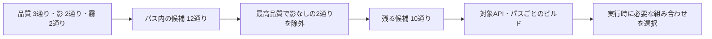
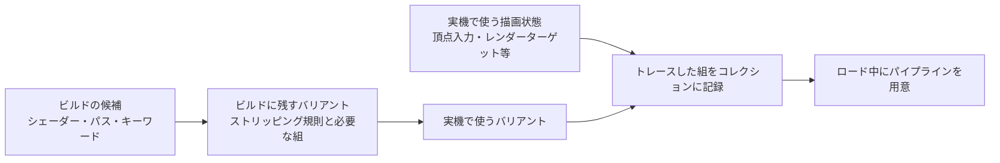

# シェーダーバリアントの管理 — コンパイルの組み合わせを減らす

シェーダーの機能をコンパイル時に切り替えると、同じソースから機能の組み合わせごとに異なるプログラムができます。これが**シェーダーバリアント**です。未使用の処理を外せる一方、組み合わせが増えるほどコンパイル、配布データ、読み込みの負荷が増えます。機能ごとに、実行時に切り替える必要があるか、両方の経路を同じプログラムに入れられるかを判断します。

## 組み合わせの数を先に数える

あるパスに品質3種、影のオン・オフ、霧のオン・オフがあると、候補は $3\times2\times2=12$ 種類です。3種の品質のうち最高品質で影が必須なら、「最高品質・影なし」の2種類を除外でき、10種類です。品質を排他的な1組で表すと、「高品質と低品質が同時に有効」のような状態が候補に入らずに済みます。



候補数はパスやシェーダーステージ、対象のグラフィックスAPI、レンダーパイプラインの設定にも依存します。図の12は1つのパス内で機能だけを数えた値です。実際のビルドでは、候補、除外後、コンパイルや格納の件数をログの集計単位に合わせて区別します。シェーダーが用意されていても、レンダーターゲット形式や深度・ブレンド状態との組み合わせによってはパイプライン作成が別途発生します。[パイプラインのコンパイルによるカクつき](/graphics/optimization/pipeline-compilation-stutter.html)

## Unity 6.3 LTS — キーワードで候補を作る

| 宣言 | 使いどころ |
| --- | --- |
| `shader_feature` | ビルド時に分かるマテリアルの機能。未使用の組み合わせをビルドから除外する仕組みがある |
| `multi_compile` | 実行時にも切り替える組み合わせを候補に入れる。レンダーパイプラインや独自のストリッピングが別に適用され得る |
| `dynamic_branch` | 同一プログラム内で実行時に分岐する。キーワードの各状態について別々のバリアントを作らない |

`shader_feature_local` や `multi_compile_local` の `_local` は、そのキーワードを同名のグローバルキーワードで上書きしない指定です。同じ選択肢を宣言したままスコープだけを変えても、この組が作る候補数は変わりません。例えば `#pragma shader_feature_local _ FOG_ON` は、オフとオンの2通りを候補にします。

コードからキーワードを有効にする、ビルド後にコンテンツを読み込むなど、ビルド時に使い方が分からない機能は、必要な組み合わせを含める仕組みとセットで設計します。Unity 6.3 LTSのStrict Shader Variant Matchingを検証用ビルドで使うと、必要な組み合わせが欠けて別の組み合わせで置き換わるケースを発見できます。

### キーワードの数とバリアントの数

シェーダーのソースで宣言したキーワードは `LocalKeyword` として各シェーダーの `keywordSpace` に入ります。グローバル側の `GlobalKeyword` は、同名で上書きを許すキーワードに作用します。例えば複数のマテリアルが同じシェーダーを使っていて、一部だけ霧を切りたいなら、ローカルスコープで宣言したキーワードをマテリアル単位で設定します。シェーダー間で全体設定を共有するキーワードには名前の所有者を決め、無関係なシェーダーが同じ名前を使わないようにします。[Unity 6.3、Declare shader keywords](https://docs.unity3d.com/6000.3/Documentation/Manual/SL-MultipleProgramVariants-declare.html)

Unity 6.3 の公式マニュアルでは、予約された 4 個を含めて 1 シェーダーで合計 128 個を超えると速度に影響する場合があるとしています。Unity 6.1 の公式マニュアルには、グローバル 4,294,967,294 個、シェーダーまたはコンピュートシェーダー単体のローカル 65,534 個という上限が記載されています。6.1 では動的分岐用のキーワードも含め、`UsePass` やフォールバックの依存元で宣言された同名キーワードは一度だけ数えます。ここで数えるのは名前の個数です。例えば独立した 20 個のオン・オフは、名前が少なくても $2^{20}=1,048,576$ 通りを 1 つのプログラムに対して作り得ます。Unity 6.3 のビルドでは、対象 API とパスごとの候補数、ストリップ後の数、コンパイル時間も確認します。[Unity 6.3、Declare shader keywords](https://docs.unity3d.com/6000.3/Documentation/Manual/SL-MultipleProgramVariants-declare.html)、[Unity 6.1、Shader keyword fundamentals](https://docs.unity.cn/6000.1/Documentation/Manual/shader-keywords.html)

キーワードを見直すときは、品質段階や描画方式を排他的なセットにします。例えば「影なし・硬い影・柔らかい影」は、`SHADOW_ON` と `SHADOW_SOFT` を独立に切り替えると 4 状態になり、「影なし・柔らかい影」が余ります。影なしを `_` とする 3 択なら、許可する状態を宣言から読めます。ストリッピングには、シェーダーの宣言だけでは表せない依存を任せます。例えば「最高品質では必ず影あり」という品質と影の間の条件を除外規則にします。

### IPreprocessShaders でビルド前に除外する

`IPreprocessShaders.OnProcessShader` は Player と AssetBundle のビルドで、グラフィックスシェーダーのスニペットについて候補の `IList<ShaderCompilerData>` を受け取ります。不要な組を `RemoveAt` で除きます。シェーダー名、パス、シェーダーステージ、コンパイラープラットフォーム、キーワードの組を使って、規則を必要な範囲に絞れます。コンピュートシェーダーのカーネルには別の `IPreprocessComputeShaders` が用意されています。すでにキャッシュされたシェーダーにはコールバックが呼ばれないため、規則変更後に全件を確認するときはクリーンビルドします。[Unity 6.3、OnProcessShader](https://docs.unity3d.com/6000.3/Documentation/ScriptReference/Build.IPreprocessShaders.OnProcessShader.html)

次は Unity 6.3 の Editor アセンブリでコンパイルできる C# です。`Sny0/VariantDemo` の `ForwardLit` という名前のパスに、`QUALITY_HIGH` と `SHADOWS_ON` をそれぞれオフ／オンで宣言してあることを前提とします。下の規則はこのシェーダーのこのパスだけに適用し、最高品質で影を無効にする候補を削除します。キーワードが見つからないときは、宣言または名前が変わった可能性があるので、ビルドのログに記録して候補を残します。

```csharp
using System.Collections.Generic;
using UnityEditor.Build;
using UnityEditor.Rendering;
using UnityEngine;
using UnityEngine.Rendering;

public sealed class StudyVariantStripper : IPreprocessShaders
{
    public int callbackOrder => 0;

    public void OnProcessShader(
        Shader shader, ShaderSnippetData snippet, IList<ShaderCompilerData> data)
    {
        if (shader.name != "Sny0/VariantDemo" || snippet.passName != "ForwardLit")
            return;

        LocalKeyword high = shader.keywordSpace.FindKeyword("QUALITY_HIGH");
        LocalKeyword shadows = shader.keywordSpace.FindKeyword("SHADOWS_ON");
        if (!high.isValid || !shadows.isValid)
        {
            Debug.LogWarning("StudyVariantStripper: expected keywords were not found.");
            return;
        }

        for (int i = data.Count - 1; i >= 0; --i)
        {
            ShaderKeywordSet keywords = data[i].shaderKeywordSet;
            if (keywords.IsEnabled(high) && !keywords.IsEnabled(shadows))
                data.RemoveAt(i);
        }
    }
}
```

このフィルターを、冒頭の品質 3 種、影 2 種、霧 2 種の 12 候補に適用すると、霧のオフ／オンに対応する 2 候補を除き、10 候補が残ります。既存のストリッピングが先に実行されている場合、受け取るリストにはすでに候補がないこともあります。規則の追加前後で「受け取った件数」「削除した件数」「残った件数」を API、ステージ、パスごとに記録すると、計数の違いが分かります。マテリアルや実行時の品質設定も同じ条件を守らせ、例えば `QUALITY_HIGH` を選ぶときに影を同時に有効にします。

AssetBundle を分けて作る場合は、どのビルドに対象シェーダーと必要なバリアントが含まれるかを決めます。通常プレイのシーン以外にも、DLC のマテリアル、切り替え可能な品質と影、デバッグメニューで選べる状態を検証に含めます。ストリッピングを強めた直後に Editor で描けるかだけを確認すると、実際の Player で必要な組の欠落を見落とします。

### ShaderVariantCollection と GraphicsStateCollection

`ShaderVariantCollection` にはシェーダー、パス種別、キーワードの組を登録できます。シーン内のマテリアルからは参照されず実行時に必要になるバリアントを、ビルドに含めるために使えます。またコレクション単位でウォームアップを要求できます。任意の組を削除する独自のストリッピング規則を併用するなら、必要なバリアントのリストと規則を突き合わせます。実行時トレースで作るリストは、記録中に表示したパスや設定に依存するため、稀にしか使わないマテリアルやプレイ中に切り替える品質も対象にします。[Unity 6.3、Create a shader variant collection](https://docs.unity3d.com/6000.3/Documentation/Manual/shader-variant-collections.html)

同じシェーダーバリアントを使っても、頂点レイアウトやレンダーターゲットの形式などが変われば、別のパイプライン状態が必要になる場合があります。Unity 6.3 の `UnityEngine.Experimental.Rendering.GraphicsStateCollection` は、バリアントに実際のグラフィックス状態を組み合わせて記録し、先に用意する実験的 API です。`BeginTrace` と `EndTrace` の間の描画を採取し、結果のコレクションを対象プラットフォームとグラフィックス API ごとに用意します。ロード中に `WarmUp` で全件を、`WarmUpProgressively` で件数を区切ってスケジュールできます。グラフィックス状態のウォームアップに対応しない古い API では、`WarmUp` が `ShaderVariantCollection.WarmUp` 相当の動作にフォールバックします。[Unity 6.3、GraphicsStateCollection](https://docs.unity.com/en-us/engine/6000.3/script-reference/unityengine/experimental/rendering/graphicsstatecollection)、[Warm up PSOs](https://docs.unity3d.com/6000.3/Documentation/Manual/shader-prewarm.html)



次は Unity 6.3 で使うロード画面側のコルーチンです。対象の `GraphicsStateCollection` を割り当て、描画を開始する前の画面で `WarmUpBeforeReveal` を実行します。`JobHandle` を完了させてからシーンを表示する呼び出し順にすると、ウォームアップを予約した直後に初回描画してしまう競合を避けられます。実際のロード時間と初回描画の時間を記録し、コレクションの範囲やロード画面で待つ量を調整します。

```csharp
using System;
using System.Collections;
using Unity.Jobs;
using UnityEngine;
using UnityEngine.Experimental.Rendering;

public sealed class StudyShaderWarmup : MonoBehaviour
{
    [SerializeField] private GraphicsStateCollection collection = null;

    public IEnumerator WarmUpBeforeReveal()
    {
        if (collection == null)
            throw new InvalidOperationException("Assign a GraphicsStateCollection.");

        JobHandle pending = collection.WarmUp();
        try
        {
            while (!pending.IsCompleted)
                yield return null;
        }
        finally
        {
            pending.Complete();
        }
    }
}
```

## Unreal Engine 5.8 — パーミュテーションの軸を定義する

Unreal Engineのグローバルシェーダーでは、`TShaderPermutationDomain` で機能の選択肢を軸として組み合わせ、パーミュテーションIDで特定の組み合わせを扱えます。例えば「ソフトシャドウの有無」と「デバッグ表示の有無」を別の軸にすると、両方オフ、片方ずつオン、両方オンの4候補です。対象プラットフォームで成立しない機能や、製品ビルドで不要なデバッグ経路は、コンパイル対象を決めるときに除外します。

件数を減らすときは、対象の品質、レンダーパス、プラットフォームで成立する組み合わせを先に列挙します。少ない演算を切り替えるだけの機能は、実行時分岐にした場合のGPU時間も測ります。同じ描画の全ピクセルで同じ値を使う分岐と、ピクセルごとに条件が異なる分岐では、GPU上の実行のされ方が異なります。

### ShouldCompilePermutation と実行時の選択

グローバルシェーダーの `ShouldCompilePermutation` は、コンパイル対象のプラットフォームとパーミュテーション ID などを受け取り、その組をコンパイルするか判断します。ID を `TShaderPermutationDomain` に戻すと、どの軸の値が選ばれたかを読めます。例えばソフトシャドウを実装していないプラットフォームなら、ソフトシャドウ有効の 2 候補を外せます。`ModifyCompilationEnvironment` は、コンパイルする組のマクロなどを設定する側です。実行時に品質設定から ID を求める処理も、同じプラットフォーム条件を参照してコンパイルされる組を選びます。[Epic Games、FGlobalShader](https://dev.epicgames.com/documentation/en-us/unreal-engine/API/Runtime/RenderCore/FGlobalShader?application_version=5.8)

| プラットフォームの条件 | 許可する組 | 候補数 |
| --- | --- | ---: |
| ソフトシャドウ対応 | オフ／オンの各状態と、デバッグ表示のオフ／オン | 4 |
| ソフトシャドウ非対応 | ソフトシャドウはオフ。デバッグ表示のオフ／オン | 2 |
| ソフトシャドウ非対応かつデバッグ表示をビルドから除外 | ソフトシャドウとデバッグ表示を両方オフ | 1 |

除外条件はシェーダーを使うコードと対にします。例えば製品ビルドでデバッグ表示をコンパイルしないなら、ランタイムでそのフラグを選べる呼び出し元も制限します。ソフトシャドウ非対応なら、要求を拒否するか、通常の影へ戻す規則を品質設定で持ちます。プラットフォームや設定が増えたときは、除外後に空になる経路がないか、Cook するターゲットごとに検証します。

### マテリアルの Static Switch、Usage、Vertex Factory

マテリアルの `Static Switch Parameter` はコンパイル時に片側を選ぶため、選ばなかった経路を生成プログラムから外せます。例えば詳細法線とエミッシブの 2 スイッチがあり、両方オフ、一方だけオンを 2 種、両方オンの全てをインスタンスで使うなら 4 組です。色の強さのように連続した値を調整したい項目は、Scalar Parameter などで 1 本のプログラムから扱えます。実行中に切り替えたい Static Switch は、必要な静的設定を別のマテリアルとして用意して切り替えるか、動的パラメーターで表す設計にします。[Epic Games、Material Parameter Expressions](https://dev.epicgames.com/documentation/en-us/unreal-engine/material-parameter-expressions-in-unreal-engine?application_version=5.8)

マテリアルの Usage フラグは、Skeletal Mesh や Mesh Particles など、マテリアルが適用される用途をエンジンに知らせます。メッシュ用シェーダーが参照する頂点の入力と変換は **Vertex Factory** が扱います。頂点バッファーからローカル位置を取り出す静的メッシュと、骨の変換から頂点位置を求めるスキンメッシュでは、必要な頂点データや処理が変わります。そのため `FMeshMaterialShaderType` の対象を判定する際は、プラットフォームとマテリアルに加えて Vertex Factory の型も関わります。各 Usage フラグが一つの Vertex Factory や一つのプログラムに対応するという数え方はできないので、実際に使うマテリアル、用途、パスの組を確認します。[Epic Games、Material Properties](https://dev.epicgames.com/documentation/en-us/unreal-engine/unreal-engine-material-properties?application_version=5.8)、[Shader Development](https://dev.epicgames.com/documentation/en-us/unreal-engine/shader-development-in-unreal-engine?application_version=5.8)、[FMeshMaterialShaderType](https://dev.epicgames.com/documentation/en-us/unreal-engine/API/Runtime/Engine/FMeshMaterialShaderType?application_version=5.8)

例えばマテリアルが使う静的な設定を 4 組、適合する Vertex Factory を 2 種、パスを 3 個と仮定し、それぞれが全て交差すると、1 ターゲットにつき $4\times2\times3=24$ 個の組になります。キャラクター用の 2 設定だけをスキンメッシュでも使うなら、同じ仮定で $(4+2)\times3=18$ 組です。これは依存を整理するためのモデルです。Cook の件数にはシェーダータイプやステージが関わり、パスごとの許可条件でも件数が変わります。共通のマスターマテリアルに全用途の Usage と Static Switch を集めたときは、どの部分をキャラクター、地形、VFX で共有できるか、分けるとどの組が消えるかをこの形で見積もれます。

UE 5.8 のプロジェクト設定には Shader Permutation Reduction があります。例えば Stationary Skylight を使わないターゲットでは、Base Pass の該当パーミュテーションを減らせます。無効化するとプロジェクト内で対応する描画の利用条件も変わるので、製品ビルドで対象シーンを検証します。マテリアル単体の設定では、Editor が用途を自動設定する場合もあるため、実際に保存された Usage を確認します。[Epic Games、Rendering Settings](https://dev.epicgames.com/documentation/unreal-engine/rendering-settings-in-the-unreal-engine-project-settings?lang=en-US)

### PSO Precaching で最初の描画に間に合わせる

UE 5.8 の PSO Precaching は、対応 RHI で使う Pipeline State Object を集めて非同期に作ります。コンポーネントのロード後に、マテリアル、Vertex Factory、頂点要素、描画パスで必要になる状態を集め、対象のメッシュパスに応じた PSO を要求します。ベースパス、深度、影、速度バッファーなどで同じコンポーネントを描く場合、各パスで別の状態が必要です。`r.PSOPrecaching` は全体の有効化、`r.PSOPrecache.Components` はコンポーネントの事前作成を制御します。描画の要求時点までに PSO が揃わないとき、プロキシの作成を遅らせて表示を待つ設定もあります。[Epic Games、PSO Precaching](https://dev.epicgames.com/documentation/en-us/unreal-engine/pso-precaching-for-unreal-engine)

初回表示で止まったときは、UE 5.8 の `r.PSOPrecache.Validation` と `stat PSOPrecache` で、必要な PSO が予測に入っていたかと、準備が間に合ったかを確認します。**Missed** は必要な PSO が事前作成されなかった件数、**Too Late** はキューに積まれたが初回利用に間に合わなかった件数です。前者ではログの Material、Vertex Factory、Mesh Pass、シェーダーハッシュを手がかりに、レンダーターゲットの状態も確認します。後者では PSO の要求時点から初回描画までの時間と、ロード中に発行された要求の量を確認します。最初のロードを測るときはドライバーキャッシュが空の条件も用意し、Unreal Insights の PSO イベントとフレームの遅れを照合します。

| 比較する観察結果 | 追加で確かめる箇所 |
| --- | --- |
| シェーダー候補と Cook 時間が増えた | Static Switch の利用組、Usage の追加、パスやターゲットの増加 |
| バリアント数は同じだが、PSO の Missed が増えた | 頂点要素、レンダーターゲット形式、ブレンドや深度状態の組 |
| PSO の Too Late が増えた | ストリーミングやロードの開始時点、優先度、描画開始までの猶予 |

自動で集める範囲の外に残る PSO は、対象を絞って実際のゲームプレイから取得し、Bundled PSO Cache として同梱する選択肢があります。比較するときは、製品に含むシェーダーの量、ロード時間、最初のプレイで止まる回数を記録します。[Epic Games、Manually Creating Bundled PSO Caches](https://dev.epicgames.com/documentation/unreal-engine/manually-creating-bundled-pso-caches-in-unreal-engine?lang=en-US)

## コード例 — フォグを2つのバリアントにする

HLSL Shader Model 6.0のピクセルシェーダーです。`Material.hlsl` を `dxc -T ps_6_0 -E MaterialPS -D USE_FOG=0 -Fo off.dxil Material.hlsl` と `dxc -T ps_6_0 -E MaterialPS -D USE_FOG=1 -Fo on.dxil Material.hlsl` で別々にコンパイルします。色は線形RGB、`viewDistance` は0以上の距離です。`FogDensity` の単位は距離の逆数です。

```hlsl
#ifndef USE_FOG
#define USE_FOG 0
#endif

cbuffer Material : register(b0)
{
    float3 BaseColor;
    float FogDensity;
    float3 FogColor;
};

struct PixelInput
{
    float viewDistance : TEXCOORD0;
};

float4 MaterialPS(PixelInput input) : SV_Target
{
    float3 color = BaseColor;
#if USE_FOG
    const float transmittance = exp(-FogDensity * input.viewDistance);
    color = lerp(FogColor, color, transmittance);
#endif
    return float4(color, 1.0);
}
```

密度が $0.1\,\mathrm{m}^{-1}$、距離が10 mなら、オンのときの透過率は $e^{-1}\simeq0.368$ です。オフではフォグの計算が前処理で外れ、元の色を返します。実行時分岐に切り替えるとプログラムを1本にできるため、残る計算量とバリアント数の両方を比較します。

## 理解度チェック

1. パス内に色の方式4種類と独立したオン・オフが3個ある。候補はいくつ？
2. 実行時に初めて有効にする機能がエディターでは見えるが、ビルドで表示されない。何を確認する？
3. シェーダーバリアントを事前に用意すれば、初めて表示したときの停止は必ず消える？
4. Unity でストリッピング規則だけを変更した。コールバックが全シェーダーで動くかを確かめるには？
5. UE の `stat PSOPrecache` で Missed は 0 のまま、Too Late が増えた。どこを調べる？

::: details 解答
1. $4\times2^3=32$ 種類です。色の方式を排他的な1組として数え、3つのオン・オフはそれぞれ掛け合わせます。
2. 対象パスとAPIで、そのキーワードの組み合わせが残っているか確認します。ビルド時のマテリアル利用状況やストリッピングの規則で外れた可能性があります。
3. パイプラインを初めて作る負荷が残る場合があります。シェーダーのコンパイル、データの読み込み、パイプラインの作成を分けて測ります。
4. クリーンビルドで各パス、ステージ、コンパイラープラットフォームの候補を記録します。キャッシュにあるシェーダーはコールバックの対象外になる場合があります。
5. 事前作成のキューには積まれています。PSO の要求時点、最初に描画する時点、並行しているロードや PSO の処理量を確認します。
:::

## 関連項目

- [HLSL](/graphics/shader/hlsl.html)
- [パイプラインのコンパイルによるカクつき](/graphics/optimization/pipeline-compilation-stutter.html)
- [CPUプロファイリング](/tools/profiling/cpu-profiling.html)
- [シェーダー最適化の実践](shader-optimization.md)

## 参考資料

- [Unity、Declare shader keywords（Unity 6.3 LTS）](https://docs.unity3d.com/6000.3/Documentation/Manual/SL-MultipleProgramVariants-declare.html)
- [Unity、Reduce shader variants（Unity 6.3 LTS）](https://docs.unity3d.com/6000.3/Documentation/Manual/shader-variant-stripping.html)
- [Unity、Shader keyword fundamentals（Unity 6.1 の上限値）](https://docs.unity.cn/6000.1/Documentation/Manual/shader-keywords.html)
- [Unity、IPreprocessShaders.OnProcessShader（Unity 6.3 LTS）](https://docs.unity3d.com/6000.3/Documentation/ScriptReference/Build.IPreprocessShaders.OnProcessShader.html)
- [Unity、Create a shader variant collection（Unity 6.3 LTS）](https://docs.unity3d.com/6000.3/Documentation/Manual/shader-variant-collections.html)
- [Unity、GraphicsStateCollection（Unity 6.3 LTS）](https://docs.unity.com/en-us/engine/6000.3/script-reference/unityengine/experimental/rendering/graphicsstatecollection)
- [Unity、Warm up PSOs（Unity 6.3 LTS）](https://docs.unity3d.com/6000.3/Documentation/Manual/shader-prewarm.html)
- [Epic Games、TShaderPermutationDomain（Unreal Engine 5.8）](https://dev.epicgames.com/documentation/unreal-engine/API/Runtime/RenderCore/TShaderPermutationDomain?lang=en-US)
- [Epic Games、FGlobalShader（Unreal Engine 5.8）](https://dev.epicgames.com/documentation/en-us/unreal-engine/API/Runtime/RenderCore/FGlobalShader?application_version=5.8)
- [Epic Games、Shader Development（Unreal Engine 5.8）](https://dev.epicgames.com/documentation/en-us/unreal-engine/shader-development-in-unreal-engine?application_version=5.8)
- [Epic Games、Material Parameter Expressions（Unreal Engine 5.8）](https://dev.epicgames.com/documentation/en-us/unreal-engine/material-parameter-expressions-in-unreal-engine?application_version=5.8)
- [Epic Games、Material Properties（Unreal Engine 5.8）](https://dev.epicgames.com/documentation/en-us/unreal-engine/unreal-engine-material-properties?application_version=5.8)
- [Epic Games、PSO Precaching（Unreal Engine）](https://dev.epicgames.com/documentation/en-us/unreal-engine/pso-precaching-for-unreal-engine)
- [Epic Games、Debugging the Shader Compile Process（Unreal Engine 5.8）](https://dev.epicgames.com/documentation/unreal-engine/debugging-the-shader-compile-process-in-unreal-engine?application_version=5.8)
- [Microsoft、HLSLのプリプロセッサー](https://learn.microsoft.com/en-us/windows/win32/direct3dhlsl/dx-graphics-hlsl-appendix-preprocessor)
