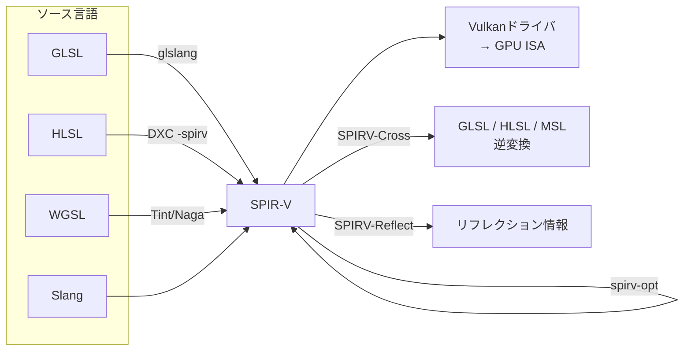

# SPIR-V と中間表現

## 概要

SPIR-V は**Vulkan / OpenCL / (OpenGL 4.6) の標準シェーダ中間表現 (IR)** です。人間が書く言語 (GLSL/HLSL/WGSL) とGPUドライバの間に立つバイナリ形式で、SSA形式の型付き命令列として構成されます。DirectXにおける **DXIL** と対をなす存在で、現代のシェーダエコシステム全体がこの「中間表現を軸としたハブ&スポーク構造」で成立しています。

## なぜ必要なのか

- **ドライバの単純化と挙動統一**: ソース言語の解析をドライバから排除し、検証済みIRだけを受け取らせる
- **言語の自由**: SPIR-Vさえ吐ければソース言語は何でもよい (GLSL/HLSL/Slang/Rust-GPU...)
- **ツールエコシステム**: 最適化 (spirv-opt)、リフレクション (SPIRV-Reflect)、逆変換 (SPIRV-Cross) が言語非依存で書ける
- シェーダ変換パイプラインを理解しないと、エンジンのシェーダビルドシステムがブラックボックスになる

## 歴史・誕生した背景

- 〜2015: GLSLソース直接コンパイル方式の限界が明確化 (ベンダー方言・実行時コンパイル時間・難読化不能)
- ゲーム業界はバイナリシェーダを要求 — `GL_ARB_get_program_binary` はドライバ更新で無効になる不完全解
- 2015: OpenCL 1.2向け「SPIR」(LLVM IRベース) の経験を経て、**独自バイナリ形式のSPIR-V** をVulkanと同時発表。LLVM IR非依存としたのは、LLVMのバージョン間非互換とGPU特有の構造 (構造化制御フロー、詳細な型) に合わせるため
- 2016: DXCがDXIL (こちらはLLVM 3.7ベース) を採用。2017年にDXCへSPIR-Vバックエンド追加
- 2023: WGSLもSPIR-Vとの相互変換を前提に設計

## それ以前の技術

- **DXBC**: DX9〜11のバイトコード。閉鎖仕様・古いレジスタマシンモデル
- **GLSLソース配布**: 上記の問題群
- **ARB program binary**: ベンダー・ドライバ固有で配布に使えない

## 解決した課題

1. コンパイラフロントエンドの一本化 → ベンダー間の挙動差の劇的減少
2. オフラインコンパイル → ロード時間短縮、ソース秘匿
3. 言語とAPIの分離 → HLSL on Vulkan、Slang等の多言語化を可能に

**残った課題**: SPIR-V/DXILは「ハードウェア命令」ではないため、**最終コンパイル (IR→GPU固有ISA) は依然ドライバ内**で起き、PSOコンパイルのヒッチ (シェーダコンパイルスタッター) 問題は残っています → 各エンジンのPSOキャッシュ戦略へ

## 現在の位置づけ

Vulkanの唯一の入力形式であり、シェーダツールチェーンの共通ハブです。実務では「読み書きする」より「パイプラインの結節点として扱う」ことが多く、リフレクション (バインディング情報の自動抽出) での利用が最頻です。

## 内部動作

### 形式の概要

- 32bitワードのストリーム。マジックナンバー `0x07230203`
- **SSA形式** (各IDは一度だけ定義される)、型は明示的にID化
- **構造化制御フロー**: ループ・分岐はマージブロック情報を持ち、GPUのSIMT実行 (再収束点) を表現できる
- ケイパビリティ宣言 (`OpCapability Shader` 等) で使用機能を明示



### 実際のSPIR-Vを覗く

GLSLの `outColor = a * b;` に相当する部分 (逆アセンブル表示):

```text
%float   = OpTypeFloat 32
%v4float = OpTypeVector %float 4
%a       = OpLoad %v4float %a_ptr
%b       = OpLoad %v4float %b_ptr
%result  = OpFMul %v4float %a %b
           OpStore %outColor %result
```

`spirv-dis shader.spv` で誰でも確認できます。命令セットは約700個で、Vulkan仕様サイトに全リストがあります。

### DXILとの比較

| | SPIR-V | DXIL |
|---|---|---|
| 管轄 | Khronos | Microsoft |
| ベース | 独自 (SSA) | LLVM 3.7 IR + メタデータ |
| 対象API | Vulkan / OpenCL / GL 4.6 | DirectX 12 |
| ツール | spirv-opt, SPIRV-Cross等 (活発) | dxc内蔵、dxil-spirv等 |
| 特徴 | 構造化制御フロー必須 | LLVMエコシステム流用 |

Proton (SteamのWindowsゲーム互換層) は **dxil-spirv** でDXIL→SPIR-V変換を行っており、両IRの相互変換は実用技術です (vkd3d-proton)。

### リフレクション

SPIR-Vからバインディング情報を抽出して、Descriptor Set Layoutを自動生成するのが現代的なエンジン設計です:

```text
シェーダビルド時: HLSL → SPIR-V → SPIRV-Reflect
  → 「set=0, binding=1 は combined image sampler、名前はalbedoTex」
  → パイプラインレイアウトの自動構築 / C++ヘッダ生成
```

## 各環境での扱い

### Unity
内部のシェーダコンパイルパイプラインがVulkan/Metal向けにSPIR-Vを経由します。開発者が直接触ることは稀ですが、Vulkanビルドのシェーダ問題の調査ではRenderDocでSPIR-V逆アセンブルを読むことになります。

### Unreal Engine
ShaderConductor→(現在はDXCベース)のクロスコンパイルでSPIR-Vを生成し、Vulkan RHIに供給。Android Vulkanビルドの実体はSPIR-Vです。

### DirectX 12
DXILを使用。`dxc -T ps_6_0 -Fo out.dxil`。DXILは署名検証 (dxil.dll) があり、改変には再署名が必要という運用上の特徴があります。

### Vulkan
`VkShaderModuleCreateInfo` にSPIR-Vバイナリを渡すのが唯一のシェーダ供給経路。実行前に **検証レイヤ + ドライバ内検証**が仕様適合をチェックします。

## コード例

シェーダビルドパイプラインの実例 (CMake):

```cmake
# GLSL → SPIR-V をビルド時に自動実行
find_program(GLSLC glslc REQUIRED)   # shaderc付属コンパイラ
file(GLOB SHADERS shaders/*.vert shaders/*.frag shaders/*.comp)
foreach(SHADER ${SHADERS})
    get_filename_component(NAME ${SHADER} NAME)
    add_custom_command(
        OUTPUT ${CMAKE_BINARY_DIR}/shaders/${NAME}.spv
        COMMAND ${GLSLC} -O ${SHADER} -o ${CMAKE_BINARY_DIR}/shaders/${NAME}.spv
        DEPENDS ${SHADER})
    list(APPEND SPV_FILES ${CMAKE_BINARY_DIR}/shaders/${NAME}.spv)
endforeach()
add_custom_target(shaders ALL DEPENDS ${SPV_FILES})
```

SPIRV-Reflectによるリフレクション (C++):

```cpp
SpvReflectShaderModule module;
spvReflectCreateShaderModule(spirvSize, spirvData, &module);

uint32_t count = 0;
spvReflectEnumerateDescriptorBindings(&module, &count, nullptr);
std::vector<SpvReflectDescriptorBinding*> bindings(count);
spvReflectEnumerateDescriptorBindings(&module, &count, bindings.data());

for (auto* b : bindings) {
    printf("set=%u binding=%u type=%d name=%s\n",
           b->set, b->binding, b->descriptor_type, b->name);
    // → VkDescriptorSetLayoutBinding を自動構築できる
}
```

## 前提知識

- [シェーダ言語総論と比較](/graphics/shader/overview.html)

## 次に読むべきページ

- [Vulkan](/graphics/api/vulkan.html) — SPIR-Vの主戦場
- [DirectX 12](/graphics/api/directx12.html) — DXIL側の世界
- [HLSL](/graphics/shader/hlsl.html) — DXCの二正面出力

## 理解度チェック

1. **SPIR-VがLLVM IRをそのまま採用しなかった理由を挙げよ。**
   ::: details 解答
   LLVM IRはバージョン間の安定性が保証されず、配布形式として不適だった。またGPUシェーダに必要な構造化制御フロー(SIMT再収束点の表現)や詳細な型・装飾情報の表現がLLVM IRの設計と合わず、Khronosが安定した独自仕様を策定する方が長期的な標準として適切と判断された。
   :::

2. **SPIR-V導入後も「シェーダコンパイルスタッター」が残るのはなぜか。**
   ::: details 解答
   SPIR-V/DXILは移植可能な中間表現であり、GPUが直接実行する機械語ではない。IR→GPU固有ISAへの最終コンパイルはPSO作成時にドライバ内で実行されるため、初出のパイプラインに対するコンパイルコストは残る。対策としてPSOの事前ウォーム・ディスクキャッシュ(Steam Shader Cache、VK_EXT_pipeline_cacheなど)が使われる。
   :::

3. **SPIRV-Crossの役割と代表的な利用例を述べよ。**
   ::: details 解答
   SPIR-Vを人間可読な高級言語(GLSL/HLSL/MSL)へ逆変換するツール。代表例はMoltenVK(Vulkanシェーダ→MSL化してMetalで実行)や、各エンジンのクロスコンパイルパイプライン(1ソースからGL/Metal向けシェーダを生成)。
   :::

## 参考資料

- Khronos, *SPIR-V Specification* / spirv.io ツール一覧
- KhronosGroup/SPIRV-Tools, SPIRV-Cross, SPIRV-Reflect
- microsoft/DirectXShaderCompiler — DXIL docs
- HansKristian-Work/dxil-spirv, vkd3d-proton — IR相互変換の実例
