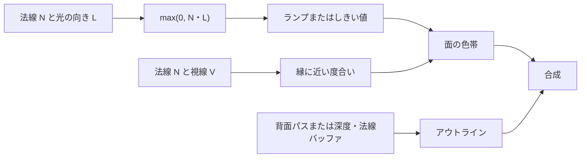

# トゥーンとNPR — 陰影の段と輪郭線を描き分ける

トゥーンシェーディングでは、面が光を向く度合いを数段階の色に置き換えます。段の位置や色、輪郭線の太さは、形を読み取りやすくするための設計変数です。こうした表現はNPR（非写実的レンダリング）の一つです。Goochらの技術イラストの照明モデルも、輪郭線とハイライトが埋もれないよう、面の陰影に使う明度を制御しています。

## ランプで陰影の段を作る

単位法線 $N$ と面から光源への単位ベクトル $L$ の内積を、$x=\max(0,N\cdot L)$ とします。$x$ を明るさにそのまま使うと面の曲がりに沿って滑らかに変化します。色帯を作るなら、例えば $x=0.25$ と $0.65$ を境界にします。

| $x$ の範囲 | 反射色へ掛ける値 | $x$ の例 |
| --- | ---: | ---: |
| $0\le x<0.25$ | 0.18 | 0.20 |
| $0.25\le x<0.65$ | 0.55 | 0.50 |
| $0.65\le x\le 1$ | 1.00 | 0.80 |

この対応をテクスチャに持たせると、影の色や段数を絵として編集できます。横軸は $x$、縦軸は例えば材質ごとの行です。行の中央をサンプルし、境界を固定したいならポイントフィルタとクランプを選びます。3段を等幅の3テクセルで表すと境界が $1/3$ と $2/3$ になるため、任意の境界にはテクセルを増やして帯の幅を作るか、しきい値をコードに置きます。

境界が移動すると輪郭がちらつく場合があります。ピクセルシェーダーの `fwidth(x)` は画面上の近傍での変化量を見積もります。コードで段を作る場合は、その値を使って境界付近だけを `smoothstep` でつなげます。実際の影の有無はライトの可視性から求めるので、モデルが光を向く条件だけで影が消えるわけではありません。



## リムライトとアウトライン

リムライトは視線方向 $V$ に対して面が横を向くほど強くします。$r=1-\max(0,N\cdot V)$ とすると、正面で0、接線方向に近づくと1です。$r$ を累乗すると縁に集中し、しきい値で切ると帯になります。光が当たる側にだけ欲しければ、$N\cdot L$ やライトの可視性で絞ります。

| アウトライン | 何を描くか | 調整する箇所 |
| --- | --- | --- |
| 背面法（inverted hull） | 頂点を法線方向に押し出したメッシュを用意し、前面をカリングして奥側の面を描く。元の面からはみ出す部分が線になる | 頂点法線が分かれた箇所の切れ目、透視投影での太さ、深度テスト |
| 画面空間 | 深度や法線の画面上の差が大きい場所を検出して色を合成する | 背景と物体の境目、同じ物体の折れ目、距離で変わる深度差、描画済みバッファに入っていない半透明物 |

背面法をDirect3D 12で行うなら、別のパイプラインで `D3D12_CULL_MODE_FRONT` を使い、前面の巻き順と深度条件を元の描画に合わせます。画面空間の深度差は、デバイス深度をそのまま比較した場合と、ビュー空間の深度へ戻して比較した場合で距離による変化が異なります。線が欲しい対象と画面上の太さを決めてから、検出に使う入力を選びます。

## コード例 — 3段の陰影とリム

HLSL Shader Model 6.0のピクセルシェーダーです。`dxc -T ps_6_0 -E ToonPS Toon.hlsl` でコンパイルできます。頂点側からワールド空間の法線と面からカメラへのベクトルを渡します。色は線形値です。アウトラインは別パスで合成します。

```hlsl
cbuffer ToonMaterial : register(b0)
{
    float3 BaseColor;
    float RimStrength;
    float3 LightToSource;
    float RimThreshold;
};

struct PixelInput
{
    float3 normalWS : TEXCOORD0;
    float3 toCameraWS : TEXCOORD1;
};

float4 ToonPS(PixelInput input) : SV_Target
{
    const float3 normal = normalize(input.normalWS);
    const float3 light = normalize(LightToSource);
    const float3 view = normalize(input.toCameraWS);
    const float ndl = saturate(dot(normal, light));
    const float width = max(0.5 * fwidth(ndl), 0.0001);

    const float middle = smoothstep(0.25 - width, 0.25 + width, ndl);
    const float bright = smoothstep(0.65 - width, 0.65 + width, ndl);
    const float diffuse = 0.18 + 0.37 * middle + 0.45 * bright;
    const float rimAngle = 1.0 - saturate(dot(normal, view));
    const float rim = smoothstep(RimThreshold - 0.05, RimThreshold + 0.05, rimAngle);
    return float4(BaseColor * diffuse + RimStrength * rim * ndl, 1.0);
}
```

段の間で `middle=1`、`bright=0` なら $0.18+0.37=0.55$、両方が1なら $0.18+0.37+0.45=1.00$ です。微分で求めた幅が大きいと中間値が増えます。帯の面積を保ちたいときは幅の上限を設けて、低解像度と遠距離で見比べます。

## 理解度チェック

1. 影色と明色をそれぞれ決めたいとき、ランプには何を入れる？
2. 同じ色を持つ箱の正面と側面の境目を検出したい。どの入力が役に立つ？
3. 正面を向く面でリムライトが弱くなるのはなぜ？

::: details 解答
1. 内積 $x$ で引く色を入れます。線形のRGBで色帯を作れば、影を青、明部を黄に寄せるように明度と色相を同時に制御できます。
2. 法線です。境界で色や深度がほぼ連続でも、面の向きは大きく変わります。
3. $N\cdot V$ が1に近づき、$1-\max(0,N\cdot V)$ が0に近づくからです。
:::

## 関連項目

- [WebGPU実践でパラメーターを変える](/practice/graphics/shader-lab.html#toon)
- [ピクセルシェーダー](/graphics/pipeline/fragment-shader.html)
- [頂点シェーダーでの表現](/graphics/shader/vertex-effects.html)
- [アンチエイリアシング](/graphics/postprocess/antialiasing.html)

## 参考資料

- [Goochほか、A Non-Photorealistic Lighting Model for Automatic Technical Illustration（SIGGRAPH 1998）](https://users.cs.northwestern.edu/~ago820/SIG98/abstract.html)
- [Microsoft、HLSLのfwidth](https://learn.microsoft.com/en-us/windows/win32/direct3dhlsl/dx-graphics-hlsl-fwidth)
- [Microsoft、Direct3D 12のD3D12_CULL_MODE](https://learn.microsoft.com/en-us/windows/win32/api/d3d12/ne-d3d12-d3d12_cull_mode)
