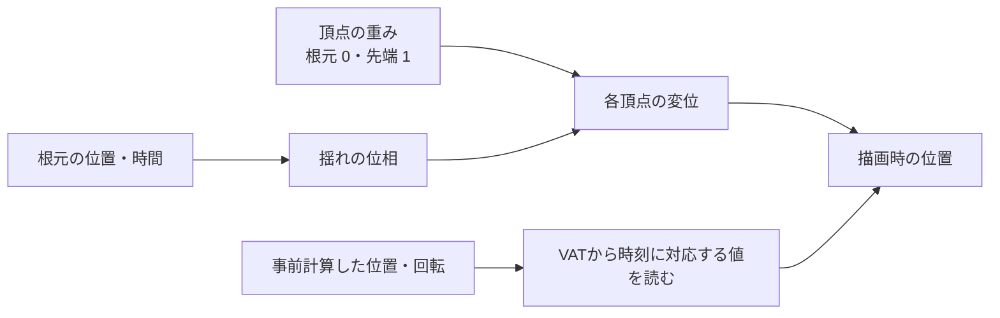

# 頂点シェーダーでの表現 — 風・波・VATで形を動かす

頂点シェーダーで位置をずらすと、風に揺れる草や波打つ水面を描けます。草なら根元を固定するための重み、波なら時間と位置によって変わる位相が必要です。シミュレーションで作った複雑な動きは、頂点ごとの変位をテクスチャに記録して再生する方法もあります。頂点から描画までの流れは[頂点シェーダー](/graphics/pipeline/vertex-shader.html)で扱います。

## 草の揺れ — 曲がり方と位相を分ける

草の根元から先端までの重みを $w\in[0,1]$ とし、風向きに沿った変位を $A w^2\sin(\phi)$ とします。$A$ は最大変位、$\phi$ は時刻と位置で変わる位相です。重みに二乗を使うと先端の動きに比べて中間が小さくなります。$A=0.20$ mで $\sin(\phi)=1$ の瞬間、根元は0 m、中間の $w=0.5$ は0.05 m、先端は0.20 m動きます。

草の1本の中では位相を共有し、根元の位置を位相に入れると、同じ場所の草が近い時刻に揺れます。幹全体を曲げる動きと、葉の縁が細かく震える動きは別の重みと周波数で足せます。CrytekのCrysisの事例では、全体を曲げる処理と葉の細部の処理を分けています。



## コード例 — ワールド空間で草を曲げる

HLSL Shader Model 6.0の頂点シェーダーです。`dxc -T vs_6_0 -E WindVS Wind.hlsl` でコンパイルできます。各頂点にオブジェクト空間の根元位置と0〜1の変形重みを渡します。`WindDirectionXZ` は単位ベクトル、`Amplitude` はメートル、`SpatialFrequency` はrad/m、`AngularFrequency` はrad/sです。行列は列ベクトルへ左から掛ける規約で、定数バッファにもこの規約で渡します。

```hlsl
cbuffer Wind : register(b0)
{
    column_major float4x4 ObjectToWorld;
    column_major float4x4 ViewProjection;
    float2 WindDirectionXZ;
    float Amplitude;
    float SpatialFrequency;
    float AngularFrequency;
    float TimeSeconds;
};

struct VertexInput
{
    float3 positionOS : POSITION;
    float3 rootOS : TEXCOORD0;
    float bendWeight : TEXCOORD1;
    float2 uv : TEXCOORD2;
};

struct VertexOutput
{
    float4 positionCS : SV_Position;
    float2 uv : TEXCOORD0;
};

VertexOutput WindVS(VertexInput input)
{
    float3 position = mul(ObjectToWorld, float4(input.positionOS, 1.0)).xyz;
    const float3 root = mul(ObjectToWorld, float4(input.rootOS, 1.0)).xyz;
    const float phase = SpatialFrequency * dot(root.xz, WindDirectionXZ)
                      - AngularFrequency * TimeSeconds;
    const float weight = saturate(input.bendWeight);
    position.xz += WindDirectionXZ * (Amplitude * weight * weight * sin(phase));

    VertexOutput output;
    output.positionCS = mul(ViewProjection, float4(position, 1.0));
    output.uv = input.uv;
    return output;
}
```

深度、影、カラーのパスで位置を変えるなら、同じ変形を適用します。カリング用の境界には最大変位を含めます。[TAA](/graphics/postprocess/taa.html)などが読む動きベクトルには、現在と前フレームそれぞれの時刻で変形した位置が要ります。この例は位置だけを出力します。法線を使う材質では、変形後の向きも用意します。

## 水面 — 波の傾きから法線を作る

平面の高さを $h(x,z,t)=A\sin(k_xx+k_zz-\omega t)$ とすると、同じ位相の点は時間とともに $(k_x,k_z)$ の向きに進みます。複数の波を足すときは、それぞれの高さを足し、傾きも軸ごとに足します。$y$ が上向きの座標系で、波の面の法線は次のベクトルを正規化したものです。

$$
N=\operatorname{normalize}\left(-\frac{\partial h}{\partial x},1,-\frac{\partial h}{\partial z}\right)
$$

例えば $A=0.10$ m、$k_x=2$ rad/m、$k_z=0$ で位相が0なら、$x$ 方向の傾きは $0.10\cdot2\cdot\cos(0)=0.20$、$z$ 方向は0です。法線は $(-0.20,1,0)$ を正規化し、約 $(-0.196,0.981,0)$ になります。頂点の間隔より細かな波は形として表現しづらいので、頂点には大きな波を使い、細かい波は法線の表現に回せます。

## VAT — 事前計算した動きを読む

VAT（頂点アニメーションテクスチャ）では、シミュレーション結果をテクスチャへ書き出します。例えば固定トポロジーの単純な配置では、テクスチャの列を頂点の番号、行をフレームに対応させ、変位や回転を読みます。フレーム10.25を再生するなら、10と11の位置を0.25で線形補間できます。頂点の列は整数で指定し、隣の頂点のデータをフィルタで混ぜないようにします。

| 表現 | 実行時の負荷と調整 |
| --- | --- |
| 手続き的な変形 | 少数のパラメーターを渡して、頂点ごとに位置や法線を計算する。風向きや周期をその場で変えられる |
| VAT | 事前に求めた位置や回転を読む。データ量は頂点数・フレーム数・格納形式などで変わり、再生できる動きは書き出したデータに依存する |

SideFX Labs VAT 3.0では、固定トポロジーの変形、剛体、トポロジーが変わる流体などで書き出しモードが分かれます。3.0のRotation Textureは法線と接線の向きを記述します。エクスポーターが使う頂点識別子、データの配置、座標系に合わせて読み出します。インポート時に頂点が分割や並べ替えされるパイプラインでは、素材に保存した参照用の値が引き続き一致するか確認します。

## 理解度チェック

1. 風で草の根元まで滑っている。どの入力を確認する？
2. 水面の高さを変えたあとに平面の法線を使い続けるとどうなる？
3. 画面の端で、揺れている草が急に消える。どこを確認する？

::: details 解答
1. 根元頂点の変形重みが0になっているか確認します。先端から根元まで同じ重みを渡すと、位相を共有する頂点がまとめて移動します。
2. 照明や反射の計算は平らな面の向きを使うため、波の傾きが見た目に反映されません。
3. カリングが参照する境界を確認します。静止時の形だけを囲む境界では、変形後の位置が画面内にあっても、描画前の判定で落ちる場合があります。
:::

## 関連項目

- [頂点シェーダー](/graphics/pipeline/vertex-shader.html)
- [リグとスキニング](/graphics/basics/rigs-and-skinning.html)
- [トゥーンとNPR](/graphics/shader/toon-and-npr.html)

## 参考資料

- [Tiago Sousa、Vegetation Procedural Animation and Shading in Crysis（GPU Gems 3）](https://developer.nvidia.com/gpugems/gpugems3/part-iii-rendering/chapter-16-vegetation-procedural-animation-and-shading-crysis)
- [Mark Finch、Effective Water Simulation from Physical Models（GPU Gems）](https://developer.nvidia.com/gpugems/gpugems/part-i-natural-effects/chapter-1-effective-water-simulation-physical-models)
- [SideFX、Labs Vertex Animation Textures 3.0](https://www.sidefx.com/docs/houdini/nodes/out/labs--vertex_animation_textures-3.0.html)
