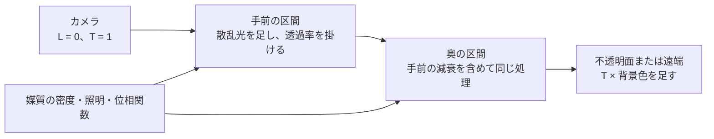

# ボリューメトリック — 高さフォグ・フロクセル・雲と大気

霧の中では、遠くの物体から来た光が弱まり、周囲の光が視線に向かって散乱する。どれだけ弱まり、どれだけ加わるかは、カメラから物体までに通過した空間の密度と照明で決まる。

## 視線上の光を積分する

散乱係数を $\sigma_s$、吸収係数を $\sigma_a$ とすると、消散係数は $\sigma_t=\sigma_s+\sigma_a$。区間内で $\sigma_t$ を一定と近似すると、長さ $\Delta s$ の区間の透過率は $T_{\mathrm{seg}}=\exp(-\sigma_t\Delta s)$ になる。

区間内で一定の散乱光源項を $S$（単位距離あたり）とすると、カメラ側から順に積分した値は次で更新できる。$\sigma_t=0$ のときの散乱項は極限の $S\Delta s$ を使える。最後に透過率 $T$ を掛けた背景色を $L$ に足す。

$$
L \leftarrow L + T\frac{S}{\sigma_t}(1-T_{\mathrm{seg}})
\qquad
T \leftarrow T T_{\mathrm{seg}}
$$

例として $\sigma_t=0.2\ \mathrm{m}^{-1}$ の霧を 5 m 通ると、透過率は $e^{-1}\simeq0.368$。同じ霧がさらに 5 m 続けば、二つの区間の透過率を掛けて $e^{-2}\simeq0.135$ になる。



位相関数は、どの角度へ散乱しやすいかを表す。霧の中の光の筋を考える場合は、光源から各地点まで光が届くか、各地点からカメラに向かう方向へどれだけ散乱するかを分ける。遮蔽された地点では光源から来る寄与が減る。

## 高さフォグ・フロクセル・雲・大気

| 対象 | 何をサンプルするか | 計算の分け方 |
| --- | --- | --- |
| 高さフォグ | 高さに応じて変わる密度 | 高さ $y$ の密度を $\rho_0 e^{-k(y-y_0)}$ と置くモデルなら、低い場所に霧が集まる |
| フロクセル（frustum voxel） | 視錐台を画面方向と奥行きに分けたセルの密度・照明 | セルを画面上の複数ピクセルで共有し、奥行き方向に積分した結果を使う |
| 雲 | 高度による分布と空間的に変化する密度、太陽からの透過率 | 雲のある範囲を追跡し、影や散乱で立体感を出す |
| 大気 | 地表からの高度で変わる分子・エアロゾルの密度 | 太陽光の減衰、視線方向の散乱、多重散乱などをルックアップテーブルで共有できる |

フロクセルの解像度を下げると計算を共有できる一方、薄い影や狭い光の筋は失われやすい。時間方向に結果を蓄積するとサンプル不足を補えるが、ライトやカメラの急な動きでは古い結果が残りうる。

## コード例 — 高さフォグを 32 区間で積分する

DXC の `-T ps_6_0 -E main` でコンパイルできる。光源の色と散乱の向きを固定し、区間内で $S/\sigma_t$ が一定になる例にしている。サンプルは各区間の中央。不透明面までの距離として 18 m を固定で使う。実際の合成では深度バッファから、カメラの各レイに沿った距離を得る。

```hlsl
float4 main(float2 uv : TEXCOORD0) : SV_Target0
{
    float2 screen = (uv * 2.0 - 1.0) * float2(1.0, -1.0);
    float3 direction = normalize(float3(screen.x, screen.y * 0.4, 1.0));
    const float cameraHeight = 1.5;
    const float opaqueDistance = 18.0;
    const int stepCount = 32;
    const float ds = opaqueDistance / stepCount;
    const float3 sourceOverExtinction = float3(0.48, 0.59, 0.74);
    const float3 background = float3(0.15, 0.20, 0.27);

    float transmittance = 1.0;
    float3 scattered = float3(0.0, 0.0, 0.0);
    for (int i = 0; i < stepCount; ++i)
    {
        float height = cameraHeight + (i + 0.5) * ds * direction.y;
        float extinction = 0.2 * exp(-0.65 * max(height, 0.0));
        float segmentT = exp(-extinction * ds);
        scattered += transmittance * sourceOverExtinction * (1.0 - segmentT);
        transmittance *= segmentT;
    }
    return float4(scattered + transmittance * background, 1.0);
}
```

## 理解度チェック

1. 吸収も散乱もない区間の透過率はいくつか。
2. 霧を通った背景色に対して、透過率と散乱光はそれぞれどう作用するか。
3. フロクセルの画面方向の解像度を下げると、何が得られ、何が失われるか。

::: details 解答

1. $\sigma_t=0$ なので 1。
2. 透過率は背景色に掛け、視線へ散乱した光は加える。
3. セルの計算結果を広い範囲で共有できる。細い光の筋や遮蔽の境界はぼけやすい。

:::

## 関連項目

- [色空間と HDR](color-space-and-hdr.md)
- [SDF とレイマーチング](sdf-and-raymarching.md)
- [ノイズと手続き的テクスチャ](procedural-noise.md)
- [水面の表現](water-shading.md)

## 参考資料

- Sébastien Hillaire, [Physically Based and Unified Volumetric Rendering in Frostbite](https://www.slideshare.net/slideshow/physically-based-and-unified-volumetric-rendering-in-frostbite/51840934), SIGGRAPH 2015 の講演資料
- Sébastien Hillaire, [A Scalable and Production Ready Sky and Atmosphere Rendering Technique](https://doi.org/10.1111/cgf.14050), 2020
- Bart Wronski, [Volumetric Fog — Unified, Compute Shader Based Solution to Atmospheric Scattering](https://bartwronski.com/wp-content/uploads/2014/08/bwronski_volumetric_fog_siggraph2014.pdf), SIGGRAPH 2014
