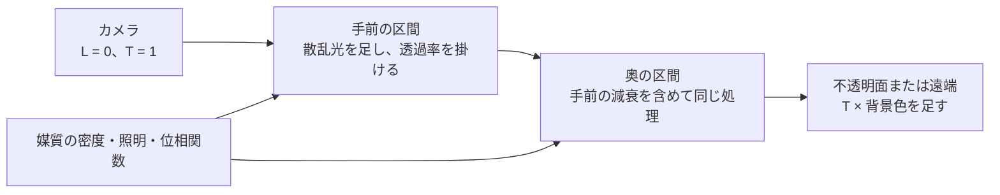
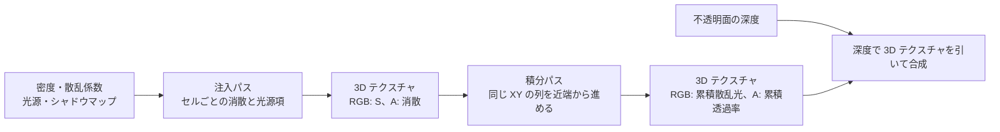

# ボリューメトリック — 高さフォグ・フロクセル・雲と大気

霧の中では、遠くの物体から来た光が弱まり、周囲の光が視線に向かって散乱する。どれだけ弱まり、どれだけ加わるかは、カメラから物体までに通過した空間の密度と照明で決まる。

## 視線上の光を積分する

散乱係数を $\sigma_s$、吸収係数を $\sigma_a$ とすると、消散係数は $\sigma_t=\sigma_s+\sigma_a$。区間内で $\sigma_t$ を一定と近似すると、長さ $\Delta s$ の区間の透過率は $T_{\mathrm{seg}}=\exp(-\sigma_t\Delta s)$ になる。

区間内で一定の散乱光源項を $S$（単位距離あたり）とすると、カメラ側から順に積分した値は次で更新できる。$\sigma_t=0$ のときの散乱項は極限の $S\Delta s$ を使える。最後に透過率 $T$ を掛けた背景色を $L$ に足す。

$$
L \leftarrow L + T\frac{S}{\sigma_t}(1-T_{\mathrm{seg}})
\qquad
T \leftarrow T T_{\mathrm{seg}}
$$

例として $\sigma_t=0.2\ \mathrm{m}^{-1}$ の霧を 5 m 通ると、透過率は $e^{-1}\simeq0.368$。同じ霧がさらに 5 m 続けば、二つの区間の透過率を掛けて $e^{-2}\simeq0.135$ になる。



位相関数は、どの角度へ散乱しやすいかを表す。霧の中の光の筋を考える場合は、光源から各地点まで光が届くか、各地点からカメラに向かう方向へどれだけ散乱するかを分ける。遮蔽された地点では光源から来る寄与が減る。

### 位相関数 — 入射光と出射光が進む方向をそろえる

サンプル点から光源への単位ベクトルを $L$、カメラへの単位ベクトルを $V$ とする。光は光源からサンプル点へ $-L$ の向きに進み、サンプル点からカメラへ $V$ の向きに進む。ここで散乱角の余弦は $\mu=(-L)\cdot V$。カメラが光源を正面に見るとき、光の進行方向は散乱の前後でほぼ同じになるため $\mu\simeq 1$ になる。BSDF と同様に両ベクトルをサンプル点から外へ向ける記法を使う資料では、内積の符号に注意する。

Henyey–Greenstein（HG）位相関数のパラメーターは平均余弦 $g$ で、$-1<g<1$ とする。$g>0$ なら前方、$g<0$ なら後方が強い。空気の分子による Rayleigh 散乱の位相関数は前方と後方が対称になる。入射光が非偏光の場合、両者は次の形で書ける。

$$
p_\mathrm{HG}(\mu,g)=\frac{1-g^2}{4\pi(1+g^2-2g\mu)^{3/2}},
\qquad
p_\mathrm{R}(\mu)=\frac{3}{16\pi}(1+\mu^2).
$$

どちらも単位は $\mathrm{sr}^{-1}$。回転対称なので、全方向の積分は $2\pi\int_{-1}^1p(\mu)d\mu$ になる。Rayleigh では $2\pi\cdot3/(16\pi)\cdot(2+2/3)=1$。HG では $g\ne0$ のとき、$(1+g^2-2g\mu)^{-1/2}/g$ を原始関数として使うと積分は 1 になる。$g=0$ では $p_\mathrm{HG}=1/(4\pi)$ の等方散乱になる。両端の $g=\pm1$ は連続な分布の式にそのまま入れられない。実装では入力範囲を内側に制限し、$1+g^2-2g\mu=(1-g)^2+2g(1-\mu)$ のように強い前方散乱で差の桁落ちが出にくい形にできる。

| 散乱方向 | $\mu$ | HG（$g=0.7$） | Rayleigh |
| --- | ---: | ---: | ---: |
| 前方 | 1 | 1.50313 | 0.11937 |
| 直角 | 0 | 0.02231 | 0.05968 |
| 後方 | −1 | 0.00826 | 0.11937 |

一点の位相関数が 1 を超えても、立体角に対する分布密度なので全方向の積分は 1 のまま。方向光について、遮蔽を $V_\ell\in[0,1]$、光源から点までの媒質の透過率を $T_\ell$、光源の強度を $E_\ell$ とすると、単一散乱の光源項は $S=\sigma_s p(\mu) E_\ell V_\ell T_\ell$ と書ける。視線側の透過率は積分の式に別に入る。同じ $\sigma_t$ の媒質でも、散乱に割り当てる割合 $\sigma_s/\sigma_t$ が小さければ、背景は同じ程度に暗くなっても霧自体は暗い。$g$ を調整する前に、逆光で位相関数がどの方向を向いているかを確認する。

## 高さフォグ・フロクセル・雲・大気

| 対象 | 何をサンプルするか | 計算の分け方 |
| --- | --- | --- |
| 高さフォグ | 高さに応じて変わる密度 | 高さ $y$ の密度を $\rho_0 e^{-k(y-y_0)}$ と置くモデルなら、低い場所に霧が集まる |
| フロクセル（frustum voxel） | 視錐台を画面方向と奥行きに分けたセルの密度・照明 | セルを画面上の複数ピクセルで共有し、奥行き方向に積分した結果を使う |
| 雲 | 高度による分布と空間的に変化する密度、太陽からの透過率 | 雲のある範囲を追跡し、影や散乱で立体感を出す |
| 大気 | 地表からの高度で変わる分子・エアロゾルの密度 | 太陽光の減衰、視線方向の散乱、多重散乱などをルックアップテーブルで共有できる |

フロクセルの解像度を下げると計算を共有できる一方、薄い影や狭い光の筋は失われやすい。時間方向に結果を蓄積するとサンプル不足を補えるが、ライトやカメラの急な動きでは古い結果が残りうる。

### 高さフォグ — 指数密度をレイに沿って解析的に積分する

高さ $y_0$ での消散係数を $\sigma_0$、密度の落ち方を $k\ge 0$ とする。カメラの高さを $y_c$、正規化した視線の鉛直成分を $d_y$ とすれば、視線距離 $s$ での高さは $y(s)=y_c+d_y s$。$\sigma_t(y)=\sigma_0 e^{-k(y-y_0)}$ を代入すると、カメラから距離 $D$ までの光学的厚さ $\tau$ は次のように積分できる。

$$
\begin{aligned}
\sigma_c &= \sigma_0 e^{-k(y_c-y_0)}, \qquad x=k d_y D,\\
\tau(D) &= \int_0^D \sigma_c e^{-kd_ys}\,ds
        = \sigma_c D\,\phi(x), \\
\phi(x) &= \frac{1-e^{-x}}{x},\qquad \phi(0)=1,\qquad T(D)=e^{-\tau(D)}.
\end{aligned}
$$

$d_y=0$ の水平な視線や $k=0$ の均一媒質では $\tau=\sigma_cD$ に戻る。上向きでは $x>0$、下向きでは $x<0$。下向きの分子 $1-e^{-x}$ と分母 $x$ は共に負なので、$\tau$ は正になる。水平に近いところで分子を直接引くと桁落ちが起きるため、$\phi(x)=1-x/2+x^2/6+O(x^3)$ を使える。

| 視線の傾き $d_y$ | 光学的厚さ $\tau$ | 透過率 $T$ |
| ---: | ---: | ---: |
| 0.2 | 1.2800 | 0.2780 |
| 0 | 1.4816 | 0.2273 |
| −0.2 | 1.7279 | 0.1777 |

数値例は $y_0=0$、$y_c=2\ \mathrm m$、$D=10\ \mathrm m$、$k=0.15\ \mathrm{m}^{-1}$、$\sigma_0=0.2\ \mathrm{m}^{-1}$。下向きのレイは端点で高さ 0 m に達し、通過する低い空間の密度が高い。指数密度を地面の下へそのまま延長すると密度が際限なく上がる。地面で区間を切るか、下側で密度を一定にする場合は、交点で区間を分けて指数区間と均一区間の光学的厚さを足す。高さの基準をワールド原点から変えた場合も、密度を求める原点 $y_0$ とカメラの高さを同じ座標系で扱う。

解析解で直接求まるのは消散の積分。光源項の比 $Q=S/\sigma_t$ が区間内で一定なら、$dT/ds=-\sigma_tT$ から視線へ加わる光は $Q(1-e^{-\tau})$ になる。点光源の距離減衰や影で $Q$ が変化する場合、光の寄与は位置をサンプルして積分する。高さフォグの深度入力が投影後の深度やビュー空間の $z$ の場合は、レイに沿った距離 $D$ に変換してから式を使う。画面周辺でフォグが薄く見える場合、ビュー空間の $z$ をそのまま $D$ に入れていないか調べる。

### フロクセル — 奥行きを分けて照明の計算を共有する

フロクセルは、画面を $W\times H$ に区切り、さらに各列を奥行き方向に $N$ スライスに分ける。近距離の密度・影を細かく扱う例として、カメラ前方軸で測った境界 $z_i$ を、正の近端 $n$ と遠端 $f$ から

$$
z_i=n(f/n)^{i/N}\quad (0\le i\le N)
$$

と置く。境界の比 $z_{i+1}/z_i$ は一定なので、奥のスライスほど厚くなる。例として $n=0.5\ \mathrm m,\ f=128\ \mathrm m,\ N=8$ なら公比は 2 で、境界は 0.5、1、2、4、8、16、32、64、128 m。サンプル点をビュー空間の $z$ からスライス座標に戻す式は $i(z)=N\log(z/n)/\log(f/n)$。これは非整数の境界座標なので、テクスチャに境界値を置くかセル中心に値を置くかに合わせて、テクセル中心への変換を決める。カメラと $n$ の間を含める設計では、その区間用のスライスを用意するか、サンプルの開始点に向かうまでを別に積分する。

正規化した視線とカメラ前方軸の内積が $\mu_z>0$ なら、レイがセルを通る長さは $\Delta s=(z_{i+1}-z_i)/\mu_z$。たとえばスライスの軸方向の厚みが 2 m で $\mu_z=0.8$ なら、レイの区間は 2.5 m。画面の中央だけで検証すると、$\mu_z$ の補正を入れ忘れた場合に気付きにくい。



1. **注入**。セル中心をワールド空間に復元し、重なる媒質の $\sigma_t$ と散乱の光源項 $S$ を求める。光源ごとに位相関数、光源の遮蔽、必要なら光源側の透過を評価する。これらを加えた 3D テクスチャを計算シェーダーから書き出す。RGB に $S$、A に $\sigma_t$ を持つのは、透過を色ごとに分けない場合の一例。
2. **積分**。同じ画面位置のスライス列を手前から処理し、各区間で $L$ と $T$ を更新する。各境界の累積値を書いておけば、同じ列の途中に不透明面がある場合も使える。手前・奥の区間の組を $(L_a,T_a)$、$(L_b,T_b)$ とすると、合成は $(L_a+T_aL_b,\ T_aT_b)$。結合則が成り立つため、列ごとの順次積分に加え、並列の前置積分にもできる。
3. **合成**。画面の深度をスライス座標に戻し、そこまでの散乱光を加えて背景を透過率で減衰させる。境界をまたぐ深度で区間の一部だけを通過する場合、注入値から残りを計算すると、累積値を単純補間する場合の誤差を減らせる。大きな遮蔽境界では隣の画面列との補間により、反対側の散乱が漏れることがある。

注入と積分の間で、前段の書き込みが後段から見えるように同期を入れる。例えば D3D12 で注入先を UAV、積分時の入力を SRV として使うなら、適切なリソース遷移を指定する。バリアの役割は [Enhanced Barriers と Vulkan synchronization2](../optimization/enhanced-barriers-and-synchronization2.md) を参照。バッファを全ピクセルで共有する利点は、影や局所ライトの計算を粗い格子上で済ませられること。デバッグ時は消散、散乱光源項、累積透過を別々に見る。時間方向の再投影を切っても残る境界のにじみは空間サンプルの問題で、再投影を入れたときだけ動くライトの筋が残るなら履歴の採用条件を確認する。

### 雲 — 視線と太陽方向で別の光学的厚さを使う

雲のレイマーチでは、視線を雲が存在する高度範囲に限定する。各サンプルで雲の密度を評価し、カメラ側へ出る光の積分に加える。太陽からサンプルに届く光のために、太陽方向にも密度を積分する。カメラまでの透過率と太陽側の透過率は、向きも通る場所も別である。太陽方向のレイに沿った光学的厚さを $\tau_\odot$ とすれば、単一散乱の照明側は $e^{-\tau_\odot}p_\mathrm{HG}(\mu,g)$ に比例する。視線を雲から太陽へ近づけると、正の $g$ による前方散乱が輪郭を明るくする。

Guerrilla の 2015 年の試作では、太陽の側から見た雲の縁が暗く、少し厚い所に明るさが出る見え方に、Powder の近似を使った。Schneider の講演資料 p. 62 の曲線では、光学的厚さを $\tau$ とすると Beer の減衰は $e^{-\tau}$、Powder 因子は $P(\tau)=1-e^{-2\tau}$ で、係数 2 は Powder 側の指数に入る。二つを掛けた Beer–Powder の値は次の式になる。

$$
B(\tau)=e^{-\tau}(1-e^{-2\tau}).
$$

$\tau=0$ では 0、$\tau=0.2$ では約 0.269919、$\tau=1$ では約 0.318092、$\tau=3$ では約 0.049664。薄い所では Powder 因子が小さく、厚い所では Beer の減衰が強い。講演の照明モデルでは、Powder の適用量を視線と光源の角度に応じて変え、Henyey–Greenstein の位相関数も掛ける。上の数値例はこの角度依存と位相関数を省き、p. 62 の二つの因子だけを比較したもの。

2017 年に公開された Nubis の実装方針では、低周波の形、細部の侵食、高さの形、広域の天候を分けて作る。Perlin–Worley を用いた低周波の形で雲の塊を作り、細かいノイズで表面を侵食する。天候データで被覆や雲の種類を変え、高さのプロファイルを切り替える。2017 年の照明資料では、2015 年の Powder の方向依存の扱いも更新し、密度や深さから光の入り方を調整する。複数の作品や年の実装で式を比較するときは、同じ「Nubis」でもモデルが更新されている点に注意する。

実装の費用は密度を評価する回数に左右される。大まかな密度がない区間では大きく進み、雲に入ったら刻みを細かくする。視線側の透過率が十分に小さくなったら、残りの寄与を許容できる範囲で打ち切る。太陽方向の密度サンプルを減らすと自己影に変化が出るため、同じカメラ・太陽の位置でそれぞれのサンプル数を変えて比較する。密度を作るノイズの種類とサンプリングは [ノイズと手続き的テクスチャ](procedural-noise.md) を参照。

### 大気 — 散乱係数と 4 種類の LUT の役割

Hillaire の 2020 年の論文では、分子の Rayleigh 散乱、エアロゾルの Mie 散乱・吸収、オゾンの吸収を別々の係数で表す。論文表 1 の値を $\mathrm{km}^{-1}$ に換算すると次のようになる。分子とエアロゾルは基準高度の係数に高さによる密度倍率を掛ける。オゾンは、高度 25 km を中心に上下 15 km へ向かって線形に減る分布を用いる。

| 成分 | 散乱係数 $\sigma_s$（$\mathrm{km}^{-1}$） | 吸収係数 $\sigma_a$（$\mathrm{km}^{-1}$） | 単一散乱での位相 |
| --- | --- | --- | --- |
| Rayleigh | (0.005802, 0.013558, 0.0331) | 0 | Rayleigh |
| Mie | 0.003996 | 0.00440 | 論文では Cornette–Shanks（既定 $g=0.8$）、簡略化には HG も使える |
| オゾン | 0 | (0.000650, 0.001881, 0.000085) | 吸収のみ |

係数と密度倍率の積を成分ごとに求め、視線の透過率には各成分の $\sigma_s+\sigma_a$ を足したものを使う。散乱光源項には、各成分の $\sigma_s$ に対応する位相関数を掛けて足す。Mie の表の値なら、基準高度での消散は $0.003996+0.00440=0.008396\ \mathrm{km}^{-1}$。密度を 1 に固定した均一な区間 10 km の Mie の透過率は $e^{-0.08396}\simeq 0.9195$。地表近くを進む長いレイでは地球の曲率によって経路の高度が変わるため、この均一な計算は単位の確認に使う。青側の Rayleigh 係数が赤側より大きいため、短波長は視線方向へ散乱されやすく、長い経路を通った直達光からは短波長が多く失われる。空の色と夕方の直達光の色は同じ積分の別の結果になる。

| LUT | 座標と保持する値 | 使う場所 |
| --- | --- | --- |
| Transmittance | 高度と、経路方向の天頂角。大気上端までの RGB の透過率 | サンプル点に太陽光が届くまでの媒質による減衰。地球に遮られるかは別に判定する |
| Multiple Scattering | 高度と太陽の天頂角。二次以降の散乱の近似 | Sky-View や空気遠近の積分で単一散乱に加える |
| Sky-View | 観測位置を基準にした方位・仰角。空の方向ごとの散乱光 | 背景の空。地平線近くへテクセルを多く配分し、太陽円盤は別に合成する |
| Aerial Perspective | カメラ視錐台の画面位置と深度。カメラまでの散乱光と透過率 | 地形や建物など、有限の距離にある対象へ空気遠近を加える |

Multiple Scattering LUT は、2 回目以降に散乱した光の方向分布を等方と近似し、二次散乱と、さらに散乱が続く割合 $f_\mathrm{ms}$ から寄与を近似する。$0\le f_\mathrm{ms}<1$ のとき、各次数の比を同じとみなせば $1+f_\mathrm{ms}+f_\mathrm{ms}^2+\cdots=1/(1-f_\mathrm{ms})$。これを二次散乱に掛ける考え方で、次数ごとの LUT を保持せずに複数回の散乱を表せる。単一散乱では各成分の位相関数を使い、太陽周辺の指向性を残す。

論文の Aerial Perspective の例では、散乱光の RGB と透過率の RGB 平均を RGBA に入れている。空の背景ではカメラから大気の端まで、物体を描く位置ではカメラから物体までという積分範囲の違いがある。空の色を計算した Sky-View の値をそのまま地形の手前に足すと、大気の奥まで積分した光が混ざる。Transmittance と Multiple Scattering は媒質の分布や係数に依存する表で、固定した大気では太陽の向きやカメラの移動に合わせて値を作り直す必要はない。座標が変わるため、読み出す場所は変わる。Sky-View と Aerial Perspective は視点や照明に依存し、太陽が動いたりカメラが移動したりする場合に更新する。低い太陽で雲や山が作る影を出す場合は、視点と深度に依存する遮蔽の扱いも必要になる。

## コード例 — 高さフォグを 32 区間で積分する

DXC の `-T ps_6_0 -E main` でコンパイルできる。光源の色と散乱の向きを固定し、区間内で $S/\sigma_t$ が一定になる例にしている。サンプルは各区間の中央。不透明面までの距離として 18 m を固定で使う。実際の合成では深度バッファから、カメラの各レイに沿った距離を得る。

```hlsl
float4 main(float2 uv : TEXCOORD0) : SV_Target0
{
    float2 screen = (uv * 2.0 - 1.0) * float2(1.0, -1.0);
    float3 direction = normalize(float3(screen.x, screen.y * 0.4, 1.0));
    const float cameraHeight = 1.5;
    const float opaqueDistance = 18.0;
    const int stepCount = 32;
    const float ds = opaqueDistance / stepCount;
    const float3 sourceOverExtinction = float3(0.48, 0.59, 0.74);
    const float3 background = float3(0.15, 0.20, 0.27);

    float transmittance = 1.0;
    float3 scattered = float3(0.0, 0.0, 0.0);
    for (int i = 0; i < stepCount; ++i)
    {
        float height = cameraHeight + (i + 0.5) * ds * direction.y;
        float extinction = 0.2 * exp(-0.65 * max(height, 0.0));
        float segmentT = exp(-extinction * ds);
        scattered += transmittance * sourceOverExtinction * (1.0 - segmentT);
        transmittance *= segmentT;
    }
    return float4(scattered + transmittance * background, 1.0);
}
```

### コード例 — フロクセルに注入し、列ごとに積分する

HLSL Shader Model 6.0 の `cs_6_0` で、同じソースを `Inject` と `Integrate` の二つのエントリーポイントとしてコンパイルする。格子は $64\times36\times48$。ビュー空間の $+Z$ を前方とする。近端を 0.5 m、遠端を 128 m とし、累積値は 0.5 m の境界から積分した各セルの遠端の値になる。照明には遮蔽物のない単一の方向光を使い、光源側の霧による減衰も無視できる場合を仮定する。そのため `Inject` の光源項では一般式の $V_\ell$ と $T_\ell$ をともに 1 とする。光源側の消散が無視できない場合は、光源から各セルまでの光学的厚さ $\tau_\ell$ を求めて $T_\ell=e^{-\tau_\ell}$ を光源項に掛ける。セルからカメラまでの透過率は別に `Integrate` で積分する。サンプルの `HeightFogOpticalDepth` は指数密度が成り立つ区間の解析解で、密度を地面でクランプした注入結果と照合するために使える。

```hlsl
static const float PI = 3.14159265358979323846;
static const uint Width = 64;
static const uint Height = 36;
static const uint SliceCount = 48;
static const float NearZ = 0.5;
static const float FarZ = 128.0;

RWTexture3D<float4> Injected : register(u0);
Texture3D<float4> InjectionInput : register(t0);
RWTexture3D<float4> Integrated : register(u1);

float PhaseHG(float mu, float g)
{
    float magnitude = abs(g);
    float alignedMu = g >= 0.0 ? mu : -mu;
    float difference = 1.0 - magnitude;
    float denominator = difference * difference
                      + 2.0 * magnitude * (1.0 - clamp(alignedMu, -1.0, 1.0));
    return (1.0 - g * g) / (4.0 * PI * denominator * sqrt(denominator));
}

float PhaseRayleigh(float mu)
{
    return 3.0 * (1.0 + mu * mu) / (16.0 * PI);
}

float ExtinctionIntegralFactor(float x)
{
    if (abs(x) < 0.01)
        return 1.0 - x * (0.5 - x * (1.0 / 6.0 - x / 24.0));
    return (1.0 - exp(-x)) / x;
}

float HeightFogOpticalDepth(float cameraHeight, float directionY, float distance)
{
    const float k = 0.15;
    float extinctionAtCamera = 0.2 * exp(-k * cameraHeight);
    return extinctionAtCamera * distance
         * ExtinctionIntegralFactor(k * directionY * distance);
}

float SliceBoundary(uint index)
{
    return NearZ * pow(FarZ / NearZ, float(index) / SliceCount);
}

float3 ViewRay(uint2 pixel)
{
    float2 ndc = ((float2(pixel) + 0.5) / float2(Width, Height)) * 2.0 - 1.0;
    return normalize(float3(ndc.x * (16.0 / 9.0) * 0.6, -ndc.y * 0.6, 1.0));
}

[numthreads(4, 4, 4)]
void Inject(uint3 id : SV_DispatchThreadID)
{
    if (id.x >= Width || id.y >= Height || id.z >= SliceCount)
        return;

    float3 ray = ViewRay(id.xy);
    float z = 0.5 * (SliceBoundary(id.z) + SliceBoundary(id.z + 1));
    float height = 2.0 + ray.y * (z / ray.z);
    float extinction = 0.2 * exp(-0.15 * max(height, 0.0));
    float3 toLight = normalize(float3(0.2, 0.25, 1.0));
    // dot(-toLight, -ray) is the cosine between propagation directions.
    float phase = PhaseHG(dot(toLight, ray), 0.7);
    // The light path has unit visibility and unit medium transmittance.
    float3 source = 0.85 * extinction * phase * float3(4.0, 3.6, 3.0);
    Injected[id] = float4(source, extinction);
}

[numthreads(8, 8, 1)]
void Integrate(uint3 id : SV_DispatchThreadID)
{
    if (id.x >= Width || id.y >= Height)
        return;

    float rayZ = ViewRay(id.xy).z;
    float3 radiance = 0.0;
    float transmittance = 1.0;
    for (uint z = 0; z < SliceCount; ++z)
    {
        uint3 cell = uint3(id.xy, z);
        float4 medium = InjectionInput.Load(int4(cell, 0));
        float segmentLength = (SliceBoundary(z + 1) - SliceBoundary(z)) / rayZ;
        float tau = medium.a * segmentLength;
        radiance += transmittance * medium.rgb * segmentLength * ExtinctionIntegralFactor(tau);
        transmittance *= exp(-tau);
        Integrated[cell] = float4(radiance, transmittance);
    }
}
```

注入は 3D のディスパッチ `(16, 9, 12)`、積分は各スレッドが一本の列を担当する `(8, 5, 1)`。テクスチャはいずれも $64\times36\times48$ で、例えば RGBA16F のテクスチャなら一枚 884,736 バイト（864 KiB、パディングや別の履歴を除く）。注入先を UAV `u0` に、次のパスで同じリソースを SRV `t0` に指定し、別のテクスチャを積分先の UAV `u1` に指定する。サンプルの `PhaseRayleigh` に差し替えて向きによる違いを比較できる。指数密度の解析解を照合する場合は、両方で地面より上の同じ区間だけを積分し、積分の開始点の高さと距離を合わせる。RGB で別々に消散する大気をこの実装に広げるときは、各チャンネルの光学的厚さと透過率を独立に持つ。

## 理解度チェック

1. 吸収も散乱もない区間の透過率はいくつか。
2. 霧を通った背景色に対して、透過率と散乱光はそれぞれどう作用するか。
3. フロクセルの画面方向の解像度を下げると、何が得られ、何が失われるか。
4. 太陽の方を向いたときに HG の強い散乱を観察したい。サンプル点から太陽とカメラへ向かうベクトルをそのまま内積してよいか。
5. 水平なレイで高さフォグの解析解を使うと、どの式に帰着するか。
6. 軸方向の厚みが同じフロクセルでも、画面中央と周辺で光学的厚さが変わるのはなぜか。
7. 遠くの山を描くとき、Sky-View LUT の値と Aerial Perspective LUT の値はどの区間の散乱を表すか。

::: details 解答

1. $\sigma_t=0$ なので 1。
2. 透過率は背景色に掛け、視線へ散乱した光は加える。
3. セルの計算結果を広い範囲で共有できる。細い光の筋や遮蔽の境界はぼけやすい。
4. 入射光の進行方向はサンプル点から太陽へ向かう方向の逆なので、そのベクトルを反転してから内積する。これで太陽を向いたときの $\mu$ は 1 に近くなる。
5. 高さと消散係数は視線上で一定なので $\tau=\sigma_cD$、$T=e^{-\sigma_cD}$ になる。
6. フロクセルの厚さはカメラの前方軸に沿った距離で定義している。周辺のレイはスライスを斜めに通るので、同じ消散係数でも通過距離が増える。
7. Sky-View は背景の空に向かう経路で、大気上端や地表に当たるまでを積分する。Aerial Perspective は視錐台の指定深度までなので、山の深度で引く。

:::

## 関連項目

- [色空間と HDR](color-space-and-hdr.md)
- [SDF とレイマーチング](sdf-and-raymarching.md)
- [ノイズと手続き的テクスチャ](procedural-noise.md)
- [水面の表現](water-shading.md)

## 参考資料

- Sébastien Hillaire, [Physically Based and Unified Volumetric Rendering in Frostbite](https://www.slideshare.net/slideshow/physically-based-and-unified-volumetric-rendering-in-frostbite/51840934), SIGGRAPH 2015 の講演資料
- Louis G. Henyey and Jesse L. Greenstein, [Diffuse Radiation in the Galaxy](https://doi.org/10.1086/144246), 1941
- Matt Pharr, Wenzel Jakob, and Greg Humphreys, [Physically Based Rendering, 3rd ed. — Phase Functions](https://www.pbr-book.org/3ed-2018/Volume_Scattering/Phase_Functions), 方向ベクトルの規約と HG の実装
- Sébastien Hillaire, [A Scalable and Production Ready Sky and Atmosphere Rendering Technique](https://doi.org/10.1111/cgf.14050), 2020
- Sébastien Hillaire, [Sky Atmosphere の参照実装](https://github.com/sebh/UnrealEngineSkyAtmosphere)
- Bart Wronski, [Volumetric Fog — Unified, Compute Shader Based Solution to Atmospheric Scattering](https://bartwronski.com/wp-content/uploads/2014/08/bwronski_volumetric_fog_siggraph2014.pdf), SIGGRAPH 2014
- Andrew Schneider and Nathan Vos, [The Real-Time Volumetric Cloudscapes of Horizon: Zero Dawn](https://advances.realtimerendering.com/s2015/The%20Real-time%20Volumetric%20Cloudscapes%20of%20Horizon%20-%20Zero%20Dawn%20-%20ARTR.pdf#page=64), SIGGRAPH 2015（登壇者 Andrew Schneider、スライド62・66・69）
- Andrew Schneider and Nathan Vos, [Nubis: Authoring Real-Time Volumetric Cloudscapes with the Decima Engine](https://www.guerrilla-games.com/read/nubis-authoring-real-time-volumetric-cloudscapes-with-the-decima-engine), SIGGRAPH 2017
