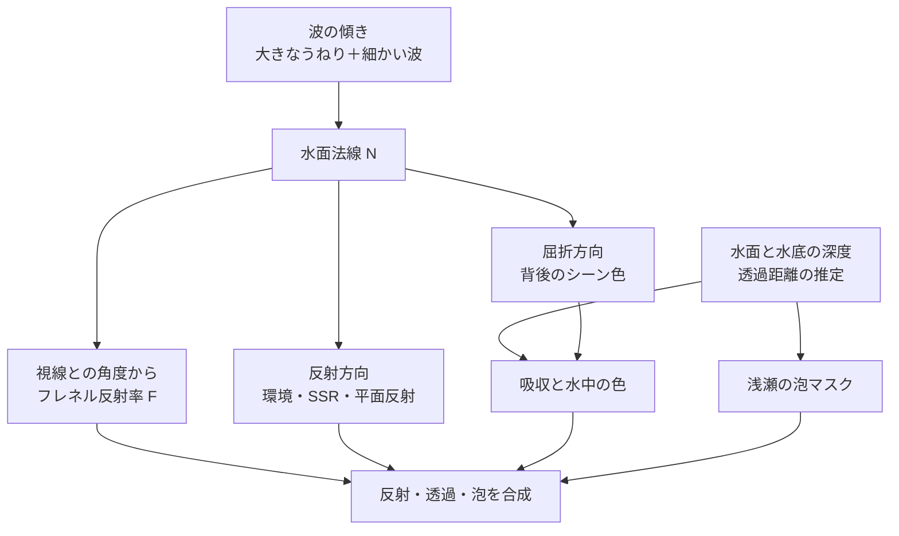

# 水面の表現 — 波の法線・反射・屈折・泡を合成する

水面を斜めから見ると空や周囲の反射が強く、真上に近い角度では水底が見えやすい。波があると、その比率と反射・屈折の向きが場所ごとに変わる。浅瀬と深い場所の色の差は、水の中を光が通る距離で作れる。



## 法線を合成する

大きなうねりは頂点変位、細かな波は時間で移動させた法線マップで扱える。同じ接空間で高さの傾きとして扱える二つの法線なら、上向きの成分 $n_z>0$ を使って、それぞれの $n_{xy}/n_z$ を足す。結果を `normalize(float3(傾きの和, 1))` で戻すと、片方が平坦な $(0,0,1)$ の場合にもう片方の法線が残る。異なる接空間で得た法線は、座標系をそろえてから合成する。[法線マップと接空間](normal-mapping.md)も参照。

## フレネル反射と水中の透過

空気の屈折率を 1、水を 1.333 と近似すると、垂直入射の反射率 $F_0$ は約 0.0204。Schlick の近似を使うと、$N\cdot V=0.5$ の反射率は約 0.0510 になる。$V$ は水面からカメラへの単位ベクトル。この式は空気側から水を見る例に使う。

$$
F_0=\left(\frac{1.333-1}{1.333+1}\right)^2,
\qquad F=F_0+(1-F_0)(1-\max(0,N\cdot V))^5
$$

反射色は環境マップ、[SSR](../lighting/ssr.md)、平面反射などから取れる。屈折色は背後のシーン色を法線に応じてずらして読む近似でも作れる。ずらした座標が画面外に出たり、水面より手前の物体を指したりすることがある。前景が混じる場合は深度などで判定し、歪ませる前の座標へ戻す。

水中の距離を $d$、波長帯ごとの吸収係数を $\sigma_a$ とすると、透過率は $e^{-\sigma_a d}$。赤が青より強く吸収される設定なら、遠くの水底ほど赤が弱まる。透過率が低い場所では、水中で散乱して視線に届く光の色が目立つ。RGB ごとに近似した吸収と散乱色の例は次のコードで確認できる。

## 泡と厚みの扱い

浅瀬の泡は水面と底の距離が小さい場所で強くし、ノイズや波の位相で形を崩せる。沖の白波は波の頂や砕波を目安に置くことがある。水面と底の深度差を使う場合は、同じカメラ空間の深度に直す。水面から水底までの鉛直距離と、屈折したレイが水中を進んだ長さは別の値になる。

Unreal Engine 5.8 の **Single Layer Water** は、深度・シーン色を使う専用の水面パスを持ち、材質から散乱・吸収係数を入力できる。ここで示す式は、反射・透過と水中の色の関係を確認する小さなモデル。

## コード例 — 反射・透過・泡を混ぜる

DXC の `-T ps_6_0 -E main` でコンパイルできる。反射環境と水底の色は式で生成し、透過距離を 0.03〜3 m の範囲で変える。水面下の距離と浅瀬の泡を同じパラメーターで可視化する。実際に背景の屈折位置を求める処理は、シーン色を読む描画パス側が受け持つ。

```hlsl
float3 CombineWaterNormals(float3 a, float3 b)
{
    float2 slope = a.xy / a.z + b.xy / b.z;
    return normalize(float3(slope, 1.0));
}

float Schlick(float cosTheta)
{
    const float ratio = (1.333 - 1.0) / (1.333 + 1.0);
    const float f0 = ratio * ratio;
    float x = 1.0 - saturate(cosTheta);
    return f0 + (1.0 - f0) * x * x * x * x * x;
}

float4 main(float2 uv : TEXCOORD0) : SV_Target0
{
    float3 a = normalize(float3(0.20 * sin(uv.x * 28.0), 0.0, 1.0));
    float3 b = normalize(float3(0.0, 0.15 * sin(uv.y * 39.0), 1.0));
    float3 n = CombineWaterNormals(a, b);
    float3 v = normalize(float3(lerp(4.0, 0.0, uv.y), 0.0, 1.0));
    float3 r = reflect(-v, n);
    float fresnel = Schlick(dot(n, v));
    float3 sky = lerp(float3(0.63, 0.77, 0.92),
                      float3(0.16, 0.37, 0.68), saturate(r.z));

    float distance = lerp(0.03, 3.0, uv.x);
    float3 transmission = exp(-float3(0.90, 0.24, 0.09) * distance);
    float3 bottom = float3(0.56, 0.45, 0.30);
    float3 waterColor = float3(0.02, 0.20, 0.25);
    float3 refracted = bottom * transmission + waterColor * (1.0 - transmission);
    float3 color = lerp(refracted, sky, fresnel);

    float foam = (1.0 - smoothstep(0.04, 0.20, distance))
               * smoothstep(-0.2, 0.6, sin(uv.y * 71.0 + uv.x * 41.0));
    return float4(lerp(color, float3(0.88, 0.93, 0.91), foam), 1.0);
}
```

## 理解度チェック

1. 空気側から水面を水平に近い角度で見ると、反射と透過の比率はどう変わるか。
2. 水中の距離 $d$ を 2 倍にした場合、吸収だけを考えた透過率は元の透過率の何乗か。
3. 屈折に使う UV をずらした結果、水面より手前の物体の色を読んだ。どう対処できるか。

::: details 解答

1. $N\cdot V$ が 0 に近づき、フレネル反射率が高くなる。
2. 2 乗。$\exp(-2\sigma_a d)=[\exp(-\sigma_a d)]^2$。
3. ずらした座標の深度を調べ、手前なら歪ませる前のサンプルへ戻すなどの処理を行う。

:::

## 関連項目

- [WebGPU実践でパラメーターを変える](/practice/graphics/shader-lab.html#water)
- [法線マップと接空間](normal-mapping.md)
- [BRDF の中身](brdf-internals.md)
- [SSR](../lighting/ssr.md)
- [ボリューメトリック](volumetrics.md)

## 参考資料

- Mark Finch, [GPU Gems — Effective Water Simulation from Physical Models](https://developer.nvidia.com/gpugems/gpugems/part-i-natural-effects/chapter-1-effective-water-simulation-physical-models)
- Tiago Sousa, [GPU Gems 2 — Generic Refraction Simulation](https://developer.nvidia.com/gpugems/gpugems2/part-ii-shading-lighting-and-shadows/chapter-19-generic-refraction-simulation)
- Christophe Schlick, [An Inexpensive BRDF Model for Physically-based Rendering](https://doi.org/10.1111/1467-8659.1330233)
- Epic Games, [Single Layer Water Shading Model（UE 5.8）](https://dev.epicgames.com/documentation/en-us/unreal-engine/single-layer-water-shading-model-in-unreal-engine)
