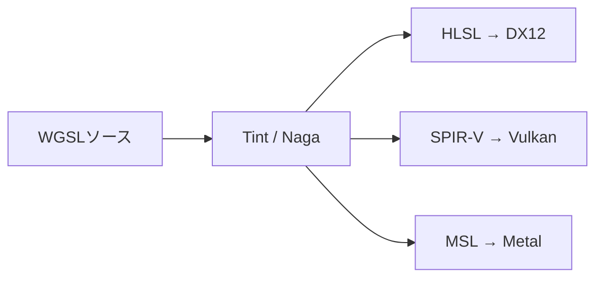

# WGSL

## 概要

WGSL (WebGPU Shading Language) は**WebGPUのために新規設計されたシェーダ言語**です (2023年、W3C)。Web実行の安全性要求から、**未定義動作の排除・厳密な型システム・仕様の完全な形式化**を特徴とします。Rustに似た構文を持ち、ブラウザ内で各ネイティブAPI (DX12/Vulkan/Metal) のシェーダへ変換されます。

## なぜ必要なのか

- WebGPUの唯一のシェーダ言語 — Webで最新GPU機能 (Compute等) を使う入口
- 「安全なシェーダ言語はどう設計されるか」の教材として価値が高い
- Tint (Chrome) / Naga (Firefox/wgpu) の変換パイプラインは、ネイティブ開発でもクロスコンパイル基盤として利用可能

## 歴史・誕生した背景

- 2017: WebGPU標準化開始。当初はシェーダ形式を巡り**大論争** — Apple陣営は独自言語 (WHLSL)、Google/Mozilla陣営は**SPIR-Vバイナリの直接採用**を主張
- SPIR-V案は (1) Appleの知財懸念 (Vulkan系規格への忌避)、(2) Web審査に耐える検証可能性、(3) 人間可読性、で合意に至らず
- **2020: 妥協案としてWGSL誕生** — 「SPIR-Vへ1対1に近い変換ができる、人間可読なテキスト言語」として設計
- 2023: WebGPU 1.0 (Chrome 113) と共に正式化

## それ以前の技術

WebGL の GLSL ES 1.00/3.00。実行時にドライバのGLSLコンパイラへ渡す方式で、GLSLの断片化問題とWeb特有のセキュリティ検証 (ANGLEによる書き換え) の重さを抱えていました。

## 解決した課題

1. **未定義動作の排除**: 配列範囲外アクセスはクランプ等の定義済み動作に、無限ループも動作規定 — 悪意あるシェーダからの保護
2. **単一の厳密仕様**: 「実装依存」を極小化し、全ブラウザで同一挙動を保証
3. 事前検証可能: バインディングの整合性・型の整合性をブラウザが完全検証できる

## 現在の位置づけ

WebGPUの普及と一体です。ブラウザゲーム・Web上の3Dツール (Figma的なもの)・ブラウザML推論で採用が進みます。ネイティブ側でも **wgpu (Rust)** / **Dawn (C++)** を通じ、WGSLをポータブルなシェーダ言語として使うプロジェクトが増えています。

## 内部動作 — 言語の要点

### 構文の特徴 (Rust風)

```wgsl
// 変数: let=不変, var=可変。型は後置
let x: f32 = 1.0;
var y = vec3f(0.0);        // 型推論 + 短縮エイリアス (vec3f = vec3<f32>)

// 関数
fn add(a: f32, b: f32) -> f32 { return a + b; }

// エントリポイントは属性で宣言
@vertex
fn vsMain(@location(0) pos: vec3f) -> @builtin(position) vec4f {
    return vec4f(pos, 1.0);
}
```

### アドレス空間とバインディング

```wgsl
struct Camera { view: mat4x4f, proj: mat4x4f }

@group(0) @binding(0) var<uniform> cam: Camera;
@group(0) @binding(1) var<storage, read> particles: array<vec4f>;
@group(0) @binding(2) var<storage, read_write> output: array<f32>;
@group(1) @binding(0) var tex: texture_2d<f32>;
@group(1) @binding(1) var smp: sampler;

var<workgroup> tile: array<f32, 256>;   // groupshared相当
var<private> accum: f32;                 // スレッドローカル
```

`@group` / `@binding` はWebGPUの BindGroup に1対1対応します → [WebGPU](/graphics/api/webgpu.html)

### 安全性のための設計

| 危険 | WGSLの対処 |
|---|---|
| 範囲外アクセス | 実装は clamp / 破棄など定義済み動作を選択 (メモリ破壊は不可能) |
| 未初期化変数 | ゼロ初期化を保証 |
| ポインタ | 制限された `ptr<>` のみ (関数引数等、エイリアス解析可能な範囲) |
| 無限ループ | 動作が規定される (uniformity解析と併せて) |
| 非uniform制御フロー内のバリア | **コンパイルエラー** (uniformity analysis — WGSL特有の厳格さ) |

**Uniformity解析**は初学者最大の躓きポイントです。`textureSample` や `workgroupBarrier` は「全スレッドが同じ制御フローで到達する」ことを静的に証明できないとエラーになります。

## 各環境での扱い

### Unity / Unreal Engine
直接の関係はありません (両エンジンのWebGPU出力が成熟すれば、内部変換ターゲットになります)。

### DirectX 12
ブラウザ内では Tint/Naga がWGSLを**HLSLへ変換**してDX12で実行します (Windows Chrome)。

### Vulkan
同様に**SPIR-Vへ変換**されて実行 (Android/Linux)。wgpu/DawnをネイティブVulkanアプリの抽象層として使う場合もこの経路です。

### Metal
**MSLへ変換** (macOS/iOS)。



## コード例

Compute Shader (パーティクル更新) の完全な例:

```wgsl
struct Particle { pos: vec4f, vel: vec4f }
struct SimParams { dt: f32, gravity: f32, bounds: f32, count: u32 }

@group(0) @binding(0) var<uniform> params: SimParams;
@group(0) @binding(1) var<storage, read_write> particles: array<Particle>;

@compute @workgroup_size(64)
fn simulate(@builtin(global_invocation_id) gid: vec3u) {
    let i = gid.x;
    if (i >= params.count) { return; }

    var p = particles[i];
    p.vel.y = p.vel.y - params.gravity * params.dt;
    p.pos = vec4f(p.pos.xyz + p.vel.xyz * params.dt, p.pos.w);

    // 床でバウンド
    if (p.pos.y < 0.0) {
        p.pos.y = 0.0;
        p.vel.y = -p.vel.y * 0.8;
    }
    particles[i] = p;
}
```

頂点+フラグメントの1ファイル構成 (WGSLは複数エントリを1モジュールに書ける):

```wgsl
struct VSOut {
    @builtin(position) pos: vec4f,
    @location(0) color: vec3f,
}

@vertex
fn vsMain(@builtin(vertex_index) vi: u32) -> VSOut {
    var positions = array<vec2f, 3>(
        vec2f(0.0, 0.5), vec2f(0.5, -0.5), vec2f(-0.5, -0.5));
    var colors = array<vec3f, 3>(
        vec3f(1,0,0), vec3f(0,1,0), vec3f(0,0,1));
    var out: VSOut;
    out.pos = vec4f(positions[vi], 0.0, 1.0);
    out.color = colors[vi];
    return out;
}

@fragment
fn fsMain(in: VSOut) -> @location(0) vec4f {
    return vec4f(in.color, 1.0);
}
```

## 前提知識

- [シェーダ言語総論と比較](/graphics/shader/overview.html)

## 次に読むべきページ

- [WebGPU](/graphics/api/webgpu.html) — WGSLのホストAPI
- [SPIR-V と中間表現](/graphics/shader/spirv.html) — 変換先の理解
- [HLSL](/graphics/shader/hlsl.html) / [GLSL](/graphics/shader/glsl.html) との対応表は [総論](/graphics/shader/overview.html) 参照

## 理解度チェック

1. **WebGPUがSPIR-Vバイナリを直接採用せずWGSLを新設計した理由を3つ挙げよ。**
   ::: details 解答
   (1) AppleがVulkan系規格(SPIR-V)の採用に知財・戦略上の懸念を示し、全ブラウザ合意が不可能だった。(2) Webプラットフォームの伝統として、配信されるコードには人間可読性・View Sourceの精神が求められた。(3) Web安全性のためにブラウザが完全検証できる、未定義動作を排除した厳密仕様が必要で、既存仕様の流用では達成困難だった。
   :::

2. **WGSLの「uniformity解析」は何を防いでいるか。**
   ::: details 解答
   ワークグループ/クワッド内の一部スレッドしか到達しない制御フロー内で、全スレッドの協調を前提とする操作(workgroupBarrier、暗黙微分を使うtextureSample等)が実行されることを静的に防ぐ。これらは実機ではハングや未定義値の原因になるため、コンパイル時エラーとして排除する。
   :::

3. **「配列範囲外アクセスでもメモリ破壊が起きない」ことがWebでは必須要件である理由は。**
   ::: details 解答
   シェーダは悪意ある可能性のあるWebページから供給されるコードであり、GPU経由で他プロセスのメモリやドライバ状態を読み書きできればサンドボックス脱出になる。したがって全メモリアクセスが検証済み・定義済み動作であることが、性能より優先される絶対条件となる。
   :::

## 参考資料

- W3C, *WebGPU Shading Language* 仕様
- Tint (Dawn) / Naga (wgpu) — 実装
- Surma & Le Brun, *"WebGPU — All of the cores, none of the canvas"*
- webgpufundamentals.org — WGSL実践教材
