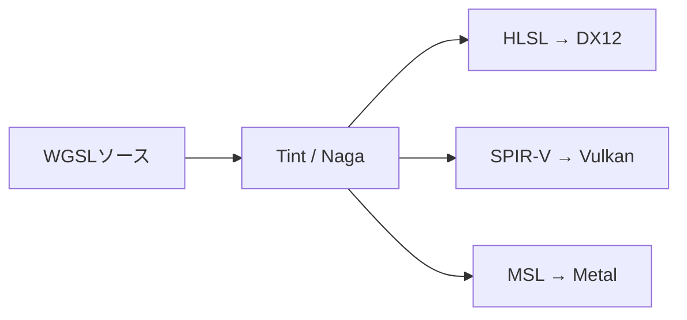

# WGSL

## 概要

WGSL (WebGPU Shading Language) は**WebGPUのために設計されたシェーダー言語**です。型やリソースの検証と、実行時エラーの規則を備え、Webへ配信するシェーダーを扱います。Rustに似た構文を持ち、ブラウザーの実装が各ネイティブAPI（DX12/Vulkan/Metal）向けに変換します。[W3CのWGSL仕様](https://www.w3.org/TR/WGSL/)

## なぜ必要なのか

- WebGPUの唯一のシェーダ言語 — Webで最新GPU機能 (Compute等) を使う入口
- 「安全なシェーダ言語はどう設計されるか」の教材として価値が高い
- Tint (Chrome) / Naga (Firefox/wgpu) の変換パイプラインは、ネイティブ開発でもクロスコンパイル基盤として利用可能

## 歴史・誕生した背景

- 2017: WebGPU標準化開始。当初はシェーダ形式を巡り**大論争** — Apple陣営は独自言語 (WHLSL)、Google/Mozilla陣営は**SPIR-Vバイナリの直接採用**を主張
- SPIR-V案は (1) Appleの知財懸念 (Vulkan系規格への忌避)、(2) Web審査に耐える検証可能性、(3) 人間可読性、で合意に至らず
- **2020: 妥協案としてWGSL誕生** — 「SPIR-Vへ1対1に近い変換ができる、人間可読なテキスト言語」として設計
- 2023: Chrome 113でWebGPUの提供開始。ブラウザーでの出荷とW3C仕様の成熟度は区別する（2026年11月のWGSL公開仕様はCandidate Recommendation Draft）

## それ以前の技術

WebGL の GLSL ES 1.00/3.00。実行時にドライバのGLSLコンパイラへ渡す方式で、GLSLの断片化問題とWeb特有のセキュリティ検証 (ANGLEによる書き換え) の重さを抱えていました。

## 解決した課題

1. **エラーと検証の規則**: shader-creation error、pipeline-creation error、dynamic errorを区別し、不正なアクセスなどの扱いを定める
2. **共通の言語仕様**: 挙動の差を狭めるが、浮動小数点の精度や不定値など、仕様が幅を認める部分もある
3. **事前検証**: 型やバインディングなどを検証できる。一方で、実行時にしか決まらない範囲外アクセスをすべて静的に排除するわけではない

## 現在の位置づけ

WebGPUの普及と一体です。ブラウザゲーム・Web上の3Dツール (Figma的なもの)・ブラウザML推論で採用が進みます。ネイティブ側でも **wgpu (Rust)** / **Dawn (C++)** を通じ、WGSLをポータブルなシェーダ言語として使うプロジェクトが増えています。

## 内部動作 — 言語の要点

### 構文の特徴 (Rust風)

関数内では `let` で値を固定し、`var` で再代入できる変数を宣言します。モジュールスコープでコンパイル時に値を決める場合は `const` を使います。[WGSL — Value Declarations](https://www.w3.org/TR/WGSL/#value-decls)

```wgsl
const clipW: f32 = 1.0;

// エントリポイントは属性で宣言
@vertex
fn vsMain(@location(0) pos: vec3f) -> @builtin(position) vec4f {
    let offset: f32 = 0.25;
    var shifted = pos; // 型推論で vec3f (vec3<f32>)
    shifted.x += offset;
    return vec4f(shifted, clipW);
}
```

### アドレス空間とバインディング

```wgsl
struct Camera { view: mat4x4f, proj: mat4x4f }

@group(0) @binding(0) var<uniform> cam: Camera;
@group(0) @binding(1) var<storage, read> particles: array<vec4f>;
@group(0) @binding(2) var<storage, read_write> output: array<f32>;
@group(1) @binding(0) var tex: texture_2d<f32>;
@group(1) @binding(1) var smp: sampler;

var<workgroup> tile: array<f32, 256>;   // groupshared相当
var<private> accum: f32;                 // スレッドローカル
```

`@group` / `@binding` はWebGPUの BindGroup に1対1対応します → [WebGPU](/graphics/api/webgpu.html)

### 安全性のための設計

| 危険 | WGSLの対処 |
|---|---|
| 範囲外アクセス | dynamic error。許される結果や処理は仕様で定められ、WebGPUのメモリ保護と併せて扱う。常に0を返すとは限らない |
| 未初期化変数 | ゼロ初期化を保証 |
| ポインタ | 制限された `ptr<>` のみ (関数引数等、エイリアス解析可能な範囲) |
| 無限ループ | dynamic errorとなる。uniformity解析が停止性を証明するわけではない |
| 非uniform制御フロー内のバリア | **コンパイルエラー** (uniformity analysis — WGSL特有の厳格さ) |

**Uniformity解析**は、協調する呼び出しが必要な制御フローで操作へ到達するかを調べます。`workgroupBarrier`はワークグループ、`textureSample`の暗黙微分は主にクワッド内の一様性が問題です。微分の診断は`derivative_uniformity`で制御できますが、診断を弱めても有効な微分が得られる保証にはなりません。[W3Cのuniformity解析](https://www.w3.org/TR/WGSL/#uniformity-analysis)

## 各環境での扱い

### Unity / Unreal Engine
UnityはWebGPU向けの描画バックエンドを持ち、HLSLからWGSLへの内部変換を行います。Unity 6.1では実験的な機能でしたが、**Unity 6.6ではWebビルド向けのproduction graphics APIとして提供**されています。対象ブラウザー・プラットフォーム・URP機能の条件を確認します。Unreal EngineのWeb対応は同じ状況とは限らず、使用する配布・プラグインの対応を別に調べます。

### DirectX 12
ブラウザ内では Tint/Naga がWGSLを**HLSLへ変換**してDX12で実行します (Windows Chrome)。

### Vulkan
同様に**SPIR-Vへ変換**されて実行 (Android/Linux)。wgpu/DawnをネイティブVulkanアプリの抽象層として使う場合もこの経路です。

### Metal
**MSLへ変換** (macOS/iOS)。



## コード例

Compute Shader (パーティクル更新) の完全な例:

```wgsl
struct Particle { pos: vec4f, vel: vec4f }
struct SimParams { dt: f32, gravity: f32, count: u32, _pad: u32 }

@group(0) @binding(0) var<uniform> params: SimParams;
@group(0) @binding(1) var<storage, read_write> particles: array<Particle>;

@compute @workgroup_size(64)
fn simulate(@builtin(global_invocation_id) gid: vec3u) {
    let i = gid.x;
    if (i >= min(params.count, arrayLength(&particles))) { return; }

    var p = particles[i];
    p.vel.y = p.vel.y - params.gravity * params.dt;
    p.pos = vec4f(p.pos.xyz + p.vel.xyz * params.dt, p.pos.w);

    // 床でバウンド
    if (p.pos.y < 0.0) {
        p.pos.y = 0.0;
        p.vel.y = -p.vel.y * 0.8;
    }
    particles[i] = p;
}
```

頂点+フラグメントの1ファイル構成 (WGSLは複数エントリを1モジュールに書ける):

```wgsl
struct VSOut {
    @builtin(position) pos: vec4f,
    @location(0) color: vec3f,
}

@vertex
fn vsMain(@builtin(vertex_index) vi: u32) -> VSOut {
    var positions = array<vec2f, 3>(
        vec2f(0.0, 0.5), vec2f(0.5, -0.5), vec2f(-0.5, -0.5));
    var colors = array<vec3f, 3>(
        vec3f(1,0,0), vec3f(0,1,0), vec3f(0,0,1));
    var out: VSOut;
    out.pos = vec4f(positions[vi], 0.0, 1.0);
    out.color = colors[vi];
    return out;
}

@fragment
fn fsMain(input: VSOut) -> @location(0) vec4f {
    return vec4f(input.color, 1.0);
}
```

## 前提知識

- [シェーダ言語総論と比較](/graphics/shader/overview.html)

## 次に読むべきページ

- [WebGPU](/graphics/api/webgpu.html) — WGSLのホストAPI
- [SPIR-V と中間表現](/graphics/shader/spirv.html) — 変換先の理解
- [HLSL](/graphics/shader/hlsl.html) / [GLSL](/graphics/shader/glsl.html) との対応表は [総論](/graphics/shader/overview.html) 参照

## 関連項目

- [WebGPUでシェーダーの出力を比べる](/practice/graphics/shader-lab.html)

## 理解度チェック

1. **WebGPUがSPIR-Vバイナリを直接採用せずWGSLを新設計した理由を3つ挙げよ。**
   ::: details 解答
   人間が読める配信形式、Web向けの型・リソース検証、各GPU APIへ変換できる言語と実装を共通仕様として用意するため。仕様で検証可能な誤りとdynamic errorを区別する。WGSLを使えば、すべての実行時エラーを事前に排除できたり、全GPUでビット単位に同じ結果になったりするという意味ではない。
   :::

2. **WGSLの「uniformity解析」は何を防いでいるか。**
   ::: details 解答
   バリアや暗黙微分など、呼び出し間の協調を前提とする操作が、必要な範囲で一様な制御フローにあるかを調べる。バリアと微分では協調する範囲が異なる。微分に関する診断は制御可能だが、不正な制御フローでの結果を修復するものではない。
   :::

3. **「配列範囲外アクセスでもメモリ破壊が起きない」ことがWebでは必須要件である理由は。**
   ::: details 解答
   Webページからのシェーダーが、許可していないメモリへアクセスできないことが必要だから。範囲外アクセスはdynamic errorとして扱い、WebGPUのリソース検証・堅牢性や実装の隔離と併せて保護する。配列範囲外の読み取りが常に0になるという保証と混同しない。
   :::

## 参考資料

- W3C, *WebGPU Shading Language* 仕様
- Tint (Dawn) / Naga (wgpu) — 実装
- Surma & Le Brun, *"WebGPU — All of the cores, none of the canvas"*
- webgpufundamentals.org — WGSL実践教材
- [Unity: 6.6のWebGPU対応](https://discussions.unity.com/t/unity-6-6-is-now-available/1735357)
- [Unity: WebGPUの制約（6.1）](https://docs.unity3d.com/6000.1/Documentation/Manual/WebGPU.html)
- [W3C: Errors](https://www.w3.org/TR/WGSL/#errors)
