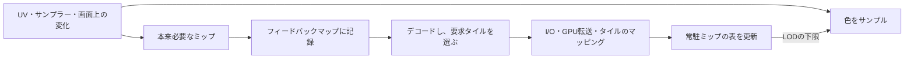

# Sampler Feedbackとテクスチャストリーミング — 必要なミップをGPUで記録する

広い地形のうち、カメラに近い一角だけに細かいテクスチャが必要になることがあります。**Sampler Feedback**は、シェーダーのサンプル要求から、どの領域でどのミップが必要かをGPUに記録するDirect3D 12の機能です。ストリーミング側はその記録を使って、予算内で読み込むタイルを選びます。[ミップ選択の仕組み](/graphics/texture/texture-filtering-and-mipmaps.html)に加えて、要求と常駐状況の違いを押さえると処理を追えます。

## 必要なミップと、実際に読めるミップ

ミップ0が最も細かい画像です。ある領域でミップ2と4が必要になった場合、**MinMipフィードバック**はその領域に2を記録します。一方、その領域にミップ4より細かいタイルがまだ常駐していなければ、色を読むサンプルはLODの下限4を使います。要求の記録にも下限4を入れると、まだ読み込めないミップ2が必要だったことを伝えられません。



Microsoftのストリーミング設計例では、要求を書き込む**フィードバックマップ**と、実際に読める最も細かいミップを表す**常駐側のMinMipマップ**を分けます。後者はアプリケーションが管理するデータです。書き込み用の座標とサンプラーを実際の色のサンプルとそろえたうえで、常駐用のLOD下限は色を読む方にだけ渡します。

| フィードバック形式 | デコード後に読める値 |
| --- | --- |
| `MIN_MIP_OPAQUE` | 各ミップ領域で要求された最も細かいミップの番号。要求なしは `0xFF` |
| `MIP_REGION_USED_OPAQUE` | ミップごと、領域ごとに要求があったか。`R8_UINT` にデコードすると未要求は `0x00`、要求ありは `0xFF`（255） |

例えばミップ0が2048×1024で、フィードバック領域を128×128テクセルに分けると、MinMipのデコード結果は16×8領域です。これはフィードバックの格子で、実際に読み込むタイルの境界や格納形式はリソースのタイリング情報で確認します。粗いミップやフィルタの足跡により、記録は必要と見なした周辺領域を含むことがあります。

## コード例 — 色を読みながら要求を残す

HLSL Shader Model 6.5のピクセルシェーダーです。`dxc -T ps_6_5 -E FeedbackPS Feedback.hlsl` でコンパイルできます。`Albedo` のSRVと同じリソースを対象に `CreateSamplerFeedbackUnorderedAccessView` を使って `NeededMip` のUAVを作ります。例の `ResidentLodClamp` は描画全体で同じ下限を使う簡略版です。タイル単位のストリーミングでは、領域とフィルタの足跡を考慮して下限を求めます。

```hlsl
Texture2D<float4> Albedo : register(t0);
SamplerState AlbedoSampler : register(s0);
FeedbackTexture2D<SAMPLER_FEEDBACK_MIN_MIP> NeededMip : register(u0);

cbuffer TextureAvailability : register(b0)
{
    float ResidentLodClamp;
};

struct PixelInput
{
    float2 uv : TEXCOORD0;
};

[earlydepthstencil]
float4 FeedbackPS(PixelInput input) : SV_Target
{
    NeededMip.WriteSamplerFeedback(Albedo, AlbedoSampler, input.uv);
    return Albedo.Sample(AlbedoSampler, input.uv, int2(0, 0), ResidentLodClamp);
}
```

この例は深度テストを早期に行える不透明パスを想定します。`discard` や深度出力を使うパスでは、どのピクセルが要求を書き込むかも設計に含めます。明示的な微分で色を読む実装では、同じ微分を `WriteSamplerFeedbackGrad` に渡せます。テクスチャのサンプルにオフセットを指定する場合、フィードバックの書き込み側は同じオフセットの指定に対応していません。

## 記録をタイルの常駐へつなぐ

Direct3D 12では、`D3D12_FEATURE_D3D12_OPTIONS7` の `SamplerFeedbackTier` で対応を確認します。Tier 0.9で使うサンプラーのアドレスモードはラップかクランプです。`Texture2D` のSRVはミップ0から全ミップを含め、プレーン番号とリソースの最小LODクランプを0にします。Tier 1.0では、このアドレスモードとSRVの追加制限が緩和されます。サンプル時に渡す `ResidentLodClamp` と、SRV自体の `ResourceMinLODClamp` は別の設定です。

1. **記録する。** フィードバックUAVをクリアしてから書き込みます。前フレームの要求も残す設計なら、どの期間を集計するかを決めます。
2. **デコードする。** 不透明形式のマップを `ResolveSubresourceRegion` の `D3D12_RESOLVE_MODE_DECODE_SAMPLER_FEEDBACK` で読める形式へ変換します。CPUで選ぶ場合は、読み戻しが完了したフレーム分を非同期に処理できます。
3. **予算内で読み込む。** 予約リソースの対象タイルを選び、マッピングと転送を行います。次の描画でタイルを安全に読める時点で常駐側のマップへ反映します。追い出すときは、以後の描画がそのタイルを参照しない順序を守ります。

カメラを急に振ると、要求を記録した時点とタイルが使える時点で見える場所が変わります。粗いミップを使える状態で保ち、最近の要求やカメラ移動に基づく先読みを加えると、転送待ちで細部の表示が遅れる時間を抑えられます。予算はフィードバックを出した回数だけでなく、I/O、転送、常駐メモリのそれぞれで管理します。

### ハードウェアのフィードバックが使えないとき

Vulkan 1.3 で同じストリーミング構成を作る場合は、描画時に求めた UV と LOD からページ ID を作り、可視ピクセルの要求をストレージ画像やバッファーへ書く方式がある。次の Compute パスで ID を重複除去し、必要なページをストリーミング側へ渡す。描画による書き込みから Compute による読み取りへの依存は [synchronization2](../optimization/enhanced-barriers-and-synchronization2.md) で表す。同じ構成は Sampler Feedback 非対応の D3D12 デバイスでも実装できる。

例えば、1 ページにつき 32 ビットの最小 LOD を保持し、初期値を最も粗い LOD にして細かい要求をアトミックな最小値で集約する。1 ピクセルに対して手作業で求めた LOD とページ番号は、異方性フィルターが読む全タップを表さない。境界付近の隣接ページや複数 LOD を余分に要求するか、粗い常駐ページへフォールバックする規則を用意する。 [Microsoft — Sampler Feedback のソフトウェア近似](https://microsoft.github.io/DirectX-Specs/d3d/SamplerFeedback.html#minmip-feedback-map)・[Khronos — Vulkan 1.3 のシェーダーアトミック操作](https://docs.vulkan.org/spec/latest/chapters/shaders.html#shaders-atomics)

## 理解度チェック

1. 同じ領域からミップ1と3の要求があった場合、MinMipフィードバックの値は何ですか。
2. ミップ4までしか常駐していない状態でミップ2が必要になりました。フィードバックの書き込みにもLOD下限4を渡すと、何が起きますか。
3. 要求したタイルを読み込み始めた時点で、常駐側のマップを細かいミップへ更新してよいですか。

::: details 解答
1. 1です。番号が小さいほど細かく、MinMipはその領域で最も細かい要求を記録します。
2. 本来の要求がクランプされるため、より細かいミップ2をロードする判断に使えません。常駐側の下限は色を読む経路に渡します。
3. 実際にマッピングと転送が済み、描画側が安全に参照できるように順序付けた時点で更新します。
:::

## 関連項目

- [テクスチャのフィルタリングとミップマップ](/graphics/texture/texture-filtering-and-mipmaps.html)
- [D3D12のリソースバリア](/graphics/optimization/d3d12-resource-barriers.html)
- [アセットロード](/game/asset-loading.html)

## 参考資料

- [Microsoft、Direct3D 12 Sampler Feedback仕様](https://microsoft.github.io/DirectX-Specs/d3d/SamplerFeedback.html)
- [Microsoft、Shader Model 6.5仕様](https://microsoft.github.io/DirectX-Specs/d3d/HLSL_ShaderModel6_5.html)
- [Microsoft、D3D12_FEATURE_DATA_D3D12_OPTIONS7](https://learn.microsoft.com/en-us/windows/win32/api/d3d12/ns-d3d12-d3d12_feature_data_d3d12_options7)
- [Microsoft、CreateSamplerFeedbackUnorderedAccessView](https://learn.microsoft.com/en-us/windows/win32/api/d3d12/nf-d3d12-id3d12device8-createsamplerfeedbackunorderedaccessview)
