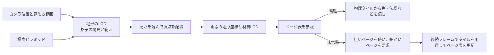

# 地形とバーチャルテクスチャ — 高さの格子と材質ページを別々に配る

地形を遠くまで見せるときは、形を作る頂点の数と、表面を彩るテクセルの数を別々に決めます。例えば岩肌の色だけが細かい平地なら、頂点を増やさず、画面に映る範囲に細かいテクスチャを割り当てられます。



## ハイトマップから地形のLODを作る

ハイトマップは平面座標 $x,z$ に一つの高さ $h(x,z)$ を割り当てます。格子点を $(x,h(x,z),z)$ に置き、隣接点を三角形で結びます。同じ $x,z$ に床と天井がある洞窟などは別のメッシュで表します。

地形を均一な格子で描くと、遠くでは一つの三角形が画面の一画素より小さくなることがあります。パッチ方式では領域ごとに格子間隔を選びます。LODを切り替える条件には、簡略化で失う標高の差を画面へ投影した誤差を使えます。透視投影の簡易見積もりでは、画面の垂直方向の焦点距離を $f_y$ ピクセル、視線に直交する標高誤差を $e$、視点座標の奥行きを $z$ とすると、投影した誤差は $f_y e / z$ ピクセルです。$f_y=720$、$e=0.5$ m、$z=180$ m なら 2 px です。境界の距離を行き来するときは、切り替えに幅を設けるか高さを補間して変化を和らげます。

### 四分木でパッチを選ぶ

地形全体を四分木に分け、遠いパッチは粗い親、近いパッチは細かい子として選ぶ方式がある。Filip Strugar の CDLOD は距離に応じて四分木から描画範囲を選び、LOD が変わる距離帯で細かい格子の頂点を粗い格子の位置へ近づける。例えば 64 m の親を 32 m の子へ分けても、グリッドの頂点数が同じなら子は 2 倍細かくサンプルできる。切り替えの境界では隣のパッチと位置が合うようにし、カメラが近づく途中で段差や隙間が出ないことを確認する。 [Strugar — CDLOD の公開実装](https://github.com/fstrugar/CDLOD)

## ジオメトリクリップマップ

LosassoとHoppeの Geometry Clipmaps（SIGGRAPH 2004）は、標高を複数の解像度に前処理し、カメラ周辺を覆う入れ子の格子に保持します。細かい格子は中心を、粗い格子はその外側のリングを描きます。例えば基準の間隔が 1 m なら、隣接する粗いレベルの間隔は 2 m、次は 4 m です。

カメラが各レベルの格子点をまたぐと、サンプルする窓の原点がずれます。固定サイズのキャッシュを周回させ、前の窓と重なる標高を保持して新しく入った行や列を更新できます。リングの境界では、細かい格子の高さを外縁へ向けて粗いレベルの高さに近づけ、格子の接続もそろえます。粗い格子にない中間頂点が境界で浮くと、継ぎ目が割れて見えます。

## コード例 — 隣り合う高さを補間する

HLSL Shader Model 6.0 の頂点シェーダーです。高さの mip ピラミッドは線形値で用意し、b0 にパッチの位置と各種スケール、t0 と s0 にテクスチャとサンプラーを渡します。DXC の `dxc -T vs_6_0 -E main terrain.hlsl` で単体コンパイルできます。境界の重みが 0 なら細かい高さ、1 なら粗い高さを選びます。CPUまたは別のGPU処理が格子を配置し、外縁の頂点を粗い格子と接続できるトポロジーを供給します。

```hlsl
Texture2D<float> HeightMap : register(t0);
SamplerState HeightSampler : register(s0);

cbuffer Terrain : register(b0)
{
    float4x4 WorldToClip;
    float2 OriginXZ;
    float CellSize;
    float HeightScale;
    float2 HeightUvScale;
    float2 HeightUvBias;
    uint FineMip;
    uint CoarseMip;
};

struct VertexInput
{
    float2 grid : POSITION;
    float edgeBlend : TEXCOORD0;
};

float4 main(VertexInput v) : SV_Position
{
    float2 xz = OriginXZ + v.grid * CellSize;
    float2 uv = xz * HeightUvScale + HeightUvBias;
    float fine = HeightMap.SampleLevel(HeightSampler, uv, float(FineMip));
    float coarse = HeightMap.SampleLevel(HeightSampler, uv, float(CoarseMip));
    float height = HeightScale * lerp(fine, coarse, saturate(v.edgeBlend));
    return mul(WorldToClip, float4(xz.x, height, xz.y, 1.0));
}
```

高さが細かい側で 0.6、粗い側で 0.4、重みが 0.25、倍率が 100 m なら高さは 55 m です。境界で値を一致させるには、両側のメッシュが同じワールド座標で同じ粗い標高を読むようにします。

## 材質はページ単位で常駐させる

バーチャルテクスチャでは、各 mip を小さなページに分けます。シェーダーは仮想座標と mip からページを決め、ページ表でGPU上の物理タイルへ引き直します。必要なタイルが未常駐なら、用意済みの親ページへフォールバックする構成にできます。テクスチャフィルタリングがページの外へ及ぶときは、隣のテクセルを入れた境界領域を確保するなど、実装に応じた処理が必要です。地形の格子LODと材質のページ要求は独立しており、格子が粗くても画素のUVが細かいページを必要とする場合があります。

Unreal Engine 5.8 の **Streaming Virtual Texturing（SVT）** は、元のテクスチャを事前にタイル化し、必要になったタイルをストレージから読みます。**Runtime Virtual Texturing（RVT）** は、シーンに配置した地形やスプラインなどの材質出力を実行時にページへ描き込み、地形の合成結果を再利用できます。離れた領域を先に焼いた低 mip をSVTとして供給する構成もあります。カメラの急移動を含む場面で、ページ要求から表示までの遅延、キャッシュの置き換え回数、ページの生成・転送時間を確認します。

### 描画からページ要求を作る

材質を評価する際に、UV と画面上の変化量から必要なミップを見積もり、テクスチャ ID、ミップ、ページ座標をフィードバック先へ書く。GPU 側で重複をまとめ、ストリーミング側は常駐表と照合して不足ページだけを要求する。例えば同じページを 300 ピクセルが参照していても、I/O 側へ渡すのは一つの要求でよい。ページの転送が終わるまでは粗い常駐ミップを読み、アップロードとページ表の更新を描画から見える順に同期する。ハードウェアでの要求記録は [Sampler Feedback](sampler-feedback.md)、GPU と CPU の受け渡しは [アセットロード](/game/asset-loading.html) を参照。

## 理解度チェック

1. 細かい地形格子から粗い格子へ移る境界で、同じ場所の頂点の高さをそろえるには、何を共有するか。
2. 1 m 間隔の内側レベルから二つ外のレベルへ移ると、格子の間隔は何 m になるか。
3. 地形に焼き込む道路の見た目と、ストレージから読む大きな岩肌のテクスチャには、UE 5.8のどの方式が対応するか。

::: details 解答

1. 同じ位置で参照する粗い標高と、境界の頂点の接続をそろえる。細かい側の高さを境界に向けて粗い値へ寄せる。
2. 4 m。各レベルで間隔を2倍にする。
3. 地形や道路の材質出力を描き込むならRVT。事前にタイル化した岩肌を必要な場所から読むならSVT。

:::

## 関連項目

- [テクスチャのフィルタリングとミップマップ](/graphics/texture/texture-filtering-and-mipmaps.html)
- [テクスチャストリーミングとmipの常駐](/graphics/texture/texture-streaming-and-mip-residency.html)
- [Sampler Feedbackとテクスチャストリーミング](/graphics/texture/sampler-feedback.html)
- [頂点シェーダーでの表現](/graphics/shader/vertex-effects.html)

## 参考資料

- [Frank Losasso、Hugues Hoppe、Geometry Clipmaps、SIGGRAPH 2004](https://hhoppe.com/geomclipmap.pdf)
- [Arul Asirvatham、Hugues Hoppe、Terrain Rendering Using GPU-Based Geometry Clipmaps、GPU Gems 2](https://developer.nvidia.com/gpugems/gpugems2/part-i-geometric-complexity/chapter-2-terrain-rendering-using-gpu-based-geometry)
- [Microsoft HLSL Texture Object — SampleLevel](https://learn.microsoft.com/en-us/windows/win32/direct3dhlsl/dx-graphics-hlsl-to-samplelevel)
- [Epic Games、Unreal Engine 5.8 — Runtime Virtual Texturing](https://dev.epicgames.com/documentation/en-us/unreal-engine/runtime-virtual-texturing-in-unreal-engine?application_version=5.8)
- [Epic Games、Unreal Engine 5.8 — Streaming Virtual Texturing](https://dev.epicgames.com/documentation/en-us/unreal-engine/streaming-virtual-texturing-in-unreal-engine?application_version=5.8)
