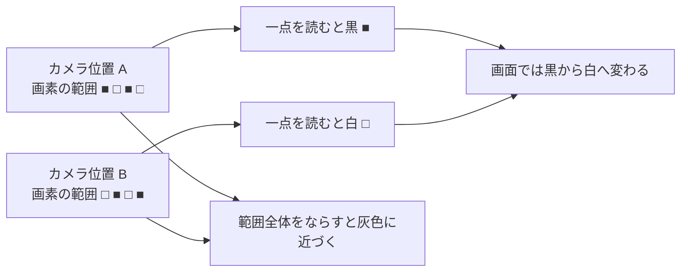
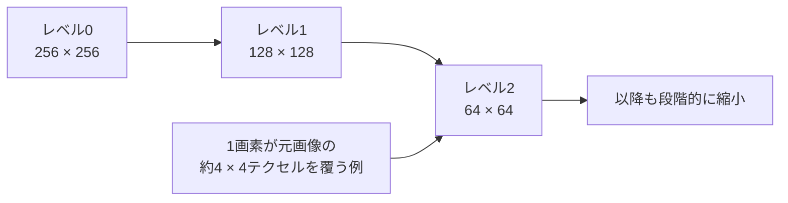

# テクスチャのフィルタリングとミップマップ — 遠くの模様はなぜちらつく？

白黒の細かい模様を床に貼り、斜めから見ます。手前では模様の一つひとつが見えます。遠くでは線が太く見えたり、カメラを少し動かすだけで模様が明滅したりします。**画面の1画素に、テクスチャのどれだけの範囲が入るか**を考えると、サンプラーの設定で見え方が変わる理由が分かります。

[斜めの床でフィルタリングを比べる実践](/practice/graphics/texture-filtering-observation.html)では、4種類を同じ模様で試せます。

## 1画素では細かい模様を表しきれない

テクスチャ上の一つの画素を**テクセル**と呼びます。[レンダリングパイプライン](/graphics/pipeline/overview.html)では、三角形の内側で補間したUVをフラグメントシェーダーへ渡し、テクスチャを読みます。手前の床では、画面の1画素がテクスチャの狭い範囲を覆います。遠くの床では、同じ1画素に何個ものテクセルが入ります。

遠くの白黒模様の色を一点だけで決めると、模様の多くを取りこぼします。カメラが少し動いて一点のサンプルが黒から白に移ると、その画素が急に明るくなります。画面の解像度で細かな変化を表しきれず、別の模様やちらつきに見える現象が**エイリアシング**です。

図では白黒が同じ割合で入る範囲を考えています。実際の色は、模様の分布とフィルターの重みに応じて変わります。画素が覆う範囲を考慮して細かい変化をならすと、カメラを動かしたときの色の跳びを抑えられます。

## 元画像をポイントとバイリニアで読む

**ポイントサンプリング**（ニアレスト）は、指定したUVに最も近いテクセルを一つ読みます。色の境界をぼかさず拡大したい絵に使えます。**バイリニア**は、同じ解像度の画像から周囲の4テクセルを取り、横と縦の位置に応じて重みを付けます。テクセルの境界で色が急に切り替わりにくくなります。

この実践のポイントとバイリニアでは、どちらも元画像を使います。画面の1画素が元画像の十数テクセルをまたぐとき、周囲4個だけでは、離れた場所にある白黒まで十分に反映できません。遠くを安定して描くには、読み取る解像度も変えます。 [OpenGL ES 3.0仕様のテクスチャフィルター](https://registry.khronos.org/OpenGL/specs/es/3.0/es_spec_3.0.pdf)

## ミップマップは縮小した画像を使い分ける

**ミップマップ**は、同じ画像を段階的に縮小して用意したものです。元画像が256×256なら、レベル0が256×256、レベル1が128×128、レベル2が64×64です。小さい画像では、一つのテクセルが元画像の広い範囲の色を反映します。

隣の画素へ移ったときのUVの変化をもとに、GPUはテクスチャがどの程度縮小されているかを見積もります。そこから読み取る解像度を決める値が**LOD**です。例えば元画像の約4×4テクセルが1画素に入る場面では、縦横が4分の1になったレベル2が目安です。

実践の**トライリニア**は、LODに近い2レベルをそれぞれバイリニアで読み、その結果をさらに混ぜます。カメラの距離が変わり、使うレベルが移るときの境目も滑らかになります。WebGL 2の `generateMipmap` で縮小画像を作れます。どのレベルをメモリに置いておくかは、[テクスチャストリーミングとmipの常駐](/graphics/texture/texture-streaming-and-mip-residency.html)で扱います。 [OpenGL ES 3.0仕様のLODとミップマップ](https://registry.khronos.org/OpenGL/specs/es/3.0/es_spec_3.0.pdf) · [WebGL 2.0仕様](https://registry.khronos.org/webgl/specs/latest/2.0/)

## 斜めの床では覆う範囲が細長くなる

床を浅い角度で見ると、1画素に入るテクスチャの範囲が、奥行き方向には長く、横方向には短くなることがあります。例えば、元画像で横2テクセル・奥行き16テクセルを覆う場合です。両方向を同じ尺度で扱い、16テクセルに近い縮小レベルを使うと、横方向の細かな模様もぼけます。

**異方性フィルタリング**は、このように方向によって範囲の広さが違う場合に、細長い範囲に合わせてサンプルを組み合わせます。遠くの床では、ちらつきを抑えながら横方向の模様が残る場合があります。具体的な取り方やサンプル数は実装に依存します。実践では拡張 `EXT_texture_filter_anisotropic` が使える環境で、上限の範囲内で異方性を指定します。 [KhronosのWebGL拡張仕様](https://registry.khronos.org/webgl/extensions/EXT_texture_filter_anisotropic/) · [異方性フィルタリングの仕様](https://registry.khronos.org/OpenGL/extensions/EXT/EXT_texture_filter_anisotropic.txt)

## 4種類を同じ床で比べる

| 選ぶモード | 縮小時の設定 | 見比べる箇所 |
| --- | --- | --- |
| ポイント | `NEAREST` | 手前の模様の角と、動かしたときの遠くのちらつき |
| バイリニア | `LINEAR` | 手前の境目が滑らかになり、遠くで残る細かな変化 |
| トライリニア（ミップマップ） | `LINEAR_MIPMAP_LINEAR` | 遠くの模様の安定と、斜めの部分のぼけ |
| 異方性 | トライリニアに異方性の設定を加える | 斜めの床で、ぼけ方と模様の残り方がどう変わるか |

まずカメラを停止したまま切り替え、次に**カメラを横に動かす**を有効にして見比べます。位置が同じときのぼけと、動かしたときのちらつきの両方を観察できます。 [ブラウザー実践を開く](/practice/graphics/texture-filtering-observation.html)

<a href="/study/samples/graphics/texture-filtering-observation/index.html" target="_self">比較デモを直接開く</a>

## 理解度チェック

1. 遠くの白黒模様を一点で読むと、カメラを少し動かしただけでなぜちらつきますか。

   ::: details 解答
   1画素の範囲に白と黒が入っていても、一点では片方だけを読みます。位置が少しずれて反対側の色を拾うと、画素の明るさが変わります。
   :::

2. バイリニアとトライリニアは、どの画像から色を読みますか。

   ::: details 解答
   この実践のバイリニアは元画像の周囲4テクセルを読みます。トライリニアはLODに近い2つのミップレベルをバイリニアで読み、その結果も混ぜます。
   :::

3. 斜めの床で異方性フィルタリングが役立つのは、1画素がテクスチャ上でどんな範囲を覆うときですか。

   ::: details 解答
   一方向に広く、もう一方に狭い、細長い範囲を覆うときです。その形に合わせてサンプルを組み合わせると、短い方向の模様を残しやすくなります。
   :::

## 関連項目

- [マテリアル・テクスチャ・シェーダーの基本](/graphics/basics/materials-textures-and-shaders.html)で、テクスチャ、UV、サンプラーの担当を整理する。
- [ラスタライゼーション](/graphics/pipeline/rasterization.html)で、三角形とUVが画面のサンプルにつながる段階を確認する。
- [アンチエイリアシング](/graphics/postprocess/antialiasing.html)で、床模様のちらつきとポリゴンの輪郭のギザギザを比べる。
- [3DCG・描画ロードマップの「レンダリングパイプライン」](/learn/roadmap.html?node=gfx-pipeline#graphics)

## 参考資料

- [Khronos — WebGL 2.0 Specification](https://registry.khronos.org/webgl/specs/latest/2.0/) · [OpenGL ES 3.0.6 Specification](https://registry.khronos.org/OpenGL/specs/es/3.0/es_spec_3.0.pdf)
- [Khronos — WebGL EXT_texture_filter_anisotropic](https://registry.khronos.org/webgl/extensions/EXT_texture_filter_anisotropic/) · [OpenGL EXT_texture_filter_anisotropic](https://registry.khronos.org/OpenGL/extensions/EXT/EXT_texture_filter_anisotropic.txt)
