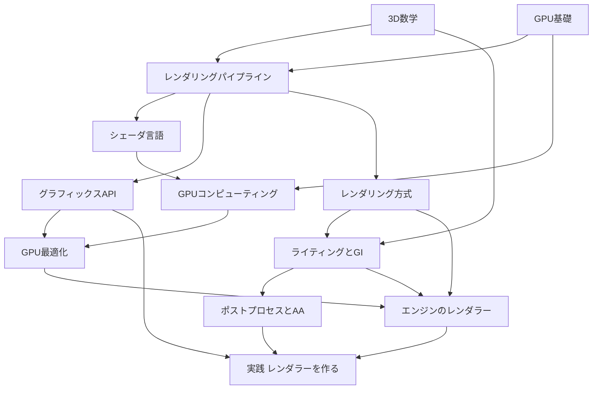

# 描画の学習ロードマップ

描画に関する技術辞典の本文を、前提のつながりに沿って読むためのガイドです。以下は推奨する経路です。既に知っている項目は飛ばし、目的に必要なところから参照してください。

## 知識ツリー全体像

## フェーズ1: 土台を確認する

GPU・数学・パイプラインの前提を確認します。不明な項目を補いながら進めます。

| 順序 | ページ | 到達目標 |
|---|---|---|
| 1 | [GPUとは何か](/hardware/gpu/what-is-gpu.html) | GPUが「大量の同じ計算」に特化した理由を説明できる |
| 2 | [CPUとGPUの役割分担](/hardware/gpu/cpu-vs-gpu.html) | ドローコールがGPUに届くまでの流れを説明できる |
| 3 | [GPUアーキテクチャ詳解](/hardware/gpu/architecture.html) | SM/CU、SIMT、メモリ階層を図に描ける |
| 4 | [ベクトル](/math/rendering/vector.html) → [行列](/math/rendering/matrix.html) → [座標変換](/math/rendering/transform.html) | MVP変換を自力で導出できる |
| 5 | [カメラと射影](/math/rendering/camera.html) → [クォータニオン](/math/rendering/quaternion.html) | 透視投影行列の各要素の意味を説明できる |
| 6 | [パイプライン全体像](/graphics/pipeline/overview.html) → [Vertex Shader](/graphics/pipeline/vertex-shader.html) → [ラスタライゼーション](/graphics/pipeline/rasterization.html) → [Fragment Shader](/graphics/pipeline/fragment-shader.html) → [出力結合](/graphics/pipeline/output-merger.html) | 頂点がピクセルになるまでを工程ごとに説明できる |

## フェーズ2: シェーダとAPI

手を動かし始めるフェーズです。シェーダ言語→APIの順を推奨します。

1. [シェーダ言語総論と比較](/graphics/shader/overview.html) — まず全体像
2. [HLSL](/graphics/shader/hlsl.html) — Unity/UE/DX12の共通言語として最優先
3. [GLSL](/graphics/shader/glsl.html) / [WGSL](/graphics/shader/wgsl.html) / [SPIR-V](/graphics/shader/spirv.html)
4. [グラフィックスAPIの歴史](/graphics/api/history.html) — なぜ明示的APIに進化したか
5. [OpenGL](/graphics/api/opengl.html) → [DirectX 11](/graphics/api/directx11.html) — 「古いAPI」の設計を知ると新APIの動機が分かる
6. [DirectX 12](/graphics/api/directx12.html) → [Vulkan](/graphics/api/vulkan.html) → [WebGPU](/graphics/api/webgpu.html) → [Metal](/graphics/api/metal.html)
7. [4大API横断比較](/graphics/api/comparison.html) — 総まとめ

## フェーズ3: GPUコンピューティング

レンダリングの最先端(GPU Driven、Nanite、各種GI)はすべてCompute Shaderの上に成り立っています。

1. [Compute Shader](/graphics/compute/compute-shader.html)
2. [GPU並列実行モデル (Warp/Wave)](/graphics/compute/execution-model.html) — **最重要ページの一つ**
3. [Shared Memory と Atomic](/graphics/compute/shared-memory.html)
4. [並列アルゴリズム (Reduction/Scan)](/graphics/compute/parallel-algorithms.html)
5. [CUDA と OpenCL](/graphics/compute/cuda-opencl.html)

## フェーズ4: レンダリング技術

「現代のゲームの絵作り」を理解するフェーズです。

- 方式: [Forward](/graphics/path/forward.html) → [Deferred](/graphics/path/deferred.html) → [Forward+/Clustered](/graphics/path/forward-plus.html)
- ライティング: [PBR](/graphics/lighting/pbr.html) → [IBL](/graphics/lighting/ibl.html) → [シャドウ](/graphics/lighting/shadow.html)
- GI: [GI総論](/graphics/lighting/gi.html) → [SSAO](/graphics/lighting/ssao.html) → [SSR](/graphics/lighting/ssr.html) → [レイトレーシング](/graphics/lighting/raytracing.html) → [パストレーシング](/graphics/lighting/path-tracing.html) → [Lumen](/graphics/lighting/lumen.html)
- 画像処理: [ポストプロセス](/graphics/postprocess/overview.html) → [AA](/graphics/postprocess/antialiasing.html) → [TAA](/graphics/postprocess/taa.html) → [アップスケーリング](/graphics/postprocess/upscaling.html)

## フェーズ5: 最適化と実務

1. [GPU最適化の基礎](/graphics/optimization/basics.html)
2. [デバッグ・プロファイリングツール](/graphics/optimization/tools.html) — RenderDoc / PIX / Nsight
3. [RenderGraph / FrameGraph](/graphics/optimization/render-graph.html)
4. [GPU Driven Rendering](/graphics/optimization/gpu-driven.html)

## フェーズ6: エンジン内部

1. [Unity のレンダラーと SRP](/graphics/engine/unity-renderer.html) → [URP](/graphics/engine/urp.html) → [HDRP](/graphics/engine/hdrp.html)
2. [Unreal Engine のレンダラー](/graphics/engine/unreal-renderer.html)

## フェーズ7: 総仕上げ — ゼロからレンダラーを作る

[レンダラーの設計・実装](/graphics/capstone/01-design.html)は「実践・サンプル」にある教材です。各ステップの設計とコード断片を追い、分からない概念を辞典の本文へ戻って調べます。

## 学習スタイル別の入り口

| あなたのタイプ | 推奨の入り方 |
|---|---|
| まず全体像を掴みたい | [技術全史年表](/guide/rendering/timeline.html) → フェーズ1 |
| Unityをすでに使っている | [Unity のレンダラーと SRP](/graphics/engine/unity-renderer.html) を読み、分からない用語を辿って戻る |
| UEをすでに使っている | [Unreal Engine のレンダラー](/graphics/engine/unreal-renderer.html) から同様に |
| 低レベルから積み上げたい | フェーズ1 → フェーズ2で前提を確認する |
| とにかく手を動かしたい | [レンダラーの設計・実装](/graphics/capstone/01-design.html) を読みながら、詰まったページに戻る |
