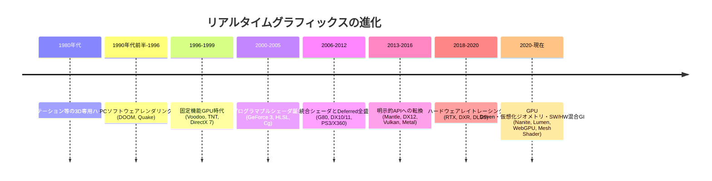
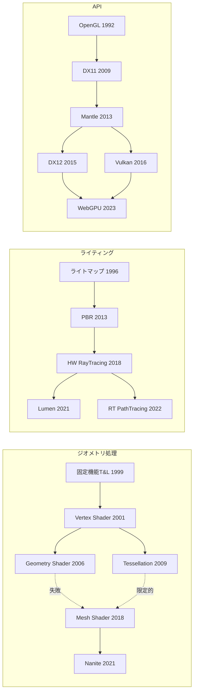

# リアルタイム3D技術全史

技術は暗記するものではなく、**進化の必然**として理解するものです。このページはWiki全体の背骨となる年表です。各時代の「当時の課題」が、次の時代の技術を生み出しています。

## 全体年表

## 1. PCゲームのソフトウェアレンダリング (1990年代前半〜1996)

**PCゲームでの課題**: 汎用PCの多くでは、3D描画をCPUで処理するコストが大きかった。これは「当時3D専用ハードウェアがなかった」という意味ではない。1982年のGeometry Engine論文には行列変換・clipping・出力座標への写像を行う専用VLSIが記載されている。ワークステーションや専用機と、当時の一般PCゲームの描画環境は分けて読む。

- 1992: id Software **Wolfenstein 3D** — レイキャスティングによる疑似3D
- 1993: **DOOM** — BSPツリーによる可視面判定。ジョン・カーマックの名を世界に知らしめた
- 1996: **Quake** — 完全な3Dポリゴン + ライトマップ(事前計算GI の原点)。マイケル・アブラッシュの最適化本はこの時代の聖典
- CPUのピクセル塗りつぶし能力が限界 → **専用ハードウェアの必要性**が明確に

→ 詳細: [GPUとは何か](/hardware/gpu/what-is-gpu.html)

## 2. 固定機能パイプライン時代 (1996〜2000)

**当時の課題**: ラスタライズとテクスチャリングをハードウェア化したい。

- 1996: 3dfx **Voodoo Graphics** — 民生用3Dアクセラレータの爆発的普及。Glide API
- 1996: Microsoft **Direct3D** 初版 / SGI **OpenGL** はワークステーションから民生へ
- 1999: NVIDIA **GeForce 256** — T&L等を統合し、同社の定義で「世界初のGPU」として販売。3D用専用処理の存在自体がこの年から始まったわけではない
- 描画処理は**固定機能** — ライティング計算式は変更不可能で、表現の均質化が課題に

→ 詳細: [グラフィックスAPIの歴史](/graphics/api/history.html)

## 3. プログラマブルシェーダ誕生 (2001〜2005)

**当時の課題**: 固定機能では独自の絵作りができない。

- 2001: **GeForce 3** + DirectX 8 — Vertex/Pixel Shader (アセンブリ言語)
- 2002: ATI Radeon 9700 + **DirectX 9** — Shader Model 2.0、浮動小数点レンダーターゲット
- 2003: **HLSL** / **Cg** — 高級シェーダ言語の登場。GLSLもOpenGL 2.0で標準化 (2004)
- 代表作: Half-Life 2 (2004), F.E.A.R. (2005) — 動的ライティングとシャドウの時代へ
- 論文: この頃 GPGPU研究が始まる (BrookGPU など) → 後のCUDAへ

→ 詳細: [シェーダ言語総論](/graphics/shader/overview.html), [Vertex Shader](/graphics/pipeline/vertex-shader.html)

## 4. 統合シェーダと Deferred 全盛 (2006〜2012)

**当時の課題**: 頂点/ピクセルで別々のハードウェアユニットは非効率。多数の動的ライトを扱いたい。

- 2006: NVIDIA **G80 (GeForce 8800)** — 統合シェーダアーキテクチャ + **CUDA** 発表
- 2006-07: PS3 / Xbox 360 世代 — **Deferred Rendering** が主流化 (Killzone 2 の発表資料が有名)
- 2009: **DirectX 11** — Compute Shader、Tessellation
- 2007: Crysis — 当時の技術の集大成。「Can it run Crysis?」
- 物理ベースレンダリング(PBR)の理論が実務に降りてくる準備期間

→ 詳細: [Deferred Rendering](/graphics/path/deferred.html), [Compute Shader](/graphics/compute/compute-shader.html)

## 5. PBRの標準化と明示的APIへの転換 (2013〜2017)

**当時の課題**: ドライバのオーバーヘッドが大きくCPUがボトルネックに。マルチコアCPUを活かせない。

- 2012-13: **PBR標準化** — Disney原則BRDF (Burley, SIGGRAPH 2012)、UE4のPBR採用 (Karis, 2013)
- 2013: AMD **Mantle** — 明示的APIの先駆け (Battlefield 4)
- 2014: Apple **Metal** / 2015: **DirectX 12** / 2016: **Vulkan** (MantleがKhronosに寄贈されて誕生)
- 2014: UE4 / Unity 5 リリース — 商用エンジンの民主化
- Forward+ / Clustered Shading の論文と実装が普及 (Harada 2012, Olsson 2012)

→ 詳細: [PBR](/graphics/lighting/pbr.html), [DirectX 12](/graphics/api/directx12.html), [Vulkan](/graphics/api/vulkan.html)

## 6. ハードウェアレイトレーシング時代 (2018〜2020)

**当時の課題**: ラスタライズ+画面空間手法では反射・GI・影の品質に限界。

- 2018: NVIDIA **Turing (RTX 20)** — RTコア + Tensorコア。**DXR** (DirectX Raytracing)
- 2018: **DLSS** — 深層学習アップスケーリングの幕開け
- 2019: Metro Exodus — RTGIの実用化第一世代
- 2020: PS5 / Xbox Series X — コンソールにもRT搭載。**Mesh Shader** 世代 (Turing/RDNA2)

→ 詳細: [ハードウェアレイトレーシング](/graphics/lighting/raytracing.html), [アップスケーリング](/graphics/postprocess/upscaling.html), [Mesh Shader](/graphics/pipeline/mesh-shader.html)

## 7. GPU Driven・仮想化・ニューラルの現在 (2020〜)

**当時の課題**: ジオメトリ量とライティング品質の要求が従来パイプラインの設計限界を超えた。

- 2021: UE5 **Nanite** (仮想化マイクロポリゴンジオメトリ) + **Lumen** (SW/HWハイブリッドGI)
- 2022: **FSR 2** (時間的アップスケーリング) / **XeSS** — アップスケーラの三つ巴時代
- 2023: **WebGPU** 正式リリース (Chrome 113) / DLSS 3.5 Ray Reconstruction
- 2024-25: Work Graphs (GPU自律実行)、ニューラルレンダリング(Neural Radiance Cache, 3D Gaussian Splatting)の実用化研究
- ReSTIR系サンプリング (2020〜) がリアルタイムパストレーシングを現実に (Cyberpunk 2077 Overdrive)

→ 詳細: [Lumen](/graphics/lighting/lumen.html), [GPU Driven Rendering](/graphics/optimization/gpu-driven.html), [パストレーシング](/graphics/lighting/path-tracing.html), [WebGPU](/graphics/api/webgpu.html)

## 技術系譜図

## 代表的人物

| 人物 | 貢献 |
|---|---|
| John Carmack | DOOM/Quake。リアルタイム3Dの開拓者。Carmack's Reverse (シャドウボリューム) |
| Michael Abrash | 最適化とラスタライザの古典的著作。Quakeの共同開発 |
| Tim Sweeney | Unreal Engine 創始者。Nanite/Lumen 時代の技術ビジョン |
| Brian Karis | UE4のPBR標準化 (2013)、Nanite の設計者 |
| Brent Burley | Disney 原則BRDF (2012) — PBR標準化の理論的基盤 |
| Natalya Tatarchuk | AMD→Bungie→Unity。Destiny のレンダラー、Unity のグラフィックス統括 |
| Takahiro Harada | Forward+ (2012) の提案者 |
| Turner Whitted | 再帰レイトレーシング (1980) |
| James Kajiya | レンダリング方程式 (1986) — 全てのGI手法の理論的原点 |
| Edwin Catmull | Zバッファ、テクスチャマッピング、サブディビジョン曲面。Pixar創業者 |

## この年表の使い方

各章の「歴史・誕生した背景」セクションは、この年表のどこかに位置づけられます。**新しい技術を学ぶときは、必ず「それ以前は何が使われていて、何が課題だったのか」から入る**ことを勧めます。それがこのWiki全体の設計思想です。

## 次に読むべきページ

- [GPUとは何か](/hardware/gpu/what-is-gpu.html) — フェーズ1の開始
- [グラフィックスAPIの歴史](/graphics/api/history.html) — API進化のより詳しい物語
- [学習ロードマップ](/guide/rendering/roadmap.html)
- [James H. Clark: The Geometry Engine (SIGGRAPH 1982)](https://stanford.edu/class/cs349g/p127-clark.pdf)
- [NVIDIA: GeForce 256の回顧（メーカーのGPU定義）](https://blogs.nvidia.com/blog/first-gpu-gaming-ai/)
