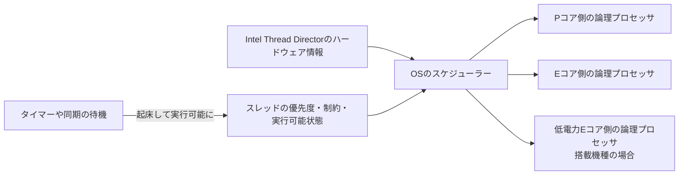

# ハイブリッドCPUのスケジューリング — コアの特性とスレッドの待ち時間

異なる特性のコアを持つCPUでは、同じ仕事でも実行先によって処理時間や電力の使い方が変わります。ゲームのフレームが遅れたときは、コア上の実行に時間がかかったのか、スレッドが実行できる状態になってから順番を待ったのか、タイマーや同期オブジェクトを待っていたのかを切り分けます。



## コアの特性とOSの判断

Intelは第12世代Coreの一部で、単一スレッドで高い性能を狙うPコアと、電力や面積当たりの処理量を重視するEコアを組み合わせました。以降は低電力Eコア（LP Eコア）を持つ製品もあります。例えばCore Ultra 9 288V（Series 2）はPコア4基と低電力Eコア4基、Core Ultra X9 388H（Series 3）はPコア4基、Eコア8基、低電力Eコア4基です。この2製品の論理スレッド数はそれぞれ8と16で、物理コア数と同じです。ハイパースレッディングに対応し有効な製品では、1物理コアに複数の論理プロセッサが割り当てられます。

Intel Thread Directorは実行中の仕事に関するハードウェア側の情報をOSへ渡します。実際の配置を決めるのはOSのスケジューラーです。Windows 11上でも、仕事の状態、優先度、電力条件、アフィニティなどが影響します。フレーム全体の完了を決めるのは依存の最長経路なので、メインスレッドが速いコアで動いていても、必須のワーカージョブを待つ時間は残ります。

Windows 10以降のCPU Sets APIでは、論理プロセッサが属するグループ、コア番号、`EfficiencyClass` などを取得できます。Microsoftの仕様では、異種コア構成で値が大きいクラスほど高性能かつ電力効率が低い傾向を表します。値を特定モデルのコア名へ固定で変換せず、実際の機種で確認します。CPU Setsによる配置指定はOSの電力管理と共存するための機構で、厳しいアフィニティ制約が適用される場合はそちらの制約も考慮されます。

### 同じ世代でも製品によって構成が変わる

Core Ultra Series 2 のデスクトップ向け 285K は P コア 8 基と E コア 16 基を持ち、合計 24 スレッドです。モバイル向けの 288V と同じ Series 2 でも、コアの内訳が異なります。AMD Ryzen AI 400 Series の Ryzen AI 9 HX 470 は Zen 5 が 4 基、Zen 5c が 8 基で、SMT を含めて 12 コア・24 スレッドです。論理プロセッサ数が同じ 24 でも、285K では 24 物理コア、HX 470 では 12 物理コアを共有します。 [Intel — Core Ultra 200S Series](https://download.intel.com/newsroom/2024/client-computing/Intel-Core-Ultra-200S-Series-Presentation.pdf)、[AMD — Ryzen AI 9 HX 470](https://www.amd.com/en/products/processors/laptop/ryzen/ai-400-series/amd-ryzen-ai-9-hx-470.html)

ジョブシステムでワーカー数や配置を調整するなら、論理プロセッサの総数に加えて、物理コアの共有とクラスを確認します。`EfficiencyClass` は Windows が報告する相対的なクラスです。Intel の P コアや E コア、AMD の Zen 5 や Zen 5c を、OS 上で共通の名前や固定のクラス番号に対応づけて使うと、機種ごとの違いを取りこぼします。最後にフレームを止めているジョブは、CPU タイムラインで実行先と待ち時間を調べます。

### Windows 11 の QoS と EcoQoS

スレッドの QoS（Quality of Service）は、必要な性能と電力効率を Windows に伝える情報です。スケジューリング優先度は、実行可能なスレッドのどれを次に走らせるかを主に左右します。QoS は CPU の電力管理や、異種コアがある場合の配置先の選択に関わります。ウィンドウのフォーカス、可視性、音声の再生などからも自動で決まり、API で明示する方法もあります。 [Microsoft — Quality of Service](https://learn.microsoft.com/en-us/windows/win32/procthread/quality-of-service)

| 指定 | Windows 11 での意味 | 使う仕事の例 |
| --- | --- | --- |
| OS に任せる | フォーカスや可視性などを基に、OS が自動で分類する。 | まず通常の設定で計測する。 |
| HighQoS | 標準の高性能な動作を求める。 | フレームの完了に影響する仕事の調査。 |
| EcoQoS | 電力効率を優先し、効率のよい周波数やコアを選ぶ方針を適用する。 | 今のフレームが完了を待たないキャッシュ整備やバックグラウンド処理。 |

EcoQoS は Windows 11 で追加された分類です。`SetThreadInformation` の `ThreadPowerThrottling` で、スレッドごとに実行速度のスロットリングを有効・無効にできます。プロセスに指定する場合は `SetProcessInformation` の `ProcessPowerThrottling` を使います。ゲーム本体と背景処理が同じプロセスにある場合は、処理を担当する専用スレッドに範囲を絞れます。毎フレーム合流するジョブを含む共有プールに一括で適用すると、そのジョブの完了が遅れ、フレーム全体も遅れることがあります。API の成功は指定が受理されたことを表し、実行されたコアは CPU タイムラインで確かめます。 [Microsoft — SetThreadInformation](https://learn.microsoft.com/en-us/windows/win32/api/processthreadsapi/nf-processthreadsapi-setthreadinformation)、[Microsoft — SetProcessInformation](https://learn.microsoft.com/en-us/windows/win32/api/processthreadsapi/nf-processthreadsapi-setprocessinformation)

### コード例 — 専用スレッドに QoS を指定する

Windows 11、C++20 のコンソール例です。`cl /std:c++20 /EHsc thread-qos.cpp` でコンパイルし、引数に `eco`、`high`、`auto` のいずれかを渡します。Windows の設定を変える対象は、このプログラム内で新しく起動したスレッドです。制御する項目を `ControlMask` で、オンにする項目を `StateMask` で指定します。

```cpp
#define WIN32_LEAN_AND_MEAN
#include <windows.h>

#include <iostream>
#include <string_view>
#include <thread>

int main(int argc, char* argv[])
{
    if (argc != 2) {
        std::cerr << "Usage: thread-qos eco|high|auto\n";
        return 1;
    }

    const std::string_view mode = argv[1];
    if (mode != "eco" && mode != "high" && mode != "auto") {
        std::cerr << "Unknown QoS mode\n";
        return 1;
    }

    DWORD result = ERROR_SUCCESS;
    std::thread worker([mode, &result] {
        THREAD_POWER_THROTTLING_STATE state{};
        state.Version = THREAD_POWER_THROTTLING_CURRENT_VERSION;
        if (mode != "auto") {
            state.ControlMask = THREAD_POWER_THROTTLING_EXECUTION_SPEED;
        }
        if (mode == "eco") {
            state.StateMask = THREAD_POWER_THROTTLING_EXECUTION_SPEED;
        }
        if (!SetThreadInformation(GetCurrentThread(), ThreadPowerThrottling, &state,
                                  static_cast<DWORD>(sizeof(state)))) {
            result = GetLastError();
            return;
        }

        PROCESSOR_NUMBER cpu{};
        GetCurrentProcessorNumberEx(&cpu);
        std::cout << mode << ": group=" << cpu.Group
                  << " logical=" << static_cast<unsigned>(cpu.Number) << '\n';
    });
    worker.join();

    if (result != ERROR_SUCCESS) {
        std::cerr << "SetThreadInformation failed: " << result << '\n';
        return 2;
    }
}
```

出力する CPU 番号は `GetCurrentProcessorNumberEx` を呼んだ瞬間の実行先です。同じワーカーがその後も同じコアに留まるかは、コンテキストスイッチを含むトレースで確認します。設定を比較するときは、電源接続、アプリのフォーカス、入力の有無を揃えます。Windows 11 の対応環境では、バッテリー駆動中に入力が途絶えると、前面アプリの自動分類が High から Medium に下がることがあり、自動計測の条件に影響します。 [Microsoft — GetCurrentProcessorNumberEx](https://learn.microsoft.com/en-us/windows/win32/api/processthreadsapi/nf-processthreadsapi-getcurrentprocessornumberex)、[Microsoft — Quality of Service](https://learn.microsoft.com/en-us/windows/win32/procthread/quality-of-service)

## コード例 — CPU Setを列挙する

Windows 10以降のC++20コンソール例です。MSVCで `cl /std:c++20 /EHsc cpu-sets.cpp` としてコンパイルできます。APIが返す可変長レコードを、`Size` のバイト数ずつ進みます。`Group` を一緒に表示すると、別のグループで同じ番号を持つ論理プロセッサを区別できます。

```cpp
#define WIN32_LEAN_AND_MEAN
#include <windows.h>

#include <cstddef>
#include <cstring>
#include <iostream>
#include <vector>

int main()
{
    ULONG size = 0;
    if (!GetSystemCpuSetInformation(nullptr, 0, &size, nullptr, 0)
        && GetLastError() != ERROR_INSUFFICIENT_BUFFER) {
        return 1;
    }
    if (size == 0) {
        return 1;
    }
    std::vector<std::byte> buffer(size);
    if (!GetSystemCpuSetInformation(
            reinterpret_cast<SYSTEM_CPU_SET_INFORMATION*>(buffer.data()),
            size, &size, nullptr, 0)) {
        return 1;
    }

    constexpr std::size_t headerSize = offsetof(SYSTEM_CPU_SET_INFORMATION, CpuSet);
    for (std::size_t offset = 0; offset < size;) {
        SYSTEM_CPU_SET_INFORMATION item{};
        const auto remaining = size - offset;
        if (remaining < headerSize) {
            return 2;
        }
        std::memcpy(&item, buffer.data() + offset, headerSize);
        if (item.Size < headerSize || item.Size > remaining) {
            return 2;
        }
        if (item.Type == CpuSetInformation) {
            if (item.Size < sizeof(item)) {
                return 2;
            }
            std::memcpy(&item, buffer.data() + offset, sizeof(item));
            const auto& cpu = item.CpuSet;
            std::cout << "group=" << cpu.Group
                      << " logical=" << unsigned(cpu.LogicalProcessorIndex)
                      << " core=" << unsigned(cpu.CoreIndex)
                      << " class=" << unsigned(cpu.EfficiencyClass) << '\n';
        }
        offset += item.Size;
    }
}
```

同じ `Group` と `CoreIndex` に複数の `LogicalProcessorIndex` があれば、その物理コアを複数の論理プロセッサが共有しています。クラスが一つしか出ない機種でも列挙は有効です。ここでは配置を変更していません。実行先がフレームごとにどう変わったかは、CPUのタイムラインで確認します。

## タイマー分解能と実行再開は別の時刻

`timeBeginPeriod` はWindowsのタイマーサービスへ分解能を要求します。Windows 10 バージョン2004以降は従来のグローバルな要求の扱いが変わり、呼び出していないプロセスに高い分解能は保証されません。Windows 11では、ウィンドウを持つプロセスが完全に隠れるなど、ユーザーに見えない・聞こえない条件でも高い分解能は保証されません。呼び出しを使う場合は、同じ値で `timeEndPeriod` と対応させます。

タイマーの満了でスレッドが実行可能になっても、直後にコアへ割り当てられるとは限りません。`QueryPerformanceCounter` の精度は `timeBeginPeriod` で改善しません。WPRなどで、待機から実行可能になるまで、実行可能になってから走り出すまで、コア上で実行した区間を分けて見ます。例えば起床予定から0.8 ms遅れて実行可能になり、その後2.0 ms待った場合、予定から実行開始までの差は2.8 msです。

プロセスの電力設定には、実行速度の `PROCESS_POWER_THROTTLING_EXECUTION_SPEED` のほか、タイマー分解能の要求を無視する `PROCESS_POWER_THROTTLING_IGNORE_TIMER_RESOLUTION` があります。前者を使って EcoQoS にした場合と、後者を有効にしてタイマー分解能の要求を無視させた場合では、変わる処理段階が異なります。遅れを調べるときは、実行可能になった時刻と、その後どこでいつ走ったかを別々に見ます。 [Microsoft — SetProcessInformation](https://learn.microsoft.com/en-us/windows/win32/api/processthreadsapi/nf-processthreadsapi-setprocessinformation)

## 理解度チェック

1. Thread Directorの情報を受けて、最終的にスレッドの実行先を決めるのは何か。
2. 同じ物理コアの二つの論理プロセッサを見つけるとき、どのフィールドを比較するか。
3. タイマーが満了してもスレッドが1 ms走り出さなかった。分解能を上げる前に何を調べるか。
4. アセットを展開するワーカーに EcoQoS を適用するとき、その展開がフレームの完了を止めないかをどう判断するか。

::: details 解答

1. OSのスケジューラー。優先度や実行制約なども考慮する。
2. `Group` と `CoreIndex` が同じで、`LogicalProcessorIndex` が異なるレコードを探す。
3. 実行可能になった時刻と、CPUに割り当てられた時刻を比べる。両者の差なら、タイマー満了後のスケジューリングを調べる。
4. フレームを確定する処理が、その展開結果やワーカーの完了を待っているかを調べる。待つ場合は、展開と合流を含む時間を、設定を変える前後で測る。

:::

## 関連項目

- [スレッドのスケジューリング](/os/thread-scheduling.html)
- [ジョブシステムとワークスティーリング](/runtime/jobs-and-work-stealing.html)
- [CPUプロファイリング](/tools/profiling/cpu-profiling.html)

## 参考資料

- [Intel — Game Dev Guide for 12th Gen Intel Core Processor Hybrid Architecture](https://www.intel.com/content/www/us/en/developer/articles/guide/12th-gen-intel-core-processor-gamedev-guide.html)
- [Intel — Core Ultra 9 288Vの仕様（Series 2）](https://www.intel.com/content/www/us/en/products/sku/240961/intel-core-ultra-9-processor-288v-12m-cache-up-to-5-10-ghz/specifications.html)
- [Intel — Core Ultra X9 388Hの仕様（Series 3）](https://www.intel.com/content/www/us/en/products/sku/245526/intel-core-ultra-x9-processor-388h-18m-cache-up-to-5-10-ghz/specifications.html)
- [Intel — Core Ultra 200S Seriesの製品構成](https://download.intel.com/newsroom/2024/client-computing/Intel-Core-Ultra-200S-Series-Presentation.pdf)
- [AMD — Ryzen AI 9 HX 470の仕様（Ryzen AI 400 Series）](https://www.amd.com/en/products/processors/laptop/ryzen/ai-400-series/amd-ryzen-ai-9-hx-470.html)
- [Microsoft — CPU Sets（Windows 10以降）](https://learn.microsoft.com/en-us/windows/win32/procthread/cpu-sets)
- [Microsoft — GetSystemCpuSetInformation](https://learn.microsoft.com/en-us/windows/win32/api/processthreadsapi/nf-processthreadsapi-getsystemcpusetinformation)
- [Microsoft — SYSTEM_CPU_SET_INFORMATION](https://learn.microsoft.com/en-us/windows/win32/api/winnt/ns-winnt-system_cpu_set_information)
- [Microsoft — WindowsのQuality of Service](https://learn.microsoft.com/en-us/windows/win32/procthread/quality-of-service)
- [Microsoft — SetThreadInformationとThreadPowerThrottling](https://learn.microsoft.com/en-us/windows/win32/api/processthreadsapi/nf-processthreadsapi-setthreadinformation)
- [Microsoft — SetProcessInformationとProcessPowerThrottling](https://learn.microsoft.com/en-us/windows/win32/api/processthreadsapi/nf-processthreadsapi-setprocessinformation)
- [Microsoft — GetCurrentProcessorNumberEx](https://learn.microsoft.com/en-us/windows/win32/api/processthreadsapi/nf-processthreadsapi-getcurrentprocessornumberex)
- [Microsoft — timeBeginPeriod（Windows 10 バージョン2004とWindows 11の動作）](https://learn.microsoft.com/en-us/windows/win32/api/timeapi/nf-timeapi-timebeginperiod)
