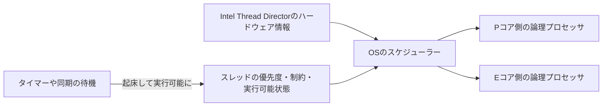

# ハイブリッドCPUのスケジューリング — コアの特性とスレッドの待ち時間

異なる特性のコアを持つCPUでは、同じ仕事でも実行先によって処理時間や電力の使い方が変わります。ゲームのフレームが遅れたときは、コア上の実行に時間がかかったのか、スレッドが実行できる状態になってから順番を待ったのか、タイマーや同期オブジェクトを待っていたのかを切り分けます。



## コアの特性とOSの判断

Intelの第12世代Coreにおけるハイブリッド構成には、単一スレッドで高い性能を狙うPコアと、電力や面積当たりの処理量を重視するEコアがあります。同じ世代でも搭載数や構成は製品ごとに異なります。ハイパースレッディングなどが有効な場合、物理コアとOSから見える論理プロセッサの数も一致しません。

Intel Thread Directorは実行中の仕事に関するハードウェア側の情報をOSへ渡します。実際の配置を決めるのはOSのスケジューラーです。Windows 11上でも、仕事の状態、優先度、電力条件、アフィニティなどが影響します。フレーム全体の完了を決めるのは依存の最長経路なので、メインスレッドが速いコアで動いていても、必須のワーカージョブを待つ時間は残ります。

Windows 10以降のCPU Sets APIでは、論理プロセッサが属するグループ、コア番号、`EfficiencyClass` などを取得できます。Microsoftの仕様では、異種コア構成で値が大きいクラスほど高性能かつ電力効率が低い傾向を表します。値を特定モデルのコア名へ固定で変換せず、実際の機種で確認します。CPU Setsによる配置指定はOSの電力管理と共存するための機構で、厳しいアフィニティ制約が適用される場合はそちらの制約も考慮されます。

## コード例 — CPU Setを列挙する

Windows 10以降のC++20コンソール例です。MSVCで `cl /std:c++20 /EHsc cpu-sets.cpp` としてコンパイルできます。APIが返す可変長レコードを、`Size` のバイト数ずつ進みます。`Group` を一緒に表示すると、別のグループで同じ番号を持つ論理プロセッサを区別できます。

```cpp
#define WIN32_LEAN_AND_MEAN
#include <windows.h>

#include <cstddef>
#include <cstring>
#include <iostream>
#include <vector>

int main()
{
    ULONG size = 0;
    if (!GetSystemCpuSetInformation(nullptr, 0, &size, nullptr, 0)
        && GetLastError() != ERROR_INSUFFICIENT_BUFFER) {
        return 1;
    }
    if (size == 0) {
        return 1;
    }
    std::vector<std::byte> buffer(size);
    if (!GetSystemCpuSetInformation(
            reinterpret_cast<SYSTEM_CPU_SET_INFORMATION*>(buffer.data()),
            size, &size, nullptr, 0)) {
        return 1;
    }

    constexpr std::size_t headerSize = offsetof(SYSTEM_CPU_SET_INFORMATION, CpuSet);
    for (std::size_t offset = 0; offset < size;) {
        SYSTEM_CPU_SET_INFORMATION item{};
        const auto remaining = size - offset;
        if (remaining < headerSize) {
            return 2;
        }
        std::memcpy(&item, buffer.data() + offset, headerSize);
        if (item.Size < headerSize || item.Size > remaining) {
            return 2;
        }
        if (item.Type == CpuSetInformation) {
            if (item.Size < sizeof(item)) {
                return 2;
            }
            std::memcpy(&item, buffer.data() + offset, sizeof(item));
            const auto& cpu = item.CpuSet;
            std::cout << "group=" << cpu.Group
                      << " logical=" << unsigned(cpu.LogicalProcessorIndex)
                      << " core=" << unsigned(cpu.CoreIndex)
                      << " class=" << unsigned(cpu.EfficiencyClass) << '\n';
        }
        offset += item.Size;
    }
}
```

同じ `Group` と `CoreIndex` に複数の `LogicalProcessorIndex` があれば、その物理コアを複数の論理プロセッサが共有しています。クラスが一つしか出ない機種でも列挙は有効です。ここでは配置を変更していません。実行先がフレームごとにどう変わったかは、CPUのタイムラインで確認します。

## タイマー分解能と実行再開は別の時刻

`timeBeginPeriod` はWindowsのタイマーサービスへ分解能を要求します。Windows 10 バージョン2004以降は従来のグローバルな要求の扱いが変わり、呼び出していないプロセスに高い分解能は保証されません。Windows 11では、ウィンドウを持つプロセスが完全に隠れるなど、ユーザーに見えない・聞こえない条件でも高い分解能は保証されません。呼び出しを使う場合は、同じ値で `timeEndPeriod` と対応させます。

タイマーの満了でスレッドが実行可能になっても、直後にコアへ割り当てられるとは限りません。`QueryPerformanceCounter` の精度は `timeBeginPeriod` で改善しません。WPRなどで、待機から実行可能になるまで、実行可能になってから走り出すまで、コア上で実行した区間を分けて見ます。例えば起床予定から0.8 ms遅れて実行可能になり、その後2.0 ms待った場合、予定から実行開始までの差は2.8 msです。

## 理解度チェック

1. Thread Directorの情報を受けて、最終的にスレッドの実行先を決めるのは何か。
2. 同じ物理コアの二つの論理プロセッサを見つけるとき、どのフィールドを比較するか。
3. タイマーが満了してもスレッドが1 ms走り出さなかった。分解能を上げる前に何を調べるか。

::: details 解答

1. OSのスケジューラー。優先度や実行制約なども考慮する。
2. `Group` と `CoreIndex` が同じで、`LogicalProcessorIndex` が異なるレコードを探す。
3. 実行可能になった時刻と、CPUに割り当てられた時刻を比べる。両者の差なら、タイマー満了後のスケジューリングを調べる。

:::

## 関連項目

- [スレッドのスケジューリング](/os/thread-scheduling.html)
- [ジョブシステムとワークスティーリング](/runtime/jobs-and-work-stealing.html)
- [CPUプロファイリング](/tools/profiling/cpu-profiling.html)

## 参考資料

- [Intel — Game Dev Guide for 12th Gen Intel Core Processor Hybrid Architecture](https://www.intel.com/content/www/us/en/developer/articles/guide/12th-gen-intel-core-processor-gamedev-guide.html)
- [Microsoft — CPU Sets（Windows 10以降）](https://learn.microsoft.com/en-us/windows/win32/procthread/cpu-sets)
- [Microsoft — GetSystemCpuSetInformation](https://learn.microsoft.com/en-us/windows/win32/api/processthreadsapi/nf-processthreadsapi-getsystemcpusetinformation)
- [Microsoft — SYSTEM_CPU_SET_INFORMATION](https://learn.microsoft.com/en-us/windows/win32/api/winnt/ns-winnt-system_cpu_set_information)
- [Microsoft — timeBeginPeriod（Windows 10 バージョン2004とWindows 11の動作）](https://learn.microsoft.com/en-us/windows/win32/api/timeapi/nf-timeapi-timebeginperiod)
