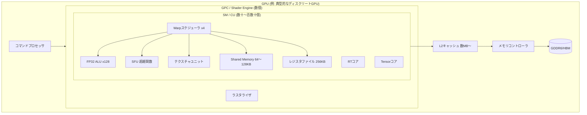
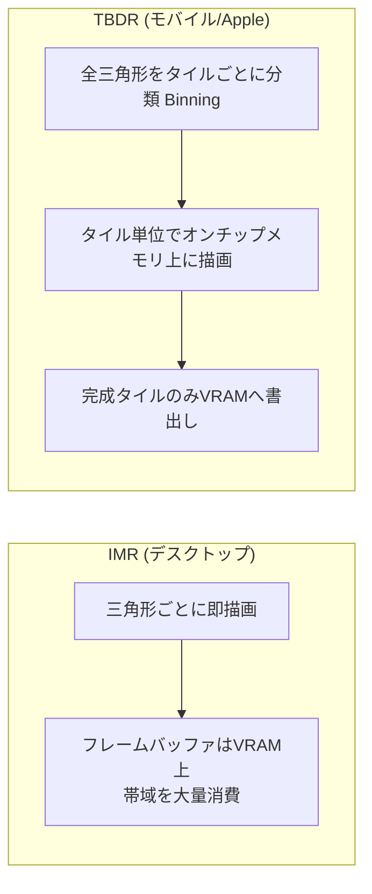

# GPUアーキテクチャ詳解

## 概要

このページではGPUの内部構造を、**シェーダコア (SM/CU)・SIMT実行・メモリ階層・固定機能ユニット**の4つの軸で解説します。ここを理解すると、「なぜ分岐が遅いのか」「なぜメモリアクセスパターンが性能を支配するのか」「occupancyとは何か」といった、シェーダ最適化のすべての疑問に答えられるようになります。

## なぜ必要なのか

シェーダは「気軽に書けるC風言語」に見えますが、その実行環境はCPUと根本的に異なります。アーキテクチャを知らずに書いたシェーダは、**演算器の大半を遊ばせたまま**動くことがあります。逆に構造を知っていれば、同じ結果を数分の一のコストで得られます。最適化・Compute Shader・GPU Drivenの全ての土台です。

## 歴史・誕生した背景

- **2001〜2005 (分離シェーダ)**: 頂点シェーダ用とピクセルシェーダ用に**別々の専用ユニット**を搭載。頂点重視のシーンではピクセルユニットが遊び、その逆も起きた
- **2006 (統合シェーダ)**: NVIDIA **G80** が汎用の「ストリーミングマルチプロセッサ (SM)」に統一。負荷に応じて頂点/ピクセル/(後に)コンピュートを同じユニットに動的配分できるようになった。ATI/AMDも Xenos (Xbox 360) → TeraScale で追随
- **2012〜 (GCN/Kepler以降)**: コンピュート性能重視の設計へ。AMD GCNの「Compute Unit (CU)」、明示的なWavefront実行
- **2018〜 (Turing/RDNA)**: RTコア・Tensorコアという新たな固定機能の追加。RDNAはWave64からWave32へ移行
- **現在**: NVIDIA (Ada/Blackwell)、AMD (RDNA3/4)、Intel (Xe)、Apple (Mシリーズ)、Qualcomm (Adreno) がそれぞれの方言を持つが、基本構造は共通

## それ以前の技術

固定機能パイプライン時代のGPUは「頂点処理回路 → ラスタライザ → ピクセル処理回路」が固定配線されたASICでした。プログラム可能性がなく、演算とデータフローが完全にハードコードされていました。

## 解決した課題

統合シェーダアーキテクチャは (1) ユニット稼働率の平準化、(2) シェーダステージの追加をソフトウェアで実現可能に (GS/Tessellation/Compute/Mesh はすべて同じSM上で動く)、(3) GPGPUへの道、の3つを一挙に解決しました。

## 現在の位置づけ

全ベンダーが統合シェーダ+SIMTを採用しています。ベンダー間の主な違い:

| | NVIDIA | AMD | Intel | Apple |
|---|---|---|---|---|
| 実行単位の呼称 | SM | CU / WGP | Xe-core | GPU Core |
| SIMD幅 (スレッド束) | Warp = 32 | Wave32 / Wave64 | SIMD8〜32 | SIMD32 |
| キャッシュ戦略 | 大きなL2 | Infinity Cache (巨大LLC) | L2 | TBDR + タイルメモリ |
| ラスタライズ方式 | タイルド即時 (IMR系) | IMR系 | IMR系 | **TBDR** |

モバイルGPU (Apple/Adreno/Mali) は **TBDR (Tile-Based Deferred Rendering)** という根本的に異なる方式を採ります(後述)。

## 内部動作

### 階層構造



### SIMT実行モデル (要点)

- スレッドは **Warp (32) / Wave (32 or 64)** 単位で束ねられ、1つのプログラムカウンタを共有して同じ命令を実行する
- `if` で分岐が割れると両方のパスを**マスク付きで順番に実行** (divergence) → 実効性能が半減しうる
- SMは多数のWarpを保持し、あるWarpがメモリ待ちになると**即座に別のWarpへ切替**える(レイテンシ隠蔽)
- 保持できるWarp数は**レジスタ使用量とShared Memory使用量**で決まる = **Occupancy**

この詳細は [GPU並列実行モデル (Warp/Wave)](/graphics/compute/execution-model.html) で徹底的に扱います。

### メモリ階層

| 階層 | 容量の目安 | レイテンシ | 備考 |
|---|---|---|---|
| レジスタ | 256KB/SM | 即時 | スレッドごとに割当。使いすぎるとOccupancy低下 |
| Shared Memory (LDS/groupshared) | 64〜128KB/SM | 数十cycle | スレッドグループ内共有。明示的に使う |
| L1/テクスチャキャッシュ | 128KB級/SM | 数十cycle | |
| L2 | 4〜96MB | 数百cycle | 全SM共有 |
| VRAM | 8〜24GB | 400〜800cycle | 帯域は数百GB/s〜1TB/s |
| PCIe経由のシステムRAM | - | 極めて遅い | 転送は最小化する |

**GPU最適化の大半はメモリ最適化**です。ALUは余っていることが多く、ボトルネックはほぼ常にメモリ帯域とレイテンシです → [GPU最適化の基礎](/graphics/optimization/basics.html)

### 固定機能ユニット

シェーダ化されず、今も専用回路であり続けるもの:

- **ラスタライザ**: 三角形→ピクセル変換 → [ラスタライゼーション](/graphics/pipeline/rasterization.html)
- **テクスチャユニット**: アドレス計算・フィルタリング・フォーマット展開
- **ROP / Output Merger**: 深度テスト・ブレンド → [出力結合](/graphics/pipeline/output-merger.html)
- **RTコア**: BVHトラバーサルと三角形交差 → [ハードウェアレイトレーシング](/graphics/lighting/raytracing.html)
- **Tensorコア**: 行列積 (DLSSなどで使用) → [アップスケーリング](/graphics/postprocess/upscaling.html)

### IMR と TBDR



TBDRは帯域(=消費電力)を劇的に節約でき、モバイルで支配的です。ただし「全ジオメトリを一旦バッファに溜める」ため、ジオメトリ量が多いシーンや `discard` 多用に弱いという特性があります。モバイル向け最適化ではこの違いが決定的に重要です。

## 各環境での扱い

### Unity
アーキテクチャ差は基本的に抽象化されますが、モバイル(TBDR)向けには `RenderPass` API / URPの `RenderGraph` がタイルメモリを活かすように設計されています。シェーダのターゲットレベルは `#pragma target 4.5` などで指定します。

### Unreal Engine
RHIが差を吸収しますが、`r.Mobile.*` 系のCVarやモバイルレンダラーはTBDR前提の設計です。SM5/SM6 (Shader Model) のフィーチャーレベルでハードウェア世代を区別します。

### DirectX 12
アーキテクチャに最も近いAPIの一つ。`D3D12_FEATURE_DATA_D3D12_OPTIONS` 群でWaveサイズ・RT Tier・Mesh Shader Tierなどを問い合わせます。HLSL SM6.0以降のWave Intrinsicsでハードウェアの実行単位を直接操作できます。

### Vulkan
`VkPhysicalDeviceSubgroupProperties` でsubgroup(=Warp/Wave)サイズを取得。`VK_KHR_fragment_shading_rate` や `renderpass` のsubpassはTBDRハードウェアを直接活かす設計です。

## コード例

Wave/Subgroupサイズをシェーダから利用する例 (HLSL SM6):

```hlsl
// 32スレッド(1 Warp)の合計を、共有メモリなしで1命令で求める
[numthreads(64, 1, 1)]
void CSMain(uint3 id : SV_DispatchThreadID) {
    float v = Input[id.x];
    float waveSum = WaveActiveSum(v);   // ハードウェアのWave幅で水平加算
    if (WaveIsFirstLane())
        Output[id.x / WaveGetLaneCount()] = waveSum;
}
```

Occupancyを意識したレジスタ削減の考え方 (擬似コード):

```text
// 悪い例: ループ外で大量の値を生かし続ける → レジスタ圧迫 → Occupancy低下
big1..big40 = 事前計算した40個の値
for each light: color += Shade(big1..big40, light)

// 良い例: ループ内で都度計算 (ALUは余っている)
for each light:
    a, b, c = 必要になった時点で再計算
    color += Shade(a, b, c, light)
```

## 前提知識

- [GPUとは何か](/hardware/gpu/what-is-gpu.html)
- [CPUとGPUの役割分担](/hardware/gpu/cpu-vs-gpu.html)

## 次に読むべきページ

- [GPU並列実行モデル (Warp/Wave)](/graphics/compute/execution-model.html) — SIMT実行の詳細
- [パイプライン全体像](/graphics/pipeline/overview.html) — このハードウェアの上で走る論理パイプライン
- [Shared Memory と Atomic](/graphics/compute/shared-memory.html)
- [GPU最適化の基礎](/graphics/optimization/basics.html)

## 理解度チェック

1. **統合シェーダアーキテクチャ以前の「分離シェーダ」の問題点は何だったか。**
   ::: details 解答
   頂点用・ピクセル用ユニットが固定比率で搭載されていたため、シーンの負荷特性(頂点重視/ピクセル重視)によってどちらかのユニット群が遊んでしまい、稼働率が上がらなかった。
   :::

2. **GPUがCPUのような巨大キャッシュや分岐予測を持たない代わりに、メモリレイテンシをどう処理しているか。**
   ::: details 解答
   1つのSMに多数のWarpを常駐させ、メモリ待ちが発生したWarpから実行可能な別のWarpへハードウェアが1サイクルで切り替えることで、演算器を遊ばせない(レイテンシ隠蔽)。これが可能なWarp数の余裕をOccupancyと呼ぶ。
   :::

3. **シェーダのレジスタ使用量を減らすと性能が向上することがあるのはなぜか。**
   ::: details 解答
   SMのレジスタファイルは全常駐Warpで分け合うため、1スレッドのレジスタ消費が多いと常駐できるWarp数(Occupancy)が減り、レイテンシ隠蔽能力が下がる。レジスタを削れば同時常駐Warpが増え、メモリ待ちを隠しやすくなる。
   :::

4. **TBDRがモバイルで採用される最大の理由と、その代償を述べよ。**
   ::: details 解答
   理由: フレームバッファ操作をオンチップのタイルメモリ内で完結させ、消費電力の主因であるDRAM帯域を劇的に削減できるため。代償: 全ジオメトリをタイルごとに分類(ビニング)して溜める必要があり、ジオメトリ量の多いシーンでビニングコストとメモリが増大する。
   :::

## 参考資料

- Fabien Giesen, *"A trip through the Graphics Pipeline 2011"* — 全パート必読
- NVIDIA, 各世代 Architecture Whitepaper (Turing / Ampere / Ada)
- AMD, *RDNA Architecture* Whitepaper / GPUOpen の ISA ドキュメント
- ARM, *Mali GPU Best Practices* (TBDR理解に)
- Real-Time Rendering 4th ed., Chapter 23 "Graphics Hardware"
