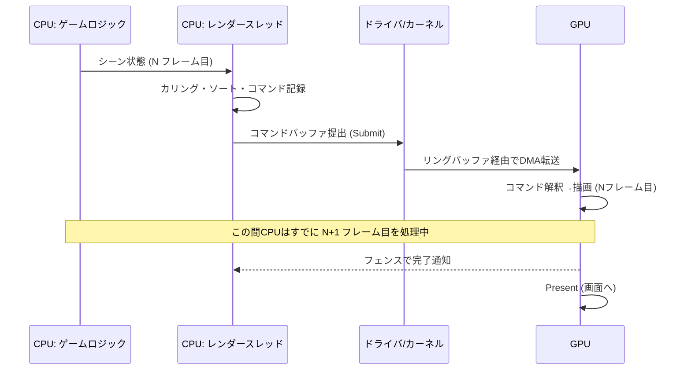
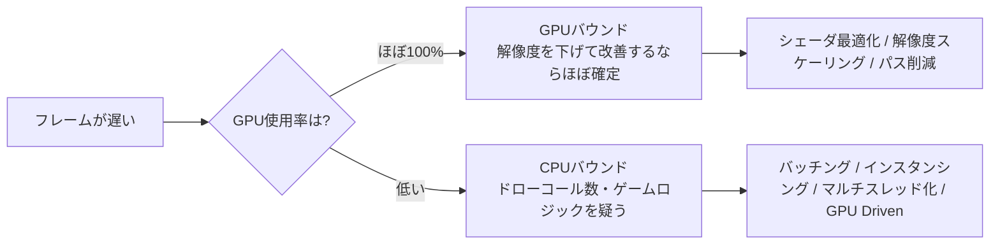

# CPUとGPUの役割分担

## 概要

リアルタイムレンダリングは **CPUとGPUの分業** で成り立っています。CPUは「何を描くか」を決めてコマンドを組み立て、GPUは「実際に描く」を実行します。両者は**非同期に並走するパイプライン**であり、この関係を理解しないと、最適化もAPI設計 (DX12/Vulkanのコマンドバッファ) も理解できません。

## なぜ必要なのか

- GPUは自分では何も始められません。**「このメッシュを、このシェーダで、この状態で描け」という命令列 (コマンド)** をCPUが供給する必要があります
- 逆にCPUはピクセルを塗る速度で圧倒的に負けます
- フレームレートは **CPU側の準備時間とGPU側の描画時間のうち遅い方** で決まります。「CPUバウンド」「GPUバウンド」の切り分けはパフォーマンス分析の第一歩です

## 歴史・誕生した背景

初期のグラフィックスAPI (OpenGL 1.x) は「CPUが1コマンドずつGPUに指示する」即時モードでした。GPUが高速化するにつれ、**CPUがコマンドを発行する速度が追いつかなくなる**「ドローコールボトルネック」が2000年代後半に深刻化します。

- DX9〜11時代: 1フレームに数千ドローコールが限界。ドライバがシングルスレッド前提だった
- 2013: AMD **Mantle** — コマンドバッファをアプリ側で並列生成する設計を提示
- 2015-16: DX12 / Vulkan — この設計が標準化され、CPU側の描画準備をマルチコアに分散できるようになった

## それ以前の技術

**即時モード (Immediate Mode)**。`glBegin()/glVertex()/glEnd()` のように、CPUがAPIを呼ぶたびにドライバが状態を検証しコマンドへ変換していました。ドライバ内部の隠れたコストが大きく、マルチスレッド化も不可能でした。

## 解決した課題

現代の明示的API + マルチスレッドレンダリングは以下を解決しました:

1. ドローコール発行コストの削減 (ドライバの検証を事前に済ませる = PSO)
2. コマンド生成のマルチコア並列化
3. CPU-GPU間の同期タイミングをアプリが制御可能に

## 現在の位置づけ

役割分担の現在形は以下の通りです。

| 処理 | 担当 | 備考 |
|---|---|---|
| ゲームロジック・AI・物理(剛体) | CPU | 一部物理はGPUへ |
| カリング・描画リスト構築 | CPU → **GPUへ移行中** | [GPU Driven Rendering](/graphics/optimization/gpu-driven.html) |
| コマンドバッファ生成 | CPU (マルチスレッド) | |
| 頂点変換・ラスタライズ・シェーディング | GPU | |
| ポストプロセス・アップスケーリング | GPU | |
| スキニング・パーティクル | GPU (Compute) が主流 | |

## 内部動作

### 1フレームの流れ



重要なのは **CPUとGPUは1〜3フレームずれて並走している** ことです。CPUがフレームNのコマンドを作っている間、GPUはフレームN-1を描画しています。

- このずれを管理する仕組みが **フェンス (Fence)** と **フレームインフライト数** です → [デバイス初期化](/graphics/capstone/02-device.html)
- GPUがまだ読んでいるバッファをCPUが書き換えると壊れるため、**リソースの多重化 (リングバッファ)** が必要になります

### コマンドがGPUに届くまで

1. アプリがAPI呼び出しでコマンドを**記録** (DX12: `ID3D12GraphicsCommandList`, Vulkan: `VkCommandBuffer`)
2. **提出 (Submit)** でカーネルドライバがGPUのリングバッファに書き込む
3. GPUの**コマンドプロセッサ**が命令をフェッチ・解釈し、各ハードウェアブロックに仕事を分配する

### CPUバウンド vs GPUバウンド



判定には [PIX / RenderDoc / Nsight](/graphics/optimization/tools.html) を使います。

## 各環境での扱い

### Unity
メインスレッドとは別に**レンダースレッド**がグラフィックスAPIを呼びます (`Multithreaded Rendering`)。さらに Graphics Jobs を有効にするとコマンド生成が複数ワーカーに分散されます。SRPでは `CommandBuffer` に描画命令を記録し `ScriptableRenderContext.Submit()` で提出します。

### Unreal Engine
**GameThread → RenderThread → RHIThread** の3段パイプライン。GameThreadがシーン状態を`FScene`へ複製し、RenderThreadが描画パスを組み立て、RHIThreadが実際のAPI呼び出しを行います。`stat unit` で各スレッドの時間 (Game/Draw/RHI/GPU) を確認でき、どこがボトルネックか一目で分かります。

### DirectX 12
コマンド記録は `ID3D12GraphicsCommandList`、提出は `ID3D12CommandQueue::ExecuteCommandLists`。CPU-GPU同期は `ID3D12Fence`。複数スレッドで同時にコマンドリストを記録することが設計の前提です。

### Vulkan
`VkCommandBuffer` を `VkCommandPool` (スレッドごとに1つ) から確保して記録し、`vkQueueSubmit` で提出。同期は `VkFence` (CPU-GPU) と `VkSemaphore` (GPU-GPU) を使い分けます。

## コード例

DX12でのフレーム同期の骨格 (C++):

```cpp
// フレームごとのフェンス値でGPUの進行を追跡する
const UINT kFramesInFlight = 2;
UINT64 fenceValues[kFramesInFlight] = {};

void RenderFrame(UINT frameIndex) {
    // 1. このフレームスロットをGPUがまだ使用中なら待つ
    if (fence->GetCompletedValue() < fenceValues[frameIndex]) {
        fence->SetEventOnCompletion(fenceValues[frameIndex], fenceEvent);
        WaitForSingleObject(fenceEvent, INFINITE);
    }
    // 2. コマンド記録 (CPU側の仕事)
    allocator[frameIndex]->Reset();
    cmdList->Reset(allocator[frameIndex].Get(), pso.Get());
    RecordDrawCommands(cmdList.Get());
    cmdList->Close();

    // 3. 提出 (ここからGPUの仕事)
    ID3D12CommandList* lists[] = { cmdList.Get() };
    queue->ExecuteCommandLists(1, lists);
    swapChain->Present(1, 0);

    // 4. フェンスをシグナルし、次にこのスロットを使う時の目印にする
    fenceValues[frameIndex] = ++nextFence;
    queue->Signal(fence.Get(), fenceValues[frameIndex]);
}
```

Unityでのコマンドバッファ (C#):

```csharp
var cmd = new CommandBuffer { name = "MyPass" };
cmd.SetRenderTarget(myRT);
cmd.ClearRenderTarget(true, true, Color.black);
cmd.DrawMesh(mesh, matrix, material, 0, 0);
// SRP内: context.ExecuteCommandBuffer(cmd) → context.Submit()
```

## 前提知識

- [GPUとは何か](/hardware/gpu/what-is-gpu.html)

## 次に読むべきページ

- [GPUアーキテクチャ詳解](/hardware/gpu/architecture.html) — GPU内部でコマンドがどう処理されるか
- [DirectX 12](/graphics/api/directx12.html) / [Vulkan](/graphics/api/vulkan.html) — コマンドバッファモデルの具体像
- [GPU最適化の基礎](/graphics/optimization/basics.html) — CPU/GPUバウンドの実践的な切り分け

## 理解度チェック

1. **CPUとGPUが「並走」しているとはどういうことか。それによって生じるリソース管理上の問題は何か。**
   ::: details 解答
   CPUがフレームNのコマンドを準備している間、GPUはフレームN-1以前を描画しており、両者は1〜3フレームずれて動作する。このためGPUがまだ参照中のバッファをCPUが上書きしてしまう危険があり、フェンスによる同期とリソースの多重化(フレームインフライト数ぶんのバッファ複製)が必要になる。
   :::

2. **「解像度を下げたらフレームレートが上がった」場合、CPU/GPUどちらのバウンドと考えられるか。**
   ::: details 解答
   GPUバウンド。解像度はピクセル数=GPUのシェーディング量にのみ影響し、CPUのコマンド生成コストはほぼ変わらないため。
   :::

3. **DX12/Vulkanがドローコールボトルネックを軽減できた設計上の理由を2つ挙げよ。**
   ::: details 解答
   (1) パイプライン状態を事前にコンパイルするPSOにより、ドロー時のドライバ検証コストを排除した。(2) コマンドバッファ記録をアプリケーション側で自由にマルチスレッド化できるようにした。
   :::

## 参考資料

- Fabien Giesen, *"A trip through the Graphics Pipeline 2011"* — Part 1, 2 (コマンド処理)
- GDC 2014, AMD *"Mantle: Introducing a new API for Graphics"*
- Unreal Engine ドキュメント *"Parallel Rendering Overview"*
- Unity ドキュメント *"Graphics jobs"*
