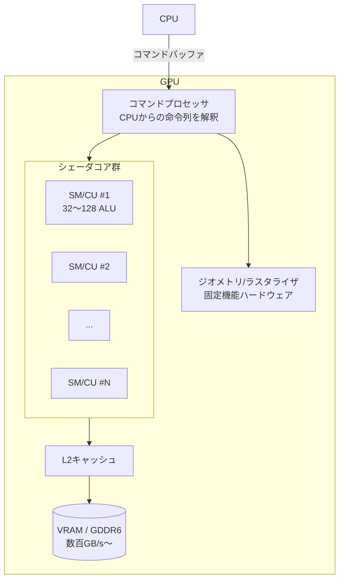

# GPUとは何か

## 概要

GPU (Graphics Processing Unit) は、**大量のデータに対して同じ計算を並列に実行する**ことに特化したプロセッサです。CPUが「少数の複雑な処理を高速に」こなすレイテンシ指向であるのに対し、GPUは「単純な処理を数千〜数万並列で」こなす**スループット指向**の設計です。

現代のGPUは1画面(4K = 約830万ピクセル)を毎秒60〜120回計算し、さらに物理シミュレーション・AI推論・レイトレーシングまでを担う、事実上の超並列汎用計算機です。

## なぜ必要なのか

3Dグラフィックスの計算は、本質的に**恥ずかしいほど並列 (embarrassingly parallel)** です。

- 100万頂点の座標変換 → 各頂点は互いに独立
- 830万ピクセルのライティング計算 → 各ピクセルは互いに独立

1080p・60fpsは毎秒約1.24億pixelです。仮に1pixelあたり300回の演算なら毎秒約373億回となり、この計算だけで数TFLOPSになるわけではありません。実際の負荷には複数pass・overdraw・texture取得・geometry等も加わり、命令数とFLOPSも同じ尺度ではありません。GPUはこうした大量データを高いスループットと電力効率で処理するための設計で、CPUで達成できる性能は内容と機種によって変わります。

## 歴史・誕生した背景

| 年 | 出来事 |
|---|---|
| 1980年代〜 | Geometry Engine等、3D幾何処理用の専用ハードウェアが存在 |
| 1990年代前半〜1996 | 一般PCゲームではCPUによるソフトウェア描画が広く使われた (DOOM 1993, Quake 1996) |
| 1996 | 3dfx **Voodoo Graphics** — ラスタライズ+テクスチャを行う民生用3Dアクセラレータ |
| 1999 | NVIDIA **GeForce 256** — T&L等を統合し、同社が定義する「世界初のGPU」として販売。GPUという呼称と3D専用処理の起源は分ける |
| 2001 | GeForce 3 — プログラマブルシェーダ搭載 |
| 2006 | GeForce 8800 (G80) — **統合シェーダ** + CUDA。GPGPUの幕開け |
| 2018 | Turing (RTX) — レイトレーシング用RTコア、AI用Tensorコア |
| 2020〜 | GPUがゲーム・科学計算・機械学習の共通基盤に |

「グラフィックス専用の固定回路」から始まり、プログラマブル化 → 統合化 → 汎用化という進化を辿ってきました。この流れは [GPUアーキテクチャ詳解](/hardware/gpu/architecture.html) と [技術全史年表](/guide/rendering/timeline.html) で詳しく扱います。

## それ以前の技術

一般PCゲームでは**ソフトウェアレンダリング**が広く使われ、CPUが座標変換からpixelの塗りつぶしまで行う実装もありました。一方で、ワークステーション等ではそれ以前から専用ハードウェアによる3D処理が存在しました。

- Quake (1996) はアセンブリで極限まで最適化されたCPUラスタライザを持っていた
- 解像度320x240、テクスチャはニアレスト補間、ライティングは事前計算(ライトマップ)が限界
- CPU時間のほぼ全てが描画に消え、ゲームロジックに使える時間がなかった

## 解決した課題

1. **ピクセル塗りつぶし性能**: テクスチャサンプリング+補間を専用回路化し、CPU比で桁違いのフィルレートを実現
2. **CPUの解放**: 描画をオフロードし、CPUをゲームロジック・物理・AIに使えるようにした
3. **並列性の活用**: ピクセル間の独立性という問題構造そのものをハードウェア設計に落とし込んだ

## 現在の位置づけ

- ゲーム機・PC・スマートフォンのすべてにGPUが搭載され、リアルタイム3Dの前提条件となっている
- **ディスクリートGPU** (GeForce / Radeon / Arc) と **統合GPU** (Apple Mシリーズ, Snapdragon Adreno, AMD APU) の二極
- 機械学習ブームによりGPUは「グラフィックスも出来る汎用並列計算機」へと意味が変化した
- ゲームエンジン側も描画のCPU依存を減らす [GPU Driven Rendering](/graphics/optimization/gpu-driven.html) へ進化中

## 内部動作

GPUの中身を一言で言うと「**小さなプロセッサ(SM/CU)を数十〜百個以上並べ、それぞれが32〜64スレッドを束ねてSIMD実行する**」構造です。



重要な概念を3つだけ先取りします(詳細は各ページへ)。

1. **SIMT実行**: 32スレッド(NVIDIAではWarp)が同じ命令を同時に実行する → [GPU並列実行モデル](/graphics/compute/execution-model.html)
2. **レイテンシ隠蔽**: メモリ待ちの間、別のWarpに切り替えて演算器を遊ばせない。CPUのキャッシュ+分岐予測とは真逆のアプローチ
3. **固定機能との共存**: ラスタライザ・テクスチャユニット・RTコアなど、頻出処理は今も専用回路 → [ラスタライゼーション](/graphics/pipeline/rasterization.html)

### CPUとの設計思想の違い

| | CPU | GPU |
|---|---|---|
| 目標 | レイテンシ最小化 | スループット最大化 |
| コア数 | 8〜32 (大きく複雑) | 数千ALU (小さく単純) |
| キャッシュ | 巨大 (数十MB) | 小さい (レイテンシは隠蔽で対処) |
| 分岐予測・アウトオブオーダー | あり | 基本なし |
| スレッド切替 | 重い (OSが管理) | 1サイクル (ハードウェアが管理) |
| 得意 | 逐次処理・分岐だらけのコード | 均質な大量データ処理 |

## 各環境での扱い

### Unity
GPUは `Graphics API` 設定 (DX11/DX12/Vulkan/Metal) の背後に抽象化されます。`SystemInfo.graphicsDeviceType` や `SystemInfo.graphicsShaderLevel` でGPU能力を取得できます。描画スレッドがコマンドを生成し、GPUへ送信します。

### Unreal Engine
RHI (Render Hardware Interface) がGPU/APIを抽象化します。`GRHISupportsMeshShadersTier0` のようなグローバル変数でハードウェア機能を判定します。統計は `stat gpu` コンソールコマンドで確認できます。

### DirectX 12
`IDXGIAdapter` がGPUそのものを表し、`ID3D12Device` がGPUへの論理的な接続を表します。`CheckFeatureSupport` でRTコアの有無などを問い合わせます。

### Vulkan
`VkPhysicalDevice` がGPUを表し、`vkGetPhysicalDeviceProperties` / `vkGetPhysicalDeviceFeatures` で能力を列挙します。複数GPU環境では明示的にどのGPUを使うか選択します。

## コード例

GPUを列挙して能力を調べる最小コード (Vulkan / C++):

```cpp
uint32_t count = 0;
vkEnumeratePhysicalDevices(instance, &count, nullptr);
std::vector<VkPhysicalDevice> gpus(count);
vkEnumeratePhysicalDevices(instance, &count, gpus.data());

for (auto gpu : gpus) {
    VkPhysicalDeviceProperties props;
    vkGetPhysicalDeviceProperties(gpu, &props);
    printf("GPU: %s (API %u.%u)\n", props.deviceName,
           VK_API_VERSION_MAJOR(props.apiVersion),
           VK_API_VERSION_MINOR(props.apiVersion));
    // discrete か integrated か
    if (props.deviceType == VK_PHYSICAL_DEVICE_TYPE_DISCRETE_GPU)
        printf("  -> ディスクリートGPU\n");
}
```

Unity (C#) でGPU情報を取得:

```csharp
Debug.Log($"GPU: {SystemInfo.graphicsDeviceName}");
Debug.Log($"API: {SystemInfo.graphicsDeviceType}");
Debug.Log($"VRAM: {SystemInfo.graphicsMemorySize} MB");
Debug.Log($"Compute対応: {SystemInfo.supportsComputeShaders}");
Debug.Log($"RayTracing対応: {SystemInfo.supportsRayTracing}");
```

## 前提知識

- 特定の本文を先に読む必要はありません。GPUの説明の入口として使えます。

## 次に読むべきページ

- [CPUとGPUの役割分担](/hardware/gpu/cpu-vs-gpu.html) — CPUからGPUへ命令が届くまで
- [GPUアーキテクチャ詳解](/hardware/gpu/architecture.html) — SM/CU、メモリ階層の詳細
- [パイプライン全体像](/graphics/pipeline/overview.html) — GPUが絵を描く工程

## 理解度チェック

1. **GPUが「スループット指向」であるとはどういう意味か。CPUの「レイテンシ指向」と対比して説明せよ。**
   ::: details 解答
   CPUは1つの処理が完了するまでの時間(レイテンシ)を最小化するため、分岐予測・アウトオブオーダー実行・巨大キャッシュに回路を割く。GPUは個々の処理の完了時間は遅くても、単位時間あたりの総処理量(スループット)を最大化するため、その回路面積を大量のALUに割き、メモリ待ちはスレッド切替で隠蔽する。
   :::

2. **3Dグラフィックスが「embarrassingly parallel」と呼ばれるのはなぜか。**
   ::: details 解答
   頂点変換もピクセルシェーディングも、各要素(頂点・ピクセル)の計算が他の要素に依存せず独立しているため、通信や同期なしに単純分割で並列化できるから。
   :::

3. **GeForce 256が「世界初のGPU」を名乗った根拠となる機能は何か。**
   ::: details 解答
   NVIDIAがT&L (Transform & Lighting)、triangle setup/clipping、rendering等を単一chipへ統合した製品として定義したこと。一般PC向けの描画処理をCPUから移す転換点の一つであり、世界中の全ての3D変換処理がそれ以前はCPU上だったという意味ではない。
   :::

## 参考資料

- Fabien Sanglard, *"A trip through the Graphics Pipeline"* (関連: Ryg blog series)
- NVIDIA, *GPU Gems* シリーズ (無料公開)
- Hennessy & Patterson, *Computer Architecture: A Quantitative Approach* — GPU章
- Real-Time Rendering, 4th Edition (Akenine-Möller他) — 第3章 "The Graphics Processing Unit"
- Fabien Sanglard, *Game Engine Black Book: DOOM / Wolfenstein 3D* — ソフトウェアレンダリング時代の一次資料
- [James H. Clark: The Geometry Engine (SIGGRAPH 1982)](https://stanford.edu/class/cs349g/p127-clark.pdf)
- [NVIDIA: GeForce 256の回顧（メーカーのGPU定義）](https://blogs.nvidia.com/blog/first-gpu-gaming-ai/)
