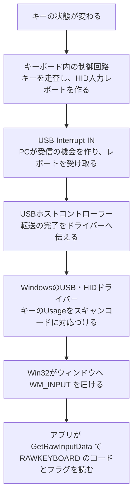
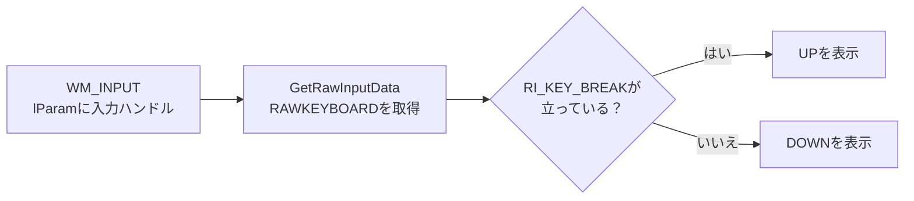

# USBキーボードの入力がWindowsのアプリに届くまで — HIDレポートとWM_INPUT

スペースキーを押して離すと、Windowsのアプリは押下と解放を別の通知として扱えます。その前に、キーボードがキーの状態を調べ、PCがUSBで状態を受け取り、Windowsがアプリ向けのデータに変換します。ここでは**ケーブルを通るデータ**と**ウィンドウが受け取るデータ**を、同じスペースキーを使って追います。



## キーボード内でキーの状態を調べる

接点式のキーボードには、スイッチを行と列につないで調べる**キーマトリクス**を使うものがあります。制御回路は行や列を順番に選び、どの交点のスイッチが閉じているかを読みます。接点が閉じる前後に短い揺れが出る場合は、**デバウンス**でその揺れを扱い、押した状態や離した状態を確定します。スイッチの検出方式やデバウンスの処理は製品の実装によって変わります。 [QMKのキーマトリクス](https://docs.qmk.fm/how_a_matrix_works) · [QMKのデバウンス](https://docs.qmk.fm/feature_debounce_type)

確定した状態をPCへ渡す形式の一つが**HID入力レポート**です。HIDの**Report Descriptor**（レポート記述子）には、レポートのどのビットやバイトが何の入力を表すかが記述されています。各入力の用途を表す番号を**Usage**と呼びます。例えばKeyboard/Keypad Usage Page（`0x07`）では、スペースキーのUsageは `0x2C` です。 [USB-IF HID 1.11 §6.2.2](https://www.usb.org/sites/default/files/hid1_11.pdf) · [HID Usage Tables 1.5 §10](https://usb.org/sites/default/files/hut1_5.pdf#page=91)

## HIDレポートの例で押下と解放を比べる

HIDの**Boot Protocol**に対応するキーボードを、そのモードで使う場合の例です。標準の8バイト形式は、修飾キーのビット、予約バイト、押されている通常キーのUsageを入れる6枠に分かれます。スペースキーだけを押して離すと、例えば次のように変化します。 [USB-IF HID 1.11 Appendix B](https://www.usb.org/sites/default/files/hid1_11.pdf#page=69)

| 状態 | 修飾キー | 予約 | 通常キーの6枠 |
| --- | --- | --- | --- |
| 何も押していない | `00` | `00` | `00 00 00 00 00 00` |
| スペースキーを押している | `00` | `00` | `2C 00 00 00 00 00` |
| スペースキーを離した | `00` | `00` | `00 00 00 00 00 00` |

この形式では、前のレポートになかった `2C` が現れたら押下、前のレポートにあった `2C` がなくなったら解放と判断できます。通常の**Report Protocol**で使う形式は、機器が提示するReport Descriptorで確認します。キーのビットマップやReport IDを使う機器もあり、上の8バイト形式はBoot Protocolの例です。

## USBではPC側が受信の機会を作る

USBキーボードの入力では、PC側の**ホスト**がInterrupt IN転送を定期的にスケジュールします。USB 2.0では、デバイスの**エンドポイント**に対してホストがINトランザクションを始め、準備できたデータがあれば受け取ります。データがまだ用意できていないときは、デバイスはNAKで応答できます。エンドポイントは、転送先や転送元になる機器側の論理的な受け口です。 [USB 2.0仕様 §5.7・§8.5.4](https://www.usb.org/document-library/usb-20-specification)

エンドポイント記述子の `bInterval` は、通信速度に応じた形でサービス間隔を表します。USBで受信を試みる間隔に加えて、キーボード内の検出やWindows側の処理、アプリがメッセージを取り出すまでの時間も入力の遅れに含まれます。USBの転送方式の名前にある「Interrupt」と、ホストコントローラーがCPUへ完了を通知する割り込みは、図の別の段階です。 [USB 2.0仕様 §5.7.4・§9.6.6](https://www.usb.org/document-library/usb-20-specification)

## Windowsがレポートをキーの通知に変える

Windowsの標準的なUSB HIDキーボードでは、USBのHIDミニドライバーとHIDクラスドライバーが機器と通信します。キーボード用の `KBDHID.sys` がHID Usageをスキャンコードへ変換し、キーボードのクラスドライバー `KBDCLASS.sys` がその入力を扱います。アプリはWin32の入力APIから、用途に応じた形式で受け取ります。 [MicrosoftのHIDアーキテクチャ](https://learn.microsoft.com/en-us/windows-hardware/drivers/hid/hid-architecture) · [キーボードのHIDクライアントドライバー](https://learn.microsoft.com/en-us/windows-hardware/drivers/hid/keyboard-and-mouse-hid-client-drivers)

| ウィンドウメッセージ | 読み取るもの |
| --- | --- |
| `WM_INPUT` | Raw Inputに登録した機器のデータ。キーボードでは `RAWKEYBOARD` からスキャンコードや押下・解放のフラグを読む。 |
| `WM_KEYDOWN` / `WM_KEYUP` | 従来のキー通知。仮想キーコードなどを読む。 |
| `WM_CHAR` | 文字入力。キー通知を `TranslateMessage` で処理すると、キーボード配列や修飾キーの状態に応じて文字の通知が作られる場合がある。 |

`RAWKEYBOARD` は、Windowsのキーボード入力として変換されたデータです。USBのレポート記述子や、Boot Protocolで例にしたバイト列を調べる場所は別にあります。仮想キーコードの `VKey` も、入力欄へ確定した文字を表す値とは用途が異なります。 [MicrosoftのRaw Input](https://learn.microsoft.com/en-us/windows/win32/inputdev/about-raw-input) · [キーボード入力の概要](https://learn.microsoft.com/en-us/windows/win32/inputdev/about-keyboard-input)

## WM_INPUTで押下と解放を観察する

このC++例は、開いたウィンドウが前面にある間、**スペースキーと矢印キー**の通知を最新10件まで画面に表示します。WindowsのVisual Studio C++ツールとWindows SDKを使います。 [開発ツールの基本](/tools/development-tools-basics.html)

1. <a href="/study/samples/hardware/usb-keyboard-raw-input/raw_keyboard.cpp" download>raw_keyboard.cpp</a> を練習用フォルダーに保存します。
2. **x64 Native Tools Command Prompt for VS** でそのフォルダーを開き、次のコマンドでビルド・実行します。

```bat
cl /nologo /std:c++20 /permissive- /EHsc /W4 /WX /utf-8 raw_keyboard.cpp user32.lib gdi32.lib /link /SUBSYSTEM:WINDOWS
.\raw_keyboard.exe
```

3. サンプルのウィンドウを選び、スペースキーを一回押して離します。次に、独立した右矢印キーを押して離します。
4. スペースキーをしばらく押し続けると、Windowsのキーリピートにより押下側の通知が複数並ぶことがあります。最後に離して解放の行を探します。ウィンドウ右上の×で終了すると一覧も消えます。

一般的なキーボードで見られる表示例です。通知が使うコードはキーボードやキーによって変わります。

```text
DOWN  MakeCode=0x0039  Flags=0x0000  VKey=0x0020
UP    MakeCode=0x0039  Flags=0x0001  VKey=0x0020
DOWN  MakeCode=0x004D  Flags=0x0002  VKey=0x0027 E0
UP    MakeCode=0x004D  Flags=0x0003  VKey=0x0027 E0
```

| フィールド | この実践で確認すること |
| --- | --- |
| `MakeCode` | スキャンコードの部分。例ではスペースキーの押下と解放に同じ `0x0039` が現れる。 |
| `Flags` | `RI_KEY_BREAK`（`0x0001`）のビットが立っていれば解放。立っていなければ押下側。右矢印の例には拡張キーを示す `RI_KEY_E0`（`0x0002`）もある。 |
| `VKey` | Windowsの仮想キーコード。例では `0x0020` が `VK_SPACE`、`0x0027` が `VK_RIGHT`。 |

`Flags == 0` で押下を判定すると、右矢印のように別のフラグが立つ押下を見落とします。サンプルでは `(Flags & RI_KEY_BREAK) != 0` で解放のビットだけを調べます。押した瞬間だけをゲームのアクションに使うときは、直前のキー状態も持ち、離していた状態から押した状態に変わったかを確認します。 [MicrosoftのRAWKEYBOARD](https://learn.microsoft.com/en-us/windows/win32/api/winuser/ns-winuser-rawkeyboard) · [仮想キーコード](https://learn.microsoft.com/en-us/windows/win32/inputdev/virtual-key-codes) · [WM_KEYDOWNとキーリピート](https://learn.microsoft.com/en-us/windows/win32/inputdev/wm-keydown)

## コードで通知を受け取る箇所

1. `RegisterRawInputDevices` で、Generic Desktop Usage Page（`0x01`）のKeyboard（`0x06`）を登録します。これは機器の種類を表す組み合わせです。レポート内の個々のキーはKeyboard/Keypad Usage Pageで表します。
2. ウィンドウが前面で `WM_INPUT` を受け取ると、`lParam` に付いた入力ハンドルを `GetRawInputData` に渡して内容を取得します。種類が `RIM_TYPEKEYBOARD` のとき、`RAWKEYBOARD` を読みます。
3. 表示対象のキーについて押下・解放を表示します。前面で受け取った `WM_INPUT` は、処理後に `DefWindowProcW` にも渡してWindows側の後処理を行います。 [MicrosoftのRegisterRawInputDevices](https://learn.microsoft.com/en-us/windows/win32/api/winuser/nf-winuser-registerrawinputdevices) · [WM_INPUT](https://learn.microsoft.com/en-us/windows/win32/inputdev/wm-input) · [GetRawInputData](https://learn.microsoft.com/en-us/windows/win32/api/winuser/nf-winuser-getrawinputdata)

登録の対象はWindowsがキーボードとして扱う入力です。Bluetoothキーボードなどからも同じ型の通知を受け取れます。



::: details C++ソース全文

<<< @/public/samples/hardware/usb-keyboard-raw-input/raw_keyboard.cpp{cpp}

:::

## 理解度チェック

1. Boot Protocolの例で、スペースキーを離したときは、どのように状態が変わりますか。

   ::: details 解答
   前のレポートにあった `0x2C` が通常キーの枠から消えます。今回の例では、ほかに押しているキーもないので全枠がゼロになります。
   :::

2. `Flags` が `0x0002` の行と、`0x0003` の行では、どちらが解放ですか。

   ::: details 解答
   `RI_KEY_BREAK` に対応する最下位ビットが立った `0x0003` が解放です。どちらにも `RI_KEY_E0` のビットが含まれます。
   :::

3. USB側のスペースキーの `0x2C` と、ウィンドウで見た `MakeCode=0x0039` はそれぞれ何の番号ですか。

   ::: details 解答
   `0x2C` はHIDのKeyboard/Keypad Usageです。`0x0039` はWindowsが `RAWKEYBOARD` に入れてアプリへ渡したスキャンコードです。
   :::

## 関連項目

- [入力アクションとデバイスの基本](/game/basics/input-actions-and-devices.html)で、アプリが入力をゲームの操作へ対応づける流れを確認する。
- [ボタンを押してから画面に出るまで](/guide/low-level/button-to-screen.html)で、入力からゲームループ、描画、表示までをたどる。
- [ゲーム開発ロードマップの「入力アクションとデバイス」](/learn/roadmap.html?node=game-input#game)

## 参考資料

- [USB-IF — USB 2.0仕様 §5.7、§8.5.4、§9.6.6](https://www.usb.org/document-library/usb-20-specification) · [HID 1.11 §6.2.2、Appendix B](https://www.usb.org/sites/default/files/hid1_11.pdf) · [HID Usage Tables 1.5](https://usb.org/sites/default/files/hut1_5.pdf)
- [Microsoft — HIDのアーキテクチャ](https://learn.microsoft.com/en-us/windows-hardware/drivers/hid/hid-architecture) · [キーボードのHIDドライバー](https://learn.microsoft.com/en-us/windows-hardware/drivers/hid/keyboard-and-mouse-hid-client-drivers)
- [Microsoft — Raw Inputの概要](https://learn.microsoft.com/en-us/windows/win32/inputdev/about-raw-input) · [WM_INPUT](https://learn.microsoft.com/en-us/windows/win32/inputdev/wm-input) · [RAWKEYBOARD](https://learn.microsoft.com/en-us/windows/win32/api/winuser/ns-winuser-rawkeyboard)
