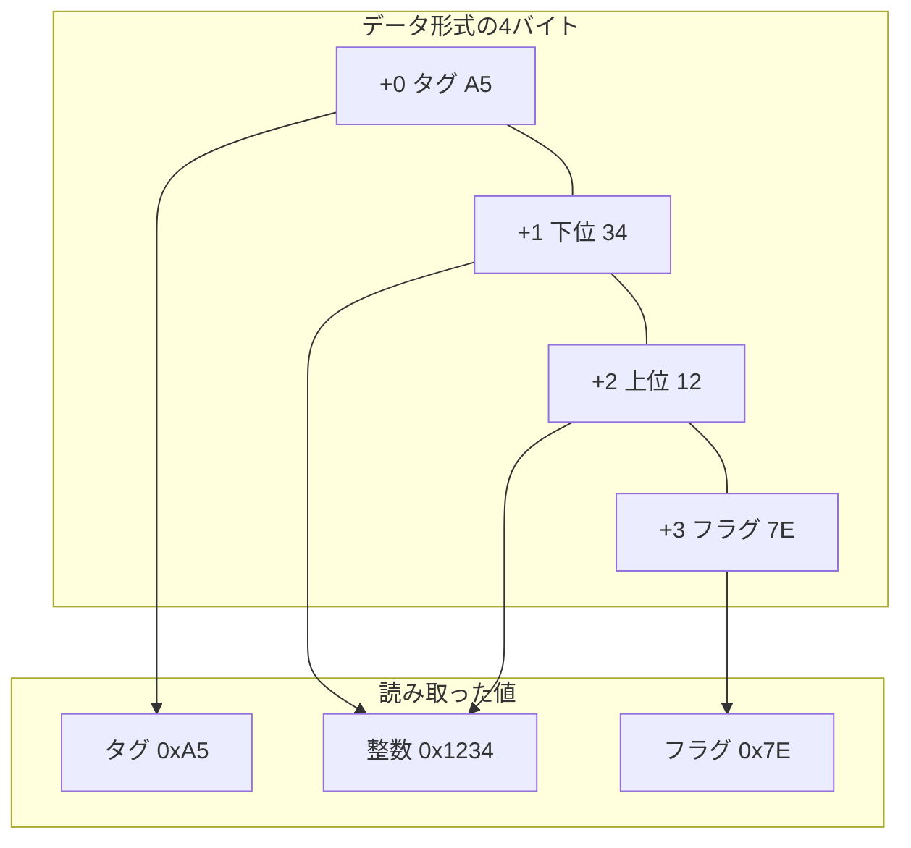

# Cでバイト列を読む

ファイルや通信のデータを読むコードでは、各値がどの位置に何バイトで格納されるかをデータ形式が定めます。ここでは、タグ1バイト、リトルエンディアンの整数2バイト、フラグ1バイトという形式を使います。

```c
const unsigned char wire[] = {0xA5, 0x34, 0x12, 0x7E};
```



図の `+0` から `+3` は配列の先頭からのオフセットです。整数の先頭は `+1` にあり、下位バイトの `0x34` が上位バイトの `0x12` より先に並びます。デコーダーは上位バイトを8ビット左へ移動し、下位バイトとビットORを取って `0x1234` を作ります。メモリから1バイトずつ取得して桁を明示的に割り当てるため、この式はCPUのエンディアンに依存しません。[整数のビットとバイト](/data/integer-bits-and-bytes.html)

## 配列の長さを関数に渡す

`wire` は `const unsigned char` の4要素配列です。`sizeof wire` は配列全体のバイト数で、Cでは `sizeof(unsigned char)` が1なので、この例では4です。一方、`wire + 1` の `wire` は先頭要素へのポインタに変換され、加算の結果は2番目の要素を指します。ポインタの値に配列の長さは含まれないので、先頭から1バイト進んだ場所には残りの長さ `sizeof wire - 1` も渡します。[WG14 N1570 6.3.2.1、6.5.3.4](https://www.open-std.org/jtc1/sc22/wg14/www/docs/n1570.pdf)

| 式や宣言 | この例で分かること |
| --- | --- |
| `sizeof wire` | `wire` が宣言された側で配列全体のバイト数を得る。結果は4 |
| `wire + 1` | `wire[1]` を指すポインタを得る。ポインタから残りの長さは分からない |
| 仮引数 `const unsigned char bytes[2]` | 仮引数の型は `const unsigned char *` に調整される。宣言に `2` を書いても実行時に長さは検査されない |
| 関数内の `sizeof bytes` | `bytes` がポインタ型の仮引数なら、ポインタ型のサイズを得る。渡された配列の長さは分からない |

配列を使う式の多くでは先頭要素へのポインタへの変換が起こります。配列を `sizeof` や単項 `&` のオペランドにしたときは、その変換が起きません。配列の宣言に見える仮引数でも、関数に入った時点ではポインタ型に調整済みです。[WG14 N1570 6.3.2.1、6.7.6.3](https://www.open-std.org/jtc1/sc22/wg14/www/docs/n1570.pdf)

## 長さを検査してから読む

次の関数は先頭2バイトを読めるときに `*out` に結果を書き、`1` を返します。`size` が2未満のときは入力を読まずに `0` を返します。この例では8ビットのバイトを使うため `CHAR_BIT == 8` をコンパイル時に確認し、結果には正確に16ビットの `uint16_t` を使っています。[WG14 N1570 6.5.7、6.5.12、7.20.1.1](https://www.open-std.org/jtc1/sc22/wg14/www/docs/n1570.pdf)

<<< @/public/samples/compilers/c-byte-decoder-disassembly/byte_decoder.c{c}

呼び出し元では次のように渡します。`size` は渡したアドレスから実際に読めるバイト数に合わせ、`out` には書き込み可能な `uint16_t` のアドレスを指定します。読み取る位置を外部データから決める場合は、ポインタの加算と残り長さの計算より先に、オフセットが入力の長さ以下であることを検査します。[バイナリファイルの検証](/data/binary-file-validation.html)

```c
const size_t value_offset = 1;
uint16_t value = 0;
int result = read_u16_le(wire + value_offset, sizeof wire - value_offset, &value);
```

## 構造体の配置と見比べる

読み取った値をCの構造体に入れて処理できます。次の型では、コンパイラが各メンバーのアラインメントを満たすように、メンバー間や末尾に余白を置くことがあります。[WG14 N1570 6.2.8、6.7.2.1](https://www.open-std.org/jtc1/sc22/wg14/www/docs/n1570.pdf)

```c
struct record {
    unsigned char tag;
    uint16_t value;
    unsigned char flags;
};
```

| 対象 | +0 | +1 | +2 | +3 | +4 | +5 |
| --- | --- | --- | --- | --- | --- | --- |
| 4バイトのデータ形式 | タグ | 整数の下位 | 整数の上位 | フラグ | なし | なし |
| MSVC x64で観察した `struct record` | `tag` | パディング | `value` の下位 | `value` の上位 | `flags` | パディング |

実行例では `sizeof(struct record)` は6、`_Alignof(struct record)` は2です。`offsetof(struct record, value)` で分かる構造体内の `value` の位置は2、データ形式で整数が始まる位置は1です。構造体の具体的な配置は処理系や設定で変わります。バイト列を扱うときは、形式の位置とバイト順に従って値を読み、その結果を構造体のメンバーに入れます。[メモリレイアウト](/runtime/cpp-internals/memory-layout.html)

## 手元で確かめる

[Cのバイト読み取りをx86-64の逆アセンブリで追う](/practice/compilers/c-byte-decoder-disassembly.html)から3つのソースを取得できます。実行すると、4バイトの入力と構造体のサイズ、整数の `0x1234`、残りが1バイトのときに出力が変わらないことを確認できます。
