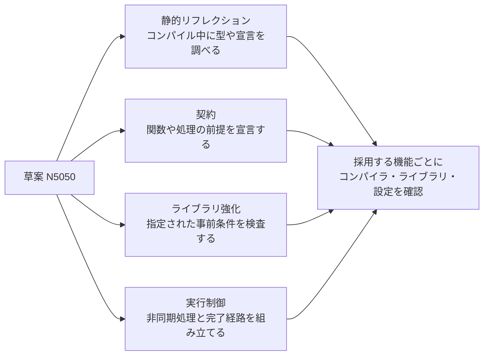

# C++26 の主な新機能 — 静的リフレクション・契約・ライブラリ強化・実行制御

2026 年 11 月 13 日時点で、ISO の第 8 版 `ISO/IEC DIS 14882` は開発中で、公開ページ上の段階は投票終了の **40.60**。公開済みの版は C++23 に対応する `ISO/IEC 14882:2024`。ここでは DIS の基礎となった WG21 作業草案 **N5050** を対象にする。草案に機能が含まれることと、特定のコンパイラや標準ライブラリで使えることは別々に確認する。



## 静的リフレクション

`^^Type` のようなリフレクション式は `std::meta::info` を作る。例えば非 static のデータメンバーを問い合わせ、公開条件に合うメンバーの情報を取得できる。スプライス構文 `[: … :]` を使う箇所では、得られた情報を型やメンバーなどの言語要素として参照できる。

メンバー名を使ってデバッグ UI や検査用ダンプを生成すると、同じ型情報を手書きで重ねずに済む。セーブデータの外部形式では、メンバー名・順番を変えたときの互換性を別途決める。例えば型のメンバーを列挙しても、旧フィールド名を新フィールドに変換する規則は自動では付かない。

### コード例 — メンバーの名前と型をコンパイル時に取り出す

GCC 16.2 は `g++ -std=c++26 -freflection reflection.cpp -o reflection` でこの例をビルドできる。`^^Stats` で型のリフレクションを得て、`nonstatic_data_members_of` でアクセス可能な非 static メンバーを取り出す。`std::define_static_array` で結果を定数評価から参照できる配列へ移す。`template for` は通常の実行時ループと異なり、各メンバーに対して文を展開する。メンバーごとに型が異なっていても、`object.[:member:]` はそのメンバーを表す式として型検査される。

```cpp
#include <iostream>
#include <meta>
#include <string_view>
#include <type_traits>

struct Stats
{
    int health;
    float speed;
    std::string_view name;
};

template<class T>
void print_fields(const T& object)
{
    static constexpr auto members = std::define_static_array(
        std::meta::nonstatic_data_members_of(^^T, std::meta::access_context::unprivileged()));
    template for (constexpr auto member : members)
    {
        using MemberType = [:std::meta::type_of(member):];
        if constexpr (std::is_floating_point_v<MemberType>)
            std::cout << "(real) ";
        std::cout << std::meta::identifier_of(member) << ": " << object.[:member:] << '\n';
    }
}

int main()
{
    print_fields(Stats{80, 2.5f, "runner"});
}
```

出力は `health: 80`、`(real) speed: 2.5`、`name: runner` の順。`[:std::meta::type_of(member):]` は型へ戻すスプライスで、`object.[:member:]` はオブジェクトのメンバーへ戻すスプライス。前者で得た型からコンパイル時に `if constexpr` の分岐を選び、後者で実行時の値を読み出す。リフレクションが列挙する順序を外部ファイルのフィールド順に直結させると、構造体の変更が外部形式の変更になる。デバッグ表示とセーブ形式で同じ列挙を使うなら、セーブ側に固定 ID と移行規則を持たせる。

## 契約とライブラリの強化

N5050 の契約アサーションには関数の事前条件 `pre(...)`、事後条件 `post(...)`、文として使う `contract_assert(...)` がある。例えば `pre(index < count)` は、呼び出し側が守る前提を宣言する。契約の評価には `ignore`、`observe`、`enforce`、`quick-enforce` があり、どの意味で評価するかは実装定義。副作用が必要な処理を述語に入れると、その副作用を前提にできない。

**hardened 標準ライブラリ**では、指定された事前条件を強化済みの実装が実行時に検査する。例として `std::vector::operator[]` の添字は `size()` 未満でなければならない。強化済みの実装で前提を破ると契約違反になる。`at()` は範囲外で `std::out_of_range` を投げる既存のインターフェースで、`operator[]` の契約違反が同じ例外で回復できるという保証はない。パーサーなど、入力エラーから処理を続ける必要がある境界では、範囲を明示的に検査して結果を返す。

### コード例 — 入口・出口・関数内の契約を分ける

GCC 16.2 の `g++ -std=c++26 -fcontracts -fcontract-evaluation-semantic=observe contract.cpp -o contract`。`pre` は関数に入る際、`post(result: …)` は正常に戻る際に評価する。戻り値の名前は `result` であり、述語から読み取れる。`post` の述語から値渡しの引数を参照するため、ここでは `limit` を `const` にしている。`contract_assert` は中間結果に対して置く。

```cpp
#include <algorithm>
#include <cassert>
#include <contracts>
#include <cstdio>

void handle_contract_violation(const std::contracts::contract_violation& violation)
{
    const auto where = violation.location();
    std::fprintf(stderr, "contract violation at line %u\n",
                 static_cast<unsigned>(where.line()));
}

int clamp_health(int value, const int limit)
    pre(limit >= 0)
    post(result: result >= 0 && result <= limit)
{
    const int lower_bounded = std::max(0, value);
    contract_assert(lower_bounded >= 0);
    return std::min(lower_bounded, limit);
}

int main(int argc, char**)
{
    assert(clamp_health(120, 100) == 100);
    assert(clamp_health(-10, 100) == 0);
    std::printf("%d\n", clamp_health(75, 100));
    // An optional argument exercises the replacement handler in observe mode.
    if (argc > 1)
        contract_assert(argc == 1);
}
```

通常の実行は `75` を表示する。引数を渡すと、このビルドではハンドラーがファイル内の行番号を出して実行が続く。違反を試す箇所は `main` の末尾に置いたので、壊れた前提のまま配列の添字や確保サイズを計算することはない。処理系が置き換え可能と定めた場合にだけ、グローバル名前空間で `handle_contract_violation` を定義できる。`observe` でハンドラーが正常に戻れば続行する。`enforce` で正常に戻ればプログラムは終了し、`quick-enforce` はハンドラーを呼ばずに終了する。`ignore` では述語を評価しない。どの意味で評価するかは実装とビルド設定に依存する。

### コード例 — 境界を検査してから標準ライブラリを呼ぶ

C++20 でもコンパイルできる例。入力の範囲外を `std::nullopt` にして呼び出し元へ返す。C++26 の強化された `operator[]` が検査するのは、分岐を通った先に残る事前条件である。外部入力を受ける API の結果として、強化機能による終了を使う必要はない。

```cpp
#include <cassert>
#include <cstddef>
#include <optional>
#include <vector>

std::optional<int> lookup(const std::vector<int>& table, std::size_t index)
{
    if (index >= table.size())
        return std::nullopt;
    return table[index];
}

int main()
{
    const std::vector<int> table{20, 40, 60};
    assert(lookup(table, 2) == 60);
    assert(!lookup(table, 3));
}
```

## std::execution の sender と receiver

sender は、開始するとどのような完了を届ける処理かを表す。receiver はその完了を受け取り、値・エラー・停止の経路を扱う。`then` は値による完了を受けて次の処理に変換できる。例えばアセットの読み込み結果にパースをつなぎ、その値を次の処理へ渡す。`connect` で sender と receiver を接続して操作状態を得て、`start` で開始する。操作状態は完了まで生存させる。

どこで処理を実行するかは scheduler などの選択に関わる。`then` をつないだだけで新しいスレッドやファイル I/O が手に入るわけではない。どこで実行・完了するかと、メインスレッドへ渡す境界を確認する。[非同期 I/O](../../os/asynchronous-file-io.md)は OS から完了を受け取る仕組みを扱う。

### コード例 — scheduler 上で始め、結果をまとめて待つ

`just` は開始時に、保持した値を下流へ届ける sender を作る。`starts_on` に scheduler を指定すると、そこに処理の開始を委ねる。`when_all` は二つの sender の値を入力順でまとめ、`std::this_thread::sync_wait` はこの例のように値完了の形が一種類の場合に、`optional<tuple<…>>` で返す。停止なら空、エラーなら例外になる。`when_all` は仕事をまとめる演算で、各仕事をどこで実行するかは sender の構成で決まる。

標準ライブラリの sender/receiver 対応は、`<execution>` または `<version>` の機能テストマクロ `__cpp_lib_senders` で確認できる。`__cpp_lib_execution` は並列アルゴリズムの実行ポリシー用のマクロ。

Compiler Explorer の Linux x86-64 環境で、NVIDIA HPC SDK 26.9 の nvc++ に付属する `<execution>` を使って実行を確認した。`nvc++ -std=c++26 -pthread sender.cpp -o sender` でビルドし、`./sender` で実行する。同じソースに `-DSTUDY_USE_STDEXEC -I path/to/stdexec/include` を付ければ、NVIDIA の参照実装でも試せる。nvc++ で参照実装を選ぶ場合は `--no-stdexec` も指定する。参照実装の検証にはリビジョン `28968426` を使用した。

```cpp
#include <cassert>
#include <iostream>
#include <thread>
#include <tuple>
#include <utility>

#ifdef STUDY_USE_STDEXEC
#include <stdexec/execution.hpp>
namespace ex = stdexec;
using stdexec::sync_wait;
#else
#include <execution>
namespace ex = std::execution;
using std::this_thread::sync_wait;
#endif

int main()
{
    ex::run_loop work;
    auto scheduler = work.get_scheduler();
    static_assert(ex::scheduler<decltype(scheduler)>);
    auto pipeline = ex::when_all(
        ex::starts_on(scheduler, ex::then(ex::just(20), [](int n) { return n * 2; })),
        ex::just(2));
    std::jthread worker([&] { work.run(); });
    auto result = [&] {
        try
        {
            return sync_wait(std::move(pipeline));
        }
        catch (...)
        {
            work.finish();
            throw;
        }
    }();
    work.finish();
    assert(result.has_value());
    const auto [processed, extra] = *result;
    std::cout << processed + extra << '\n';
}
```

出力は `42`。ワーカーが実行するループは、空になっただけでは終わらない。`finish()` が終了を要求し、`std::jthread` の破棄がスレッドを待つ。`work` がワーカーより長く生きる宣言順にしている。ゲームではメインスレッドのフレーム更新で `sync_wait` を呼ぶと処理が終わるまでブロックする。表示・ワールド更新へ反映する場合は、フレーム境界へ結果を渡す方式を別に設計する。

## 対応状況を切り分ける

| コンパイラ・ライブラリ | リフレクションと展開文 | 契約 | sender/receiver |
| --- | --- | --- | --- |
| GCC 16.2 / libstdc++ 16.2 | P2996R13、P1306R5。`-std=c++26 -freflection` で上の例を確認 | P2900R14。`-fcontracts` で上の例を確認 | GCC の言語モードとは別。付属の `<execution>` で上の例に必要な sender API は提供されていない |
| Clang / libc++ | LLVM の対応表では P2996R13 は未対応。展開文は Clang 23 の表で一部対応とされ、範囲を反復する形式は未対応 | LLVM の対応表では P2900R14 は未対応 | libc++ の P2300R10 は対応表で完了していない |
| MSVC / Microsoft STL | Visual Studio 2026 の公式対応表に P2996R13 の対応記載なし | 公式対応表に P2900R14 の対応記載なし | Microsoft STL が P2300R10 を未実装として追跡している |
| NVIDIA HPC SDK 26.9 / nvc++ | — | — | 付属の `<execution>` で上の例を実行確認。`__cpp_lib_senders` は `202506L` |
| NVIDIA stdexec | 使用するコンパイラで決まる | 使用するコンパイラで決まる | C++20 以降から試せる参照実装。上の例をこの経路でも実行確認 |

libc++ には C++26 の標準化とは別に、実装独自の hardening モードがある。コンパイラで同じ名前の規格モードを選んでも、使える機能はコンパイラと標準ライブラリの組み合わせで変わる。GCC・LLVM・MSVC と参照実装は 2026 年 11 月 13 日、nvc++ は 11 月 15 日に確認した。
同じプロジェクトで複数の処理系を使うなら、コンパイラの規格モードに加え、標準ライブラリの版と各機能のテストをビルドに組み込める。

## コード例 — C++20 でメンバー列挙と入力検査を明示する

標準 C++20 で単体コンパイルできる例。デバッグ出力用のメンバー表を手で列挙し、外部から来る添字は明示的に検査する。リフレクションを使う場合に置き換えられるのは前者の列挙処理。後者は、範囲外を処理可能な入力エラーとして扱うためのロジック。

```cpp
#include <array>
#include <cstddef>
#include <iostream>
#include <optional>
#include <string_view>

struct Stats
{
    int health;
    int shield;
};

struct Field
{
    std::string_view name;
    int Stats::*member;
};

constexpr std::array fields{
    Field{"health", &Stats::health},
    Field{"shield", &Stats::shield}
};

std::optional<int> read_field(const Stats& stats, std::size_t index)
{
    if (index >= fields.size())
        return std::nullopt;

    return stats.*(fields[index].member);
}

int main()
{
    const Stats stats{80, 15};
    for (const Field& field : fields)
        std::cout << field.name << ": " << stats.*(field.member) << '\n';

    if (!read_field(stats, 2))
        std::cout << "unknown field\n";
}
```

出力は `health: 80`、`shield: 15`、`unknown field` の順。添字 2 は要素数 2 の表の範囲外なので、メンバーを参照する処理まで進まない。

## 理解度チェック

1. 静的リフレクションでメンバーの列挙を生成できると、セーブデータの互換性も自動で保たれるか。
2. 強化済み実装の `vector::operator[]` と `vector::at()` で、添字が範囲外だったときの契約はどう違うか。
3. sender/receiver の三つの完了経路は何か。
4. `template for` の中で異なる型のメンバーを扱える理由は何か。
5. `post(result: …)` は例外で抜けた場合も評価されるか。
6. `when_all` の子が別々のスレッドで実行されるかは、何が決めるか。

::: details 解答

1. 外部形式の識別子や変換規則は別に設計する。列挙は型情報の取得を支援する。
2. `operator[]` は事前条件の違反になる。`at()` は `std::out_of_range` を投げる。
3. 値、エラー、停止。
4. 本体は各メンバーについて別々に展開される。スプライスが表す型や式も展開ごとに決まる。
5. 正常に戻るときの契約なので、例外で抜けた場合には評価されない。
6. 子 sender と scheduler の構成。`when_all` 自体はスレッドを割り当てない。

:::

## 関連項目

- [C++ のテンプレートとコンセプト](templates-and-concepts.md)
- [C++ の例外](exceptions.md)
- [C++ の未定義動作](undefined-behavior.md)
- [C++ メモリモデル](memory-model.md)
- [非同期 I/O](../../os/asynchronous-file-io.md)

## 参考資料

- ISO, [ISO/IEC DIS 14882 の開発状況](https://www.iso.org/standard/91179.html)・[ISO/IEC 14882:2024](https://www.iso.org/standard/83626.html)
- WG21, [N5050 の編集報告 N5051](https://www.open-std.org/jtc1/sc22/wg21/docs/papers/2026/n5051.html)・[N5050 — Contract assertions](https://timsong-cpp.github.io/cppwp/n5050/basic.contract)
- WG21, [P2996R13 — Reflection for C++26](https://www.open-std.org/jtc1/sc22/wg21/docs/papers/2025/p2996r13.html)・[P2900R14 — Contracts for C++](https://www.open-std.org/jtc1/sc22/wg21/docs/papers/2025/p2900r14.pdf)
- WG21, [P3471R4 — Standard Library Hardening](https://www.open-std.org/jtc1/sc22/wg21/docs/papers/2025/p3471r4.html)・[P2300R10 — std::execution](https://www.open-std.org/jtc1/sc22/wg21/docs/papers/2024/p2300r10.html)
- GCC, [GCC 16 の変更点](https://gcc.gnu.org/gcc-16/changes.html)・[規格対応表](https://gcc.gnu.org/projects/cxx-status.html)
- LLVM, [libc++ の Hardening](https://libcxx.llvm.org/Hardening.html)
- NVIDIA, [stdexec](https://github.com/NVIDIA/stdexec)

- WG21, [P1306R5 — Expansion Statements](https://www.open-std.org/jtc1/sc22/wg21/docs/papers/2025/p1306r5.html)・[N5050 — Function contract specifiers](https://timsong-cpp.github.io/cppwp/n5050/dcl.contract.func)・[Contract-violation handler](https://timsong-cpp.github.io/cppwp/n5050/basic.contract.handler)・[Senders](https://timsong-cpp.github.io/cppwp/n5050/exec.snd)
- GCC, [GCC 16.2 C++ Dialect Options](https://gcc.gnu.org/onlinedocs/gcc-16.2.0/gcc/C_002b_002b-Dialect-Options.html)
- LLVM, [Clang C++ の対応表](https://clang.llvm.org/cxx_status.html)・[libc++ の C++26 対応表](https://libcxx.llvm.org/Status/Cxx26.html)
- Microsoft, [MSVC の C/C++ 規格対応表](https://learn.microsoft.com/en-us/cpp/overview/visual-cpp-language-conformance)・[Microsoft STL の P2300R10 追跡](https://github.com/microsoft/STL/issues/4768)
- NVIDIA, [stdexec の検証に使用したリビジョン](https://github.com/NVIDIA/stdexec/tree/2896842646d75f44cf574419a282bc36ca91f139)
- NVIDIA, [HPC SDK 26.3 リリースノート（`<execution>` での提供開始）](https://docs.nvidia.com/hpc-sdk/archive/26.3/pdf/hpc-sdk263rn.pdf)・[HPC SDK 26.9 コンパイラリファレンス](https://docs.nvidia.com/hpc-sdk/compilers/hpc-compilers-ref-guide/index.html)
