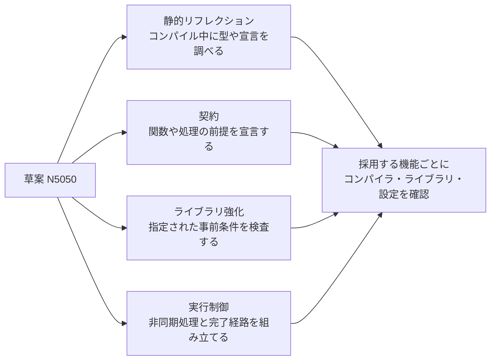

# C++26 の主な新機能 — 静的リフレクション・契約・ライブラリ強化・実行制御

2026 年 11 月 13 日時点で、ISO の第 8 版 `ISO/IEC DIS 14882` は開発中で、公開ページ上の段階は投票終了の **40.60**。公開済みの版は C++23 に対応する `ISO/IEC 14882:2024`。ここでは DIS の基礎となった WG21 作業草案 **N5050** を対象にする。草案に機能が含まれることと、特定のコンパイラや標準ライブラリで使えることは別々に確認する。



## 静的リフレクション

`^^Type` のようなリフレクション式は `std::meta::info` を作る。例えば非 static のデータメンバーを問い合わせ、公開条件に合うメンバーの情報を取得できる。スプライス構文 `[: … :]` を使う箇所では、得られた情報を型やメンバーなどの言語要素として参照できる。

メンバー名を使ってデバッグ UI や検査用ダンプを生成すると、同じ型情報を手書きで重ねずに済む。セーブデータの外部形式では、メンバー名・順番を変えたときの互換性を別途決める。例えば型のメンバーを列挙しても、旧フィールド名を新フィールドに変換する規則は自動では付かない。

## 契約とライブラリの強化

N5050 の契約アサーションには関数の事前条件 `pre(...)`、事後条件 `post(...)`、文として使う `contract_assert(...)` がある。例えば `pre(index < count)` は、呼び出し側が守る前提を宣言する。契約の評価には `ignore`、`observe`、`enforce`、`quick-enforce` があり、どの意味で評価するかは実装定義。副作用が必要な処理を述語に入れると、その副作用を前提にできない。

**hardened 標準ライブラリ**では、指定された事前条件を強化済みの実装が実行時に検査する。例として `std::vector::operator[]` の添字は `size()` 未満でなければならない。強化済みの実装で前提を破ると契約違反になる。`at()` は範囲外で `std::out_of_range` を投げる既存のインターフェースで、`operator[]` の契約違反が同じ例外で回復できるという保証はない。パーサーなど、入力エラーから処理を続ける必要がある境界では、範囲を明示的に検査して結果を返す。

## std::execution の sender と receiver

sender は、開始するとどのような完了を届ける処理かを表す。receiver はその完了を受け取り、値・エラー・停止の経路を扱う。`then` は値による完了を受けて次の処理に変換できる。例えばアセットの読み込み結果にパースをつなぎ、その値を次の処理へ渡す。`connect` で sender と receiver を接続して操作状態を得て、`start` で開始する。操作状態は完了まで生存させる。

どこで処理を実行するかは scheduler などの選択に関わる。`then` をつないだだけで新しいスレッドやファイル I/O が手に入るわけではない。どこで実行・完了するかと、メインスレッドへ渡す境界を確認する。[非同期 I/O](../../os/asynchronous-file-io.md)は OS から完了を受け取る仕組みを扱う。

## 対応状況を切り分ける

| 確認する対象 | 2026 年 11 月の資料で確認できる例 |
| --- | --- |
| 言語とヘッダー | GCC 16 系は P2996R13 のリフレクションを `-std=c++26 -freflection` で有効にできる。P2900R14 の契約にも対応を記載している。GCC 16 の C++26 対応は実験的 |
| ライブラリの強化設定 | libc++ はライブラリ独自の hardening モードを文書化している。使用する版とモードの検査範囲を確認する |
| sender/receiver ライブラリ | NVIDIA の `stdexec` は P2300 の実験的な参照実装。草案の `std::execution` を使用する場合は、選んだ標準ライブラリで対象の機能を確認する |

同じプロジェクトで複数の処理系を使うなら、コンパイラの規格モードに加え、標準ライブラリの版と各機能のテストをビルドに組み込める。

## コード例 — C++20 でメンバー列挙と入力検査を明示する

標準 C++20 で単体コンパイルできる例。デバッグ出力用のメンバー表を手で列挙し、外部から来る添字は明示的に検査する。リフレクションを使う場合に置き換えられるのは前者の列挙処理。後者は、範囲外を処理可能な入力エラーとして扱うためのロジック。

```cpp
#include <array>
#include <cstddef>
#include <iostream>
#include <optional>
#include <string_view>

struct Stats
{
    int health;
    int shield;
};

struct Field
{
    std::string_view name;
    int Stats::*member;
};

constexpr std::array fields{
    Field{"health", &Stats::health},
    Field{"shield", &Stats::shield}
};

std::optional<int> read_field(const Stats& stats, std::size_t index)
{
    if (index >= fields.size())
        return std::nullopt;

    return stats.*(fields[index].member);
}

int main()
{
    const Stats stats{80, 15};
    for (const Field& field : fields)
        std::cout << field.name << ": " << stats.*(field.member) << '\n';

    if (!read_field(stats, 2))
        std::cout << "unknown field\n";
}
```

出力は `health: 80`、`shield: 15`、`unknown field` の順。添字 2 は要素数 2 の表の範囲外なので、メンバーを参照する処理まで進まない。

## 理解度チェック

1. 静的リフレクションでメンバーの列挙を生成できると、セーブデータの互換性も自動で保たれるか。
2. 強化済み実装の `vector::operator[]` と `vector::at()` で、添字が範囲外だったときの契約はどう違うか。
3. sender/receiver の三つの完了経路は何か。

::: details 解答

1. 外部形式の識別子や変換規則は別に設計する。列挙は型情報の取得を支援する。
2. `operator[]` は事前条件の違反になる。`at()` は `std::out_of_range` を投げる。
3. 値、エラー、停止。

:::

## 関連項目

- [C++ のテンプレートとコンセプト](templates-and-concepts.md)
- [C++ の例外](exceptions.md)
- [C++ の未定義動作](undefined-behavior.md)
- [C++ メモリモデル](memory-model.md)
- [非同期 I/O](../../os/asynchronous-file-io.md)

## 参考資料

- ISO, [ISO/IEC DIS 14882 の開発状況](https://www.iso.org/standard/91179.html)・[ISO/IEC 14882:2024](https://www.iso.org/standard/83626.html)
- WG21, [N5050 の編集報告 N5051](https://www.open-std.org/jtc1/sc22/wg21/docs/papers/2026/n5051.html)・[N5050 — Contract assertions](https://timsong-cpp.github.io/cppwp/n5050/basic.contract)
- WG21, [P2996R13 — Reflection for C++26](https://www.open-std.org/jtc1/sc22/wg21/docs/papers/2025/p2996r13.html)・[P2900R14 — Contracts for C++](https://www.open-std.org/jtc1/sc22/wg21/docs/papers/2025/p2900r14.pdf)
- WG21, [P3471R4 — Standard Library Hardening](https://www.open-std.org/jtc1/sc22/wg21/docs/papers/2025/p3471r4.html)・[P2300R10 — std::execution](https://www.open-std.org/jtc1/sc22/wg21/docs/papers/2024/p2300r10.html)
- GCC, [GCC 16 の変更点](https://gcc.gnu.org/gcc-16/changes.html)・[規格対応表](https://gcc.gnu.org/projects/cxx-status.html)
- LLVM, [libc++ の Hardening](https://libcxx.llvm.org/Hardening.html)
- NVIDIA, [stdexec](https://github.com/NVIDIA/stdexec)
