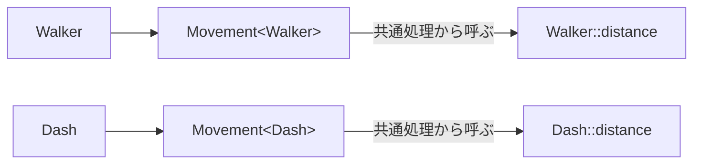

# CRTPと静的ポリモーフィズム — 共通処理から型ごとの操作を呼ぶ

複数の移動コンポーネントで「入力を制限し、移動量を計算し、位置へ加える」という手順を共有し、移動量の式だけを変える場面を考えます。呼び出し側がコンポーネントの具体型をコンパイル時に知っていれば、型に対応する処理をテンプレートで選べます。



## 自分の型を基底に渡す

`Walker : Movement<Walker>` のように、派生クラス自身を基底クラスのテンプレート引数に渡す書き方をCRTPと呼びます。基底のメンバー関数は、`static_cast<Derived&>(*this)` で、実際にその基底を含んでいる派生オブジェクトを参照します。その上で派生クラスのフックを呼びます。`Movement<Walker>` と `Movement<Dash>` は異なる型で、同じ基底型の参照だけでまとめることはできません。

基底だけの実体や、別の派生型からキャストすると前提を破ります。基底のコンストラクターを非公開にして、指定した派生型にだけ構築を許す方法があります。派生側のメンバーを使う共通処理は、派生オブジェクトの構築が終わってから呼びます。

## コード例 — Template Methodに相当する手順を共有する

C++20の単体例です。`advance` が手順を固定し、派生型の `distance` が1tickの移動量を決めます。

```cpp
#include <algorithm>
#include <iostream>

template<class Derived>
class Movement {
    friend Derived;
    Movement() = default;
    Movement(const Movement&) = default;
    Movement& operator=(const Movement&) = default;

public:
    double advance(double position, double input) const
    {
        const double clamped = std::clamp(input, -1.0, 1.0);
        return position + static_cast<const Derived&>(*this).distance(clamped);
    }
};

class Walker final : public Movement<Walker> {
public:
    double distance(double input) const { return 0.5 * input; }
};

class Dash final : public Movement<Dash> {
public:
    double distance(double input) const { return 2.0 * input; }
};

int main()
{
    Walker walk;
    Dash dash;
    const double walked = walk.advance(10.0, 1.5);
    const double dashed = dash.advance(10.0, 1.5);
    std::cout << walked << ' ' << dashed << '\n';
    return walked == 10.5 && dashed == 12.0 ? 0 : 1;
}
```

入力の1.5を1.0に制限する処理は共通なので、位置は歩きで10.5、ダッシュで12になります。`distance` は共通処理の途中で呼ばれるフックです。呼び出し先の型が分かるためインライン展開の候補になりますが、実際に展開されるかはコンパイラの判断です。

## 他の書き方を選ぶ条件

共通の基底データやメンバー構文が不要なら、処理を関数テンプレートに置き、C++20のconceptで必要な操作を表せます。C++23の明示的オブジェクト引数は、オブジェクトの型を推論する別の選択肢です。実行時に読み込む実装を共通インターフェースで扱う場合は、仮想関数や型消去が候補です。処理系が具体型を把握できる場合には仮想呼び出しを直接呼び出しへ変える最適化もあります。バイナリの大きさや命令キャッシュへの影響も含め、実際の呼び出しを計測します。

## 理解度チェック

1. `Walker` の例で、入力を制限する共通処理と型ごとのフックはどれか。
2. 生成された `Movement<Walker>` と `Movement<Dash>` を同じ基底型のポインターで扱えるか。
3. 同じ処理を多くの型へ実体化する場合、仮想呼び出しの有無以外に何を計測するか。

::: details 解答

1. 共通処理は `advance`、フックは `Walker::distance`。
2. 二つは異なる型。共通の動的インターフェースが必要なら別途設ける。
3. 生成コードの大きさ、ホットパスの時間、命令キャッシュへの影響など。

:::

## 関連項目

- [Template Method](/design/patterns/template-method.html)
- [テンプレートとconcepts](/languages/cpp/templates-and-concepts.html)
- [継承と仮想関数](/languages/cpp/inheritance-and-virtual.html)
- [C++23の実践機能](/languages/cpp/explicit-object-and-expected.html)

## 参考資料

- [WG21 N4861（C++20）— Implicit instantiation](https://timsong-cpp.github.io/cppwp/n4861/temp.inst)
- [WG21 N4861（C++20）— Static cast](https://timsong-cpp.github.io/cppwp/n4861/expr.static.cast)
- [WG21 P0847R7 — Deducing this（C++23）](https://www.open-std.org/jtc1/sc22/wg21/docs/papers/2021/p0847r7.html)
