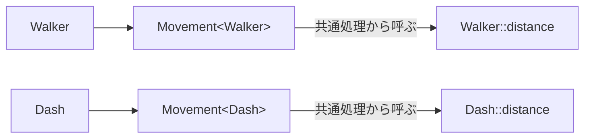
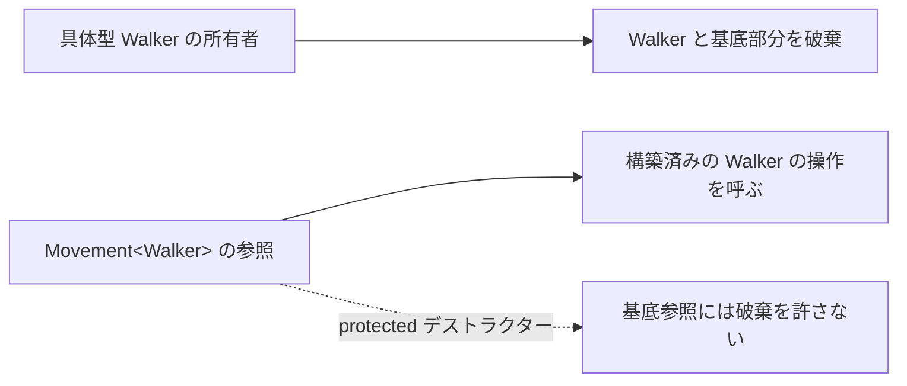

# CRTPと静的ポリモーフィズム — 共通処理から型ごとの操作を呼ぶ

複数の移動コンポーネントで「入力を制限し、移動量を計算し、位置へ加える」という手順を共有し、移動量の式だけを変える場面を考えます。呼び出し側がコンポーネントの具体型をコンパイル時に知っていれば、型に対応する処理をテンプレートで選べます。



## 自分の型を基底に渡す

`Walker : Movement<Walker>` のように、派生クラス自身を基底クラスのテンプレート引数に渡す書き方をCRTPと呼びます。基底のメンバー関数は、`static_cast<Derived&>(*this)` で、実際にその基底を含んでいる派生オブジェクトを参照します。その上で派生クラスのフックを呼びます。`Movement<Walker>` と `Movement<Dash>` は異なる型で、同じ基底型の参照だけでまとめることはできません。

基底だけの実体や、別の派生型からキャストすると前提を破ります。基底のコンストラクターを非公開にして、指定した派生型にだけ構築を許す方法があります。派生側のメンバーを使う共通処理は、派生オブジェクトの構築が終わってから呼びます。

### 構築と破棄の境界

`static_cast<Derived&>(*this)` のダウンキャストが成立するには、参照先が本当に `Derived` の基底部分である必要があります。CRTP基底を単独で構築できると、この前提を破る入口ができます。基底のデフォルト・コピーコンストラクターを `private` にして `friend Derived;` と書くと、意図した型に構築を許しながら、外から基底部分だけをコピーする操作を防げます。コンストラクターを `protected` にするだけでは、別の派生型を作る経路が残ります。

非仮想のデストラクターを `protected` にすると、外からCRTP基底のポインターで `delete` する操作はアクセス検査で拒否されます。所有するポインターは `std::unique_ptr<Derived>` のように具体型を保ち、共通処理を呼ぶためだけの参照は所有権を持たせません。動的な共通基底を通して普通の `delete` で破棄する設計では、公開された仮想デストラクターを持たせます。基底の構築中や破棄中に派生型のフックを呼ぶと、派生型が持つデータの寿命と合わなくなるので、フックは完成したオブジェクトに対して呼びます。



## コード例 — Template Methodに相当する手順を共有する

C++20の単体例です。`advance` が手順を固定し、派生型の `distance` が1tickの移動量を決めます。

```cpp
#include <algorithm>
#include <iostream>

template<class Derived>
class Movement {
    friend Derived;
    Movement() = default;
    Movement(const Movement&) = default;
    Movement& operator=(const Movement&) = default;

public:
    double advance(double position, double input) const
    {
        const double clamped = std::clamp(input, -1.0, 1.0);
        return position + static_cast<const Derived&>(*this).distance(clamped);
    }
};

class Walker final : public Movement<Walker> {
public:
    double distance(double input) const { return 0.5 * input; }
};

class Dash final : public Movement<Dash> {
public:
    double distance(double input) const { return 2.0 * input; }
};

int main()
{
    Walker walk;
    Dash dash;
    const double walked = walk.advance(10.0, 1.5);
    const double dashed = dash.advance(10.0, 1.5);
    std::cout << walked << ' ' << dashed << '\n';
    return walked == 10.5 && dashed == 12.0 ? 0 : 1;
}
```

入力の1.5を1.0に制限する処理は共通なので、位置は歩きで10.5、ダッシュで12になります。`distance` は共通処理の途中で呼ばれるフックです。呼び出し先の型が分かるためインライン展開の候補になりますが、実際に展開されるかはコンパイラの判断です。

### コード例 — 比較と計数を mixin で加える

CRTPの基底を、共通の手順を定義する用途に加え、型へ小さな機能を付け足す **mixin** として使えます。以下の `Ordered` は具体型の `operator<` から `>`、`<=`、`>=` を作ります。`Counted` は生きているインスタンス数を型ごとに数えます。C++20 の単体例で、計数は単一スレッドを前提にします。

```cpp
#include <cassert>
#include <cstddef>
#include <memory>
#include <type_traits>

template<class T>
class Ordered
{
    friend T;
    Ordered() = default;
    Ordered(const Ordered&) = default;

protected:
    ~Ordered() = default;

public:
    friend bool operator>(const T& a, const T& b) { return b < a; }
    friend bool operator<=(const T& a, const T& b) { return !(b < a); }
    friend bool operator>=(const T& a, const T& b) { return !(a < b); }
};

template<class T>
class Counted
{
    friend T;
    inline static std::size_t alive_ = 0;

    Counted() { ++alive_; }
    Counted(const Counted&) : Counted() {}
    Counted(Counted&&) noexcept : Counted() {}

protected:
    ~Counted() { --alive_; }

public:
    static std::size_t alive() { return alive_; }
};

class DrawItem final : public Ordered<DrawItem>, public Counted<DrawItem>
{
    int key_;

public:
    explicit DrawItem(int key) : key_(key) {}
    friend bool operator<(const DrawItem& a, const DrawItem& b)
    {
        return a.key_ < b.key_;
    }
};

class Light final : public Counted<Light>
{
public:
    Light() = default;
};

int main()
{
    static_assert(!std::is_destructible_v<Counted<DrawItem>>);
    static_assert(std::is_destructible_v<DrawItem>);

    {
        DrawItem back{20};
        DrawItem front{10};
        auto copy = std::make_unique<DrawItem>(front);
        Light light;
        assert(back > front && front <= *copy && *copy >= front);
        assert(DrawItem::alive() == 3 && Light::alive() == 1);
    }
    assert(DrawItem::alive() == 0 && Light::alive() == 0);
}
```

比較関数をクラス内の `friend` として定義すると、具体型を使った演算で引数依存の名前探索から見つかります。`<` は一貫した順序を表す必要があります。ここでは整数のキーを使い、等価な順序の項目を許します。C++20 で同じキーから比較を定義できる場合は `operator<=>` も候補です。計数は `Counted<DrawItem>` と `Counted<Light>` で別々になり、コピー・ムーブ構築も新しい生存オブジェクトに数えます。複数スレッドから構築・破棄する型へ同じ mixin を付けるなら、計数の読み書きに同期が必要です。

### コード例 — C++23 の明示的オブジェクト引数で書き換える

`advance` の入口を `this const auto& self` にすると、呼び出しに使われた静的な型から `self` を推論できます。フックを呼ぶための基底テンプレートやダウンキャストを省けます。型の推論は静的なので、基底の参照に型を隠すと具体型のフックは見えなくなります。以下は C++23 の単体例です。

```cpp
#include <algorithm>
#include <cassert>
#include <concepts>

class Movement
{
protected:
    ~Movement() = default;

public:
    template<class Self>
    double advance(this const Self& self, double position, double input)
        requires requires (const Self& object, double value) {
            { object.distance(value) } -> std::convertible_to<double>;
        }
    {
        const double clamped = std::clamp(input, -1.0, 1.0);
        return position + self.distance(clamped);
    }
};

struct Walker final : Movement
{
    double distance(double input) const { return 0.5 * input; }
};

struct Dash final : Movement
{
    double distance(double input) const { return 2.0 * input; }
};

int main()
{
    Walker walk;
    Dash dash;
    assert(walk.advance(10.0, 1.5) == 10.5);
    assert(dash.advance(10.0, 1.5) == 12.0);
}
```

コンパイル時の型によって呼び出し先を決めたいだけなら、この書き方で共通のクラス宣言を一つにできます。一方、`Counted<T>` のように型ごとに異なる静的データを持たせる用途では、テンプレートの実体化によって状態の置き場所を分ける意味が残ります。[C++23の実践機能](/languages/cpp/explicit-object-and-expected.html)では、明示的オブジェクト引数で `const` や値カテゴリーを扱う例も確認できます。

## 他の書き方を選ぶ条件

共通の基底データやメンバー構文が不要なら、処理を関数テンプレートに置き、C++20のconceptで必要な操作を表せます。C++23の明示的オブジェクト引数は、オブジェクトの型を推論する別の選択肢です。実行時に読み込む実装を共通インターフェースで扱う場合は、仮想関数や型消去が候補です。処理系が具体型を把握できる場合には仮想呼び出しを直接呼び出しへ変える最適化もあります。バイナリの大きさや命令キャッシュへの影響も含め、実際の呼び出しを計測します。

### 仮想関数を使う設計との比較

| 比較する点 | CRTP・明示的オブジェクト引数 | 仮想関数 |
| --- | --- | --- |
| 呼び出す実装 | 呼び出し式から分かる静的な型で決まる | 基底参照やポインターから、動的な型に対応する最終オーバーライドを選ぶ |
| 一覧にまとめる | 具体型が分かるコンテナを分けるか、型をまとめる仕組みを別に使う | 共通基底の参照やポインターの一覧で扱える |
| バイナリの構成 | 複数の具体型向けにコードを実体化する。型ごとに最適化でき、コードが重複する場合がある | ABIによって仮想関数テーブルと間接呼び出しが使われる。具体型が判明すれば直接呼び出しに変わる場合がある |
| 所有権 | 具体型を所有し、基底の参照は呼び出しに使う | 基底から破棄できる公開仮想デストラクターを用意できる |
| 用例 | コンパイル時に確定する更新処理、型ごとの計数、比較の補助 | 実行時に異なる実装を選ぶ状態やプラグイン |

C++規格が定めるのは仮想呼び出しの意味で、テーブルの配置はABIによって決まります。Itanium C++ ABIは仮想テーブルの配置と呼び出し方法を規定しています。ホットパスの違いを測るときは、同じ仕事量で、インライン展開後の命令とバイナリの大きさ、実行時に混ざる型の割合を記録します。例えば1フレームに同じ型の更新がまとまって並ぶ場合と、多数の型がランダムに混ざる場合では、データの配置や分岐の予測にも違いが出ます。

### 同じフックを型の境界の内側で使う

例えば、地上の敵が多数の `Walker` と少数の `Dash` で構成されるとします。実行時に一つずつフックを選ぶなら、基底参照を通じて `advance` 相当の処理を呼ぶ設計が自然です。型別にまとめて更新できるなら、`std::span<Walker>` と `std::span<Dash>` それぞれに共通ループを適用して、ループ内の具体型をコンパイラへ知らせる設計もできます。データを型別の配列へ移すとメモリアクセスの並び方も変わるため、実行時間が縮んだときは、呼び出し先の決め方と配置の影響を分けて測ります。

たとえば 4,096 体を処理する場合、①同じ型の並びと同じデータ配置で呼び出しだけを切り替える、②仮想呼び出しのまま型の並びを変える、③型ごとにデータの格納先も分ける、の順に比較できます。合計更新時間に加え、最適化したバイナリで呼び出しが実際に残っているかを逆アセンブリで確認します。エンジンの境界で異なる実装を受け取り、各実装の内部では型の決まったデータをまとめて処理する構成なら、動的な選択と静的な共通化を一緒に使えます。

また、`friend Derived` はダウンキャストの利用条件を守るための構築制限です。派生型のメンバーが非公開なら、基底からそのフックへアクセスできるかは派生側の定義で決まります。フックを `private` にする設計では派生側で基底を friend にするか、呼び出せる範囲を意図して公開します。フックの要件を `requires` で書くなら、派生型がまだ不完全な基底の実体化時ではなく、型が完成してから使うメンバー関数で検査すると、前提をコードと診断の両方に示せます。

## 理解度チェック

1. `Walker` の例で、入力を制限する共通処理と型ごとのフックはどれか。
2. 生成された `Movement<Walker>` と `Movement<Dash>` を同じ基底型のポインターで扱えるか。
3. 同じ処理を多くの型へ実体化する場合、仮想呼び出しの有無以外に何を計測するか。
4. mixin のデストラクターを `protected` にすると、どの経路での破棄が拒否されるか。
5. `this const Self&` を使うと、基底の参照から動的な派生型を推論できるか。

::: details 解答

1. 共通処理は `advance`、フックは `Walker::distance`。
2. 二つは異なる型。共通の動的インターフェースが必要なら別途設ける。
3. 生成コードの大きさ、ホットパスの時間、命令キャッシュへの影響など。
4. 外部から基底型のポインターで `delete` する経路。公開された派生型のデストラクターによる破棄では基底部分も破棄される。
5. 推論は呼び出し式の静的な型に基づく。実行時の型で呼び分ける場合は仮想関数などを使う。

:::

## 関連項目

- [Template Method](/design/patterns/template-method.html)
- [テンプレートとconcepts](/languages/cpp/templates-and-concepts.html)
- [継承と仮想関数](/languages/cpp/inheritance-and-virtual.html)
- [C++23の実践機能](/languages/cpp/explicit-object-and-expected.html)

## 参考資料

- [WG21 N4861（C++20）— Implicit instantiation](https://timsong-cpp.github.io/cppwp/n4861/temp.inst)
- [WG21 N4861（C++20）— Static cast](https://timsong-cpp.github.io/cppwp/n4861/expr.static.cast)
- [WG21 P0847R7 — Deducing this（C++23）](https://www.open-std.org/jtc1/sc22/wg21/docs/papers/2021/p0847r7.html)

- [WG21 N4861 — Delete expression](https://timsong-cpp.github.io/cppwp/n4861/expr.delete)・[Class member access](https://timsong-cpp.github.io/cppwp/n4861/class.access)
- [Itanium C++ ABI — Virtual Table Layout](https://itanium-cxx-abi.github.io/cxx-abi/abi.html#vtable)・[Virtual Calls](https://itanium-cxx-abi.github.io/cxx-abi/abi.html#vcall)
