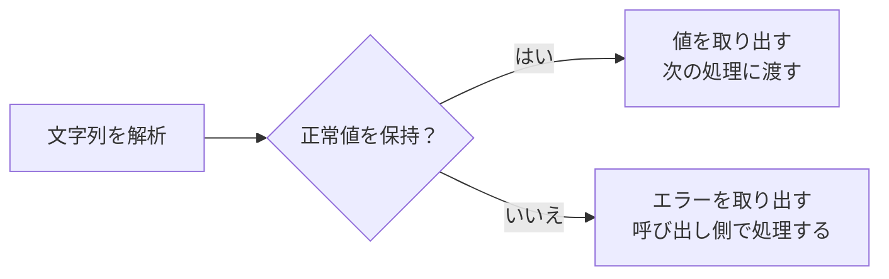

# C++23の実践機能 — deducing thisとstd::expected

同じ処理をconstの有無ごとに書くメンバー関数と、呼び出し側で失敗の内容を使いたい関数を考えます。C++23では、明示的オブジェクト引数で呼び出し元の型を受け取り、`std::expected<T, E>` で結果または失敗理由を返せます。どちらも、呼び出し側へ伝える情報を型で表す機能です。

## deducing this — 呼び出し元を引数として受け取る

通常のメンバー関数では、`obj.get()` の `obj` が暗黙のオブジェクト引数です。明示的オブジェクト引数は、最初の引数を `this Self&& self` のように宣言します。呼び出し方は `obj.get()` のまま、関数本体では `self` を経由してメンバーへアクセスします。`Self` をテンプレートで推論する使い方が、**deducing this**の代表例です。

| 呼び出すオブジェクト | `Self&&` が表す型の例 |
| --- | --- |
| 変更可能な左辺値 | `Asset&` |
| constな左辺値 | `const Asset&` |
| 変更可能な右辺値 | `Asset&&` |
| constな右辺値 | `const Asset&&` |

メンバーへの参照を返すときは、右辺値のオブジェクトから参照を返したあと、そのオブジェクトが破棄される場合を考えます。下の例は `Self&&` の推論結果に制約を付け、左辺値のみに制限します。`decltype(auto)` と括弧付きの `(self.id)` を使うことで、変更可能なオブジェクトには `int&`、constなら `const int&` を返します。

この形式には従来の暗黙の `this` がありません。明示的オブジェクトメンバー関数には末尾の `const` や参照修飾子を付けず、`virtual` にもできません。呼び出し元の型の違いはオブジェクト引数へ書きます。ラムダで `this auto&& self` を使えば、ラムダ本体から `self(...)` と自分を呼ぶ再帰も書けます。

共通の基底メンバーに `this const Self& self` を指定すると、派生型から呼んだときは `Self` がその派生型になります。基底のテンプレート引数に派生型を渡し、ダウンキャストしてフックを呼んでいたCRTPの一部を、この推論で書き換えられます。型ごとに別の静的データを持つ例と併せて、[CRTPの書き換え例](/languages/cpp/crtp.html)を参照してください。

## std::expected — 正常値とエラーを型で伝える

`std::expected<T, E>` は正常値 `T` とエラー `E` のどちらかを保持します。失敗は `std::unexpected(error)` で返します。例えばアセットIDを文字列から読む処理では、数値に変換できない、表現範囲を超える、末尾に余分な文字がある、という失敗理由を呼び出し側で使えます。正常時の値が不要な処理には `std::expected<void, E>` も使えます。



`has_value()` または真偽値への変換で状態を確認してから、`*result` や `result.error()` を使います。`value()` はエラー状態で呼ぶと `std::bad_expected_access<E>` を送出します。入力エラーを戻り値で扱うAPIでは、`value()` の送出に頼るより、成功と失敗で処理を分けると、エラーをどこで扱うかが明確になります。エラー型は失敗を表す情報であり、関数全体の `noexcept` は別に設計します。

| C++23の操作 | 成功時 | 失敗時 |
| --- | --- | --- |
| `transform` | 正常値を別の値へ写す | エラーを伝える |
| `and_then` | 次の `expected` を返す処理へ進む | エラーを伝える |
| `transform_error` | 正常値を伝える | エラーを別の型や値へ写す |
| `or_else` | 正常値を伝える | エラーを受け取り `expected` で回復や伝播を表す |
| `value_or(fallback)` | 正常値を値として返す | 代替値を返す |
| `error_or(fallback)` | 代替エラー値を返す | 保持したエラーを値として返す |

`value_or` と `error_or` の引数は普通の関数引数として先に評価されます。失敗のときだけ代替の処理を実行したい場合は分岐や `or_else` を使います。

## コード例 — アセットIDを読み、成功時に参照へアクセスする

完全なC++23ソースです。`g++ -std=c++23 asset_id.cpp -o asset_id` でコンパイルできます。MSVCでは `cl /std:c++latest /EHsc asset_id.cpp` が使えます。`<expected>` を実装した標準ライブラリが必要です。明示的オブジェクト引数をサポートする処理系では `__cpp_explicit_this_parameter` 側を使います。

```cpp
#include <array>
#include <charconv>
#include <expected>
#include <iostream>
#include <string_view>
#include <system_error>
#include <type_traits>
#include <utility>

enum class ParseError { invalid, outOfRange, trailing };

std::expected<int, ParseError> parseId(std::string_view text)
{
    if (text.empty()) {
        return std::unexpected(ParseError::invalid);
    }
    int value = 0;
    const char* end = text.data() + text.size();
    const auto parsed = std::from_chars(text.data(), end, value);
    if (parsed.ec == std::errc::invalid_argument) {
        return std::unexpected(ParseError::invalid);
    }
    if (parsed.ec == std::errc::result_out_of_range) {
        return std::unexpected(ParseError::outOfRange);
    }
    if (parsed.ptr != end) {
        return std::unexpected(ParseError::trailing);
    }
    return value;
}

struct Asset {
    int id;

#ifdef __cpp_explicit_this_parameter
    template<class Self>
        requires std::is_lvalue_reference_v<Self&&>
    decltype(auto) getId(this Self&& self) noexcept
    {
        return (self.id);
    }
#else
    int& getId() & noexcept { return id; }
    const int& getId() const& noexcept { return id; }
    const int& getId() const&& = delete;
#endif
};

static_assert(std::is_same_v<decltype(std::declval<Asset&>().getId()), int&>);
static_assert(std::is_same_v<decltype(std::declval<const Asset&>().getId()), const int&>);

template<class Object>
concept CanReadId = requires(Object&& object) { std::forward<Object>(object).getId(); };

static_assert(!CanReadId<Asset> && !CanReadId<const Asset>);

int main()
{
    constexpr std::array inputs{
        std::string_view("42"), std::string_view("42x"), std::string_view("abc"),
        std::string_view("999999999999999999999999")
    };
    for (const auto text : inputs) {
        const auto parsed = parseId(text);
        if (parsed) {
            Asset asset{*parsed};
            asset.getId() = 43;
            const Asset& saved = asset;
            std::cout << text << " -> " << saved.getId() << '\n';
        } else {
            std::cout << text << " -> error: ";
            switch (parsed.error()) {
            case ParseError::invalid:    std::cout << "invalid"; break;
            case ParseError::outOfRange: std::cout << "out of range"; break;
            case ParseError::trailing:   std::cout << "trailing characters"; break;
            }
            std::cout << '\n';
        }
    }
}
```

`42` は成功し、例の代入でIDが43になります。`42x` は末尾の文字、`abc` は解析できない値、最後の24桁の値は `int` の範囲外として表示します。`static_assert` はconstの有無に応じた参照型と、右辺値から呼べないことを確認します。Microsoftの適合表では基本の `<expected>` はVisual Studio 2022 17.3、P0847R7の明示的オブジェクト引数は17.13に記載されています。GCC 16.2のC++23モードで明示的オブジェクト引数の分岐をビルド・実行し、4行の出力と `static_assert` を確認しました。初回のVisual Studio 2022 17.5.5での確認は `expected` と従来のオーバーロードの分岐が対象です。

## 理解度チェック

1. 明示的オブジェクト引数を宣言した関数を `asset.getId()` と呼ぶとき、`self` に何が渡りますか。
2. `decltype(auto)` で `return (self.id);` の括弧は何に影響しますか。
3. `parseId("42x")` が返す `expected` に対して、次の正常処理を `and_then` でつないだ場合、その処理は実行されますか。

::: details 解答
1. メンバー関数を呼び出した `asset` がオブジェクト引数になります。`asset` が左辺値なら、推論と参照の折り畳みにより左辺値参照として渡ります。
2. `decltype` が参照を含む式の型を返すようにします。括弧なしのメンバー名は特別な規則で宣言された型が選ばれ、例では `int` になります。
3. 実行されません。失敗側の `ParseError::trailing` が次の `expected` に伝わります。
:::

## 関連項目

- [constの使い分け](/languages/cpp/const-correctness.html)
- [値・ポインター・参照](/languages/cpp/values-pointers-references.html)
- [C++の例外](/languages/cpp/exceptions.html)
- [CRTPと静的ポリモーフィズム](/languages/cpp/crtp.html)

## 参考資料

- [WG21、C++23草案N4950の関数宣言と明示的オブジェクト引数](https://timsong-cpp.github.io/cppwp/n4950/dcl.fct)
- [WG21、P0847R7 Deducing this](https://open-std.org/JTC1/SC22/WG21/docs/papers/2021/p0847r7.html)
- [WG21、P0323R12 std::expected](https://www.open-std.org/jtc1/sc22/wg21/docs/papers/2022/p0323r12.html)
- [WG21、P2505R5 Monadic Functions for std::expected](https://www.open-std.org/jtc1/sc22/wg21/docs/papers/2022/p2505r5.html)
- [WG21、C++23草案N4950のexpectedの合成操作](https://timsong-cpp.github.io/cppwp/n4950/expected.object.monadic)
- [WG21 N4950 — expectedの値とエラーを取り出す操作](https://timsong-cpp.github.io/cppwp/n4950/expected.object.obs)
- [GCC — C++規格の対応表](https://gcc.gnu.org/projects/cxx-status.html)
- [Microsoft、Visual C++の言語・ライブラリ適合状況](https://learn.microsoft.com/en-us/cpp/overview/visual-cpp-language-conformance?view=msvc-170)
