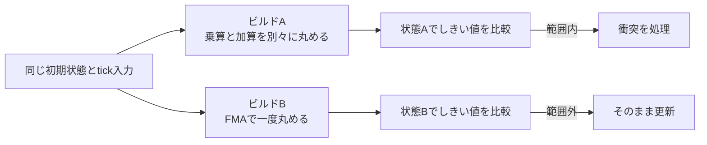

# 浮動小数点の決定性 — 同じ入力から同じtickを再現する

入力だけを記録するリプレイやロックステップでは、初期状態と各tickの入力から次の状態を再計算します。たとえば距離がしきい値を下回ったtickで衝突を起こす実装では、わずかな丸めの差が判定を変え、その後は別々の状態を更新します。どのプラットフォーム、ビルド構成、ゲームデータの組み合わせで、どの状態を一致させるかを先に決めます。[ゲームのネットワーク同期](/game/network-sync.html)



## FMAと縮約

IEEE 754-2019の fusedMultiplyAdd は、積と和を無限の精度で計算したかのように最後に一度丸めます。binary32の乗算と加算を独立に実行する場合は、それぞれの結果を丸めます。例えば $a=1+2^{-23}$、$b=1-2^{-23}$、$c=-1$ のとき、正確な積は $1-2^{-46}$ です。最近接丸めでは積が1になり、別々に計算した $a b+c$ は0になります。一度だけ丸めるFMAでは $-2^{-46}$ になります。この値はbinary32で正確に表せます。

C++20の `std::fma(a,b,c)` なら、命令を一つにできるかに関わらず、積と和を一度だけ丸める計算を要求できます。一方、ソースに `a * b + c` と書いた場合に、コンパイラがFMAへ縮約するかはコンパイル設定と対象命令に左右されます。

| 対象 | 確認する項目 |
| --- | --- |
| MSVC 17系 | `/fp:fast` は演算の並べ替えなどを許し、既定で `/fp:contract` を有効にします。Visual Studio 2022以降では `/fp:precise` の既定で縮約はオフです。実行時に浮動小数点環境を操作するコードでは `/fp:strict` の要件も確認します。 |
| Clang | `-ffp-contract=off` で縮約を無効にできます。`-ffp-model` や `-ffast-math` の指定と組み合わせるときは、実際のビルドで指定順と最終的なオプションを確認します。 |

## SIMD経路と更新の順番

SIMDで粒子の力を合計すると、同じ加算でもレーン幅や水平加算の組み方によって括弧の位置が変わります。binary32で $a=2^{24}$、$b=1$、$c=-2^{24}$ とすると、最近接偶数丸めで $(a+b)+c=0$、$(a+c)+b=1$ です。2の24乗の直上では隣り合う値の間隔が2で、$a+b$ は中間に来ます。

SIMDの経路を選ぶCPU機能検出、非正規化数をゼロに寄せる実行時設定、近似命令、数学ライブラリの実装も確認します。同じ数式を書いた複数の経路は、それぞれの出力を比較します。ジョブが完了した順に結果を足す実装でも、同様に加算順が変わります。固定順に並べ直してから足す、決まった木構造で合計するなど、順序をコードに持たせます。

## コード例 — 一度丸める場合と二度丸める場合

C++20のコンソール例です。binary32と最近接丸めを使います。`volatile` の積は比較のために `float` として保存します。MSVCでは `cl /std:c++20 /EHsc /fp:strict fp-determinism.cpp`、Clangでは `clang++ -std=c++20 -ffp-model=strict -ffp-contract=off fp-determinism.cpp -o fp-determinism` が使えます。

```cpp
#include <bit>
#include <cfenv>
#include <cmath>
#include <cstdint>
#include <iomanip>
#include <iostream>
#include <limits>

static_assert(sizeof(float) == sizeof(std::uint32_t));
static_assert(std::numeric_limits<float>::is_iec559 &&
              std::numeric_limits<float>::digits == 24);

int main()
{
    if (std::fesetround(FE_TONEAREST) != 0) {
        return 1;
    }
    const float a = 1.0f + 0x1p-23f;
    const float b = 1.0f - 0x1p-23f;
    const float c = -1.0f;
    volatile float product = a * b;
    const float separate = product + c;
    const float fused = std::fma(a, b, c);
    std::cout << std::hex << std::setfill('0')
              << "separate: " << std::setw(8) << std::bit_cast<std::uint32_t>(separate) << '\n'
              << "fused:    " << std::setw(8) << std::bit_cast<std::uint32_t>(fused) << '\n';
    return separate == 0.0f && fused == -0x1p-46f ? 0 : 2;
}
```

出力は `separate: 00000000` と `fused:    a8800000` です。符号付き指数の $-46$ にbinary32のバイアス127を加えると81になり、仮数部は0です。

## ロックステップとリプレイで最初の不一致を見つける

1. 初期状態と入力ログ、tick間隔、実行ファイルやデータの版、乱数のシードと消費順をそろえます。シミュレーションを描画時間から切り離します。
2. tick終了時に、同期対象のフィールドを決まった順序とバイト順で直列化し、その値かハッシュを比較します。ポインター、構造体のパディング、非決定的なコンテナ走査順はチェックに含めません。
3. 最初に異なるtickで入力と状態を保存し、更新系やオブジェクトごとの値に分けます。しきい値の前で演算のビット列を採り、FMAの有無、加算の木、乱数の消費順を調べます。

入力だけを保存するリプレイを版をまたいで再生するなら、対象の古いシミュレーションを残す、版を記録して対応する実装を選ぶ、状態のスナップショットを併用する、といった構成があります。固定小数点を使う設計でも、スケール、丸め、範囲外の扱い、更新順を定義します。

## 理解度チェック

1. `a*b+c` の積で一度丸める場合とFMAで計算する場合は、どの時点で差が生まれるか。
2. SIMDの実装を変えても個々の入力値は同じなのに、合計が変わるのはなぜか。
3. 1,000 tickのリプレイで最後に座標が違ったとき、最初に違いが生じた箇所をどう絞るか。

::: details 解答

1. 積を一度保存する実装ではそこで情報を失う。FMAでは加算まで計算してから丸める。
2. レーンごとの合計を作る順序が異なると、途中で丸める加算の組み合わせが変わるため。
3. 同期対象のtickごとの値かハッシュを比較して最初に異なるtickを見つけ、そのtickをフィールドや処理ごとに比較する。

:::

## 関連項目

- [浮動小数点の間隔と丸め](/data/floating-point-spacing.html)
- [浮動小数点の比較](/math/floating-point-comparison.html)
- [ゲームのネットワーク同期](/game/network-sync.html)

## 参考資料

- [IEEE Std 754-2019 — Floating-Point Arithmetic](https://ieeexplore.ieee.org/document/8766229)
- [WG21 N4861（C++20最終作業草案）— cmath](https://timsong-cpp.github.io/cppwp/n4861/c.math)
- [Microsoft — /fp（浮動小数点の動作の指定）](https://learn.microsoft.com/en-us/cpp/build/reference/fp-specify-floating-point-behavior?view=msvc-170)
- [LLVM — Clang Compiler User’s Manual、Controlling Floating-Point Behavior](https://clang.llvm.org/docs/UsersManual.html#controlling-floating-point-behavior)
- [Glenn Fiedler — Deterministic Lockstep（自作の物理同期例）](https://gafferongames.com/post/deterministic_lockstep/)
