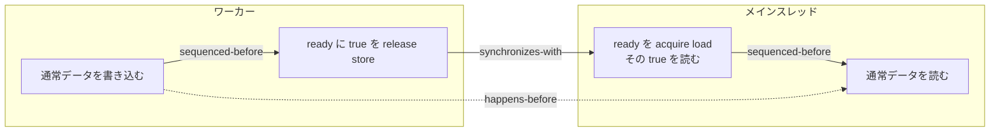

# C++ メモリモデル — atomic と happens-before で共有データを受け渡す

ワーカースレッドで作ったデータを、ゲームのメインスレッドに渡すとする。「準備できた」と知らせるフラグが不可分に読み書きできても、それだけでは、フラグが指す通常データを安全に読めるとは限らない。C++20 のメモリモデルでは、どの書き込みと読み出しを順序付けたかを追って判断する。

## atomic が保証すること

`std::atomic<T>` の読み出し・書き込みは、同じ atomic オブジェクトへの他の atomic 操作に対して不可分になる。例えば `fetch_add` は、値を読み、加え、書く処理を一つの read-modify-write（RMW）として行う。同じ atomic への変更には、全スレッドで共有される**変更順序（modification order）**がある。別の atomic の変更順序まで一つにまとめる保証は、メモリオーダーに応じて判断する。

| C++20 の順序 | 主な使い方 | 確認する保証 |
| --- | --- | --- |
| `relaxed` | 独立した統計カウンターなど | 対象の atomic への操作は不可分。別データの公開に必要な順序は作らない |
| `release` | 公開側で atomic に書き込む | 対応する acquire が値を受け取ると、公開前の処理を受け手に順序付けられる |
| `acquire` | 受け手が atomic を読み出す | 同じ atomic の対応する release から値を読んだ場合に同期が成立する |
| `acq_rel` | RMW で値の受け取りと公開を行う | 読み側に acquire、書き側に release がある |
| `seq_cst` | 順序指定を省いた場合の既定 | 該当する読み書きの acquire / release に加え、`seq_cst` 操作全体に一つの全順序がある |

表の名前は `std::memory_order::relaxed` のように指定する。単純な `load` に `release`、単純な `store` に `acquire` は指定しない。`atomic<T>` が内部ロックを使うかは型と実装に依存する。複数の操作から成る不変条件を守る場合は、[スレッドと同期](../../runtime/thread-synchronization.md)の mutex も使える。

## release と acquire の間に順序を作る

一つのスレッド内で処理が順序付けられている関係を **sequenced-before** と呼ぶ。スレッド間では、ある acquire が同じ atomic に対する release の書いた値を読むと、**synchronizes-with** が成立する。C++20 では、その release に続く同じ atomic への RMW の連鎖を経て値を読んだ場合も、規格の定める release sequence を介して成立しうる。



図の左端から右端まで関係をつなぐと、書き込みが読み出しに **happens-before** する。途中の acquire が古い `false` を読む時点では、その release とまだ同期していない。両端のアクセスが同じメモリ位置で競合し、少なくとも一方が非 atomic で、どちら向きにも happens-before がなければ、異なるスレッドのアクセスはデータ競合となる。[並行処理のバグ](../../runtime/memory/concurrency-bugs.md)では、データ競合と、順序の選び方で生じるロジック上の競合を区別している。

## seq_cst の全順序を読む

初期値 0 の atomic `x`、`y` について、スレッド A が `x = 1` を書いてから `y` を読み、B が `y = 1` を書いてから `x` を読む。すべて `seq_cst` なら、両方の読み出しが 0 になることはない。A が 0 を読むにはその読み出しが B の書き込みより前、B が 0 を読むにはその読み出しが A の書き込みより前である必要がある。各スレッド内の順序と合わせると全順序に閉路ができてしまう。

同じ四つの操作を `relaxed` にすると、C++20 の規則は両方の読み出しが 0 になる結果を排除しない。実際にその結果が現れるかは実行環境や処理系に依存する。弱い順序と `seq_cst` を混在させるときは、弱い操作がその全順序に含まれないことにも注意する。

## コード例 — 1 回だけ結果を公開する

次の C++20 プログラムは標準ライブラリだけでコンパイルできる。ワーカーは値を設定した後で `ready` を公開し、メインスレッドは `true` を読んだ後に値を確認する。ワーカーの完了待ちはその後なので、読み出しの安全性は `join()` より前に release/acquire で確立している。ループ中の `yield()` は実行機会を譲る呼び出しで、同期の根拠は `ready` の読み書き。

```cpp
#include <array>
#include <atomic>
#include <cassert>
#include <iostream>
#include <thread>

struct Result
{
    std::array<int, 3> samples{};
    std::atomic<bool> ready{false};
};

int main()
{
    Result result;
    std::thread worker([&result] {
        result.samples = {3, 5, 8};
        result.ready.store(true, std::memory_order::release);
    });

    while (!result.ready.load(std::memory_order::acquire))
    {
        std::this_thread::yield();
    }

    const int sum = result.samples[0] + result.samples[1] + result.samples[2];
    worker.join();
    assert(sum == 16);
    std::cout << sum << '\n';
}
```

出力は `16`。`ready` を `relaxed` に変えると、`samples` の読み出しまでを守る同期が失われる。この例は公開が一度きりで、公開後は書き換えない。毎フレーム繰り返すなら、読み手が使い終えるまで次の書き込みを許さない方法を用意する。受け渡し用キューやバッファの所有権を管理する理由もここにある。

## 理解度チェック

1. 複数スレッドが一つのカウンターを `fetch_add(1, std::memory_order::relaxed)` で増やす。対象のカウンターへの更新は不可分か。
2. release store の前に書いた通常データを、同じフラグの acquire load が古い `false` を返した直後に読めるか。
3. 上のコードで `join()` を値の読み出しより後に置けるのはなぜか。

::: details 解答

1. 不可分。`relaxed` でも、同じ atomic に対する RMW として一つの更新になる。
2. その release との同期がまだ成立していないので、フラグを根拠には読めない。
3. `true` を読む release/acquire の組によって、通常データの書き込みが読み出しに happens-before するため。

:::

## 関連項目

- [スレッドと同期](../../runtime/thread-synchronization.md)
- [並行処理のバグ](../../runtime/memory/concurrency-bugs.md)
- [C++ の未定義動作](undefined-behavior.md)

## 参考資料

- WG21, [作業草案 N4861](https://www.open-std.org/jtc1/sc22/wg21/docs/papers/2020/n4861.pdf)・[C++20 DIS N4860 との対応を示す編集報告 N4859](https://www.open-std.org/jtc1/sc22/wg21/docs/papers/2020/n4859.html)
- N4861 の HTML 版, [intro.races](https://timsong-cpp.github.io/cppwp/n4861/intro.races)・[atomics.order](https://timsong-cpp.github.io/cppwp/n4861/atomics.order)・[atomics.types.operations](https://timsong-cpp.github.io/cppwp/n4861/atomics.types.operations)・[atomics.lockfree](https://timsong-cpp.github.io/cppwp/n4861/atomics.lockfree)・[thread.thread.member](https://timsong-cpp.github.io/cppwp/n4861/thread.thread.member)
