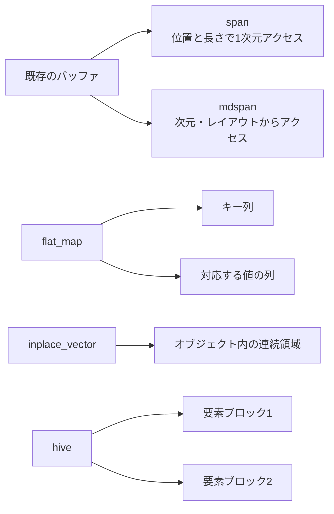

# C++23・26のコンテナとビュー — span・mdspan・flat_map・inplace_vector・hive

テクスチャの行列を関数へ渡す、IDから描画設定を引く、フレームごとの小さなリストを作る。どの場面で使うかによって、必要な性質が変わります。C++20の `span`、C++23の `mdspan` と `flat_map`、C++26草案の `inplace_vector` と `hive` を、メモリの所有権と配置から見ていきます。

## どこに要素を置くか

| 型 | 規格 | メモリと使いどころ |
| --- | --- | --- |
| `std::span<T>` | C++20 | 他のオブジェクトが所有する連続した要素列を借りる。動的な長さとコンパイル時に決まる長さを表せる |
| `std::mdspan<T, Extents, Layout>` | C++23 | 次元ごとの添字から要素へのアクセスを作る。既定のアクセサーで既存バッファを借り、行優先、列優先、ストライド付きなどの配置を表せる |
| `std::flat_map<K, V>` | C++23 | 順序付きのキーと値をそれぞれのコンテナに保持する。既定では双方が `std::vector`。一意なキーで検索できる |
| `std::inplace_vector<T, N>` | C++26草案 | 最大N個の要素をオブジェクト自身の内部に連続して置く。サイズを0〜Nの範囲で変えられる |
| `std::hive<T>` | C++26草案 | 複数のブロックに要素を置き、消した位置を後の挿入で再利用できる。反復は双方向 |



## spanとmdspan — 元のメモリを借りる

`span` を渡すと、呼び出し先は同じ型の要素を連続した列として扱えます。`span<const T>` にすると、ビューを通じた要素への書き込みを許しません。ビューをコピーしてもデータは複製されません。所有側の `vector` が再確保したり、借りている要素の寿命が終わったりすると、ビューを使い続けられません。所有側で要素を消す場合も、借りている範囲に有効な要素が残るか確認します。

`mdspan` は次元ごとの添字を、レイアウトの写像を通じて位置へ変換します。2行3列なら、`layout_right` で `(row, column)` のオフセットは `row * 3 + column` です。`layout_left` なら `row + column * 2` です。添字 `(1, 0)` は前者で3、後者で1になります。行末に余白がある幅3・行間隔4のバッファなら、`layout_stride` で行のストライドを4、列を1にできます。サイズとストライドは、実際に所有しているメモリの範囲に合わせます。

## flat_map・inplace_vector・hiveの使い分け

**`flat_map`** はキーと値を別々のコンテナで保持し、キーの並び順で検索します。キーによる検索は対数時間、1要素の挿入・削除は線形時間です。よく読む材質テーブルをまとめて構築する場面では候補になります。ゲーム中に1件ずつ頻繁に挿入・削除するなら、移動する要素数と参照の無効化を考えます。

**`inplace_vector`** は要素用の領域をオブジェクト自身に持つので、容量Nを超えるような再確保は行いません。通常の `push_back` が容量を超える場合は `std::bad_alloc` を送出します。失敗を戻り値で調べるなら `try_push_back` を使い、戻り値が空か確認します。途中へ挿入・削除すると後続の要素は移動し得ます。内部に持つ容量は空でもオブジェクトの大きさに関わるため、大量のオブジェクトへ埋め込む場合はNの上限を実測に合わせます。

**`hive`** は削除のたびに後続要素を詰めず、反復時には削除済みの場所を飛ばします。通常の挿入・削除で既存の別の要素への参照を保ちたい場合に使えます。挿入位置はコンテナが決め、末尾のイテレーターには無効化の条件があります。`shrink_to_fit` などの操作は要素の位置を変え得ます。削除した要素へのポインターを永続IDとして保持すると、同じアドレスに別の要素が入り得るため、ゲームオブジェクトの識別には世代付きハンドルなどを使います。

## コード例 — 同じバッファを1次元と2次元で読む

完全なC++ソースです。`cl /std:c++20 /EHsc views.cpp` では `span` の部分を確認できます。`mdspan` などを実装した標準ライブラリと対応する規格モードを選ぶと、`<version>` の機能テストマクロに応じて該当部分も有効になります。

```cpp
#include <array>
#include <iostream>
#include <span>
#include <version>

#ifdef __cpp_lib_mdspan
#include <mdspan>
#endif
#ifdef __cpp_lib_flat_map
#include <flat_map>
#endif
#ifdef __cpp_lib_inplace_vector
#include <inplace_vector>
#endif
#ifdef __cpp_lib_hive
#include <hive>
#endif

int main()
{
    std::array pixels{10, 11, 12, 20, 21, 22};
    std::span<int> linear{pixels};
    std::cout << "span: " << linear[3] << '\n';

#ifdef __cpp_lib_mdspan
    std::mdspan<int, std::extents<int, 2, 3>> rows{pixels.data()};
    std::cout << "mdspan: " << rows[1, 0] << '\n';
#endif

#ifdef __cpp_lib_flat_map
    std::flat_map<int, int> materials;
    materials.emplace(42, 7);
    std::cout << "flat_map: " << materials.at(42) << '\n';
#endif

#ifdef __cpp_lib_inplace_vector
    std::inplace_vector<int, 2> visible;
    visible.push_back(7);
    visible.push_back(9);
    std::cout << "inplace_vector: "
              << (visible.try_push_back(11) ? "inserted" : "full") << '\n';
#endif

#ifdef __cpp_lib_hive
    std::hive<int> particles;
    const auto first = particles.insert(10);
    const auto keep = particles.insert(20);
    particles.erase(first);
    particles.insert(30);
    std::cout << "hive: " << *keep << '\n';
#endif
}
```

`span` と行優先の `mdspan` はどちらも元の配列の要素20を読みます。`inplace_vector` の容量は2なので3つ目を追加すると `full` です。`hive` で消したのは10だけなので、既存の20へのイテレーターを使えます。手元のVisual Studio 2022 17.5.5では `span` の分岐を実行して20を確認しました。この環境にはほかの4型の対応ヘッダーがないため、その分岐は該当する草案の宣言に照合しています。

## 理解度チェック

1. `span` を保持したまま、元の `vector` が要素を再確保した場合、何を作り直しますか。
2. 2行3列の `layout_right` で添字 `(1, 2)` はどのオフセットですか。
3. `flat_map` と `hive` のうち、順序付きの一意なキーで検索する用途に合うのはどちらですか。

::: details 解答
1. 再確保後のデータと長さを使ってビューを作り直します。古いビューは以前の領域を指しています。
2. $1\cdot3+2=5$ です。
3. `flat_map` です。`hive` は各要素をブロックに保管するシーケンスコンテナです。
:::

## 関連項目

- [配列と動的配列](/algorithms/arrays-and-dynamic-arrays.html)
- [探索木](/algorithms/search-trees.html)
- [世代付きハンドル](/algorithms/generational-handles.html)

## 参考資料

- [WG21、C++20草案N4861のspan](https://timsong-cpp.github.io/cppwp/n4861/span.overview)
- [WG21、C++23草案N4950のmdspanとレイアウト](https://timsong-cpp.github.io/cppwp/n4950/mdspan.layout)
- [WG21、C++23草案N4950のflat_map](https://timsong-cpp.github.io/cppwp/n4950/flat.map.overview)
- [WG21、C++26草案N5050のinplace_vector](https://timsong-cpp.github.io/cppwp/n5050/inplace.vector)
- [WG21、C++26草案N5050のhive](https://timsong-cpp.github.io/cppwp/n5050/hive)
