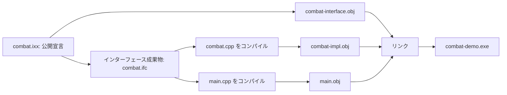

# C++20 モジュール — インターフェース・ビルド依存・ODR

C++20 の名前付きモジュールは、ある翻訳単位から公開した名前を、別の翻訳単位で `import` して使う仕組み。たとえばゲームのダメージ計算だけをモジュールとして公開し、その内部で使う補助関数をモジュール内に置ける。ビルドではコンパイラが読むインターフェースの生成と、リンカーが使う実装の結合を別々に追う。

## ヘッダーとモジュールの違い

| 項目 | `#include` でヘッダーを使う | C++20 の名前付きモジュール |
| --- | --- | --- |
| 名前を使えるようにする方法 | ヘッダーのトークンを翻訳単位に取り込む。 | コンパイラが処理したモジュールの公開宣言を `import` する。 |
| 公開範囲 | ヘッダーに書いた宣言や定義が取り込まれる。 | `export` で公開する宣言を選ぶ。 |
| プリプロセッサー | 取り込み元のマクロやインクルード順の影響を受ける。 | 名前付きモジュールの `import` はマクロを持ち込まない。 |
| コンパイル順 | ヘッダーがそろえば、各ソースを独立にコンパイルできる場合が多い。 | `import` する側のコンパイル時に、インターフェースの成果物が必要になる。 |

ヘッダーユニットの `import <header>;` は、同じ `import` キーワードを使う別の仕組み。インポート可能なヘッダーを直接インポートすると、そのヘッダーユニットのプリプロセス終了時に定義されているマクロも取り込まれる。ヘッダー内で `#undef` したマクロは残らない。名前付きモジュール経由で間接的にヘッダーユニットへ依存するだけでは、そのマクロは取り込まれない。

### インターフェースと実装

`export module combat;` は、名前が `combat` の主インターフェース単位を宣言する。一つの名前付きモジュールには主インターフェース単位が一つある。そこから `export` した名前を `import combat;` で使える。`module combat;` から始まる実装単位では、同じモジュールに属する関数を定義できる。大きくなったモジュールは `combat:rules` のようなパーティションに分けられる。パーティションの直接のインポートは同じモジュールの単位から行い、外へ公開する宣言は主インターフェースから公開する。

`module;` から名前付きのモジュール宣言までを **グローバルモジュール断片** と呼ぶ。既存ヘッダーを `#include` し、そこで得た宣言をモジュール単位の中で使える。例えば、取り込み前に設定マクロが必要な外部ヘッダーをここで処理する。

`module :private;` からファイルの終わりまでは **プライベートモジュール断片**。主インターフェース単位の後半に実装を置き、インポート側に到達させる宣言の範囲を区切れる。この断片を使うと、そのファイルがモジュールの唯一の単位になる。後述のようにインターフェースと実装を複数ファイルに分ける場合は、実装単位を使う。対応状況はコンパイラごとに異なり、GCC 16.2 のマニュアルではプライベートモジュール断片は未対応。

## ビルドに増える依存



コンパイラが別のソースからインターフェースを読むときに使う成果物を、BMI や CMI と呼ぶ。MSVC の例では `.ifc`。`.obj` はリンクに使う。BMI だけあれば利用側をコンパイルできる場合でも、実装を含むオブジェクトをリンクしなければ実行ファイルは作れない。

CMake は 3.28 から C++ モジュール用の処理を持つ。CMake 3.30 の説明では、ソースを走査してインポートの依存を調べ、必要な順序をビルドへ反映する。利用できるジェネレーターやコンパイラには条件がある。BMI はコンパイラが処理する成果物なので、ツールチェーンやビルド設定を変える場合は、その構成で作り直す。インターフェースを再利用して解析の重複を減らせる一方、インポート関係が増えれば先行するビルドを待つこともある。

### ODR への影響

ODR（One Definition Rule）は、型や関数などの定義をどこに置けるかを定める。ヘッダー方式では、同じクラスやインライン関数の定義が複数の翻訳単位に現れても、トークン列や名前解決などの条件を満たせば許される。その例外には、定義が名前付きモジュールに所属しないことという条件もある。ヘッダー内の定義を、そのまま複数のモジュール単位で重複して書く移行は避ける。`export` したテンプレートを利用側でインスタンス化する場合は、その定義も利用側から到達可能にする。

## コード例 — ルールの公開と実装を分ける

次の 3 ファイルは C++20。公開する `applyDamage` は HP とダメージが非負の場合を扱う。`remainingHp` は実装側の無名名前空間に置く。インターフェースには公開関数の宣言だけがあり、処理を変えてもその宣言を保てる。

`combat.ixx`

```cpp
export module combat;

export int applyDamage(int hp, int damage);
```

`combat.cpp`

```cpp
module combat;

namespace
{
    int remainingHp(int hp, int damage)
    {
        return damage >= hp ? 0 : hp - damage;
    }
}

int applyDamage(int hp, int damage)
{
    return remainingHp(hp, damage);
}
```

`main.cpp`

```cpp
#include <iostream>

import combat;

int main()
{
    std::cout << applyDamage(10, 3) << '\n';
    std::cout << applyDamage(2, 7) << '\n';
}
```

MSVC（Visual Studio 2022）の開発者コマンドプロンプトで、インターフェース、利用側と実装、リンクの順に進める。実行結果は `7`、`0` の 2 行。

```bat
cl /nologo /std:c++20 /EHsc /c /interface /ifcOutput combat.ifc /Focombat-interface.obj combat.ixx
cl /nologo /std:c++20 /EHsc /c /reference combat=combat.ifc /Focombat-impl.obj combat.cpp
cl /nologo /std:c++20 /EHsc /c /reference combat=combat.ifc main.cpp
link /nologo /out:combat-demo.exe main.obj combat-interface.obj combat-impl.obj
combat-demo.exe
```

## C++23 の `import std;`

C++20 で名前付きモジュールの仕組みが入り、C++23 の標準ライブラリーで `std` と `std.compat` というモジュールが加わった。`import std;` は、標準ライブラリーの `std` 名前空間の宣言などを提供する。`import std.compat;` はさらに、C 由来の関数などを対応するグローバル名前空間でも提供する。`assert` などのマクロが必要なら、対応するヘッダーを使う。

次は C++23 の単独サンプル。C++23 の標準ライブラリーモジュールに対応する環境で、`std` の BMI と必要なオブジェクトを用意してビルドする。Microsoft のコマンドライン例では、付属する `std.ixx` を `/std:c++latest` でビルドする。Microsoft STL は Visual Studio 2022 17.8 から、`std` と `std.compat` を `/std:c++20` でも利用できる。libc++ も C++20 モードで利用できる拡張を文書化している。GCC 16 は libstdc++ 付属のモジュールを組み立てる `--compile-std-module` を提供する。GCC 16.2 では下の例を `g++ -std=c++20 -fmodules --compile-std-module std_demo.cpp -o std-demo` でビルドし、`7` が表示されることを確認した。

CMake 4.4 で標準ライブラリーのモジュールも組み立てる場合、Ninja 系ジェネレーターと対応する処理系が必要。`CMAKE_EXPERIMENTAL_CXX_IMPORT_STD` を有効にし、`CMAKE_CXX_COMPILER_IMPORT_STD` で目的の規格モードが利用可能かを確かめ、対象の `CXX_MODULE_STD` を `ON` にする。ユーザー定義モジュールを扱う機能と、標準ライブラリーのモジュールを組み立てる機能では、CMake の対応条件が異なる。

```cpp
import std;

int main()
{
    const std::vector<int> hitPoints{7, 0};
    std::cout << hitPoints.front() << '\n';
}
```

## 理解度チェック

<details><summary>利用側はコンパイルできたが、applyDamage の定義が見つからずリンクに失敗した。何を調べる？</summary>

実装単位のオブジェクトがリンクに渡っているかを調べる。`combat.ifc` はコンパイラが公開宣言を読むために使う。

</details>

<details><summary>同じ定義を複数のヘッダー利用側に置けた場合、その定義を複数の名前付きモジュール単位にも置ける？</summary>

ヘッダー方式で使える ODR の例外には、名前付きモジュールに所属しないことという条件がある。移行後の定義の所属を確認し、モジュール内の適切な一つの場所に置く。

</details>

<details><summary>C++20 モジュールに対応するコンパイラなら import std; も使える？</summary>

`std` は C++23 の標準ライブラリーモジュール。C++20 モードで使える処理系もあるが、その場合は処理系の拡張に依存する。名前付きモジュールへの対応に加え、標準ライブラリーの配布物、規格モード、BMI を作るビルド構成を確認する。

</details>

## 関連項目

- [翻訳単位とヘッダー](/runtime/cpp-internals/translation-units-and-headers.html)
- [CMake](/tools/build/build-tools-cmake.html)
- [リンクエラー](/tools/build/link-errors.html)
- [ヘッダーと Assembly Definition の対比](/languages/csharp/headers-vs-asmdef.html)

## 参考資料

- [WG21 N4861 — C++20 最終作業草案 `module.unit`](https://timsong-cpp.github.io/cppwp/n4861/module.unit)
- [WG21 N4861 — C++20 最終作業草案 `module.import`](https://timsong-cpp.github.io/cppwp/n4861/module.import)
- [WG21 N4861 — C++20 最終作業草案 `basic.def.odr`](https://timsong-cpp.github.io/cppwp/n4861/basic.def.odr)
- [WG21 N4950 — C++23 最終作業草案 `std.modules`](https://timsong-cpp.github.io/cppwp/n4950/std.modules)
- [Microsoft — module, import, export](https://learn.microsoft.com/en-us/cpp/cpp/import-export-module?view=msvc-170)
- [Microsoft — Import the C++ standard library using modules from the command line](https://learn.microsoft.com/en-us/cpp/cpp/tutorial-import-stl-named-module?view=msvc-170)
- [CMake 3.30 — cmake-cxxmodules](https://cmake.org/cmake/help/v3.30/manual/cmake-cxxmodules.7.html)
- [WG21 N4861 — ヘッダーユニットからのマクロの取り込み](https://timsong-cpp.github.io/cppwp/n4861/cpp.import)
- [WG21 N4861 — グローバルモジュール断片](https://timsong-cpp.github.io/cppwp/n4861/module.global.frag)・[プライベートモジュール断片](https://timsong-cpp.github.io/cppwp/n4861/module.private.frag)
- [Microsoft — Visual Studio 2022 17.8 の C++ 適合性の改善](https://learn.microsoft.com/en-us/cpp/overview/cpp-conformance-improvements#conformance-improvements-in-visual-studio-2022-version-178)
- [LLVM — Modules in libc++](https://libcxx.llvm.org/Modules.html)
- [GCC 16 リリースノート](https://gcc.gnu.org/gcc-16/changes.html)・[GCC 16.2 — C++ Modules](https://gcc.gnu.org/onlinedocs/gcc-16.2.0/gcc/C_002b_002b-Modules.html)
- [CMake 4.4 — import std の対応条件](https://cmake.org/cmake/help/v4.4/manual/cmake-cxxmodules.7.html)・[CXX_MODULE_STD](https://cmake.org/cmake/help/v4.4/prop_tgt/CXX_MODULE_STD.html)
