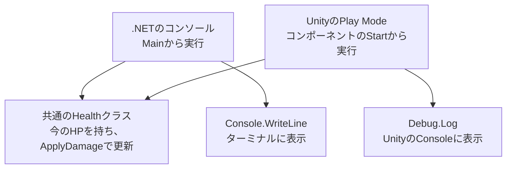

# C#の基本 — コンソールとUnityでHPを更新する

HPが10のキャラクターに、3、0、9、2のダメージを順番に渡します。HPがいくつになるかを予想してから、コンソールとUnityで実際に動かします。**HPを更新するルールは、一つのC#クラスで共有します。** 実行を始める場所と結果を表示する場所が、それぞれの環境で変わります。



## 変数と条件分岐でルールを書く

`int` は整数を表す型です。`int startingHp = 10;` では、`startingHp` という名前の変数に10を入れます。`bool` は `true` と `false` を表す型です。たとえば `amount <= 0` は、ダメージが0以下なら `true` になります。

`if` は、条件が `true` のときに波括弧の中を実行します。`||` で二つの条件をつなぐと、どちらかを満たすときに実行します。今回のルールは次のとおりです。

| 入力や状態 | HPの扱い | 戻り値 |
| --- | --- | --- |
| ダメージが0以下、またはすでにHPが0 | HPを維持する | `false` |
| HPがあり、正のダメージを受ける | ダメージを引き、結果が負なら0にする | `true` |

## クラスに状態とメソッドをまとめる

**クラス**は、データと処理をまとめた型です。`Health` は現在のHPと、HPを減らす処理を持ちます。`new Health(10)` は初期HPが10のインスタンスを作り、`Health(int initialHp)` という**コンストラクター**を呼びます。もう一度 `new Health(10)` と書けば、別のHPを持つインスタンスができます。

`Current` は今のHPを外から読める**プロパティ**です。`private set` により、値を書き換える操作は `Health` の中に置きます。C#でクラスに書く関数を**メソッド**と呼びます。`bool ApplyDamage(int amount)` はダメージを引数に取り、HPが変わったかを `return` で返します。`return false` に到達すると、以降のHPを引く行は実行されません。

<a href="/study/samples/languages/csharp/console-and-unity/Health.cs" download>Health.csをダウンロード</a>

<<< @/public/samples/languages/csharp/console-and-unity/Health.cs{csharp}

## コンソールで実行する

[開発環境の用意](/tools/setup-development-environment.html)で使った.NET 10 SDKで実行できます。PowerShellで練習用の場所を開き、`StudyHealth` というフォルダーがまだない場所で次のコマンドを実行します。

```powershell
dotnet new console --framework net10.0 --output StudyHealth
Set-Location StudyHealth
```

共通の `Health.cs` をここに置き、テンプレートの `Program.cs` を次のファイルで置き換えます。2ファイルが `StudyHealth.csproj` と同じフォルダーにあることを確認します。

<a href="/study/samples/languages/csharp/console-and-unity/Program.cs" download>Program.csをダウンロード</a>

<<< @/public/samples/languages/csharp/console-and-unity/Program.cs{csharp}

.NETはこのプログラムの入口として `Main` を呼びます。`var health` の型は、右辺の `new Health(startingHp)` から `Health` と決まります。`damages` はダメージを順番に入れた整数の配列です。

`for` は `i` を0から始め、`i < damages.Length` の間、処理を繰り返します。`damages[i]` は今の要素で、`i++` が次の要素へ進めます。各回で `ApplyDamage` に値を渡し、戻ってきた `bool` を `changed` に保存して、現在のHPと一緒に表示します。

```powershell
dotnet run
```

```text
damage=3, hp=7, changed=True
damage=0, hp=7, changed=False
damage=9, hp=0, changed=True
damage=2, hp=0, changed=False
```

3行目では、HPが7のときに9を引くので、計算途中では負になります。`Health` がその値を0に直します。4行目はHPがすでに0なので、`false` で戻ります。

## Unityで同じクラスを動かす

Unity 6.3（6000.3系）の新規プロジェクトで試します。出力を見る例なので、2Dテンプレートで始められます。入力や描画の設定は手順に含まれません。`Health.cs` と次の `HealthDemo.cs` を使います。

<a href="/study/samples/languages/csharp/console-and-unity/HealthDemo.cs" download>HealthDemo.csをダウンロード</a>

<<< @/public/samples/languages/csharp/console-and-unity/HealthDemo.cs{csharp}

`HealthDemo : MonoBehaviour` は、UnityのGameObjectに付けるコンポーネントを定義します。Unityはこのコンポーネントが有効になった後、最初の `Update` より前に `Start` を一度呼びます。この例ではダメージの列をその一回で処理します。`Update` は有効な間に各フレーム呼ばれるため、毎フレーム行う処理を学ぶときに使います。 [Unity 6.3のStart](https://docs.unity3d.com/6000.3/Documentation/ScriptReference/MonoBehaviour.Start.html) · [Update](https://docs.unity3d.com/6000.3/Documentation/ScriptReference/MonoBehaviour.Update.html)

`[SerializeField]` を付けた `startingHp` は、`private` のままInspectorで編集できます。`Start` はその値で `Health` を作り、結果を `Debug.Log` でUnityのConsoleへ送ります。 [Unity 6.3のSerializeField](https://docs.unity3d.com/6000.3/Documentation/ScriptReference/SerializeField.html) · [Debug.Log](https://docs.unity3d.com/6000.3/Documentation/ScriptReference/Debug.Log.html)

1. Projectウィンドウの `Assets` の下に `HealthPractice` フォルダーを作り、`Health.cs` と `HealthDemo.cs` を置きます。コンパイルが終わるまで待ちます。Unityにコピーするファイルはこの2つです。
2. **GameObject > Create Empty** で空のGameObjectを1個作り、Hierarchyで `Health Practice` と名前を付けます。選択した状態でInspectorの **Add Component** から **Health Demo** を追加します。Projectの `HealthDemo.cs` をInspectorへドラッグして追加することもできます。
3. Inspectorでコンポーネントの **Starting Hp** が10になっていることを確認します。**Window > General > Console** を開き、上部の **Play** を押します。Consoleにコンソール版と同じ4行が出ます。
4. Playを止めます。**Starting Hp** を5に変えて、もう一度Playします。HPは順に `2, 2, 0, 0` になります。`Health.cs` に手を加えず、開始時の値だけを変更できました。

| Unityでつまずいたとき | 確認すること |
| --- | --- |
| コンポーネントが見つからない | ファイル名が `HealthDemo.cs` でクラス名が `HealthDemo` か、Consoleにコンパイルエラーが出ていないかを確認する。 |
| Playしても4行が出ない | GameObjectとコンポーネントが有効か、Consoleで通常のログが表示される設定かを確認する。 |
| 4行が複数回出る | 同じコンポーネントを複数のGameObjectに付けていないかを確認する。 |

## 理解度チェック

1. 初期HPを10のまま、最初のダメージを `3` から `0` に変えると、最初の行の `hp` と `changed` はどうなりますか。コンソールで試してください。

   ::: details 解答
   `amount <= 0` が成立し、HPが変わる前に `false` が返ります。最初の行は `damage=0, hp=10, changed=False` です。
   :::

2. `new Health(10)` と `new Health(5)` を別々の変数に入れ、前者だけに3のダメージを与えたら、後者のHPはいくつですか。

   ::: details 解答
   5です。二回の `new` で別々のインスタンスを作るので、それぞれが現在のHPを持ちます。
   :::

3. コンソール版とUnity版で、どのメソッドから処理が始まりますか。HPのルールを変えるときはどのファイルを編集しますか。

   ::: details 解答
   コンソール版は `Program.cs` の `Main`、Unity版はコンポーネントの `Start` です。共通のルールは `Health.cs` の `ApplyDamage` にあります。
   :::

## 関連項目

- [Unityでゲームを作る — C#の基本の達成条件](/learn/roadmap.html?node=unity-csharp#unity-game)
- [変数・型・式](/languages/variables-types-and-expressions.html)と[条件分岐・繰り返し・関数](/languages/control-flow-and-functions.html)で、式や処理の順番を練習する。
- [シーン・オブジェクト・コンポーネントの基本](/game/basics/scenes-and-components.html)で、Unityのシーンに部品を組み合わせる。
- [Unity実践 シーンにキャラクターとダメージ床を配置する](/practice/unity/scene-health-demo.html)で、同じHPクラスを使って、重なった床からダメージを受ける場面を作る。
- [シューティング実装例 C#とUnity 6](/game/shooter-unity.html)で、ゲームルールを入力と表示につなぐ。

## 参考資料

- [Microsoft Learn — C#の型](https://learn.microsoft.com/en-us/dotnet/csharp/fundamentals/types/) · [選択ステートメント](https://learn.microsoft.com/en-us/dotnet/csharp/language-reference/statements/selection-statements) · [反復ステートメント](https://learn.microsoft.com/en-us/dotnet/csharp/language-reference/statements/iteration-statements)
- [Microsoft Learn — クラス](https://learn.microsoft.com/en-us/dotnet/csharp/programming-guide/classes-and-structs/classes) · [メソッド](https://learn.microsoft.com/en-us/dotnet/csharp/methods) · [Mainとコマンドライン引数](https://learn.microsoft.com/en-us/dotnet/csharp/fundamentals/program-structure/main-command-line)
- [Unity 6.3 — MonoBehaviour](https://docs.unity3d.com/6000.3/Documentation/ScriptReference/MonoBehaviour.html) · [Start](https://docs.unity3d.com/6000.3/Documentation/ScriptReference/MonoBehaviour.Start.html) · [SerializeField](https://docs.unity3d.com/6000.3/Documentation/ScriptReference/SerializeField.html)
- [Unity 6.3 — コンポーネントの追加と設定](https://docs.unity.com/en-us/engine/6000.3/manual/working-with-gameobjects/unity-components/inspector-manage-components) · [Consoleウィンドウ](https://docs.unity.com/en-us/engine/6000.3/manual/unity-editor/editor-windows-views-reference/console-window)
