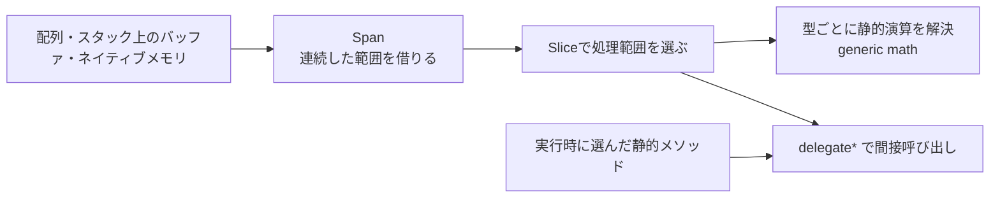

# C#のパフォーマンス機能 — Span・関数ポインター・generic math

大量の頂点やセーブデータを処理するときは、どこでバッファを割り当て、どこでデータを複製し、どこで関数を選ぶかを分けて見ます。C#ではこれらの選択をビュー、呼び出し、型制約に分けて記述できます。



## Span と ref struct

`Span<T>` は連続したメモリへのビューです。配列の一部を `Slice` で選んでも、要素は複製されません。書き込み用の `Span<T>` を通じて要素を変更すると、元の配列から同じ変更が見えます。受け取った範囲を書き換えない処理には `ReadOnlySpan<T>` が使えます。他の参照からの変更までは防ぎません。

`Span<T>` は `ref struct` なので、クラスのフィールドに保存したり、ボックス化したり、ラムダに捕捉したりできません。C# 13以降では `async` メソッド内で使える範囲が広がりましたが、`await` をまたいで保持できません。メモリの所有者が生きている間だけビューを使います。たとえばプールへ配列を返すと、同じ配列を他の利用者が書き換えられます。非同期処理にバッファ範囲を渡すなら、`Memory<T>` と所有者の寿命を合わせて管理します。

## delegate* と static abstract は異なる選択を表す

| 目的 | 機能 | 制約 |
| --- | --- | --- |
| 設定に応じて静的メソッドのアドレスを保持する | C# 9の `delegate* managed<引数型, 戻り値型>` | `unsafe` コンテキストが必要。クロージャーや呼び出し先のインスタンスは持たない。 |
| 同じジェネリック処理で数値型ごとの演算を呼ぶ | C# 11の `static abstract` インターフェースメンバー、.NET 7以降のgeneric math | 型パラメーターに制約が必要。選んだ型の演算の意味や丸めはその型に従う。 |

関数ポインターは型の付いたアドレスです。呼び出しはILの `calli` になり、関数ポインター自体はデリゲートオブジェクトを作りません。通常のデリゲートも再利用でき、ターゲットオブジェクトやクロージャーを扱えます。ネイティブとの境界で `delegate* unmanaged` を使うときは、呼び出し規約と引数・戻り値のレイアウトも合わせます。

`static abstract` を持つインターフェースで `T` を制約すると、`T.Zero` や `a + b` を型に応じて書けます。`INumber<T>` は .NET 7で追加された制約の一つです。値型をインターフェースのインスタンスに変換する書き方を避けられます。実際のインライン化、ベクトル化、分岐コストはターゲットのコード生成と計測で確認します。

## コード例 — バッファの一部を変換して集計する

C# 11と.NET 7以降のコンソール例です。プロジェクトで `AllowUnsafeBlocks` を有効にします。最初の要素はメタデータとし、残りの3要素を元のバッファ上で変換します。

```csharp
using System;
using System.Numerics;

internal static class Program
{
    private static T Sum<T>(ReadOnlySpan<T> values) where T : INumber<T>
    {
        T sum = T.Zero;
        foreach (T value in values)
        {
            sum += value;
        }
        return sum;
    }

    private static int Double(int value) => checked(value * 2);

    private static unsafe void Transform(Span<int> values, delegate* managed<int, int> transform)
    {
        for (int i = 0; i < values.Length; ++i)
        {
            values[i] = transform(values[i]);
        }
    }

    private static unsafe int Main()
    {
        int[] samples = { 99, 3, 5, 7 };
        Span<int> data = samples.AsSpan(1);
        Transform(data, &Double);
        int total = Sum<int>(data);
        Console.WriteLine($"{samples[0]} | {samples[1]}, {samples[2]}, {samples[3]} | {total}");
        return samples[0] == 99 && total == 30 ? 0 : 1;
    }
}
```

結果は `99 | 6, 10, 14 | 30`。この例では `int[]` の割り当てと出力用の文字列は残ります。実測するときは画面出力を計測区間の外に置き、同じデータで直接呼び出し、再利用するデリゲート、関数ポインターを比べます。

### Unityで使うとき

Unity 6.3 LTSのEditorが使う言語版はC# 9.0です。公式マニュアルには、Windows向けの非マネージド関数ポインターの例と、拡張可能な呼び出し規約の制約があります。上のgeneric math部分はC# 11と.NET 7以降のライブラリを前提とするため、Unity 6.3向けの共有コードでは具体的な型のオーバーロードなどで置き換えます。UnityのMonoとIL2CPPでも、対象プラットフォームのPlayerビルドで測定します。

## 理解度チェック

1. `samples.AsSpan(1)` の先頭へ書くと、元の配列のどの要素が変わるか。
2. 入力ごとに選ぶコールバックがレベルの状態を閉じ込めている。`delegate*` で置き換えるときに必要になる変更は何か。
3. Unity 6.3で上の `Sum<T>` を流用する前に、言語版とAPIのどちらを確認するか。

::: details 解答

1. `samples[1]`。ビューの先頭が元の配列の添字1に対応する。
2. 関数ポインターには状態を持たせられないので、必要な値を引数や別の状態として渡す。状態を捕捉したいならデリゲートを使える。
3. 両方。`static abstract` はC# 11、`INumber<T>` は.NET 7のライブラリから使える。Unity 6.3のC# 9.0ではこの例の制約をそのまま使えない。

:::

## 関連項目

- [C#のデリゲート・イベント・関数ポインター](/languages/csharp/delegates-events-function-pointers.html)
- [C++のテンプレートとC#のジェネリクス](/languages/csharp/templates-vs-generics.html)
- [C++とC#のメモリ管理](/languages/csharp/memory-management-vs-gc.html)

## 参考資料

- [Microsoft — System.Span\<T\>（.NET 10 APIリファレンス）](https://learn.microsoft.com/en-us/dotnet/api/system.span-1?view=net-10.0)
- [Microsoft — ref struct（C# 13での変更を含む）](https://learn.microsoft.com/en-us/dotnet/csharp/language-reference/builtin-types/ref-struct)
- [Microsoft — C# 9 function pointersの仕様](https://github.com/dotnet/csharplang/blob/main/proposals/csharp-9.0/function-pointers.md)
- [Microsoft — Generic math（.NET 7以降）](https://learn.microsoft.com/en-us/dotnet/standard/generics/math)
- [Unity 6.3 LTS — C# compiler and language version reference](https://docs.unity3d.com/6000.3/Documentation/Manual/csharp-compiler.html)
