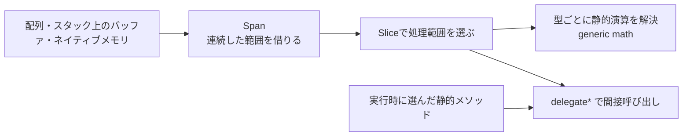

# C#のパフォーマンス機能 — Span・関数ポインター・generic math

大量の頂点やセーブデータを処理するときは、どこでバッファを割り当て、どこでデータを複製し、どこで関数を選ぶかを分けて見ます。C#ではこれらの選択をビュー、呼び出し、型制約に分けて記述できます。



## Span と ref struct

`Span<T>` は連続したメモリへのビューです。配列の一部を `Slice` で選んでも、要素は複製されません。書き込み用の `Span<T>` を通じて要素を変更すると、元の配列から同じ変更が見えます。受け取った範囲を書き換えない処理には `ReadOnlySpan<T>` が使えます。他の参照からの変更までは防ぎません。

`Span<T>` は `ref struct` なので、クラスのフィールドに保存したり、ボックス化したり、ラムダに捕捉したりできません。C# 13以降では `async` メソッド内で使える範囲が広がりましたが、`await` をまたいで保持できません。メモリの所有者が生きている間だけビューを使います。たとえばプールへ配列を返すと、同じ配列を他の利用者が書き換えられます。非同期処理にバッファ範囲を渡すなら、`Memory<T>` と所有者の寿命を合わせて管理します。

`Span<byte> scratch = stackalloc byte[64];` なら、メソッドのスタック領域に64バイトの作業領域を確保してビューで扱えます。`Span<T>` に受ける書き方は `unsafe` を要求しません。初期化子なしの領域の初期値は保証されないため、読み出す範囲を先に書くか `Clear()` を呼びます。繰り返し処理ではループの外で領域を確保して再利用します。サイズが入力次第で大きくなる場合は、配列やプールから借りた領域へ切り替えます。

### C# 11のrefフィールドとscoped

`ref struct` はC# 11から `ref` フィールドを宣言できます。値のコピーを格納する代わりに、元の変数への参照を保持します。`= ref` は参照先を付け替え、通常の `=` は参照先へ値を書き込みます。フィールド宣言の `readonly` は、置く位置で制約の対象が変わります。

| フィールドの宣言 | 参照先の付け替え | 参照先への書き込み |
| --- | --- | --- |
| `ref T` | 可能 | 可能 |
| `readonly ref T` | 宣言型のコンストラクターや `init` アクセサーに限る | 可能 |
| `ref readonly T` | 可能 | 不可 |
| `readonly ref readonly T` | 宣言型のコンストラクターや `init` アクセサーに限る | 不可 |

コンパイラーは参照先の寿命を調べ、参照を保存する側がそれより長く生きられると判断した場合に拒否します。メソッド内のローカル変数への参照をビューに入れて返すことはできません。ビューをコンストラクターに渡したときも、返せる範囲は引数の寿命に従います。`default` で初期化した構造体では `ref` フィールドが null 参照になり得るので、その値を受け付ける型ではアクセス前に検査します。

`scoped` は、引数として受け取ったビューや参照をメソッドの外へ持ち出せる範囲を制限する修飾子です。`scoped ReadOnlySpan<T>` はビューが含む参照、`scoped ref T` は渡された参照自体を対象にします。例えば `static int Sum(scoped ReadOnlySpan<int> values)` は要素を読み、合計の値を返せます。戻り値を `ReadOnlySpan<int>` にして `values` やその一部を返すと、同じ参照が外へ出るためコンパイルエラーになります。呼び出し元が渡したバッファの一部を返す関数を設計するときは、返却する引数にこの制約を付けず、返したビューを使える範囲をコンパイラーに判定させます。配列をプールへ返した時点など、アプリケーションの所有権による利用終了は別に管理します。

### C# 13のallows ref struct

C# 13から、型パラメーターの制約の末尾に `allows ref struct` を置くと、その型引数として `ref struct` を使えます。これは型を絞り込む制約に対する「反制約（anti-constraint）」で、通常の型も渡せます。ジェネリック実装は、型引数がビューのような寿命制約を持ち得る前提で検査されます。例えば、型パラメーター型の値を `object` に変換する操作はボックス化を起こし得るため拒否されます。

同じく C# 13から、`ref struct` 自身がインターフェースを実装できます。`where T : IIntView, allows ref struct` のような制約付き呼び出しなら、`T` をインターフェース型の変数へ変換せずにメンバーを呼べます。具体的なビューを直接受け取る実装に対して、入力の取り方だけが異なる複数のビューを同じコードで扱えます。標準ライブラリ側の既存の型パラメーターすべてにこの反制約が付いたわけではないので、ジェネリック API を呼ぶときは受け手の制約も確認します。

### C# 14のSpan変換

C# 14は、配列や文字列、`Span<T>` と `ReadOnlySpan<T>` の間の変換を、言語の組み込み変換として扱います。たとえば配列から同じ要素型の `Span<T>`、文字列から `ReadOnlySpan<char>`、書き込み可能なビューから読み取り専用のビューへ変換できます。さらに `ReadOnlySpan<string>` から `ReadOnlySpan<object>` のように、参照型の共変変換を使える読み取り専用ビューもあります。これらのビューへの変換で要素は複製されません。

実体が `string[]` の配列を、配列の共変変換で `object[]` 型の変数に入れることはできます。その変数を `Span<object>` へ暗黙に変換すると、コンパイルは通り、実行時にはビューを作る段階で `ArrayTypeMismatchException` が発生します。書き込み可能なビューを作るには、配列の実行時型も `object[]` である必要があります。`string[]` 型の式から `Span<object>` へ直接代入する場合、C# 13 では既存の変換演算子の引数に配列の共変変換を適用できるため、コンパイルが通って同じ例外が発生します。C# 14 ではこの型の組み合わせに言語組み込みの明示的な Span 変換があり、既存の演算子は変換候補から外れます。直接の代入はコンパイルエラー（CS0266）になり、明示的なキャストを使うと実行時に同じ例外が発生します。

以前からあった変換演算子で代入できる例もあります。C# 14では、拡張メソッドを直接呼ぶときの受け手や、型引数の推論、オーバーロード解決にも Span 変換が参加するようになりました。例えば `this ReadOnlySpan<T>` だけを受け取る拡張メソッドを、要素型の合う配列から直接呼べます。同名の配列用・列挙用のオーバーロードがある場合、言語版の変更で選ばれる候補が変わる場合があるため、選択を固定したい箇所は引数を意図する型で受けます。拡張メソッドのメソッドグループをデリゲートへ変換するときの受け手には、この変換は使われません。

## delegate* と static abstract は異なる選択を表す

| 目的 | 機能 | 制約 |
| --- | --- | --- |
| 設定に応じて静的メソッドのアドレスを保持する | C# 9の `delegate* managed<引数型, 戻り値型>` | `unsafe` コンテキストが必要。クロージャーや呼び出し先のインスタンスは持たない。 |
| 同じジェネリック処理で数値型ごとの演算を呼ぶ | C# 11の `static abstract` インターフェースメンバー、.NET 7以降のgeneric math | 型パラメーターに制約が必要。選んだ型の演算の意味や丸めはその型に従う。 |

関数ポインターは型の付いたアドレスです。呼び出しはILの `calli` になり、関数ポインター自体はデリゲートオブジェクトを作りません。通常のデリゲートも再利用でき、ターゲットオブジェクトやクロージャーを扱えます。ネイティブとの境界で `delegate* unmanaged` を使うときは、呼び出し規約と引数・戻り値のレイアウトも合わせます。

`static abstract` を持つインターフェースで `T` を制約すると、`T.Zero` や `a + b` を型に応じて書けます。`INumber<T>` は .NET 7で追加された制約の一つです。値型をインターフェースのインスタンスに変換する書き方を避けられます。実際のインライン化、ベクトル化、分岐コストはターゲットのコード生成と計測で確認します。

Unity 6.3 LTSでBurst 1.8を使う場合、Burstがコンパイルする静的関数を実行時に選ぶ用途には `BurstCompiler.CompileFunctionPointer<T>()` と `FunctionPointer<T>` があります。`T` は呼び出しのシグネチャを表すデリゲート型で、引数と戻り値にはBurstの相互運用でサポートされる型を使います。C#の `delegate* managed` と同じ機能として扱わず、Burstの対象範囲とプラットフォームごとのAOT要件を確認します。1要素ずつ間接呼び出しするとコンパイラーがループをまとめて最適化しにくくなるため、複数要素と件数を渡す方式や、ジョブに処理を直接書く方式と計測で比べます。

## コード例 — バッファの一部を変換して集計する

C# 11と.NET 7以降のコンソール例です。プロジェクトで `AllowUnsafeBlocks` を有効にします。最初の要素はメタデータとし、残りの3要素を元のバッファ上で変換します。

```csharp
using System;
using System.Numerics;

internal static class Program
{
    private static T Sum<T>(ReadOnlySpan<T> values) where T : INumber<T>
    {
        T sum = T.Zero;
        foreach (T value in values)
        {
            sum += value;
        }
        return sum;
    }

    private static int Double(int value) => checked(value * 2);

    private static unsafe void Transform(Span<int> values, delegate* managed<int, int> transform)
    {
        for (int i = 0; i < values.Length; ++i)
        {
            values[i] = transform(values[i]);
        }
    }

    private static unsafe int Main()
    {
        int[] samples = { 99, 3, 5, 7 };
        Span<int> data = samples.AsSpan(1);
        Transform(data, &Double);
        int total = Sum<int>(data);
        Console.WriteLine($"{samples[0]} | {samples[1]}, {samples[2]}, {samples[3]} | {total}");
        return samples[0] == 99 && total == 30 ? 0 : 1;
    }
}
```

結果は `99 | 6, 10, 14 | 30`。この例では `int[]` の割り当てと出力用の文字列は残ります。実測するときは画面出力を計測区間の外に置き、同じデータで直接呼び出し、再利用するデリゲート、関数ポインターを比べます。

### コード例 — 参照付きビューをジェネリック処理へ渡す

C# 14・.NET 10のコンソール例です。参照先を持つビューと、コピーした整数を持つ型の両方を同じメソッドに渡します。配列の拡張メソッド呼び出しは、C# 14の Span 変換を使います。

```csharp
using System;

public interface IIntView
{
    int Read();
}

public ref struct IntView : IIntView
{
    private readonly ref int cell;

    public IntView(ref int cell) => this.cell = ref cell;

    public int Read() => cell;

    public void Write(int value) => cell = value;
}

public readonly struct Snapshot(int value) : IIntView
{
    public int Read() => value;
}

public static class Samples
{
    public static T FirstSample<T>(this scoped ReadOnlySpan<T> values) => values[0];
}

internal static class Program
{
    private static int ReadValue<T>(T view) where T : IIntView, allows ref struct
        => view.Read();

    private static void AddTwo(scoped ref int value) => value += 2;

    private static int Main()
    {
        int health = 10;
        var snapshot = new Snapshot(health);
        var view = new IntView(ref health);
        view.Write(13);
        AddTwo(ref health);

        int[] samples = { 4, 9 };
        string[] labels = { "HP" };
        ReadOnlySpan<object> names = labels;
        int changed = ReadValue(view);
        int original = ReadValue(snapshot);
        int first = samples.FirstSample();
        Console.WriteLine($"{changed}, {original}, {first}, {names[0]}");

        object[] widened = labels;
        bool rejected = false;
        try
        {
            Span<object> writable = widened;
            Console.WriteLine(writable.Length);
        }
        catch (ArrayTypeMismatchException)
        {
            rejected = true;
            Console.WriteLine(nameof(ArrayTypeMismatchException));
        }
        return changed == 15 && original == 10 && first == 4
            && Equals(names[0], "HP") && rejected ? 0 : 1;
    }
}
```

1行目は `15, 10, 4, HP`、2行目は `ArrayTypeMismatchException` です。ビューへの書き込みは参照先の `health` に届きます。`Snapshot` は整数の値を受け取るので後から変わりません。`FirstSample` は借りたビューから値を一つ読み、ビューを外へ持ち出しません。`ReadValue` 内でインターフェース型のローカルへ代入せず、型制約を通して `Read` を呼ぶことで、同じ実装が `IntView` にも適用できます。`widened` の実体は `string[]` なので、書き込み可能な `Span<object>` を作るときに拒否されます。

### Unityで使うとき

Unity 6.3 LTSのEditorが使う言語版はC# 9.0です。公式マニュアルには、Windows向けの非マネージド関数ポインターの例と、拡張可能な呼び出し規約の制約があります。上のgeneric math部分はC# 11と.NET 7以降のライブラリを前提とするため、Unity 6.3向けの共有コードでは具体的な型のオーバーロードなどで置き換えます。UnityのMonoとIL2CPPでも、対象プラットフォームのPlayerビルドで測定します。

## 理解度チェック

1. `samples.AsSpan(1)` の先頭へ書くと、元の配列のどの要素が変わるか。
2. 入力ごとに選ぶコールバックがレベルの状態を閉じ込めている。`delegate*` で置き換えるときに必要になる変更は何か。
3. Unity 6.3で上の `Sum<T>` を流用する前に、言語版とAPIのどちらを確認するか。
4. `readonly ref int` フィールドに通常の代入をすると、参照先は付け替わるか。
5. `scoped ReadOnlySpan<int>` を受け取った関数から、そのビューを `Slice` した結果を返せるか。
6. C# 14で配列から `this ReadOnlySpan<T>` の拡張メソッドを呼んだとき、要素は別のバッファへコピーされるか。
7. 実体が `string[]` の配列を `object[]` 型の変数経由で `Span<object>` に代入すると、どの段階で拒否されるか。

::: details 解答

1. `samples[1]`。ビューの先頭が元の配列の添字1に対応する。
2. 関数ポインターには状態を持たせられないので、必要な値を引数や別の状態として渡す。状態を捕捉したいならデリゲートを使える。
3. 両方。`static abstract` はC# 11、`INumber<T>` は.NET 7のライブラリから使える。Unity 6.3のC# 9.0ではこの例の制約をそのまま使えない。
4. 付け替わらない。通常の代入は参照先へ値を書く。`readonly ref` は参照先を変更できる場所を制限する。
5. 返せない。部分ビューにも同じ借りた参照が含まれる。
6. コピーされない。C# 14の変更は変換や呼び出しの解決に関するもので、ビューは元の範囲を参照する。
7. コンパイルは通る。実行時に `Span<object>` を作る段階で配列の実行時型を確認し、`ArrayTypeMismatchException` が発生する。

:::

## 関連項目

- [C#のデリゲート・イベント・関数ポインター](/languages/csharp/delegates-events-function-pointers.html)
- [C++のテンプレートとC#のジェネリクス](/languages/csharp/templates-vs-generics.html)
- [C++とC#のメモリ管理](/languages/csharp/memory-management-vs-gc.html)

## 参考資料

- [Microsoft — System.Span\<T\>（.NET 10 APIリファレンス）](https://learn.microsoft.com/en-us/dotnet/api/system.span-1?view=net-10.0)
- [Microsoft — ref struct（C# 13での変更を含む）](https://learn.microsoft.com/en-us/dotnet/csharp/language-reference/builtin-types/ref-struct)
- [Microsoft — C# 11のrefフィールドとscopedの仕様](https://github.com/dotnet/csharplang/blob/main/proposals/csharp-11.0/low-level-struct-improvements.md)
- [Microsoft — C# 13のref structインターフェース実装とallows ref structの仕様](https://github.com/dotnet/csharplang/blob/main/proposals/csharp-13.0/ref-struct-interfaces.md)
- [Microsoft — C# 14のSpan変換の仕様](https://learn.microsoft.com/en-us/dotnet/csharp/language-reference/proposals/csharp-14.0/first-class-span-types)
- [Microsoft — C#の暗黙の参照変換（配列の共変変換）](https://learn.microsoft.com/en-us/dotnet/csharp/language-reference/language-specification/conversions#1028-implicit-reference-conversions)
- [Microsoft — Span\<T\> の配列コンストラクターと ArrayTypeMismatchException](https://learn.microsoft.com/en-us/dotnet/api/system.span-1.-ctor?view=net-10.0)
- [Microsoft — C# 9 function pointersの仕様](https://github.com/dotnet/csharplang/blob/main/proposals/csharp-9.0/function-pointers.md)
- [Microsoft — Generic math（.NET 7以降）](https://learn.microsoft.com/en-us/dotnet/standard/generics/math)
- [Microsoft — stackalloc式](https://learn.microsoft.com/en-us/dotnet/csharp/language-reference/operators/stackalloc)
- [Unity — Burst 1.8の関数ポインター](https://docs.unity3d.com/Packages/com.unity.burst@1.8/manual/csharp-function-pointers.html)
- [Unity 6.3 LTS — C# compiler and language version reference](https://docs.unity3d.com/6000.3/Documentation/Manual/csharp-compiler.html)
