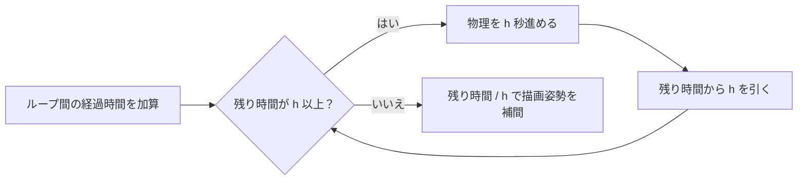
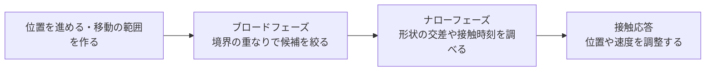

# 物理の時間積分と衝突判定 — Euler・Verlet・形状の交差

床へ落ちるボールを動かすには、加速度から次の位置と速度を求めます。床まで届くかを調べ、届いたら接触に応じて速度を変えます。このページでは、**時間を進めて運動を近似する処理**と**いつ、どの形状が触れるかを調べる処理**を分けて見ます。接触後の押し戻しや反発は[当たり判定と物理](/game/basics/collisions-and-physics.html)で扱います。

## 位置と速度を時間刻みで更新する

位置を `x`、速度を `v`、加速度を `a` とすると、位置の時間変化が速度、速度の時間変化が加速度です。力 `F` と質量 `m` から加速度を決める場合は `a = F / m` を使います。刻み幅 `h` 秒ごとに、この関係を数値的に進めます。次の表では `a` をステップ開始時の状態から求めます。

| 方法 | 1ステップの更新 | 保持する状態 |
| --- | --- | --- |
| 陽的Euler | `xNext = x + v*h`、`vNext = v + a*h` | 今の位置と速度 |
| 半陰的Euler（シンプレクティックEuler） | `vNext = v + a*h`、`xNext = x + vNext*h` | 今の位置と速度 |
| 位置Verlet | `xNext = 2*x - xPrev + a*h*h` | 今と一つ前の位置 |

位置Verletの表の式は一定の刻み幅を前提にします。初速度 `v0` が与えられる場合は、最初の `xPrev` を `x0 - v0*h + a0*h*h/2` と近似できます。内部で速度も保持する速度Verletは、ステップの前後の加速度を使って速度を更新する別の書き方です。

## 刻み幅によって安定性とエネルギーが変わる

ばねの加速度を `a = -ω²*x`、単位質量のエネルギーを `E = (v² + ω²*x²)/2` とします。空気抵抗のないこのモデルでは、連続時間で `E` は一定です。陽的Eulerの更新を `E` の式へ代入すると、各ステップでエネルギーは `1 + (ω*h)²` 倍になります。小さな誤差が積み重なり、ばねの振幅が大きくなる理由です。

同じモデルで `0 < ω*h < 2` なら、半陰的Eulerや位置Verletの位置は有界です。エネルギーは近い範囲で上下し得ます。硬いばねほど `ω` が大きいので、同じ刻み幅で安定に進められるとは限りません。刻み幅を変え、位置・速度・エネルギーを比較すると、積分法の影響を切り分けられます。

## 描画の間に固定刻みで進める

前回のループ開始から今回のループ開始までの経過時間を**アキュムレーター**に足し、`h` 秒以上たまっている間は物理を1ステップ進めて `h` を引きます。16.7 msの描画間隔に対して物理の刻みが10 msなら、前回からの残り時間によって1ステップまたは2ステップ進みます。残りを `h` で割った値は、前回と今回の確定した物理状態の間を描画用に[補間](/math/rendering/interpolation-and-curves.html)するために使えます。長い停止の後に更新が集中しないようにする扱いは[ゲームループと固定タイムステップ](/game/patterns/game-loop-and-update.html)を参照してください。



## 基本形状の交差を調べる

| 組み合わせ | 調べ方 |
| --- | --- |
| 球と球 | 中心間の距離の二乗が、半径の和の二乗以下なら交差。 |
| AABBとAABB | 各軸の閉区間を比べ、全軸で重なれば交差。1軸でも離れれば分離。 |
| レイと平面 | 原点 `o`、方向 `d`、平面上の点 `p0`、法線 `n` から `t = dot(p0 - o, n) / dot(d, n)` を求める。レイでは `t >= 0` を使う。 |
| レイと三角形 | `o + t*d = p0 + u*(p1-p0) + v*(p2-p0)` を解く。`t >= 0`、`u >= 0`、`v >= 0`、`u + v <= 1` なら三角形に当たる。 |

レイと平面の式では分母がゼロなら、レイは平面と平行です。原点も平面上にあればレイ全体が平面に含まれ、交点が一つに決まりません。**Möller–Trumbore法**は、レイと三角形の式を外積と内積で解き、事前に平面式を保存せず `t, u, v` を求めます。`t` を距離として扱う場合はレイの方向を単位長さにします。浮動小数点で平行や境界を判定する許容誤差は、座標のスケールと用途に合わせます。

## 凸形状にはSATやGJKを使う

**分離軸定理（SAT）**では、二つの凸形状を候補軸へ投影します。区間が離れる軸があれば形状も離れています。2Dの凸多角形なら両方の辺の法線、3Dの凸多面体なら両方の面の法線と異なる形状の辺どうしの外積が候補になります。平行な辺の外積はゼロになるため候補から外します。

**GJK**では、形状AとBから作るミンコフスキー差 `{a - b}` が原点を含むかを考えます。差のすべての点を列挙せず、指定方向との内積が最大になる点を返す**サポート関数**で頂点を選び、点・線分・三角形などの単体を更新して原点への距離を調べます。原論文は凸形状間の距離を求める手法です。接触後のめり込みの深さや接触点が必要なら、用途に合わせて別の処理を組み合わせます。

## 高速な物体はステップの途中で触れる

ボールが1ステップで壁の手前から反対側へ移ると、前後の姿勢だけを比べても壁と重ならないことがあります。これを**トンネリング**と呼びます。刻みを小さくすると見落としにくくなります。**連続衝突判定（CCD）**では、区間内の形状の移動を考慮し、最初に触れる時刻（TOI）などを求めます。ステップ中の移動範囲全体を含む境界で候補を絞り、必要な候補に対して時間区間を調べます。



ブロードフェーズでは[BVHとAABB](/algorithms/bounding-volume-hierarchies.html)などを使って、全物体の組み合わせから候補を絞ります。ナローフェーズは残った候補に対して形状の組み合わせに応じた判定を行います。Box2D 3.1では高速な動的ボディと静的ボディの衝突にCCDを使い、`isBullet` で指定した動的ボディは他のボディ種別にもCCDの対象を広げます。弾丸指定同士は対象外です。

## C++20でばねの積分とレイの交差を試す

次を `integration.cpp` として保存し、`cl /std:c++20 /EHsc integration.cpp` または `g++ -std=c++20 integration.cpp -o integration` でビルドできます。単位質量で `ω = 1` のばねを100ステップ進め、同じレイで平面とその上の三角形を調べます。

```cpp
#include <cmath>
#include <iostream>
#include <optional>

struct Vec3 {
    double x, y, z;
};

Vec3 operator-(Vec3 a, Vec3 b) {
    return {a.x - b.x, a.y - b.y, a.z - b.z};
}

double dot(Vec3 a, Vec3 b) {
    return a.x * b.x + a.y * b.y + a.z * b.z;
}

Vec3 cross(Vec3 a, Vec3 b) {
    return {a.y * b.z - a.z * b.y, a.z * b.x - a.x * b.z,
            a.x * b.y - a.y * b.x};
}

std::optional<double> ray_triangle(Vec3 o, Vec3 d, Vec3 a, Vec3 b, Vec3 c) {
    const Vec3 e1 = b - a;
    const Vec3 e2 = c - a;
    const Vec3 p = cross(d, e2);
    const double det = dot(e1, p);
    if (std::abs(det) < 1e-9) return std::nullopt;

    const Vec3 offset = o - a;
    const double u = dot(offset, p) / det;
    const Vec3 q = cross(offset, e1);
    const double v = dot(d, q) / det;
    const double t = dot(e2, q) / det;
    if (u < 0 || v < 0 || u + v > 1 || t < 0) return std::nullopt;
    return t;
}

int main() {
    constexpr double h = 0.1;
    double explicit_x = 1, explicit_v = 0;
    double semi_x = 1, semi_v = 0;
    double verlet_x = 1;
    double verlet_prev = 1 - h * h / 2;
    for (int i = 0; i < 100; ++i) {
        const double explicit_a = -explicit_x;
        explicit_x += explicit_v * h;
        explicit_v += explicit_a * h;
        semi_v -= semi_x * h;
        semi_x += semi_v * h;
        const double verlet_next = 2 * verlet_x - verlet_prev - verlet_x * h * h;
        verlet_prev = verlet_x;
        verlet_x = verlet_next;
    }

    const double verlet_next = 2 * verlet_x - verlet_prev - verlet_x * h * h;
    const double verlet_v = (verlet_next - verlet_prev) / (2 * h);
    const auto energy = [](double x, double v) { return (x * x + v * v) / 2; };
    std::cout << "Explicit Euler: " << energy(explicit_x, explicit_v) << '\n'
              << "Semi-implicit Euler: " << energy(semi_x, semi_v) << '\n'
              << "Position Verlet: " << energy(verlet_x, verlet_v) << '\n';

    const Vec3 o{0.25, 0.25, 2};
    const Vec3 d{0, 0, -1};
    const Vec3 a{0, 0, 0}, b{1, 0, 0}, c{0, 1, 0};
    const Vec3 normal = cross(b - a, c - a);
    std::cout << "Plane t: " << dot(a - o, normal) / dot(d, normal) << '\n';
    if (const auto hit = ray_triangle(o, d, a, b, c)) {
        std::cout << "Triangle t: " << *hit << '\n';
    }
}
```

初期エネルギーは0.5です。100ステップ後の陽的Eulerは約1.35、半陰的Eulerは約0.48、位置Verletは約0.50になります。位置Verletでは100ステップ目の前後の位置を使って、その時点の速度を近似しています。レイは三角形の内側に当たり、どちらの `t` も2です。原点の `x` を0.9に変えると、平面には当たりますが、三角形では `u + v > 1` になるので結果が出ません。平面の計算は分母が非ゼロと分かっている例です。

## 理解度チェック

1. 陽的Eulerと半陰的Eulerで、位置を進めるときに使う速度はどう違いますか。

   ::: details 解答
   陽的Eulerは更新前の速度を使います。半陰的Eulerは加速度で更新した後の速度を使います。
   :::

2. レイが三角形を含む平面に当たりました。三角形へのヒットを確かめるには何を見ますか。

   ::: details 解答
   レイの範囲で `t >= 0` を満たし、三角形の範囲で `u >= 0`、`v >= 0`、`u + v <= 1` を満たすかを調べます。
   :::

3. 前後の位置でボールが壁に重なっていません。どうして衝突があり得ますか。

   ::: details 解答
   ステップの途中で壁を通過することがあります。CCDは、物体が移動した時間区間の中で接触する時刻を調べます。
   :::

## 関連項目

- [ゲームループと時間](/game/basics/game-loop-and-time.html)で固定刻みと描画ループの関係を確認する。
- [当たり判定と物理](/game/basics/collisions-and-physics.html)で接触通知と応答の役割を確認する。
- [BVHとAABB](/algorithms/bounding-volume-hierarchies.html)で交差の候補を絞る。

## 参考資料

- [Hairer、Lubich、Wanner — Geometric Numerical Integration Illustrated by the Störmer–Verlet Method](https://www.math.mcgill.ca/gantumur/docs/down/gniverlet.pdf)
- [Möller、Trumbore — Fast, Minimum Storage Ray-Triangle Intersection](https://perso.univ-lyon1.fr/jean-claude.iehl/Public/educ/M1IMAGE/moller_triangle.pdf)
- [Eberly — Intersection of Convex Objects: The Method of Separating Axes](https://www.geometrictools.com/Documentation/MethodOfSeparatingAxes.pdf)
- [Gilbert、Johnson、Keerthi — A Fast Procedure for Computing the Distance Between Complex Objects in Three-Dimensional Space](https://graphics.stanford.edu/courses/cs164-09-spring/Handouts/paper_GJKoriginal.pdf)
- [Box2D 3.1 — Simulation](https://box2d.org/documentation/md_simulation.html)
